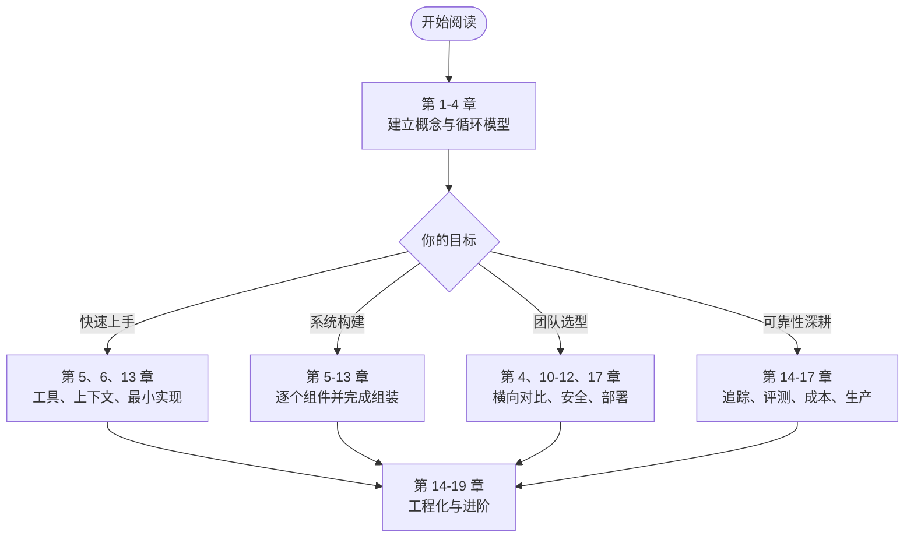

# Agent Harness 实战：构建可靠 AI 智能体的工程框架

> 模型决定能力上限，Harness 决定实际发挥。

同一个模型，在演示里能自动改完一个 Bug、跑通测试、写出一份调研报告；接进真实业务后，却会在第 20 轮忘记最初的要求，调错工具参数，把文件改坏，遇到报错后反复重试同一个动作。差距往往不在模型，而在包在模型外面的那层工程框架——**Agent Harness**。

本书讨论的就是这层框架：主循环怎么设计，工具怎么描述和执行，上下文如何压缩，记忆如何持久化，子代理如何编排，沙箱和权限如何兜底，以及如何通过追踪与评测让一个“看起来能用”的 Agent 变成“稳定可用”的系统。


**全书核心观点**：模型能力是上限，Harness 是系数。一个优秀的 Harness 能让中等模型稳定完成复杂任务；一个糟糕的 Harness 会让最强的模型频繁翻车。工程投入应该优先投向 Harness，而不是不断更换模型。


## 这本书回答什么问题

读完本书，你应该能回答下面三个问题：

1. **闭环**：如何让模型可靠地调用工具、观察结果、修正下一步，并在合适的时机停下来？
2. **上下文**：如何在有限的上下文窗口里，稳定地放入“此刻最该知道的信息”？
3. **可控**：如何让危险动作可审批、执行过程可追踪、效果好坏可评测、成本可预算？

这三个问题贯穿全书。第一部分建立模型，第二部分的每个组件都对应其中一面，第三部分把它们装成一个能跑的系统，第四部分讨论边界与演进。

## 谁应该读这本书

| 读者 | 你将从书中获得 |
|---|---|
| 有 1～5 年经验的后端 / 全栈工程师 | 从“调用 LLM API”进阶到“设计 Agent 系统”的完整方法，以及可直接运行的参考实现 |
| 正在自研 Agent 框架的团队 | 工具协议、上下文管理、沙箱、权限、评测等关键模块的设计取舍与踩坑清单 |
| AI 产品负责人 / 技术管理者 | 判断一个 Agent 产品能力边界、成本结构与风险点所需的工程视角 |
| 对 Claude Code、Codex CLI 等工具好奇的开发者 | 这些产品背后的通用架构，而不是某个产品的使用教程 |

**前置知识**：熟悉 Python 或 TypeScript 之一；了解 HTTP API；知道 Token、Prompt、Function Calling 的基本含义。不需要机器学习背景，不需要训练或微调模型的经验。

**本书不做什么**：不教模型训练与微调；不是 Prompt 技巧合集；不绑定任何单一厂商或框架。所有设计讨论都会给出可迁移的原理，具体 API 细节则以官方文档为准。

## 阅读路线图

全书 19 章按“概念 → 组件 → 实践 → 进阶”组织。不建议从头到尾匀速阅读，可以按目标选择路线。



| 路线 | 建议章节 | 适合场景 |
|---|---|---|
| 快速建立认知 | 第 1、2、4、5、13 章 | 一两天内理解 Agent 的基本结构，并跑通一个最小实现 |
| 完整构建 | 第 1～13 章 | 从零搭建自己的 Harness，边读边写 |
| 团队技术选型 | 第 1～4、10～12、14、17 章 | 评估自研还是采用现成框架，重点看安全、扩展与部署 |
| 提升线上可靠性 | 第 5～7、11、14～17 章 | 已有 Agent 上线，需要解决上下文、权限、可观测性与成本问题 |

## 全书结构

| 部分 | 章节 | 内容 |
|---|---|---|
| 第一部分 概念篇 | 第 1～4 章 | Agent Harness 的定义与演进、Agent Loop、模型接入层与工具调用协议、主流 Harness 横向对比 |
| 第二部分 核心组件篇 | 第 5～12 章 | 工具系统、上下文工程、记忆与状态、规划、子代理编排、沙箱、权限安全、扩展机制 |
| 第三部分 工程实践篇 | 第 13～17 章 | 用 MiniCoder 串起全部组件，然后讲可观测性、评测、成本优化与生产部署 |
| 第四部分 进阶与展望 | 第 18～19 章 | 长时运行 Agent、Harness 与模型的协同演进 |
| 附录 | A～D | 术语表、参考资料、排查清单、MiniCoder 代码地图 |

## 贯穿全书的示例项目：MiniCoder

书中的代码不是互不相干的片段，而是同一个命令行编码助手 **MiniCoder** 的逐步实现。每讲完一个组件，MiniCoder 就增加一块能力；第 13 章完成最终组装。

| 模块 | 对应章节 | 能力 |
|---|---|---|
| 主循环 | 第 2～3 章 | 多轮工具调用、流式输出、停止条件 |
| 工具集 | 第 5 章 | 读写文件、编辑、搜索、执行命令，以及最小 MCP 客户端 |
| 上下文管理 | 第 6 章 | 预算分配、工具结果截断、压缩与摘要 |
| 会话与记忆 | 第 7 章 | 会话持久化、项目记忆文件、检查点恢复 |
| 规划 | 第 8 章 | 待办列表与计划模式 |
| 子代理 | 第 9 章 | 独立上下文的只读探索子代理 |
| 执行环境 | 第 10 章 | 工作区隔离与命令执行约束 |
| 权限 | 第 11 章 | 分级授权与交互式审批 |
| 扩展 | 第 12 章 | 生命周期钩子与自定义命令 |
| 追踪 | 第 14 章 | 结构化事件与本地追踪文件 |
| 成本与生产 | 第 16～17 章 | 价格卡、预算账本、路由、准入、熔断与网关 |
| 长任务 | 第 18 章 | 步骤日志、幂等副作用、租约接管 |
| 演进判定 | 第 19 章 | 责任分配与脚手架退场 |

上表是全书的能力地图，不等同于 `code/` 当前已实现的范围。v1 运行时包含主循环、`read_file`、`write_file`、`run_command`、上下文压缩、会话恢复、权限与钩子；规划、子代理、长期记忆、编辑/搜索工具与 MCP 客户端仍是章节示例或工程契约。`trace`、`eval`、`cost`、`ops`、`durable`、`evolution` 以独立模块和离线演示提供，其中后四者尚未接入 `MiniCoder.run`。完整边界见[附录 D](appendix/minicoder.md)。

代码提供 Python 与 TypeScript 双版本，模块划分对应：

```text
code/
├── python/
│   ├── pyproject.toml
│   └── minicoder/
│       ├── types.py         # 规范类型
│       ├── provider.py      # 模型接入层
│       ├── tools.py         # 工具注册、校验与执行
│       ├── context.py       # 上下文预算与压缩
│       ├── session.py       # 会话、事件日志与检查点
│       ├── permissions.py   # 权限策略、风险推导与审计
│       ├── sandbox.py       # 沙箱与命令执行（local 后端）
│       ├── hooks.py         # 生命周期钩子
│       ├── commands.py      # 斜杠命令
│       ├── runtime.py       # 组合根与主循环
│       ├── trace.py         # 追踪与 Span 投影
│       ├── eval/            # 离线评测包
│       ├── cost.py          # 价格卡、预算账本、路由与缓存
│       ├── ops.py           # 部署清单、准入、熔断、网关与租约
│       ├── durable.py       # 任务日志、幂等副作用、租约与接管包
│       ├── evolution.py     # 责任分配与脚手架退场判定
│       └── demo.py          # 离线端到端演示
└── typescript/
    ├── package.json
    └── minicoder/src/       # 与 Python 版模块对应，另有 util.ts
```

TypeScript 版把规范化 JSON、SHA-256 与文本处理集中到 `util.ts`；Python 版将同类逻辑放在 `session.py` 与 `tools.py`，因此没有独立的 `util.py`。

第 13 章的 v1 包已可离线运行；第 14～19 章分别以独立模块与离线演示补入 `trace.py`、`eval/`、`cost.py`、`ops.py`、`durable.py` 与 `evolution.py`。其中 `trace` 与 `eval` 读取运行时产物，`cost`、`ops`、`durable`、`evolution` 尚未接入 `MiniCoder.run`。真实模型适配与 `cli.py` 仍未创建。

### 运行环境

- Python 3.11 及以上，或 Node.js 20 及以上
- 离线演示不需要 API Key；接入真实模型时，MiniCoder 通过统一的环境变量读取配置
- 建议在独立目录中运行示例：Agent 会真实读写文件、执行命令

```bash
# Python 版：离线演示，无需 API Key
cd code/python
python3 -m minicoder.demo
```

```bash
# TypeScript 版：Node 26 原生类型剥离；Node 20 需 tsx 或 tsc
cd code/typescript
npm run demo
```

各分层演示均可离线运行，且 Python 与 TypeScript 输出逐行一致：

```bash
cd code/python
python3 -m minicoder.trace_demo
python3 -m minicoder.eval_demo
python3 -m minicoder.cost_demo
python3 -m minicoder.ops_demo
python3 -m minicoder.durable_demo
python3 -m minicoder.evolution
```

```bash
cd code/typescript
node minicoder/src/trace_demo.ts
node minicoder/src/eval_demo.ts
node minicoder/src/cost_demo.ts
node minicoder/src/ops_demo.ts
node minicoder/src/durable_demo.ts
node minicoder/src/evolution.ts
```

真实模型与 CLI 入口仍未创建；在此之前，示例通过 `ScriptedProvider` 的固定脚本响应离线运行。


示例代码会真实调用模型 API 并可能修改当前工作目录。请使用专用测试目录，设置消费上限，并确保 API Key 只存在于环境变量中，不要写进代码或提交到仓库。


## 本书的写法约定

每章统一采用九段式结构：本章导读、学习目标、核心概念、设计权衡、代码实践、业界案例、常见陷阱、本章小结、思考题。你可以把“学习目标”当作验收标准，把“常见陷阱”当作上线前的检查表。

- **术语**：概念首次出现时附英文原文，之后中英混用；统一译名见[附录 A](appendix/glossary.md)。
- **代码**：所有代码块标注语言；同一功能提供多语言实现时使用 Tabs 切换；正文只保留关键片段，完整代码位于 `code/` 目录。
- **提示块**：`info` 用于补充背景，`warning` 标记易错点与时效性内容，`danger` 标记高风险操作，`success` 标记推荐做法。
- **时效性**：Agent 领域产品和 API 变化很快。涉及具体产品功能、参数与默认行为的内容，以官方文档为准；书中会尽量区分“稳定原理”与“当前实现”。


本书示例以 Python 3.11+、Node.js 20+ 为基线，不锁定某个厂商 SDK 的具体版本。如果你使用的 SDK 版本较新，请优先参考官方迁移说明，再对照本书的协议层代码。


## 如何反馈

阅读过程中如果发现代码无法运行、术语前后不一致，或某个产品的行为已经变化，欢迎在本书代码仓库提交 Issue。勘误会同步更新到对应章节，并在附录 B 中保留主要修订记录。

准备好了吗？从[第 1 章](part1/chapter01.md)开始，我们先回答一个最基础的问题：Agent Harness 到底是什么，它为什么值得单独写一本书。
