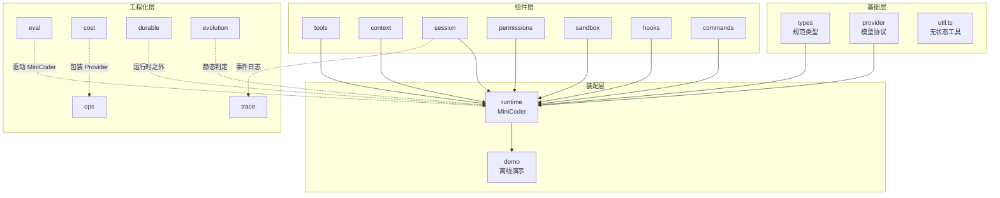
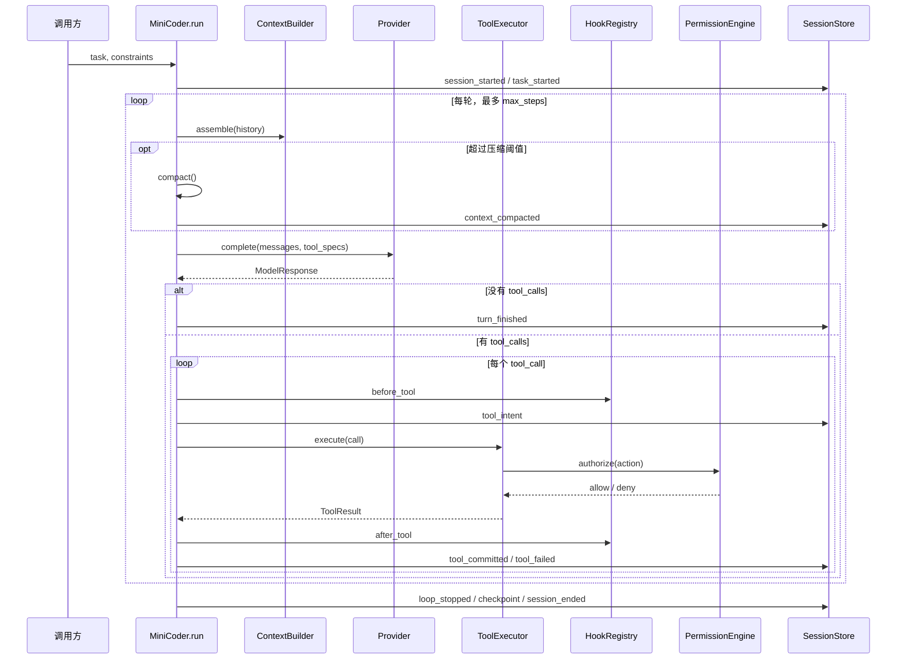

# 附录 D MiniCoder 代码地图与运行指南

本附录不重复正文的设计论证，只回答四个工程问题：代码在哪里、怎么跑起来、每个文件对应哪一章、要改一处功能应该动哪里。阅读顺序建议是先跑通离线演示，再对照模块地图回到相关章节。

全书示例项目 MiniCoder 位于仓库的 `code/` 目录。Python 与 TypeScript 两版目录结构对应，七个演示的终端输出逐行一致。所有演示默认使用临时工作区与脚本化 Provider，不访问网络，也不需要 API Key。

## D.1 五分钟跑通

### 环境要求

- Python 3.11 及以上，无第三方依赖；Python 版直接以模块方式运行。
- Node.js 20 及以上；Node.js 26 可直接运行 `.ts` 文件（原生类型剥离），Node.js 20 需要 `tsx` 或先编译。
- 建议在仓库根目录执行命令，避免工作目录漂移。



```bash
cd code/python
python3 --version
python3 -m minicoder.demo
```


```bash
cd code/typescript
node --version
npm run demo
# 等价于：node minicoder/src/demo.ts
# Node 20 可改用：npx tsx minicoder/src/demo.ts
```



主演示的预期输出以 `== MiniCoder demo ==` 开头，随后是可核对的关键行：

```text
loop      completed turns=5 tools=3 compactions=1
usage     input=500 output=100
tool      c1  read_file   ok
tool      c2  write_file  ok
tool      c3  run_command ok
tool      c4  run_command blocked block-rm:递归删除
read      lines=35 secret_visible=False redacted=True
write     chars=650 applied=True
host      unchanged=True
compact   before=233 after=70 kept_recent=2 degraded=False
```

其中 `host unchanged=True` 说明修改只发生在沙箱工作区；`secret_visible=False` 说明读取到的密钥没有进入追踪；`blocked` 说明钩子在权限检查之前阻断了递归删除。


演示会在系统临时目录中创建工作区，结束时删除；会话事件写入临时工作区的 `.minicoder/sessions/<session_id>/`，随清理一并消失。若要保留现场，可复制 `demo.py`，把 `tempfile.mkdtemp()` 换成固定目录，并将 `keep_sandbox_workspace` 设为 `True`。


### 七个可运行演示

| 演示 | 命令（Python / TypeScript 同名） | 验证重点 | 对应章节 |
|---|---|---|---|
| 主循环 | `minicoder.demo` / `demo.ts` | 工具闭环、权限审批、钩子、压缩、恢复、沙箱隔离 | 第 2、13 章 |
| 追踪 | `minicoder.trace_demo` / `trace_demo.ts` | 事件投影为 Span、审批等待、脱敏、子 Span 合并、回放 | 第 14 章 |
| 评测 | `minicoder.eval_demo` / `eval_demo.ts` | 六个任务、确定性指纹、检查项、脚本化 Judge | 第 15 章 |
| 成本 | `minicoder.cost_demo` / `cost_demo.ts` | 价格卡、预算预占与结算、路由、缓存前缀、延迟拆解 | 第 16 章 |
| 生产控制 | `minicoder.ops_demo` / `ops_demo.ts` | 部署清单校验、准入、限流、熔断、重试、预授权、租约 | 第 17 章 |
| 持久化执行 | `minicoder.durable_demo` / `durable_demo.ts` | 任务日志、崩溃恢复、幂等副作用、分代预算、验证门、接管包 | 第 18 章 |
| 演进判定 | `minicoder.evolution` / `evolution.ts` | 责任分配、脚手架分类、能力探针与退场判定 | 第 19 章 |



```bash
cd code/python
python3 -m minicoder.trace_demo
python3 -m minicoder.eval_demo
python3 -m minicoder.cost_demo
python3 -m minicoder.ops_demo
python3 -m minicoder.durable_demo
python3 -m minicoder.evolution
```


```bash
cd code/typescript
node minicoder/src/trace_demo.ts
node minicoder/src/eval_demo.ts
node minicoder/src/cost_demo.ts
node minicoder/src/ops_demo.ts
node minicoder/src/durable_demo.ts
node minicoder/src/evolution.ts
```



`eval_demo` 读取仓库中的 `code/eval/tasks.jsonl` 与 `code/eval/fixtures/`，其他演示自带内联数据。演示之间没有共享状态，可以单独运行，也可以按任意顺序运行。


Node.js 20 不能直接执行带类型标注的 `.ts` 文件。请使用 `npx tsx <file>`，或用 TypeScript 编译器产出 JavaScript 后再用 `node` 运行。Node.js 22.6 起提供实验性的类型剥离，具体默认行为以所用小版本为准；本书以 Node.js 26 的直接运行结果为基线。


## D.2 目录地图

```text
code/
├── eval/                          # 评测资产，不属于 Python 包
│   ├── tasks.jsonl                # 6 个任务：成功、阻断、拒绝、无进展、压缩、脱敏
│   └── fixtures/                  # 每个任务的工作区初始文件
├── python/
│   ├── pyproject.toml             # 包名 minicoder，requires-python >= 3.11
│   └── minicoder/
│       ├── __init__.py            # 对外导出 MiniCoder、HarnessConfig、LoopResult 等
│       ├── types.py               # 规范类型
│       ├── provider.py            # Provider 协议与两个离线实现
│       ├── tools.py               # 工具注册、Schema 校验、工作区约束、执行器
│       ├── context.py             # 上下文预算、组装、压缩
│       ├── session.py             # 会话状态、事件日志、检查点、恢复、漂移检测
│       ├── permissions.py         # 风险推导、策略、审批、授权记录
│       ├── sandbox.py             # 沙箱规格、工作区副本、命令执行
│       ├── hooks.py               # 生命周期钩子
│       ├── commands.py            # 斜杠命令展开
│       ├── runtime.py             # 组合根、主循环、单次执行漏斗
│       ├── demo.py                # 离线端到端演示
│       ├── trace.py               # 事件投影、Span、脱敏、回放
│       ├── eval/                  # 数据集、运行器、检查项、Judge、报告
│       ├── cost.py                # 价格卡、预算账本、路由、缓存计划、延迟
│       ├── ops.py                 # 清单、准入、限流、熔断、重试、网关、租约
│       ├── durable.py             # 日志、副作用存储、分代预算、验证门、接管
│       ├── evolution.py           # 责任分配与脚手架退场
│       └── *_demo.py              # 各层离线演示
└── typescript/
    ├── package.json               # type=module；npm run demo
    └── minicoder/src/             # 与 Python 模块对应，另有 util.ts
```

Python 版没有独立的 `util.py`：规范化 JSON 与摘要逻辑放在 `session.py`，文本截断与行号渲染放在 `tools.py`。TypeScript 版把这类无状态工具集中到 `util.ts`，是为了让浏览器与 Node 之外的运行时也能复用，同时避免 `session.ts` 承担过多职责。

## D.3 分层结构



三条边界值得记住：

1. **装配层只做组合。** `runtime.py` 不实现预算算法、权限规则或沙箱细节，只负责按顺序调用组件并把结果写入事件流。
2. **工程化层不改变主循环。** `trace` 读取事件，`eval` 在外部驱动运行时，`cost` 与 `ops` 包装 Provider，`durable` 与 `evolution` 当前不进入 `MiniCoder.run`。
3. **离线演示是验收入口。** 每个工程化模块都有同名演示；修改模块后先跑对应演示，再跑主演示，能最快发现接口回归。

## D.4 模块地图

下表的行数是当前版本的实际值，用于判断改动影响面；“进入运行时”表示该模块是否被 `MiniCoder` 直接调用。

| 文件（Python / TypeScript） | 行数 | 职责 | 关键符号 | 章节 | 进入运行时 |
|---|---|---|---|---|---|
| `types.py` / `types.ts` | 77 / 95 | 规范类型，隔离厂商 SDK | `Message`、`ModelResponse`、`ToolCall`、`ToolResult`、`Usage`、`FinishReason` | 2、3 | 是 |
| `provider.py` / `provider.ts` | 54 / 48 | 模型接入协议与离线替身 | `Provider`、`ScriptedProvider`、`FixedSummaryProvider`、`response` | 3 | 是 |
| `tools.py` / `tools.ts` | 254 / 280 | 工具注册、参数校验、工作区约束、执行与截断 | `Tool`、`ToolRegistry`、`ToolExecutor`、`Workspace`、`validate_args`、`build_registry` | 5 | 是 |
| `context.py` / `context.ts` | 199 / 239 | 预算分配、上下文组装、压缩触发 | `ContextBudget`、`ContextBuilder`、`BuildReport`、`needs_compaction`、`compact` | 6 | 是 |
| `session.py` / `session.ts` | 292 / 381 | 会话与任务状态、事件日志、快照、恢复、漂移 | `SessionStore`、`SessionState`、`TaskState`、`apply_event`、`idempotency_key`、`detect_drift` | 7、13、18 | 是 |
| `permissions.py` / `permissions.ts` | 295 / 376 | 风险推导、策略求值、审批、授权记录 | `Action`、`Rule`、`Policy`、`PermissionEngine`、`derive_risk`、`HeadlessApprover` | 11 | 是 |
| `sandbox.py` / `sandbox.ts` | 204 / 234 | 工作区副本、路径约束、命令执行 | `SandboxSpec`、`SandboxHandle`、`run_command`、`CommandResult`、`manifest` | 10 | 是 |
| `hooks.py` / `hooks.ts` | 82 / 91 | 生命周期事件与钩子链 | `Event`、`Hook`、`HookRegistry`、`HookOutcome` | 12 | 是 |
| `commands.py` / `commands.ts` | 37 / 44 | 斜杠命令定义与模板展开 | `Command`、`CommandRegistry`、`Expansion` | 12 | 是（默认空注册表） |
| `runtime.py` / `runtime.ts` | 417 / 452 | 组合根、主循环、执行漏斗、停止条件 | `HarnessConfig`、`LoopResult`、`MiniCoder`、`SYSTEM_PROMPT`、`make_demo_hooks` | 2、13 | 是 |
| `demo.py` / `demo.ts` | 218 / 235 | 端到端离线演示 | `main`、固定工作区脚本、`DemoApprover` | 13 | 否 |
| `trace.py` / `trace.ts` | 522 / 551 | 事件投影、Span 树、脱敏、回放、子追踪合并 | `TraceBuilder`、`Trace`、`Span`、`build_trace`、`merge_child`、`summarize`、`replay` | 14 | 否（读事件） |
| `eval/`（6 个文件） | 407 / 421 | 数据集加载、任务运行、检查项、Judge、报告 | `EvalTask`、`run_task`、`run_suite`、`evaluate_checks`、`ScriptedJudge`、`render_report` | 15 | 否（驱动运行时） |
| `cost.py` / `cost.ts` | 547 / 647 | 价格卡、预算账本、路由、缓存计划、延迟拆解 | `PriceCard`、`BudgetLedger`、`Router`、`CachePlan`、`plan_cache`、`latency_breakdown` | 16 | 否 |
| `ops.py` / `ops.ts` | 660 / 781 | 部署清单、准入、限流、熔断、重试、治理网关、租约 | `DeploymentManifest`、`AdmissionController`、`CircuitBreaker`、`GovernedProvider`、`LeaseManager` | 17 | 否（可包装 Provider） |
| `durable.py` / `durable.ts` | 615 / 732 | 任务日志、幂等副作用、分代预算、验证门、接管包 | `DurableRunner`、`TaskJournal`、`EffectStore`、`EpochPacer`、`VerificationGate`、`build_handoff` | 18 | 否 |
| `evolution.py` / `evolution.ts` | 163 / 216 | 责任分配、脚手架分类、退场判定 | `allocate`、`decide`、`summarize` | 19 | 否 |
| `util.ts` | — / 40 | TypeScript 专用无状态工具 | `canonicalJson`、`sha256Hex`、`splitLines`、`padRight` | 3 | 是（TS） |

Python 包代码合计 5943 行，TypeScript 合计 6968 行。差值主要来自 TypeScript 的显式类型声明、类字段与 `util.ts`，不是功能差异。

## D.5 一次 `run` 的数据流

`MiniCoder` 的构造过程已经确定了所有依赖：解析宿主目录、创建沙箱、建立工作区、注册工具、装配权限引擎、打开会话存储、构造执行器与上下文构建器。`run` 只负责驱动循环。



几个容易看漏的顺序细节：

- **钩子先于权限。** `_execute` 先运行 `before_tool`；若钩子返回 `modify`，被改写后的参数才进入 `ToolExecutor`，随后才做权限检查。因此“钩子能看到、权限检查的也是最终参数”。
- **权限检查在参数校验之后。** `ToolExecutor.execute` 的顺序是：查找工具 → 校验 Schema → 调用授权回调 → 执行 handler → 超时与异常处理 → 结果截断。参数不合法的调用不会进入审批。
- **取消不是异常。** `session_start` 或 `before_model` 钩子返回 `block` 时，循环以 `LoopStopReason.CANCELLED` 正常结束，仍然写 `loop_stopped`、检查点与 `session_ended`。
- **停止条件按顺序判定。** 模型不再请求工具时是 `completed`；同一签名“工具名 + 排序后的参数 + 观察前 80 字符”累计出现达到 `max_identical` 是 `no_progress`；累计 token 达到 `budget.window * 4` 是 `budget_exceeded`；步数耗尽则是 `max_steps`。

### 事件流与恢复

`SessionStore` 把两类事件分开处理：

| 类别 | 事件 | 是否参与状态重建 |
|---|---|---|
| 状态事件 | `session_started`、`task_started`、`tool_intent`、`tool_committed`、`tool_failed`、`state_changed`、`turn_finished`、`checkpoint` | 是 |
| 审计事件 | `turn_started`、`loop_stopped`、`context_compacted`、`permission_requested`、`permission_decided`、`grant_issued`、`grant_expired`、`hook_finished`、`tool_blocked`、`command_invoked`、`skill_loaded`、`sandbox_created`、`sandbox_destroyed`、`subagent_dispatched`、`subagent_returned`、`session_ended` | 否，恢复时跳过 |

恢复流程是“先读快照，再从快照序号之后重放事件”。若快照版本不是 `SCHEMA_VERSION = 1`，会拒绝恢复；若日志缺少 `session_started` 或 `task_started`，也无法重建。重放完成后可调用 `detect_drift` 比对已记录文件的 SHA-256，发现 `deleted` 或 `modified` 漂移。


排查会话问题时，先看 `events.jsonl` 的尾部，再看 `snapshot.json` 的 `seq`。事件序号是单调递增的，`checkpoint` 事件的 `data.reason` 能区分 `run_end` 与其他检查点。具体命令见附录 C 的 C.2 节。


## D.6 双语言对照

两版不是逐行翻译，而是共享同一套协议与事件格式。对应关系如下：

| 能力 | Python | TypeScript |
|---|---|---|
| 规范类型 | `types.py` | `types.ts` |
| 模型协议 | `provider.py` | `provider.ts` |
| 工具与执行器 | `tools.py` | `tools.ts` |
| 上下文 | `context.py` | `context.ts` |
| 会话与恢复 | `session.py` | `session.ts` |
| 权限 | `permissions.py` | `permissions.ts` |
| 沙箱 | `sandbox.py` | `sandbox.ts` |
| 钩子与命令 | `hooks.py`、`commands.py` | `hooks.ts`、`commands.ts` |
| 组合根 | `runtime.py` | `runtime.ts` |
| 追踪 | `trace.py` | `trace.ts` |
| 评测 | `eval/` 包 | `eval/` 目录 |
| 成本、生产、持久化、演进 | `cost.py`、`ops.py`、`durable.py`、`evolution.py` | 同名 `.ts` |

两版的 `demo`、`trace_demo`、`eval_demo`、`cost_demo`、`ops_demo`、`durable_demo` 与 `evolution` 输出逐行一致。验证方式是在两个目录分别运行并比较：

```bash
(cd code/python && python3 -m minicoder.demo) > /tmp/py.txt
(cd code/typescript && node minicoder/src/demo.ts) > /tmp/ts.txt
diff /tmp/py.txt /tmp/ts.txt && echo identical
```

要让输出保持一致，演示中不能依赖以下内容：当前时间、随机数、绝对路径、临时目录名、Map 遍历顺序、浮点格式化差异。现有演示用固定时间戳、固定顺序、统一格式化与确定性指纹来满足这一约束。修改任何一个演示时，都应把“双语言输出一致”当作验收条件。

## D.7 扩展 MiniCoder

### 增加一个工具

工具的最小闭环是：声明 `ToolSpec`、实现异步 handler、注册到 `ToolRegistry`。注册时会校验名称格式、参数 Schema 必须是 `object`、必须显式 `additionalProperties: false`，并要求写操作不能声明 `parallel_safe`。

```python
from minicoder.tools import Tool, ToolSpec
from minicoder.types import ToolResult

async def list_files(args):
    names = sorted(
        str(p.relative_to(ws.root)) for p in ws.root.rglob("*") if p.is_file()
    )
    return ToolResult(True, "\n".join(names), metadata={"count": len(names)})

coder.registry.register(
    Tool(
        ToolSpec(
            "list_files",
            "列出工作区内的文件；只读。",
            {"type": "object", "additionalProperties": False, "properties": {}},
        ),
        list_files,
        parallel_safe=True,
        risk="read",
    )
)
```

注册后还要确认三件事：`ContextBuilder` 下次组装时会把新工具写进提示词；`derive_risk` 能识别 `risk` 并给出对应的审批策略；`ToolExecutor` 的 1600 字符截断与工具自身超时不会互相冲突。若工具会产生副作用，先补权限规则与测试，再接入主循环。

### 接入真实模型

实现 `Provider.complete` 即可，不需要让 SDK 类型进入核心代码：

```python
class MyProvider:
    async def complete(self, messages, tools=(), **options):
        raw = await my_sdk.chat(messages=messages, tools=tools, **options)
        return ModelResponse(
            text=raw.text,
            tool_calls=raw.tool_calls,
            finish_reason=map_finish_reason(raw.finish_reason),
            usage=Usage(raw.input_tokens, raw.output_tokens),
        )
```

适配层必须处理四件事：把厂商的停止原因映射到 `FinishReason`；把工具调用参数规范化为字典；把用量映射到 `Usage`；把网络错误转成可重试或不可重试的异常。不要在 Provider 里做权限判断或文件写入，这两件事属于执行漏斗。

### 增加钩子或命令

钩子实现 `Handler`，返回 `HookResult("continue" | "modify" | "block", payload, reason)`。`HookRegistry` 按 `(priority, name)` 排序执行；`critical=True` 的钩子抛异常时会阻断，非关键钩子抛异常只记录并跳过。

命令只是模板展开：`CommandRegistry.expand("/review src/app.py")` 返回 `Expansion`，由调用方决定把展开文本作为用户消息还是系统提示。当前 `MiniCoder` 默认注入空注册表，接入 CLI 时需要显式传入。

### 增加评测任务

评测任务写在 `code/eval/tasks.jsonl`，一行一个 JSON。任务字段包括 `id`、`goal`、`constraints`、`fixture`、`allow_write`、`budget`、`script` 与 `checks`。`script` 是 `ScriptedProvider` 的响应序列；`checks` 可声明 `reason`、`files`、`files_unchanged`、`tools_ok`、`tools_failed`、`tools_blocked`、`required_tools`、`answer_contains`、`compactions_min`、`trace_no_secret`、`trace_has_mask`。新增任务时，同时在 `code/eval/fixtures/` 下准备初始工作区，并确保两次运行的任务指纹一致。

### 补齐 CLI 与真实 Provider

仓库尚未创建 `cli.py` 或 `cli.ts`。建议的接入顺序是：

1. 读取环境变量与命令行参数，构造 `HarnessConfig`。
2. 选择 Provider；把 `ScriptedProvider` 保留为离线模式。
3. 实现交互式 `Approver`，把 `ApprovalRequest.render()` 展示给用户，并处理 `allow_once`、`allow_session`、`deny`。
4. 注册钩子与命令；根据配置文件决定是否启用沙箱保留工作区。
5. 处理 `SIGINT`：在当前工具结束后停止循环，调用 `close()` 销毁沙箱并写出最终检查点。


接入真实模型后，示例会真实读写文件并执行命令。请使用专用测试目录，设置消费上限，确保 API Key 只存在于环境变量中，并保留 `deny` 默认策略。沙箱的 `local` 后端不是安全边界，详见 D.8。


## D.8 已知边界与工程契约

当前代码是“可离线运行的参考实现”，不是完整产品。下面这些边界是刻意保留的，阅读与改动时不要误判：

| 边界 | 现状 | 影响与处理 |
|---|---|---|
| 真实 Provider | 只有 `ScriptedProvider` 与 `FixedSummaryProvider` | 接入真实模型需自行实现 `Provider`；不要把 SDK 类型写进 `types.py` |
| CLI | 未创建 `cli.py` / `cli.ts` | 交互审批、参数解析、信号处理都需补齐 |
| 规划与子代理 | 没有 `planning.py` / `subagent.py`；事件名已预留 | 第 8、9 章讲的是设计与教学代码；v1 运行时不派发子代理 |
| 长期记忆 | 没有独立的 `memory.py` | 第 7 章只给记忆文件格式；v1 用会话快照与事件重放 |
| 内置工具 | 实际只有 `read_file`、`write_file`、`run_command` | 第 5 章的编辑、搜索、MCP 客户端未进入 v1 注册表 |
| `ops` / `durable` | 未接入 `MiniCoder.run` | 第 17、18 章演示的是可组合件；生产化需要显式装配 |
| `cost` | 有账本、路由、缓存计划，但主循环仍用原始 Provider | 需要包装为治理 Provider，或把预算检查下沉到循环 |
| 租约 | `LeaseManager` 与 `TaskLeaseManager` 为内存实现 | 多进程或多主机部署时需要换成共享存储，并保留 fencing token |
| 沙箱网络策略 | `local` 后端不执行 `network="deny"` | 不能把它当作网络隔离；生产环境应换容器或微虚拟机 |
| `read_only_base` | 是初始化时的 `copytree` 副本，不是只读挂载 | 沙箱内可写；宿主文件不受影响，但“只读基线”语义需自行保证 |
| 命令超时 | 工具外层 20 秒，内层 `run_command` 15 秒 | 进程忽略 `SIGTERM` 时可能仍挂起；必要时使用进程组终止与上层看门狗 |
| 事件 Schema | `SCHEMA_VERSION = 1`，无迁移器 | 改事件字段前先决定兼容策略，避免旧快照无法恢复 |
| 演示时钟 | 固定为 `2026-11-03T00:00:00Z` | 便于输出对比；真实部署应注入时钟 |
| 测试目录 | 尚未创建 | 当前以七个演示作为回归入口 |

这些边界与附录 C 的排查清单互补：附录 C 回答“出错后怎么定位”，本附录回答“为什么这里没有某个能力”。

### 修改后的最小自检

1. 在 `code/python` 与 `code/typescript` 分别运行主演示，确认输出一致。
2. 运行受影响模块的演示；改动 `trace`、`eval`、`cost`、`ops`、`durable`、`evolution` 时至少各跑一次。
3. 确认没有把密钥、绝对路径或临时目录名写进固定输出。
4. 确认权限默认仍是拒绝，写工具没有被错误声明为 `parallel_safe`。
5. 若改了事件字段，更新 `SCHEMA_VERSION` 或提供兼容读取逻辑。
6. 若改了沙箱或工具超时，重新检查阻塞路径与清理逻辑。

## D.9 从演示输出反查模块

七个演示的输出前缀是稳定的，可以直接用来定位代码。看到某一行不明白时，按第一列找到模块，再按第三列回到正文：

| 输出前缀 | 含义 | 产生位置 |
|---|---|---|
| `loop`、`usage` | 停止原因、轮数、工具调用数、压缩次数与 token 用量 | `runtime.LoopResult` 与 `MiniCoder.run` |
| `tool` | 工具提交、失败或阻断的单行摘要 | `SessionStore` 的 `tool_committed`、`tool_failed`、`tool_blocked` |
| `read`、`write`、`host` | 读取脱敏、写入结果与宿主隔离 | `demo.py` 的断言行 |
| `compact` | 压缩前后 token、保留轮数与是否降级 | `context.compact` 的 `CompactionResult` |
| `hook` | 钩子链名称、动作与短路位置 | `HookRegistry.run` 的 `trace` |
| `audit` | 授权记录：序号、决定、工具、规则 | `PermissionEngine.records` |
| `intent` | 工具调用意图与幂等键 | `session.idempotency_key` |
| `recover` | 恢复来源、重放条数、文件数与漂移 | `SessionStore.recover` 与 `detect_drift` |
| `sandbox` | 命令运行次数与工作区是否保留 | `sandbox.destroy_sandbox` |
| `span`、`metrics`、`redact`、`child`、`replay` | Span 树、汇总指标、脱敏、子追踪合并、回放 | `trace.py` |
| `task`、`check` | 评测任务结果与单项检查 | `eval/runner.py` 与 `eval/report.py` |
| `price`、`cost`、`budget`、`route`、`cache`、`latency` | 价格、结算、预算、路由、缓存与延迟 | `cost.py` |
| `manifest`、`admit`、`rate`、`retry`、`failover`、`breaker`、`preauth`、`lease`、`drain` | 部署校验、准入、限流、重试、熔断、预授权与租约 | `ops.py` |
| `journal`、`step`、`effect`、`crash`、`epoch`、`resume`、`verify`、`effects`、`digest` | 日志、步骤、幂等副作用、崩溃、分代预算、恢复、验证与摘要 | `durable.py` |
| `gate`、`allocate`、`scaffold`、`contract`、`summary` | 能力探针、责任分配、脚手架判定、接口契约与汇总 | `evolution.py` |

## D.10 按目标选择入口

| 你的目标 | 先读 | 再读 | 动手改 |
|---|---|---|---|
| 理解 Agent Loop | 第 2 章 | `runtime.py` 的 `run` 与 `_execute` | `demo.py` 的脚本响应 |
| 设计工具协议 | 第 3、5 章 | `types.py`、`tools.py` | 新增一个只读工具 |
| 解决上下文问题 | 第 6 章 | `context.py`、`BuildReport` | 调整预算或压缩阈值 |
| 做会话恢复 | 第 7、18 章 | `session.py`、`durable.py` | 增加事件或检查点 |
| 加权限与审批 | 第 11 章 | `permissions.py`、`runtime._authorize` | 增加规则或 `Approver` |
| 做可观测性 | 第 14 章 | `trace.py`、事件清单 | 增加 Span 或脱敏规则 |
| 做评测回归 | 第 15 章 | `eval/runner.py`、`tasks.jsonl` | 增加任务与检查项 |
| 控制成本与上线 | 第 16、17 章 | `cost.py`、`ops.py` | 包装 Provider、加准入 |
| 长时任务与演进 | 第 18、19 章 | `durable.py`、`evolution.py` | 接日志、租约与验证门 |

MiniCoder 的价值不在于它已经覆盖所有能力，而在于每个能力都有可运行的边界和可替换的接口。把某个模块替换成生产实现时，保持协议与事件格式不变，主循环就不需要重写。
