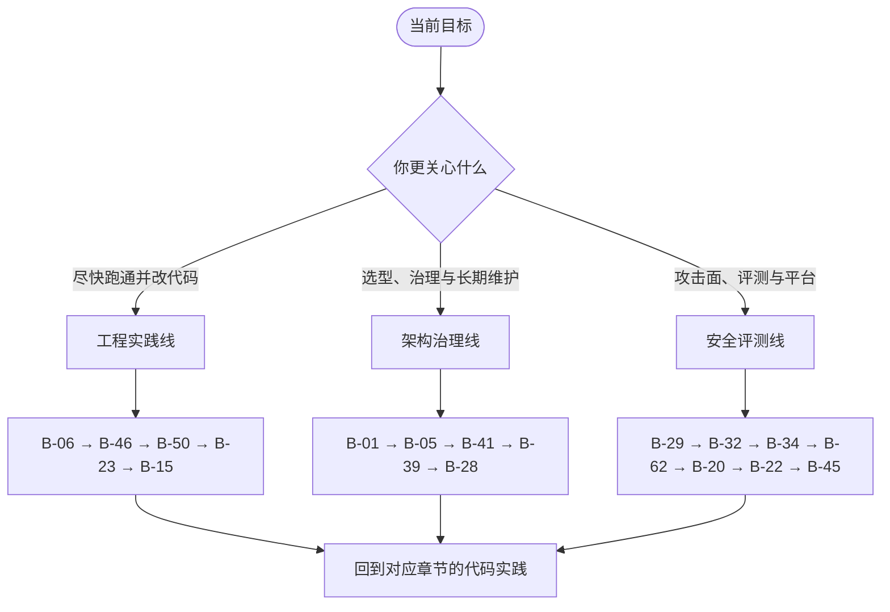

# 附录 B 参考资料与延伸阅读

本附录有三个用途：追溯正文观点的来源，为某个组件寻找更深的一手材料，以及在模型或产品更新后重新核对事实。它不是“读完这些就能掌握 Agent”的清单，也不意味着列出的每个观点都被本书完全采纳。

每条资料附一句“为什么读”，说明它与哪一章的哪个问题相关。建议先读这一句，再决定是否打开原文。论文与书籍提供稳定的原理，产品文档与规范提供当前实现；两者混在一起读，最容易把“一时的默认行为”误当成“长期的工程规律”。


**资料的三种寿命。** 经典论文与工程书通常以年为单位保持有效；协议规范与官方文档以月为单位演进；基准榜单与产品功能可能以周为单位变化。读的时候先判断它属于哪一类，再决定要不要把结论写进设计文档。


## B.1 使用说明与资料分级

| 级别 | 典型资料 | 阅读方式 | 时效风险 |
|---|---|---|---|
| A 经典 | 论文、教材、工程专著 | 通读，理解前提、方法与局限 | 低，但要注意结论的适用边界 |
| B 一手规范 | 协议规范、官方文档、源码、变更日志 | 按版本查阅，记录版本号与日期 | 中，接口与默认值会变 |
| C 时效资料 | 工程博客、基准榜单、产品发布说明 | 快速浏览，回到一手来源核对 | 高，不宜直接作为设计依据 |

使用本附录时，建议遵守三条原则。

1. **一手来源优先。** 规范、源码与变更日志高于二手解读；工程博客有观点，但也会随产品定位变化。
2. **记录版本。** 任何写进设计文档的外部事实，都应附上模型 ID、SDK 版本、规范版本与查阅日期。
3. **区分引用与背书。** 本书引用某篇论文，是借用它的视角或证据，不代表它给出了完整的工程答案。


本附录的链接与书目信息核对于 2026 年 11 月。产品文档、规范章节与基准版本仍会变化；如果链接失效，请用“标题 + 作者/机构”检索，优先选择官方域名、arXiv 或对应仓库。具体功能与默认行为，以你使用版本的官方文档为准。


## B.2 思想与范式

这一组回答“Agent 为什么长成这样”。它们不是 Harness 的实现手册，但决定了你如何理解模型能力、脚手架与工程约束之间的关系。

| 编号 | 资料 | 为什么读 | 章节 |
|---|---|---|---|
| B-01 | [The Bitter Lesson](http://www.incompleteideas.net/IncIdeas/BitterLesson.html)（Sutton，2019） | 能力方法终将胜过手工知识。本书用它讨论 Harness 的退场边界，而不是把它当成“删代码”的许可 | 1、19 |
| B-02 | [Chain-of-Thought Prompting Elicits Reasoning in Large Language Models](https://arxiv.org/abs/2201.11903)（Wei 等，2022） | 把中间推理写出来能改善多步任务。理解“让模型想清楚”的收益，也理解它不是外部验证 | 2、8 |
| B-03 | [ReAct: Synergizing Reasoning and Acting in Language Models](https://arxiv.org/abs/2210.03629)（Yao 等，2022） | 推理与行动交替的原始范式。今天的原生工具调用是它的工程化版本，但观察—修正的骨架没有变 | 1、2、4 |
| B-04 | [Toolformer: Language Models Can Teach Themselves to Use Tools](https://arxiv.org/abs/2302.04761)（Schick 等，2023） | 模型可以学习何时、如何调用 API。说明工具使用既有提示工程成分，也有可训练的能力成分 | 3、5 |
| B-05 | [Cognitive Architectures for Language Agents](https://arxiv.org/abs/2309.02427)（Sumers 等，2023） | 把语言智能体拆成记忆、决策与行动模块，为 Harness 的组件边界提供一套学术词汇 | 1、7 |
| B-06 | [Building effective agents](https://www.anthropic.com/engineering/building-effective-agents)（Anthropic，2024） | 区分 workflow 与 agent，总结常见编排模式，并反复强调“先用最简单的方案”。读第 4、13 章前先读这篇 | 4、13、19 |

## B.3 上下文、记忆与规划

这一组对应第 6～8 章。核心问题不是“能不能塞进去”，而是“塞进去之后模型还能不能用好”。

| 编号 | 资料 | 为什么读 | 章节 |
|---|---|---|---|
| B-07 | [Lost in the Middle: How Language Models Use Long Contexts](https://arxiv.org/abs/2307.03172)（Liu 等，2023） | 长上下文中间位置的信息最容易被忽略。它解释了为什么预算分配、关键约束前置与压缩是必要的 | 6 |
| B-08 | [MemGPT: Towards LLMs as Operating Systems](https://arxiv.org/abs/2310.08560)（Packer 等，2023） | 把上下文窗口当内存、外部存储当磁盘的分页思路。理解记忆分层的动机，但别把虚拟上下文当成任务状态 | 7 |
| B-09 | [Generative Agents: Interactive Simulacra of Human Behavior](https://arxiv.org/abs/2304.03442)（Park 等，2023） | 记忆流、反思与计划。长期运行的 Agent 如何积累经验并在需要时召回 | 7、18 |
| B-10 | [Reflexion: Language Agents with Verbal Reinforcement Learning](https://arxiv.org/abs/2303.11366)（Shinn 等，2023） | 用语言化反思改进行为。有效的前提是有可验证的反馈，否则容易自我强化错误 | 8 |
| B-11 | [Tree of Thoughts: Deliberate Problem Solving with Large Language Models](https://arxiv.org/abs/2305.10601)（Yao 等，2023） | 显式搜索多条推理路径。说明“多想几步”的收益与成本，适合离线或高价值任务 | 8 |
| B-12 | [Plan-and-Solve Prompting](https://arxiv.org/abs/2305.04091)（Wang 等，2023） | 先分解再执行。对应 Harness 中的计划模板与待办列表，而不是让模型一次想完所有细节 | 8 |
| B-13 | [Voyager: An Open-Ended Embodied Agent with Large Language Models](https://arxiv.org/abs/2305.16291)（Wang 等，2023） | 技能库与自动课程。长时运行 Agent 如何复用已验证的能力，而不是每次从零开始 | 18、19 |
| B-14 | [Effective context engineering for AI agents](https://www.anthropic.com/engineering/effective-context-engineering-for-ai-agents)（Anthropic，2025） | context rot、即时检索、压缩、结构化笔记与子代理。第 6 章的直接延伸，也解释了 Claude Code 的上下文策略 | 6、9、18 |

## B.4 工具、子代理与多智能体

这一组对应第 5、9 章。工具接口与代理编排是 Harness 中最容易被“抽象层”掩盖的部分，读原始材料能把责任边界看清楚。

| 编号 | 资料 | 为什么读 | 章节 |
|---|---|---|---|
| B-15 | [SWE-agent: Agent-Computer Interfaces Enable Automated Software Engineering](https://arxiv.org/abs/2405.15793)（Yang 等，2024） | 提出 Agent-Computer Interface：工具接口的设计会改变模型表现。工具不是薄封装，而是能力的一部分 | 5 |
| B-16 | [AutoGen: Enabling Next-Gen LLM Applications via Multi-Agent Conversation](https://arxiv.org/abs/2308.08155)（Wu 等，2023） | 可编程的多代理对话。看清 handoff、群聊与责任链带来的编排复杂度 | 9 |
| B-17 | [MetaGPT: Meta Programming for A Multi-Agent Collaborative Framework](https://arxiv.org/abs/2308.00352)（Hong 等，2023） | 角色分工与结构化产物（需求、设计、代码）。展示流水线式多代理的收益，也暴露过度工程的风险 | 9 |
| B-18 | [Introducing the Model Context Protocol](https://www.anthropic.com/news/model-context-protocol)（Anthropic，2024） | 为什么需要统一的工具与资源协议。从“每家一个插件”到客户端—服务器架构的动机 | 5、11 |
| B-19 | [Model Context Protocol specification](https://modelcontextprotocol.io)（MCP 项目） | 传输、能力协商、JSON-RPC 消息与安全注意事项。实现客户端前读当前版本，别背旧字段 | 5、11 |

## B.5 评测与长时任务

这一组对应第 15、18 章。读基准时，重点不是榜单分数，而是判定结构：它如何定义成功、如何处理回归、如何衡量可靠性。

| 编号 | 资料 | 为什么读 | 章节 |
|---|---|---|---|
| B-20 | [SWE-bench: Can Language Models Resolve Real-World GitHub Issues?](https://arxiv.org/abs/2310.06770)（Jimenez 等，2023） | `FAIL_TO_PASS` 与 `PASS_TO_PASS` 的判定结构。理解“修好”与“没弄坏”必须分开度量 | 15 |
| B-21 | [Terminal-Bench](https://www.tbench.ai)（Terminal-Bench 项目，2025） | 容器化终端任务，更接近真实运维与开发环境，也更容易暴露沙箱、超时与错误恢复的短板 | 15、17 |
| B-22 | [τ-bench: A Benchmark for Tool-Agent-User Interaction in Real-World Domains](https://arxiv.org/abs/2406.12045)（Yao 等，2024） | 模拟用户、领域策略与 `pass^k`。“连续 k 次都成功”比单次成功率更接近生产可靠性 | 15 |
| B-23 | [WebArena: A Realistic Web Environment for Building Autonomous Agents](https://arxiv.org/abs/2307.13854)（Zhou 等，2023） | 真实网站环境中的长程任务。评测不只看结果，还要看路径与副作用 | 15 |
| B-24 | [OSWorld: Benchmarking Multimodal Agents for Open-Ended Tasks in Real Computer Environments](https://arxiv.org/abs/2404.07972)（Xie 等，2024） | 真实操作系统控制。沙箱边界与可复现环境是这类评测成立的前提 | 10、15 |
| B-25 | [GAIA: A Benchmark for General AI Assistants](https://arxiv.org/abs/2311.12983)（Mialon 等，2023） | 面向通用助手的真实问题。提醒你：公开评测的任务分布与你的产品任务分布往往不同 | 15 |
| B-26 | [Judging LLM-as-a-Judge with MT-Bench and Chatbot Arena](https://arxiv.org/abs/2306.05685)（Zheng 等，2023） | 系统梳理 LLM-as-Judge 的位置偏差、长度偏差与自我偏好。Judge 需要校准，不能直接采信 | 15 |
| B-27 | [Agent-as-a-Judge: Evaluate Agents with Agents](https://arxiv.org/abs/2410.10934)（Zhuo 等，2024） | 用 Agent 评 Agent 的过程与产物。适合开放式任务，但仍需抽样人工复核 | 15 |
| B-28 | [Measuring AI Ability to Complete Long Tasks](https://arxiv.org/abs/2503.14499)（Kwa 等，METR，2025） | 用“人类完成时间”衡量长程能力，并讨论能力翻倍趋势。外推要谨慎，但它提供了长任务评测的坐标系 | 18、19 |

## B.6 安全、权限与治理

这一组对应第 11、17 章。Agent 的安全问题不是“模型会不会说错话”，而是“不可信内容能否变成动作，动作的最坏后果有多大”。

| 编号 | 资料 | 为什么读 | 章节 |
|---|---|---|---|
| B-29 | [OWASP Top 10 for LLM Applications](https://genai.owasp.org)（OWASP GenAI Security Project，2025） | 提示词注入、过度代理、无界消耗等风险清单。做权限、预算与审计时可以直接当检查表 | 11、17 |
| B-30 | [NIST AI Risk Management Framework](https://www.nist.gov/itl/ai-risk-management-framework)（NIST，2023；生成式 AI 剖面 2024） | 治理、映射、度量、管理四类活动。把 Agent 风险放进组织级框架，而不是只留在代码里 | 11、12 |
| B-31 | [EU AI Act](https://digital-strategy.ec.europa.eu/en/policies/regulatory-framework-ai)（欧盟，2024） | 风险分级与分阶段义务。产品出海或合规评审时读官方文本；本附录不构成法律意见 | 11、17 |
| B-32 | [Not what you've signed up for: Compromising Real-World LLM-Integrated Applications with Indirect Prompt Injection](https://arxiv.org/abs/2302.12173)（Greshake 等，2023） | 间接提示词注入：网页、文件、工具输出都可能变成指令。这是 Agent 安全与聊天机器人的分水岭 | 11 |
| B-33 | [AgentDojo: A Dynamic Environment to Evaluate Prompt Injection Attacks and Defenses for LLM Agents](https://arxiv.org/abs/2406.13352)（Debenedetti 等，2024） | 动态注入攻击与防御的评测环境。验证“加了过滤器”是否真的降低攻击成功率 | 11、15 |
| B-34 | [Defeating Prompt Injections by Design](https://arxiv.org/abs/2503.18813)（Debenedetti 等，2025） | 用能力隔离与数据流控制限制注入影响。比“让模型更听话”更接近工程解 | 11 |
| B-35 | [Security Engineering](https://www.cl.cam.ac.uk/~rja14/book.html)（Anderson，第 3 版，2020） | 把安全当系统属性而不是模型属性。权限、信任边界与对抗思维的基础读物 | 11 |

## B.7 系统与软件工程基础

这一组不直接讲 Agent，但第 14～19 章的概念大多来自这些系统与工程实践。模型会换，日志、恢复、发布与复杂度的规律不会。

| 编号 | 资料 | 为什么读 | 章节 |
|---|---|---|---|
| B-36 | [Designing Data-Intensive Applications](https://dataintensive.net)（Kleppmann，2017） | 日志、复制、事务与 exactly-once 的现实边界。第 18 章的持久化设计直接建立在这些概念上 | 18 |
| B-37 | Database Internals（Petrov，O'Reilly，2019） | WAL、恢复、B-tree 与 LSM。理解“先写日志再执行”为什么能撑住崩溃 | 18 |
| B-38 | [Site Reliability Engineering](https://sre.google/sre-book/table-of-contents/)（Beyer 等，O'Reilly，2016） | SLO、错误预算、toil 与事故响应。把 Agent 的可靠性目标写成可运营的指标 | 17、19 |
| B-39 | [Software Engineering at Google](https://abseil.io/resources/swe-book)（Winters 等，O'Reilly，2020） | 代码评审、测试文化与废弃实践。契约版本化与脚手架退场都需要这些纪律 | 19 |
| B-40 | Release It!（Nygard，第 2 版，2018） | 熔断、舱壁、超时与重试预算。第 17 章生产控制模式的来源之一 | 17 |
| B-41 | A Philosophy of Software Design（Ousterhout，2018） | 复杂度、深模块与信息隐藏。判断一层 Harness 是否“值得存在”的思维工具 | 19 |
| B-42 | Observability Engineering（Majors 等，O'Reilly，2022） | 高基数事件、追踪与可调试性。第 14 章事件模型的上位概念 | 14 |
| B-43 | [The Twelve-Factor App](https://12factor.net)（Wiggins，2011） | 配置外置、无状态进程、日志作为事件流。部署清单的经典对照 | 17 |
| B-44 | AI Engineering（Huyen，O'Reilly，2025） | 从评测、检索增强到 Agent 与成本延迟的系统视角。适合作为全书之后的第二遍阅读 | 15、16 |
| B-45 | [Trustworthy Online Controlled Experiments](https://experimentguide.com)（Kohavi 等，2020） | A/B 实验、护栏指标与样本量。把“升级/退场”做成可统计的发布决策 | 15、17、19 |

## B.8 框架、产品与官方文档

这一组对应第 4、5、12、13 章。产品文档变化快，读的时候重点看三件事：默认权限边界、失败时的行为，以及哪些能力其实是 Harness 提供的。

| 编号 | 资料 | 为什么读 | 章节 |
|---|---|---|---|
| B-46 | [Claude Code documentation](https://code.claude.com/docs) | 权限模式、Hooks、Skills、子代理与记忆文件。对照第 4、12 章的产品化实现 | 4、11、12 |
| B-47 | [Claude Agent SDK documentation](https://code.claude.com/docs/en/agent-sdk/overview) | 把产品 Harness 作为库嵌入。注意它与固定版本 Harness 的绑定及迁移说明 | 4、13 |
| B-48 | [Claude Code best practices](https://www.anthropic.com/engineering/claude-code-best-practices)（Anthropic，2025） | 项目记忆、探索—计划—执行—验证的工作流。可作为团队默认实践的起点 | 6、7、13 |
| B-49 | [Writing effective tools for agents](https://www.anthropic.com/engineering/writing-tools-for-agents)（Anthropic，2025） | 工具命名、描述与返回值的 token 效率。第 5 章工具设计的工程补充 | 5 |
| B-50 | [A practical guide to building agents](https://cdn.openai.com/business-guides-and-resources/a-practical-guide-to-building-agents.pdf)（OpenAI，2025） | Agent 的判定标准、单/多代理编排与护栏分层。与 Anthropic 的文章对照读，差异本身就是信息 | 4、13 |
| B-51 | [OpenAI Agents SDK](https://github.com/openai/openai-agents-python)（OpenAI） | Runner、handoff、guardrail、session 与 tracing 的最小实现，适合对照 MiniCoder 的运行时 | 4、9、13 |
| B-52 | [OpenAI Codex CLI](https://github.com/openai/codex)（OpenAI） | 审批策略、沙箱与 `AGENTS.md`。观察“策略无法强制执行就拒绝运行”的边界设计 | 4、10、11 |
| B-53 | [Aider](https://aider.chat)（Aider 项目） | 仓库地图、编辑格式与 Git 提交。第 1 章案例的原始出处 | 1、4 |
| B-54 | [OpenHands](https://github.com/All-Hands-AI/OpenHands)（All Hands AI） | 容器运行时、事件流与上下文压缩。研究型平台的完整实现 | 4、10 |
| B-55 | [LangGraph documentation](https://docs.langchain.com/oss/python/langgraph/overview)（LangChain） | 图执行、checkpointer、interrupt 与持久化。第 18 章的工业参照 | 2、7、18 |
| B-56 | [Cursor documentation](https://docs.cursor.com)（Anysphere） | IDE Agent 的规则、索引与交互。注意闭源部分的边界，别把界面行为当成全部实现 | 4、6 |
| B-57 | [Agents Companion](https://www.kaggle.com/whitepaper-agent-companion) 与 [Context Engineering: Sessions & Memory](https://www.kaggle.com/whitepaper-context-engineering-sessions-and-memory)（Google，2025） | Agent 组件、会话与记忆、上下文工程。与 Anthropic、OpenAI 的材料形成三方对照 | 6、7 |
| B-58 | [OpenTelemetry GenAI semantic conventions](https://opentelemetry.io/docs/specs/semconv/gen-ai/)（OpenTelemetry） | `gen_ai.*` 属性与事件约定。字段仍在演进，接入时锁定版本并保留映射层 | 14 |
| B-59 | [JSON-RPC 2.0 Specification](https://www.jsonrpc.org/specification)（JSON-RPC 工作组） | 请求、响应、通知与错误对象。MCP 的消息层基础 | 5 |
| B-60 | [RFC 9457: Problem Details for HTTP APIs](https://www.rfc-editor.org/rfc/rfc9457.html)（IETF，2023） | 工具错误返回的结构化参考。错误也是模型要读的上下文 | 5 |
| B-61 | [JSON Schema](https://json-schema.org)（JSON Schema 组织） | 工具入参校验的通用语言。注意各厂商对 Schema 子集的支持差异 | 5 |
| B-62 | [gVisor](https://gvisor.dev) 与 [Firecracker](https://firecracker-microvm.github.io) | 用户态内核与 microVM 的隔离权衡。第 10 章选型表的延伸 | 10 |

## B.9 按章节索引

如果你正在读某一章，可以先从这里找对应的延伸材料。编号指向上文的条目。

| 章节 | 建议延伸阅读 | 用途 |
|---|---|---|
| 第 1 章 什么是 Agent Harness | B-01、B-03、B-05、B-06 | 建立模型能力与 Harness 分工的基本框架 |
| 第 2 章 Agent Loop 剖析 | B-02、B-03、B-06、B-16 | 理解循环、推理、编排与停止条件的原始形状 |
| 第 3 章 模型接入层与工具调用协议 | B-18、B-19、B-59、B-60、B-61 | 协议、消息关联与错误结构 |
| 第 4 章 主流 Harness 横向对比 | B-06、B-46、B-47、B-50、B-52、B-53、B-54、B-55、B-56 | 对照产品与框架的真实边界 |
| 第 5 章 工具系统设计 | B-04、B-15、B-19、B-49、B-60、B-61 | 工具接口、描述与返回值设计 |
| 第 6 章 上下文工程 | B-07、B-14、B-48、B-57 | 长上下文退化、压缩与即时检索 |
| 第 7 章 记忆与状态管理 | B-08、B-09、B-46、B-48、B-55 | 记忆分层、持久化与恢复 |
| 第 8 章 规划与任务分解 | B-02、B-10、B-11、B-12 | 推理、反思、搜索与计划模板的边界 |
| 第 9 章 子代理与多智能体编排 | B-13、B-14、B-16、B-17、B-51 | 上下文隔离、职责分工与编排成本 |
| 第 10 章 沙箱与执行环境 | B-24、B-54、B-62 | 隔离强度、运行时选型与可复现环境 |
| 第 11 章 权限、安全与人在回路 | B-29、B-30、B-31、B-32、B-33、B-34、B-35、B-52 | 注入、过度代理、审批与治理框架 |
| 第 12 章 扩展机制 | B-19、B-46、B-47、B-48、B-49 | Hooks、Skills、命令与插件边界 |
| 第 13 章 从零实现 MiniCoder | B-06、B-46、B-47、B-50、B-51、B-55 | 最小实现与产品级 Harness 的差距 |
| 第 14 章 可观测性与追踪 | B-42、B-58 | 事件模型、Span 与语义约定 |
| 第 15 章 评测体系 | B-20、B-21、B-22、B-23、B-24、B-25、B-26、B-27 | 基准的判定结构与 Judge 偏差 |
| 第 16 章 成本与延迟优化 | B-44、B-45 | 成本模型、缓存与实验度量 |
| 第 17 章 生产部署 | B-29、B-38、B-40、B-43 | 限流、熔断、配置与运行边界 |
| 第 18 章 长时运行 Agent | B-13、B-28、B-36、B-37、B-55 | 日志、恢复、长程能力与任务状态 |
| 第 19 章 Harness 与模型的协同演进 | B-01、B-06、B-14、B-39、B-41 | 能力退场、契约稳定性与复杂度 |

## B.10 三条延伸阅读路线

不同读者的下一步不同。下面给出三条路线，每条都假设你已经读过对应章节，只想补足背景。

**工程实践线：先把闭环跑通。** 先读 B-06 与 B-50，建立“workflow 与 agent”的分界；再对照 B-46 或 B-51 看一个真实运行时如何组织工具、会话与审批；最后用 B-23 或 B-15 理解工具接口为什么会影响成功率。这条线不需要先读论文，但要在自己的任务上做小规模对照。

**架构治理线：判断什么该留下。** 先读 B-01，再看 B-05 与 B-41，建立“能力、约束、复杂度”三个维度；然后用 B-39 的工程纪律检查契约与废弃流程，最后用 B-28 校准对长程能力的预期。这条线适合技术负责人和平台团队，重点不是记住结论，而是学会写清“为什么保留这一层”。

**安全评测线：把边界变成可验证的指标。** 从 B-29 与 B-32 开始，先理解攻击面；再用 B-34 看设计层的隔离思路，用 B-62 理解执行环境边界；最后用 B-20、B-22 与 B-45 把“更安全”“更可靠”变成可测的通过率、`pass^k` 与护栏指标。不要只用公开榜单证明安全，公开基准不覆盖你的权限模型与数据边界。

三条路线都会回到同一件事：**把外部资料转成你自己的探针、门禁与设计约束。** 读得再多，如果没有落到代码、评测和发布流程里，仍然只是知识收藏。

## B.11 如何持续跟进与反馈

Agent 领域的信息噪声很大，建议把“跟进”限制在少量一手来源上。

- **规范与变更日志**：MCP 规范、OpenTelemetry GenAI 语义约定、OWASP GenAI 项目、你所用 SDK 的 release notes。这些决定接口与字段，优先级最高。
- **官方工程博客**：Anthropic、OpenAI、Google 的工程文章适合看设计动机与失败案例，但要回到文档核对当前行为。
- **论文**：关注 `cs.AI`、`cs.CL`、`cs.SE` 与系统会议（OSDI、SOSP、NSDI）中与 Agent 运行时、评测、隔离相关的部分。不必追每一篇，按本书章节索引找主题即可。
- **基准与榜单**：只跟踪两三个与你任务分布接近的基准，并始终配合自己的评测集。榜单用于发现方法，不用于替代验收。

一个可执行的习惯是每月留出三十分钟，做四件事：扫一遍上述规范与 release notes；检查自己的评测集是否仍覆盖主要失败类型；记录一次模型或 SDK 升级带来的行为差异；把新结论写成一条可验证的设计约束。长期看，这比收藏大量链接更有效。

如果发现本附录的链接失效、书目信息有误，或某条资料与正文表述不一致，欢迎在本书代码仓库提交 Issue。勘误会同步更新到对应章节，并在后续版本中修订本附录。外部资料会变，但“回到一手来源、记录版本、用评测说话”这三条方法不会过时。
