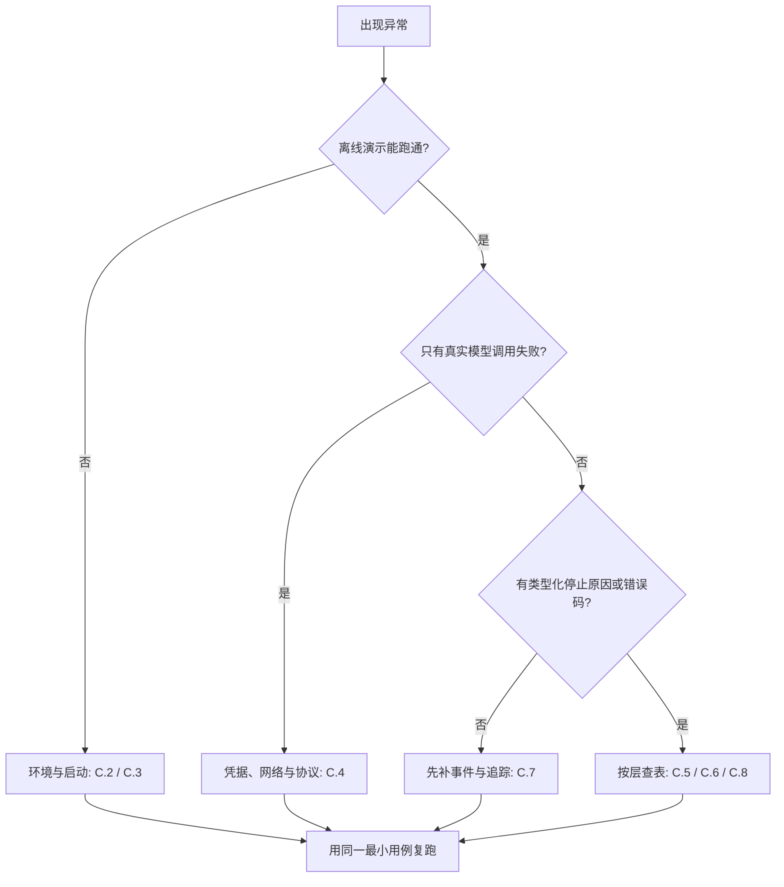

# 附录 C 常见问题排查清单

排查的目标不是让报错消失，而是找到责任层。同一个症状可能来自模型、Harness、执行环境或部署配置；如果一上来就换模型、调大重试次数或关掉权限检查，通常只是把问题推迟到更难复现的地方。

本附录按五层组织：任务层、模型层、Harness 层、环境层与运营层。先分层，再做最小复现，最后一次只改一个变量。每节给出症状、先检查什么、常见修复，以及对应章节。


不要用关闭权限、关闭沙箱、跳过验证或手工修改事件日志的方式“修复”问题。这些操作会让症状暂时消失，却把根因留在系统里。排查可以降低日志级别、增加只读观测，但不能降低安全边界。


## C.1 先分层，再动手

| 层 | 典型症状 | 先看什么 | 对应章节 |
|---|---|---|---|
| 任务层 | 目标含糊、缺少必要上下文、任务本身不可完成 | 用户输入、约束、验收标准 | 第 2、8 章 |
| 模型层 | 拒绝执行、参数格式错误、编造工具、不产出计划 | 原始响应、`finish_reason`、工具 Schema | 第 3 章 |
| Harness 层 | 循环不停、过早停止、上下文丢失、状态不一致、权限异常 | `events.jsonl`、停止原因、检查点 | 第 2、5～12 章 |
| 环境层 | 版本不兼容、命令找不到、网络失败、沙箱路径错误 | 语言版本、工作目录、最小演示 | 第 10、13 章 |
| 运营层 | 配额、成本、延迟、限流、租约、发布异常 | 账本、追踪、部署清单 | 第 14～18 章 |



四条排查原则：

1. **一次只改一个变量。** 同时换模型、改提示词、删脚手架，退化时无法归因。
2. **先证据，后猜测。** 先看 `loop_stopped` 的 `reason`、工具调用的 `error_code`、权限的 `rule`，再决定改哪里。
3. **用神谕上下文区分模型与 Harness。** 由人直接提供完成任务所需的精确上下文；如果仍然失败，优先怀疑模型或任务定义；如果成功，问题多半在上下文组装或工具接口。
4. **安全边界不是可调参数。** 权限、沙箱、验证门出问题，应修规则或修实现，不是把它们关掉。

| 做法 | 症状是否消失 | 是否解决根因 | 主要风险 |
|---|---|---|---|
| 调大 `max_steps` | 可能 | 否 | 成本上升，掩盖无进展循环 |
| 换更强模型 | 可能 | 否 | 掩盖 Harness 缺陷，回归时再次出现 |
| 放宽权限规则 | 是 | 否 | 事故半径扩大 |
| 关闭沙箱或验证 | 是 | 否 | 不可逆副作用与错误交付 |
| 盲目重试 | 可能 | 否 | 重复副作用、成本翻倍 |
| 加观测 + 最小复现 + 单变量 | 否 | 是 | 时间成本较高 |

## C.2 五分钟最小复现

在改代码前，先建立一个能稳定复现的最小用例。

1. **跑离线演示。** 它不调用真实模型，能快速排除安装、版本与工作目录问题。
2. **记录版本。** Python / Node 版本、模型 ID、SDK 与规范版本、最近的改动。
3. **缩小输入。** 一个目标、一个工具、一个文件；去掉并行与子代理。
4. **固定随机性。** 温度、种子、当前时间、文件顺序；能固定就固定。
5. **留证据。** 记录 `session_id`、`trace_id`、停止原因、工具错误码与权限规则名。
6. **写下预期与实际。** 不要只写“失败了”，要写“第几轮、哪个工具、返回了什么”。

```bash
# Python：离线演示，无需 API Key
cd code/python
python3 --version
python3 -m minicoder.demo
```

```bash
# TypeScript：Node 26 可直接运行 .ts；Node 20 使用 tsx 或先编译
cd code/typescript
node --version
node minicoder/src/demo.ts
# Node 20 示例：npx tsx minicoder/src/demo.ts
```

查看会话事件：

```bash
SID=<session-id>
tail -n 50 .minicoder/sessions/$SID/events.jsonl | python3 -m json.tool --json-lines
grep '"type": "loop_stopped"' .minicoder/sessions/$SID/events.jsonl
```


当前仓库的离线示例使用 `ScriptedProvider` 与假传输层，不会调用真实模型，也没有真实 CLI 入口。接入真实模型后的 401、429、TLS 与流式解析问题，属于你自己的适配层，不在示例包覆盖范围内。


## C.3 环境与启动

| 症状 | 先检查 | 常见修复 |
|---|---|---|
| `ModuleNotFoundError: minicoder` | 当前目录、虚拟环境、`PYTHONPATH` | 在 `code/python` 下运行 `python3 -m minicoder.demo`；确认用的是同一个 Python |
| `python` 与 `python3` 行为不同 | 两个解释器是否指向同一环境 | 统一使用 `python3`，或显式激活虚拟环境 |
| Node 报 `Unknown file extension ".ts"` | Node 版本低于支持类型剥离的版本 | 升级 Node，或用 `npx tsx minicoder/src/demo.ts`，或先编译 |
| `Cannot find module ...` | 是否在包根目录运行、ESM 扩展名 | 从 `code/typescript` 运行；相对导入保留 `.ts` 后缀 |
| 离线演示在改动后失败 | 最近的编辑、语法错误 | `python3 -m compileall -q minicoder`；对比演示输出与正文基线 |
| `UnicodeDecodeError` | 终端编码、文件编码、子进程输出 | 统一 UTF-8；沙箱捕获使用 `errors="replace"`，不要假设输出一定是文本 |
| 工作区 `PermissionError` | 目录属主、只读挂载、临时目录权限 | 使用专用可写目录；不要用系统目录或共享目录做演示 |
| 磁盘被临时沙箱占满 | `keep_workspace` 与异常退出 | 清理临时目录；默认 `keep_workspace=false` 会删除工作区，调试时可临时保留 |

环境排查的捷径是“跑最小演示，而不是读全部代码”。如果 `python3 -m minicoder.demo` 通过，而你的脚本失败，优先比较导入路径、工作目录与配置，而不是怀疑 Harness 逻辑。

## C.4 模型接入与协议

| 症状 | 先检查 | 常见修复 |
|---|---|---|
| 401 / 403 | Key 是否有效、是否过期、是否有该模型权限 | 从环境变量读取凭据；不要打印或提交 Key；检查账号与区域 |
| 404 模型不存在 | 模型 ID、base URL、区域、兼容服务映射 | 用官方文档核对模型名；兼容服务可能使用不同命名 |
| 429 | 速率限制、并发、租户配额 | 退避 + 抖动；接入准入控制；不要固定间隔猛重试 |
| 5xx / 超时 | 厂商状态、网络、代理、请求体大小 | 设重试预算与熔断；记录请求 ID；区分可重试与不可重试错误 |
| TLS / 代理失败 | CA 证书、企业代理、DNS | 用 `curl` 单独验证端点；配置代理与证书；不要把网络问题当协议问题 |
| 返回空文本且没有工具调用 | `finish_reason` 是否为 `end_turn`、`max_tokens`、`content_filter` | 按结束原因处理；不要用“再试一次”掩盖截断或拒绝 |
| 模型只说话、不调用工具 | 工具描述、Schema、是否提供工具、模型能力 | 改工具描述与参数示例；不要从自然语言里猜参数 |
| 工具参数 JSON 解析失败 | OpenAI-compatible 的 `arguments` 是字符串 | 在适配层解析；失败时把解析错误作为观察回填，让模型修正 |
| 输出被截断 | `finish_reason == "max_tokens"` | 提高输出上限、缩短上下文或拆分任务；不要静默续写 |
| 内容被拒绝或过滤 | `finish_reason`、产品策略、输入内容 | 按策略处理；不要循环重试同一请求 |
| 用量为 0 或缺失 | 厂商是否返回 usage、流式是否在最后一块 | 保留估算路径，但预算结算以厂商返回为准；记录差异 |
| 流式工具调用拼不完整 | 是否按 `index` 建立缓冲、是否处理最后一块 | 按索引聚合参数片段；以最终 `finish_reason` 为准 |

协议层的核心检查只有一句：**工具调用与工具结果必须结构化关联。** 如果 `tool_call_id` / `tool_use_id` 在适配时丢失，模型下一轮就无法把结果对应回调用，表现为“反复调用同一个工具”或“看不见结果”。

## C.5 主循环、上下文与状态

### C.5.1 循环与停止条件

| 症状 | 先检查 | 常见修复 |
|---|---|---|
| 永远不停 | `max_steps`（演示默认 8）、`loop_stopped.reason` | 设置步数、成本、时间上限；检查是否每轮都请求工具 |
| 过早停止 | `finish_reason`、最后一条 assistant 消息 | 区分自然结束、`max_tokens`、内容过滤与工具调用缺失 |
| 反复同一动作 | `max_identical`（演示默认 2）、动作签名 | 签名包含工具名、参数与前 80 字符观察；观察变化会让重复检测失效，需改用稳定的进展键 |
| 误判无进展 | 是否存在合法的轮询或等待 | 对轮询工具使用更长的判定窗口，或把“进展”定义成领域指标 |
| `budget_exceeded` | `usage` 统计、上下文增长、重试 | 对齐结算口径；缓存 token 与推理 token 分开；不要把本地估算当账单 |
| 取消后工具还在跑 | 工具是否响应取消、子进程是否被杀 | 协作式取消；沙箱超时向进程组发信号；对忽略 SIGTERM 的进程加外层强杀 |
| 已完成但答案为空 | 最后一条 assistant 消息、停止原因 | 不要只看 `completed`；检查模型是否返回空文本 |
| 轮数不对 | `turn_finished` 是否缺失或重复 | 事件缺失会导致状态重建偏差；先修事件，再修计数 |

`no_progress` 的演示实现比较的是“工具名 + 参数 + 观察前 80 字符”。它对重复命令有效，但对“每次输出略有不同”的失败无效；生产系统应增加领域级进展指标，而不是只依赖字符串签名。

### C.5.2 上下文与压缩

| 症状 | 先检查 | 常见修复 |
|---|---|---|
| 最初要求被忘记 | 系统提示词、压缩摘要、检查点 | 把硬约束固定在系统提示词或单独区块；里程碑后重新注入 |
| 上下文溢出 | 本地估算与厂商用量的差异、工具输出大小 | 截断工具结果；压缩历史；降低单次读取量 |
| 压缩后仍然溢出 | 摘要长度、固定开销、工具 Schema | 给摘要设上限；固定部分单独预算；必要时分段压缩 |
| 压缩反复触发 | `context_compacted` 事件频率、摘要是否有效缩短 | 检查压缩结果长度；压缩失败要回退到确定性裁剪 |
| 关键细节在中间丢失 | 关键约束的位置、上下文干扰项 | 把关键约束放在开头或结尾；减少无关文件与长日志 |
| 索引或仓库地图过期 | 生成时间、Git 提交、写入后是否失效 | 写入后失效重建；把版本号或提交哈希写进索引 |
| token 数对不上 | 不同 tokenizer、是否含工具 Schema | 不要在厂商之间直接比较 token；以同一 tokenizer 与同一口径统计 |

### C.5.3 会话与恢复

| 症状 | 先检查 | 常见修复 |
|---|---|---|
| 找不到会话 | `session_id`、工作区根目录 | 事件在 `<workspace>/.minicoder/sessions/<session_id>/`；确认不是换了目录 |
| `快照版本不兼容，需先迁移` | `SCHEMA_VERSION`（当前为 1） | 写迁移脚本或新开会话；不要手工改快照字段 |
| `会话缺少 session_started 或 task_started` | 事件日志是否被截断、是否指错会话 | 恢复完整日志；确认写入顺序；不要从中间片段重建 |
| 恢复后出现“未知事件” | 新事件未加入 `AUDIT_EVENTS` 或状态处理器 | 审计事件加入忽略集合；状态事件实现 `apply_event` 分支 |
| 文件哈希漂移 | `detect_drift` 结果、外部编辑 | 恢复后重新读取再写；把漂移作为显式事件，不要静默覆盖 |
| 崩溃后留下 pending 调用 | `tool_intent` 后是否有 `tool_committed` | 先查幂等存储与下游实际效果，再决定重试或标记失败 |
| 恢复后重复写入 | 幂等键是否稳定、下游是否幂等 | 用 `session_id + call_id + 工具 + 规范化参数` 生成幂等键；下游也要去重 |
| 快照落后于日志 | `recover()` 的 `source` 与 `replayed` | 这是正常设计：从快照回放后续事件；只要事件完整即可 |

## C.6 工具、权限与沙箱

### C.6.1 工具调用

| 症状 | 先检查 | 常见修复 |
|---|---|---|
| 未知工具 | 工具注册表、名称拼写、命名空间 | 返回可用工具列表作为观察；不要静默改名 |
| Schema 校验失败 | `required`、类型、额外字段、Schema 子集 | 在工具层校验并返回结构化错误；不要强行转换类型 |
| 参数缺失或多传 | `validate_args` 的路径信息 | 给出具体字段路径；让模型看到可修正的错误 |
| 结果对不上调用 | `tool_call_id` / `tool_use_id` | 保留结构化关联；不要把结果压成普通用户文本 |
| 结果被截断后模型看不懂 | `max_chars`、head/tail 截断 | 保留头尾与总长度；提供分页读取或搜索工具 |
| 大文件一次读爆 | 单次读取上限、上下文预算 | 先搜索再读；使用 offset/limit；摘要与原文分离 |
| 重试导致重复副作用 | 调用 ID 是否变化、幂等键 | 重试复用同一调用 ID；副作用工具必须支持幂等或去重 |
| 工具挂起 | 超时设置、子进程组 | 设超时；超时后杀进程组；返回 `error_code=timeout` |
| 二进制或非 UTF-8 输出 | 解码方式 | 以替换模式解码；二进制内容先摘要或拒绝 |

### C.6.2 权限与审批

| 症状 | 先检查 | 常见修复 |
|---|---|---|
| 预期允许却被拒绝 | 默认策略、匹配规则、规范化后的目标 | 看 `permission_decided.rule`；路径先规范化再匹配；默认拒绝是安全默认 |
| 预期拒绝却被允许 | 是否有过宽规则、deny 优先级 | 规则按 deny → ask → allow 求值；不要用 allow 覆盖 deny |
| 无交互环境一直挂起 | 审批回调是否等待输入 | 使用 `HeadlessApprover`（所有 ask 一律拒绝）或显式预授权；不要在无人值守时静默放行 |
| 授权过期 | 授权 TTL、时钟 | 重新审批；记录过期事件；不要把过期授权当永久授权 |
| 展示的动作与实际执行不一致 | 展示的是模型原文还是规范化动作 | 展示 `action.target` 与风险等级；审批必须针对实际动作 |
| 子代理绕过审批 | 子代理是否继承授权、是否走同一执行漏斗 | 不继承授权；所有动作走同一权限入口 |
| 预授权范围过宽 | 前缀匹配边界 | `/repo/a` 会匹配 `/repo/abc`；改用路径边界或规范化后的精确匹配 |
| 审计缺失 | `permission_requested` / `permission_decided` 事件 | 审批与拒绝都要记录；追加写要落盘 |

### C.6.3 沙箱与命令执行

| 症状 | 先检查 | 常见修复 |
|---|---|---|
| `工作目录超出沙箱工作区` | 传入的 `cwd`、符号链接 | `resolve_cwd` 会解析真实路径并做 `relative_to` 检查；把路径限制在工作区内 |
| 命令找不到 | `PATH` 是否在白名单、命令是否安装 | 默认只放行 `PATH`、`LANG`、`LC_ALL`、`TERM`；需要更多变量时显式加入白名单 |
| 设置了 `network="deny"` 仍能联网 | 本地后端是否真正执行网络隔离 | **local 后端不强制网络策略**，该字段目前是声明；生产需容器、网络命名空间或 microVM |
| `read_only_base` 仍可写 | 是否把它当成只读挂载 | 它只是启动时的目录拷贝，不是只读挂载；需要真只读就用运行时挂载 |
| 超时后进程仍在 | 子进程是否忽略 SIGTERM | 超时会向进程组发 SIGTERM；对忽略者加外层强杀与总时限 |
| 工作区被删除 | `keep_workspace` 默认值 | 默认 `false` 会清理；排查时临时设为 `true`，事后记得清理 |
| 输出被截断 | `max_output_chars`（默认 4000） | 看 `stdout_total` / `stderr_total`；让模型分页读取或先过滤 |
| 平台命令行为不同 | macOS 与 Linux 的 GNU/BSD 差异 | 不要假设 `sed -i`、`readlink -f` 等参数一致；在目标平台验证 |


`local` 后端是工作区约束，不是安全边界。它不隔离文件系统、不强制网络策略，也不限制内核攻击面。不要用它执行不可信代码或高风险命令。


## C.7 扩展、追踪与评测

### C.7.1 Hooks、命令与 Skills

| 症状 | 先检查 | 常见修复 |
|---|---|---|
| Hook 没有触发 | 事件名、注册表、调用时机 | 对齐生命周期事件名；确认注册发生在运行之前 |
| Hook 阻断了所有调用 | `action=block`、`reason`、`trace` | 看 `hook_finished`；修正条件；不要在排查时全局放行 |
| Hook 改写参数后权限判断不对 | Hook 与权限的先后顺序 | 改写必须发生在权限判断之前；权限针对最终动作 |
| Hook 抛异常 | 失败策略是 fail-open 还是 fail-closed | 显式选择并记录；安全相关 Hook 默认 fail-closed |
| 自定义命令不展开 | 命令注册、参数校验、展开结果 | 看 `command_invoked`；未知命令应报错而不是原样传给模型 |
| Skill 没有加载 | 路径、信任级别、层级覆盖 | 检查加载顺序与来源；第三方 Skill 默认不启用脚本与网络 |
| 插件来源不可信 | 供应链、签名、权限声明 | 使用允许列表与签名校验；不要自动加载未知插件 |

### C.7.2 追踪与可观测性

| 症状 | 先检查 | 常见修复 |
|---|---|---|
| 没有 Span | 事件是否存在、`build_trace` 的输入 | 先保证事件完整；追踪是投影，不是事实源 |
| 父子关系断裂 | `traceparent`、子代理合并逻辑 | 传递 trace/span ID；子代理返回时合并到父 span |
| 工具 Span 缺失 | 工具事件是否写入、是否被当成审计事件忽略 | 状态事件与审计事件都要保留；投影时不要只读一部分 |
| 时间戳全相同 | 演示使用固定时钟 | 真实运行使用系统时钟；不要把演示时间戳当性能数据 |
| 日志里有密钥 | 脱敏是否覆盖参数与结果 | 用 `redact_text` / `redact_args`；日志与追踪都要脱敏 |
| 回放结果不一致 | 温度、时间、文件顺序、外部状态 | 回放用于诊断，不作为正确性证明；记录模型版本与采样参数 |
| 日志量过大 | 采样、保留期、截断 | 采样与分层保留；关键事件不采样，调试日志可采样 |

### C.7.3 评测与回归

| 症状 | 先检查 | 常见修复 |
|---|---|---|
| 与公开榜单差距大 | 脚手架、任务子集、环境、评分器 | 公开分数不可直接迁移；用自己的任务集做 A/B |
| 结果不稳定 | 温度、网络、时间、执行顺序 | 固定条件；重复运行；用 `pass^k` 而不是只看单次成功 |
| Judge 评分偏差 | 位置、长度、自我偏好、提示词 | 交换顺序、盲评、人工校准；Judge 不是免费真值 |
| 回归没有发现 | 评测集覆盖、断言是否只看最终答案 | 增加失败类型与过程指标；把线上事故固化成用例 |
| 基准污染 | 测试是否泄漏到训练或上下文 | 使用保留集；隔离测试文件；不要把孩子和洗澡水一起倒 |
| `pass@k` 与 `pass^k` 混用 | 指标定义 | `pass@k` 是至少一次成功；`pass^k` 是连续 k 次都成功；可靠性看后者 |
| 成本与延迟没有进评测 | 是否只记录通过率 | 增加单位成功任务成本与 p95 延迟；否则“更省钱”无法回归 |

## C.8 成本、生产与长时运行

### C.8.1 成本与延迟

| 症状 | 先检查 | 常见修复 |
|---|---|---|
| 单任务成本暴涨 | 重试、上下文增长、子代理、缓存未命中 | 按任务看账本；限制重试预算；子代理单独计费 |
| 缓存命中率低 | 前缀是否稳定（系统提示词、工具顺序、时间戳） | 固定前缀；把动态内容移到后缀；不要在系统提示词里放时间 |
| 路由到错误模型 | 任务分级、回退条件、路由日志 | 记录路由决策；给回退设上限；不要只按价格路由 |
| 重试导致成本翻倍 | 是否对非幂等调用重试 | 只重试可重试错误；副作用调用先查幂等存储 |
| 延迟高但模型不慢 | 排队、工具、压缩、网络 | 看延迟分解；先优化最大项；不要盲目换模型 |
| 预算与实际账单不一致 | 预留、结算、缓存与推理 token | 预留与结算分开记录；以厂商账单校准价格卡 |

### C.8.2 生产部署

| 症状 | 先检查 | 常见修复 |
|---|---|---|
| 429 风暴 | 准入、限流、并发、租户配额 | 准入控制 + 退避抖动；按租户限流；不要全局重试 |
| 熔断一直打开 | 半开探测、失败窗口、恢复条件 | 设半开与恢复阈值；不要手工绕过熔断 |
| 多实例配额超标 | 限流状态是否只在进程内 | 使用共享配额存储；本地判断 + 共享快照 |
| 租约脑裂 | fencing token、下游是否校验 | 下游必须校验令牌或版本号；只在内存里记租约不算隔离 |
| 灰度没有效果 | 流量切分是否真正接入 | 路由层落地百分比；同时看指标与回滚开关 |
| 发布时丢请求 | 优雅退出、截止时间 | 停止接新请求，等待在途完成，超时后强制回收 |
| 日志泄露凭据 | 脱敏覆盖范围 | 统一脱敏；禁止打印请求头与完整环境变量 |

### C.8.3 长时运行

| 症状 | 先检查 | 常见修复 |
|---|---|---|
| 崩溃后步骤重复执行 | `step_id`、幂等键、提交顺序 | 意图与效果分离；提交前查日志；副作用幂等 |
| 进度丢失 | 任务日志是否 `fsync`、投影是否最新 | 追加写 + 落盘；摘要只是投影；保留接管包 |
| fencing 失效 | 下游是否真正校验令牌 | 下游资源校验版本或令牌；否则 fencing 只是记账 |
| 分代预算提前耗尽 | 节奏控制、验证预留 | 按 epoch 分配；为验证留预算；不要把所有预算给生成 |
| 验证门误判通过 | 是否只认退出码、是否校验输出 | 真实命令 + 退出码 + 输出哈希；恢复后重跑验证 |
| 恢复后接错代 | 租约 epoch、日志尾部 | 从最新日志与租约读取；旧令牌失败关闭 |
| 上下文重置后忘了计划 | 简报、里程碑笔记、待办 | 每代从简报开始；把计划与约束外置到文件 |

## C.9 诊断包与修复后的回归

提交 Issue 或升级排查时，附上以下信息，通常能减少一半来回：

- 版本：Python / Node、提交哈希、模型 ID、SDK 与规范版本。
- 配置：脱敏后的模型、预算、超时、沙箱与权限配置。
- 最小输入：能稳定复现的任务描述与工作区状态。
- 标识：`session_id`、`trace_id`、相关 `call_id` / `action_id`。
- 事件：`events.jsonl` 尾部与 `loop_stopped`、`tool_failed`、`permission_decided` 等关键事件。
- 账本：usage、单位成功任务成本、重试次数。
- 沙箱：命令、退出码、是否超时、输出总量与截断情况。
- 预期与实际：第几轮、哪个工具、返回了什么、你期望什么。
- 复现步骤：从干净目录开始的命令序列。

不要附上 API Key、完整环境变量、用户隐私数据或未脱敏的工具输出。

修复完成后，至少做四件事：

1. **加一个回归用例。** 把这次失败固化成评测集或单元测试，而不是只记住原因。
2. **重跑双语言演示。** `python3 -m minicoder.demo` 与 `node minicoder/src/demo.ts` 应保持一致。
3. **更新运行手册。** 把新的检查项、阈值或已知限制写进团队文档。
4. **记录版本与日期。** 外部事实会过期；没有版本记录的结论，半年后无法判断是否仍然成立。

排查的终点不是“这次好了”，而是“同类问题下次能被更早发现”。如果一份清单只能帮你恢复服务，却不能留下测试与观测，它只完成了一半工作。
