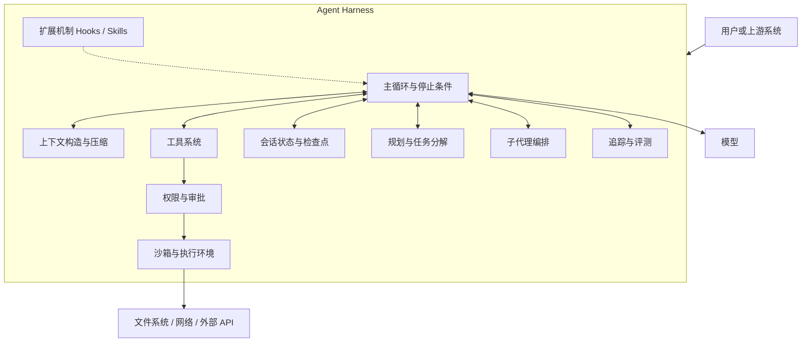
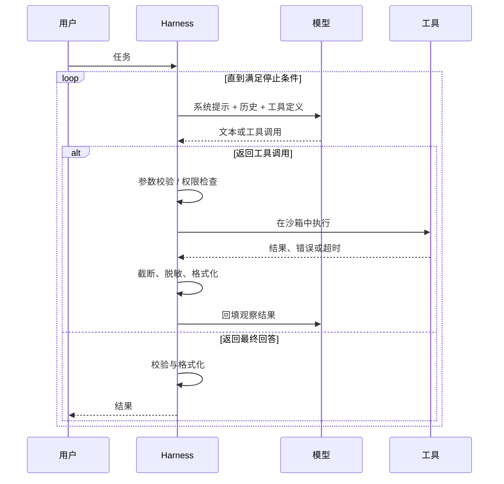

# 第 1 章 什么是 Agent Harness

## 本章导读

某团队用同一个模型做代码助手：演示时十轮内修完 Bug，上线后稍复杂的任务到第三十轮就开始重复读同一个文件；把报错贴回去，它道歉后继续同样的改法，还曾误删测试文件。换成更强的模型，前二十轮明显变好，长任务依旧崩溃。问题不在模型，而在模型外面缺了一层工程框架。本章要回答：这层框架是什么，它为什么决定了 Agent 的实际表现。

## 学习目标

读完本章你将能够：

- 用“模型之外的系统”这一定义，识别一个 Agent 产品中 Harness 的边界；
- 解释 Harness 的四项基本职责，以及它们如何把模型的概率输出收敛为有界动作；
- 描述 Agent 从 Prompt 链、ReAct 到原生工具调用循环的演进，说明每次演进解决了什么失败模式；
- 区分“模型能力上限”与“Harness 实现度”，并判断一个故障应该归因到哪一层；
- 读懂一个 60 行的最小 Harness，并指出它在生产环境中还缺什么。

## 1.1 核心概念：模型只是一个函数

调用一次大模型 API，本质上是一次无状态的函数调用：输入一组消息，输出下一段文本，或者一个结构化的工具调用请求。模型不知道上一次调用发生了什么，不能读文件，不能执行命令，也不能在两次调用之间等待。它甚至不知道自己刚才说过什么——除非你把历史重新放进输入。

这个事实听起来简单，却决定了 Agent 工程的全部形态。模型会写代码，但它不能把代码保存到磁盘；模型能规划步骤，但它不能保证第三步会被执行；模型能识别错误，但它看不到命令的真实退出码，除非有人把退出码告诉它。

所以，Agent 不是模型本身进化出的新物种，而是围绕这个函数搭出来的一套系统。本书给这套系统一个名字：**Agent Harness**（智能体执行框架，下文简称 Harness）。

先定义 **智能体（Agent）**：

> 智能体是一个以目标为输入，能够自主选择并执行动作、根据动作结果调整后续行为的软件系统。

这个定义包含三个条件：下一步做什么由系统在运行时决定；系统能作用于外部世界；动作结果会回到决策过程。缺一条就不是本书讨论的 Agent。只会回答问题的聊天机器人没有动作；按固定脚本依次调用五个 API 的工作流没有运行时决策；把工具结果丢掉、只根据模型臆测继续的“伪循环”没有真正的观察。

再定义 **Harness**：

> Agent Harness 是包在模型之外、把模型调用组织成可控执行过程的那层软件。它负责组装上下文、调度工具、维护状态、约束权限，并记录整个过程的轨迹。

它和常说的 Agent 框架（framework）、脚手架（scaffolding）有重叠，但侧重点不同：框架强调可复用的代码组织，脚手架强调为提升特定任务表现而临时搭建的结构，Harness 强调“模型之外、长期存在、负责把模型输出变成可控执行”的那一层。一个产品可以不用任何框架，但仍然有自己的 Harness。

有一个更直接的识别方法：把一个 Agent 任务拆开，所有不属于“模型推理”的部分，合起来就是 Harness。谁决定这一轮发哪些消息？谁解析模型返回的工具名和参数？谁检查这个命令能不能执行？谁把超长的文件输出截断？谁在失败后重试？谁把会话存下来以便明天继续？谁记录每一步的耗时和费用？答案都是 Harness。


**关键区分**：模型输出的是“提案”，Harness 决定是否把它变成“效果”。模型说“请执行 rm -rf build”，这只是文本；是否真的执行、在哪个目录执行、要不要先让用户确认，全部由 Harness 决定。这条边界是 Agent 安全性的地基。


## 1.2 引擎与整车：一个恰当的比喻，以及它的边界

理解模型与 Harness 的关系，最直观的比喻是发动机与整车。Harness 这个词原指马具：它不产生动力，却把马的动力传导到车上，并让车夫能控制方向与刹车。软件里的 Harness 借用了这层含义——不生产智能，只负责把智能安全、稳定地转化为行动。

模型是发动机：它决定功率上限、响应速度和燃油效率。Harness 是传动系统、底盘、刹车、转向、仪表盘和散热系统。一台 500 马力的发动机，如果变速箱匹配糟糕、刹车过热、轮胎抓不住地，赛道圈速可能还不如一台调校良好的 300 马力整车。反过来，底盘再好，也压榨不出发动机不存在的马力。

这个比喻能解释很多工程现象：

- **换模型像换发动机**。如果传动和散热没跟上，短距离加速会变快，长距离比赛仍然会退赛。这对应“换了更强模型，前二十轮变好，长任务依旧崩溃”。
- **圈速是系统指标，不是部件指标**。用户感知的是任务完成率、耗时和副作用，不是模型的 benchmark 分数。
- **匹配比堆料重要**。小模型配一个工具设计良好、上下文精简的 Harness，常常胜过大模型配一个混乱的 Harness。

但比喻有一个重要边界：汽车的底盘不会改变发动机的输入，而 Harness 会主动塑造模型看到的每一个 token。它不只是被动的传动装置，还是模型的“感官”和“工作台”。模型只能根据 Harness 给它的上下文做判断；上下文里少了关键文件，模型再强也只能猜。因此更准确的说法是：Harness 同时是整车、试车台和闭环控制系统。

由此可以得到一个粗略的归因框架——不是可计算的公式，而是排查问题的顺序：

> 实际表现 ≈ 模型在理想条件下的能力 × Harness 把能力转化为稳定行为的效率 × 任务与工具的匹配度

三者任意一项接近零，结果都接近零。下一节拆开看第二项具体包含什么。

## 1.3 Harness 的四项基本职责

不同产品的 Harness 形态差异很大，但职责可以归为四类，外加两条横切关注点。



### 1.3.1 循环控制

Harness 决定什么时候调用模型、什么时候执行工具、什么时候停下来。听起来只是 `while` 循环，真正难的是停止条件。

一个没有停止条件的 Agent 会以两种方式失控：一种是停不下来，反复读同一个文件、反复执行同一条失败命令；另一种是停得太早，模型说“完成了”，但测试根本没跑。生产级的循环至少需要四类刹车：模型明确结束、预算耗尽（步数、token、金额、时间）、检测到无进展、用户中断。第 2 章会展开讲这些条件如何组合。

### 1.3.2 上下文构造

每一轮调用前，Harness 要决定把哪些信息放进上下文：系统提示词、工具定义、历史消息、项目记忆、检索到的文件、上一步的工具结果。上下文窗口不是仓库，而是工作台。把所有东西都堆上去，模型会被无关信息稀释注意力；只放最近几条消息，模型又会忘记任务目标。

上下文构造的核心是预算分配：系统提示词占多少、历史占多少、工具结果占多少、留给模型输出多少。接近上限时还要压缩、摘要或把细节外置到文件系统。第 6 章专门讨论这套工程。

### 1.3.3 动作执行

模型返回工具调用后，Harness 负责一条完整的执行链：校验参数是否符合 Schema、检查当前权限是否允许、在沙箱中执行、把结果格式化成模型能理解的形式、必要时截断或脱敏。

这条链上任何一环缺失，都会把模型的一次错误放大成生产事故。路径参数没校验，模型可能写到仓库外面；命令没走沙箱，一次误删就无法挽回；结果没截断，一个巨大的日志文件会直接把上下文撑爆。第 5、10、11 章分别讲工具系统、沙箱和权限。

### 1.3.4 状态管理

消息历史不等于状态。一个可恢复的 Agent 还需要知道：当前任务计划是什么、哪些步骤已完成、改了哪些文件、最后一次验证结果如何。进程崩溃、用户关闭终端、任务跨天继续，都要求这些信息能落盘并从检查点恢复。

状态管理与上下文构造是一体两面：上下文是“这一轮给模型看什么”，状态是“系统真正记住了什么”。第 7 章会把二者拆开讲清楚。

### 1.3.5 两条横切关注点

**安全与权限**不单独属于某个模块。工具注册时要标记风险等级，执行前要检查策略，高风险动作要审批，所有动作要留审计日志。它像操作系统里的权限检查一样，贯穿每一次系统调用。

**可观测性与评测**同样贯穿全程。没有追踪，你只能看到最终答案，看不到模型在第 7 步选错了工具、第 12 步被权限拒绝后开始胡编。没有评测集，你无法判断一次 Harness 改动是让系统变好还是变坏。第 14、15 章分别处理这两件事。

下图是一轮典型交互的时序。注意两个容易忽略的点：工具结果必须先经过 Harness 的处理才回到模型；模型返回“最终回答”也只是提案，Harness 仍然可以做校验、格式化或拒绝。



## 1.4 从 Prompt 链到自主 Agent：Harness 的演进

Harness 不是一开始就长成这样。它是在模型能力变化和失败模式转移的过程中逐步长出来的。理解这条演进线，能帮我们判断哪些设计是权宜之计，哪些会长期保留。

| 阶段 | 控制流由谁决定 | 工具接口 | 主要瓶颈 | Harness 的核心工作 |
|---|---|---|---|---|
| Prompt 链 | 开发者预先编排 | 文本拼接 | 分支处理、错误传播 | 流程编排、格式解析 |
| ReAct | 模型在每一步决定 | 自由文本中的动作 | 解析鲁棒性、提示敏感 | 解析动作、容错、重试 |
| 原生工具调用 | 模型返回结构化调用 | JSON Schema | 上下文、权限、成本 | 校验、执行、上下文管理 |
| 长时运行 Agent | 模型 + 持久化状态机 | 多工具、MCP | 恢复、评测、多租户 | 状态、观测、编排、治理 |

**Prompt 链**把复杂任务拆成固定的几步，每步一个提示词。它适合步骤明确、输入输出稳定的任务，比如“抽取字段 → 校验 → 生成摘要”。一旦中间某步输出格式不对，整条链就会带着错误往下走；需要根据中间结果分支时，代码会迅速变成一团条件判断。

**ReAct** 让模型交替输出推理和动作，Harness 从自由文本里解析出“要调用哪个工具、参数是什么”。它把控制权交给了模型，灵活性大幅提升，但解析非常脆弱：模型换个说法、加一句解释、把工具名写错一个字母，解析就失败。很多早期的 Agent 框架大量精力花在“让模型稳定输出可解析格式”上。

**原生工具调用（Native Tool Calling / Function Calling）** 是分水岭。厂商 API 直接返回结构化的工具名和参数，Harness 不再需要从自然语言里猜动作，只要按 Schema 校验、分发、执行。可靠性提升的来源不是模型更聪明，而是接口从“自由文本”变成了“带类型的请求”。这正是 Harness 设计的典型思路：能靠协议约束的，不要靠提示词祈祷。

工具调用标准化之后，旧的瓶颈消失，新的瓶颈立刻出现。Agent 能跑几十轮以后，上下文会满、权限会失控、成本会失控、失败后无法恢复。于是 Harness 的重心从“解析动作”转向“管理执行过程”：压缩、审批、沙箱、检查点、追踪。

这条演进线有一个值得记住的规律：**Harness 的复杂度不会消失，只会转移。** 模型能力提升会吃掉一部分脚手架，但被吃掉的通常是“弥补模型短板”的部分；系统级的约束、状态、安全和观测不会因为模型变强而消失。第 19 章会回到这个问题，讨论“苦涩的教训”在 Agent 领域的适用边界。

## 1.5 能力上限与实现度

同一个模型在不同产品里的表现差异，常常被误读为“模型不稳定”。更准确的说法是：benchmark 测的是模型在固定 Harness 下的能力，产品跑的是模型在自家 Harness 下的实现度。

这两类失败需要不同的处理方式：

- **能力失败**：模型确实做不到。比如让它一次性推理一个超出上下文窗口的代码库，或者完成它没有学过的领域推理。换更强模型、拆小任务、补充工具，才是解法。
- **Harness 失败**：模型本可以做到，但系统没给它需要的信息、没让它执行、没接住它的错误。比如关键文件没放进上下文、工具结果被截断、权限拒绝后没有告诉模型原因、失败后没有重试。

一个实用的归因实验是“神谕上下文测试”（oracle context test）：由人把完成任务所需的精确信息直接放进提示词，包括正确的文件内容、命令输出和错误信息，再让模型做一次。如果这样能成功，说明模型能力够，问题在 Harness 的信息供给或执行链；如果仍然失败，才考虑能力问题。这个实验不能证明模型万能，但能快速排除大量误判。

再看长任务的可靠性。假设单步成功率是 95%，各步近似独立，连续 100 步全部成功的概率是：

```text
0.95 ^ 100 ≈ 0.0059
```

不到 0.6%。这不是说真实 Agent 一定这么低，因为步骤之间并不独立，Harness 也能纠错；但它揭示了一个关键事实：**长任务不是短任务的简单延长，而是误差累积。** 一个在 5 步任务里表现良好的系统，跑到 50 步可能完全不可用。

Harness 提升可靠性只有三个杠杆：

1. **减少步数**：更好的工具、更清晰的上下文、更合理的任务拆分，让模型少走弯路；
2. **提高单步成功率**：准确的工具描述、及时的观察结果、合适的模型选择；
3. **让失败可恢复**：检查点、重试、验证闭环、必要时回滚。

三个杠杆分别对应本书的不同章节。理解这一点，就不会把“Agent 不稳定”简单归咎于模型采样温度。

## 1.6 设计权衡：薄 Harness 与厚 Harness

Harness 的设计没有统一答案，但几乎所有选择都落在同一条轴上：把多少决策交给模型，把多少约束写进代码。把决策交给模型，系统更灵活，能享受模型升级带来的收益；把约束写进代码，系统更可预测，但可能限制模型发挥。

| 维度 | 薄 Harness | 厚 Harness |
|---|---|---|
| 下一步做什么 | 模型根据系统提示自行决定 | 状态机、规则或计划显式指定 |
| 上下文 | 尽量精简，依赖模型自行推理 | 主动注入计划、状态、校验结果 |
| 工具设计 | 少量通用工具，参数自由度高 | 大量专用工具，参数受约束 |
| 安全边界 | 依赖运行环境与模型自律 | 独立策略层、审批与沙箱 |
| 上手速度 | 快 | 慢 |
| 长任务稳定性 | 方差大，失败难复现 | 边界清晰，失败可定位 |
| 模型升级收益 | 直接，旧脚手架少 | 可能被过时约束拖住 |
| 维护成本 | 代码少，排障难 | 代码多，排障相对容易 |
| 典型场景 | 原型、只读探索、短任务 | 写操作、高风险、多租户产品 |

这张表最容易被误读成“厚就是好”或“薄就是先进”。两种误读都会付出代价。

厚 Harness 的典型失败是“用代码替模型思考”：把步骤写死、把输出格式卡死、遇到没见过的输入就报错。模型升级后，这些约束不再必要，却仍然限制着系统。薄 Harness 的典型失败是“把安全交给自觉”：没有权限检查、没有沙箱、没有预算，模型一次错误就造成不可逆的副作用。

更实用的原则是分层，而不是二选一：

- **决策路径尽量薄**：让模型决定读哪个文件、先改哪里、是否需要再查一次。这些是模型擅长、且会随模型升级变强的部分。
- **安全与观测尽量厚**：权限、沙箱、审计、追踪、预算，这些不随模型变聪明而消失，反而在自主性提高后更重要。
- **验证闭环必须存在**：无论薄厚，都要有独立于模型的检查——测试、类型检查、Schema 校验、人工审批。

还有一组相关权衡是自主性与可控性：

| 维度 | 高自主 | 高可控 |
|---|---|---|
| 谁决定下一步 | 模型 | 流程或规则 |
| 用户打断频率 | 低 | 高 |
| 副作用风险 | 高 | 低 |
| 流程灵活性 | 高 | 低 |
| 适合场景 | 只读探索、研究、原型 | 生产写操作、运维、金融 |

折中方案不是取中间值，而是**按风险分级**：只读操作默认自主执行，写操作根据影响范围升级审批，不可逆操作强制人工确认。这样既保留了探索阶段的效率，又给危险动作加上刹车。第 11 章会把这条原则落成具体的权限模型。

## 1.7 代码实践：约 60 行看清骨架

下面用一段可以离线运行的代码，把 Harness 的骨架从模型中剥离出来。我们用 `ScriptedModel` 代替真实模型，按固定脚本返回工具调用，这样不需要 API Key，也能完整观察循环、工具分发、观察回填和停止条件。

<details>
<summary>为什么这里不用真实模型 API</summary>

真实 API 会引入网络、密钥、计费和厂商协议差异，掩盖本章想展示的结构。第 3 章会接入真实模型，并处理流式输出、工具调用参数增量和错误语义。这里的脚本模型只负责证明一件事：Harness 的行为可以在模型之外被完整描述和测试。

</details>



```python
from __future__ import annotations

from dataclasses import dataclass, field
from pathlib import Path
from typing import Any, Callable


@dataclass
class Message:
    role: str          # user | assistant | tool
    content: str


@dataclass
class Step:
    kind: str                        # tool_call | final
    tool: str = ""
    args: dict[str, Any] = field(default_factory=dict)
    text: str = ""


class ScriptedModel:
    """用固定脚本代替真实模型，先单独观察 Harness 的骨架。"""

    def __init__(self, script: list[Step]) -> None:
        self.script = script
        self.cursor = 0

    def next(self, messages: list[Message]) -> Step:
        if self.cursor >= len(self.script):
            return Step("final", text="脚本已耗尽")
        step = self.script[self.cursor]
        self.cursor += 1
        return step


Tool = Callable[..., str]


def read_file(path: str) -> str:
    return Path(path).read_text(encoding="utf-8")


def count_lines(path: str) -> str:
    return str(len(Path(path).read_text(encoding="utf-8").splitlines()))


TOOLS: dict[str, Tool] = {
    "read_file": read_file,
    "count_lines": count_lines,
}


def run(
    task: str,
    model: ScriptedModel,
    tools: dict[str, Tool],
    max_steps: int = 8,
) -> str:
    messages = [Message("user", task)]

    for step_no in range(1, max_steps + 1):
        step = model.next(messages)
        if step.kind == "final":
            return step.text

        fn = tools.get(step.tool)
        try:
            observation = fn(**step.args) if fn else f"未知工具：{step.tool}"
        except Exception as exc:
            observation = f"工具执行失败：{type(exc).__name__}: {exc}"

        messages.append(Message("assistant", f"调用 {step.tool}，参数 {step.args}"))
        messages.append(Message("tool", observation))
        print(f"[step {step_no}] {step.tool} -> {observation!r}")

    raise RuntimeError(f"达到最大步数 {max_steps}，任务未完成")


if __name__ == "__main__":
    Path("demo.txt").write_text("alpha\nbeta\ngamma\n", encoding="utf-8")

    script = [
        Step("tool_call", "count_lines", {"path": "demo.txt"}),
        Step("tool_call", "read_file", {"path": "demo.txt"}),
        Step("final", text="demo.txt 共 3 行，内容为 alpha / beta / gamma。"),
    ]

    print(run("统计并阅读 demo.txt", ScriptedModel(script), TOOLS))
```



```typescript
import { readFileSync, writeFileSync } from "node:fs";

type Message = { role: "user" | "assistant" | "tool"; content: string };

type Step =
  | { kind: "tool_call"; tool: string; args: Record<string, unknown> }
  | { kind: "final"; text: string };

class ScriptedModel {
  script: Step[];
  cursor = 0;

  constructor(script: Step[]) {
    this.script = script;
  }

  next(_messages: Message[]): Step {
    return this.script[this.cursor++] ?? { kind: "final", text: "脚本已耗尽" };
  }
}

const tools: Record<string, (args: Record<string, unknown>) => string> = {
  read_file: ({ path }) => readFileSync(String(path), "utf-8"),
  count_lines: ({ path }) =>
    String(readFileSync(String(path), "utf-8").split("\n").length - 1),
};

function run(task: string, model: ScriptedModel, maxSteps = 8): string {
  const messages: Message[] = [{ role: "user", content: task }];

  for (let stepNo = 1; stepNo <= maxSteps; stepNo++) {
    const step = model.next(messages);
    if (step.kind === "final") return step.text;

    const fn = tools[step.tool];
    let observation: string;
    try {
      observation = fn ? fn(step.args) : `未知工具：${step.tool}`;
    } catch (error) {
      observation = `工具执行失败：${(error as Error).message}`;
    }

    messages.push({
      role: "assistant",
      content: `调用 ${step.tool}，参数 ${JSON.stringify(step.args)}`,
    });
    messages.push({ role: "tool", content: observation });
    console.log(`[step ${stepNo}] ${step.tool} -> ${JSON.stringify(observation)}`);
  }

  throw new Error(`达到最大步数 ${maxSteps}，任务未完成`);
}

writeFileSync("demo.txt", "alpha\nbeta\ngamma\n", "utf-8");

const script: Step[] = [
  { kind: "tool_call", tool: "count_lines", args: { path: "demo.txt" } },
  { kind: "tool_call", tool: "read_file", args: { path: "demo.txt" } },
  { kind: "final", text: "demo.txt 共 3 行，内容为 alpha / beta / gamma。" },
];

console.log(run("统计并阅读 demo.txt", new ScriptedModel(script)));
```



Python 版运行输出（TypeScript 版仅引号风格不同，结果一致）：

```text
[step 1] count_lines -> '3'
[step 2] read_file -> 'alpha\nbeta\ngamma\n'
demo.txt 共 3 行，内容为 alpha / beta / gamma。
```

这段代码只有六十多行，但已经包含五个关键决策点：

| 代码位置 | 承担的职责 | 对应章节 |
|---|---|---|
| `ScriptedModel.next(messages)` | 模型协议边界：输入上下文，输出结构化提案 | 第 3 章 |
| `TOOLS` 字典 | 工具注册与分发：按名称找到实现 | 第 5 章 |
| `messages.append(Message("tool", ...))` | 观察回填：把执行结果送回模型 | 第 2、6 章 |
| `max_steps` 与 `kind == "final"` | 停止条件：正常结束与预算耗尽 | 第 2 章 |
| `try / except` 转成 observation | 错误隔离：工具失败不应让进程崩溃 | 第 5 章 |

它同时暴露了生产环境必须补齐的能力：没有上下文预算与压缩，历史会无限增长；没有权限检查，任何工具都能执行；没有沙箱，文件操作直接作用于真实目录；没有持久化，进程退出后任务丢失；没有追踪，只能看到打印出来的几行日志；没有并行调用，多个独立工具只能串行等待。这些缺口构成了本书第二、三部分的主线。


不要把这段代码直接接到真实 Shell。它的 `tools` 只做了名称分发，没有参数校验、路径约束和权限检查。把模型输出直接拼进命令或路径，等同于把不可信输入直接交给操作系统。生产实现见第 5、10、11 章。


## 1.8 业界案例：Aider 的 Harness 设计

Aider 是一个在终端中工作的开源结对编程工具。它常被当作“另一个 AI 编程助手”，但从 Harness 的角度看，它更值得研究的是四个围绕失败模式设计的机制。

**仓库地图（Repo Map）** 解决“上下文放不下整个仓库”的问题。Aider 用 tree-sitter 解析代码，建立定义与引用之间的关系图，再按相关性排序，在固定 token 预算内挑出最该给模型看的代码片段。公开资料中提到它使用了图排序算法；具体实现可能随版本变化，以官方文档和源码为准。关键不在算法细节，而在于它把“上下文选择”做成了一个独立的、可调预算的组件，而不是把整个仓库硬塞进去。

**编辑格式（Edit Format）** 解决“模型直接写文件不可靠”的问题。Aider 让模型输出特定格式的修改块，由 Harness 解析并应用到文件，而不是让模型自由生成整份文件后覆盖。格式约束把模型的输出变成可校验的结构，降低了误改的概率；应用失败时，Harness 还能把错误反馈给模型重试。

**Git 自动提交** 解决“改坏了回不去”的问题。默认在每次成功修改后自动提交，用户可以用 diff 审查、用 Git 回滚。这把版本控制从“用户手动操作”变成了 Harness 的安全网。它不是模型能力，但没有它，自主修改文件的风险会高一个数量级。

**Lint / Test 反馈回路** 解决“改完不验证”的问题。修改后运行配置好的检查与测试，把失败信息回填给模型，让它继续修。这是把“观察”从“文件写成功了”提升到“代码真的能跑”的关键一步，也是第 8 章“反思与自我纠错”的工程基础。

| Aider 机制 | 针对的失败模式 | 本书对应主题 |
|---|---|---|
| 仓库地图 | 上下文装不下、无关代码干扰 | 第 6 章 上下文工程 |
| 编辑格式 | 模型直接覆盖文件、修改不可校验 | 第 5 章 工具系统 |
| Git 自动提交 | 改坏后无法回滚 | 第 7 章 检查点与回滚 |
| Lint / Test 回路 | 只改不验、错误被带到下一步 | 第 8 章 反思、第 15 章 评测 |

这个案例说明：Aider 的差异化不完全来自模型，而来自它把几个高频失败模式分别变成了 Harness 里的独立机制。换一个更强的模型，这些机制仍然有价值；换一个更弱的模型，它们能兜住更多错误。另一条路线是 Claude Code 这类产品，把权限审批、项目记忆文件、子代理和 Hooks 做成产品级接口，思路相同，只是把安全与扩展性放在了更显眼的位置。具体功能以各自官方文档为准。

## 1.9 常见陷阱

**陷阱一：把 Harness 问题当成 Prompt 问题。**
症状是不断往系统提示词里加“请不要重复”“请先读文件”“请务必运行测试”，短期有效，长任务依旧失效。原因是上下文增长后指令被稀释、状态没有显式维护。正确做法是改结构：把任务状态写进文件或检查点，压缩历史，给“完成”设可验证的条件，而不是继续堆提示词。

**陷阱二：没有预算和停止条件。**
症状是 Agent 在第 40 轮还在重试同一条命令，账单持续上涨。除了最大步数，还要有 token 预算、时间预算、无进展检测和用户中断。停止条件不是一行 `max_steps`，而是一组互相补充的刹车。

**陷阱三：信任模型生成的参数。**
模型给出的路径可能包含 `../`，命令可能带有破坏性参数，SQL 可能拼接了注入内容。模型输出应当被视为不可信输入：按 Schema 校验、按白名单限制、在沙箱中执行、高风险动作走审批。第 11 章会给出完整的分级模型。

**陷阱四：过早引入多代理。**
三个代理互相讨论看起来很先进，实际常常带来三倍成本、冲突的文件修改和难以定位的责任链。先用单代理把工具、上下文和验证做好；只有当子任务需要独立上下文、或者可以真正并行时，再引入子代理，并且用评测数据证明收益。

**陷阱五：只测最终答案。**
评测集全过，线上仍然不稳定，因为测试只看了答案对不对，没看它调用了哪些工具、走了多少步、有没有越权。轨迹级评测（trajectory evaluation）会检查工具选择、调用顺序、副作用和成本。第 15 章会把这件事做成可执行的流程。

## 1.10 本章小结

- 从 API 语义看，模型是一个无状态函数；Agent 是围绕它构建的、能行动和观察的系统。
- Harness 是模型之外的全部工程层，可以用“Agent 减去模型”来识别它的边界。
- Harness 的四项基本职责是循环控制、上下文构造、动作执行、状态管理；安全与可观测性是贯穿全程的两条横切关注点。
- 模型输出是提案，不是效果。Harness 负责校验、授权和执行，这条边界是 Agent 安全性的基础。
- 从 Prompt 链到 ReAct 再到原生工具调用，Harness 的复杂度没有消失，只是从“解析文本”转移到“管理执行过程”。
- 长任务的失败往往是指数级误差累积；提升可靠性靠减少步数、提高单步成功率、让失败可恢复。
- Aider 的案例表明，围绕高频失败模式设计独立机制，能在不换模型的情况下显著改变实际表现。

## 1.11 思考题

1. 回想一个你接触过的 Agent 产品。列出它至少三项“模型之外”的行为，并判断它们分别属于 Harness 的哪项职责。如果去掉其中一项，用户最先感知到的退化是什么？
2. 你的业务里，哪些失败属于能力失败，哪些属于 Harness 失败？设计一个“神谕上下文测试”，用最小成本把两者区分开。
3. 如果明天的模型上下文扩大十倍、工具调用完全可靠，你会删掉 Harness 的哪些部分？哪些部分无论模型多强都不能删？请给出判断理由。
