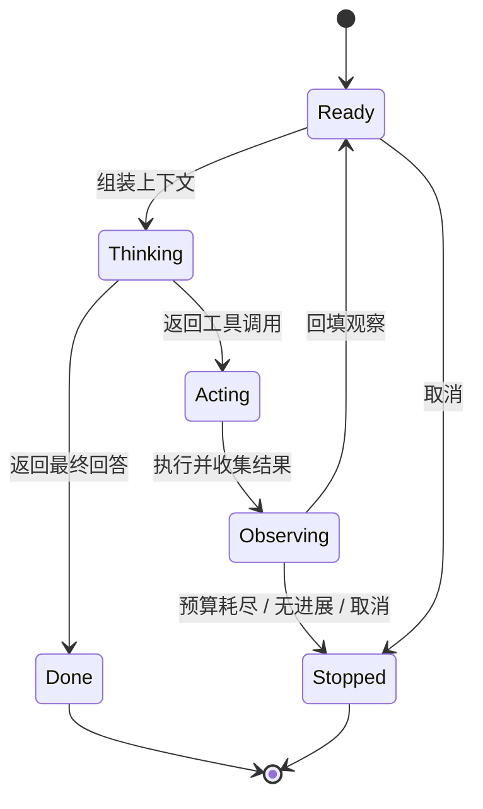

# 第 2 章 Agent Loop 剖析

## 本章导读

一个修测试的 Agent 在第 12 步已经改完代码，模型说“完成”，但测试根本没跑；第 18 步它开始重复读同一个文件，账单涨了三倍。事后检查，循环只有一句 `while True` 和一个“没有工具调用就退出”的判断。本章拆开这个循环：它有哪些状态、什么时候该停、流式与中断如何不破坏已有状态。

## 学习目标

读完本章你将能够：

- 用状态机描述一次 Agent 执行，区分轮（Turn）、步（Step）与会话（Session）；
- 设计六类停止条件，并说明它们的检查时机与优先级；
- 实现一个支持预算、无进展检测、并行工具调用和协作取消的主循环；
- 正确处理流式输出与用户中断，避免半截参数和脏状态；
- 诊断空转、早停、重复动作、取消后状态不一致等常见循环故障。

## 2.1 核心概念：循环是一个状态机

去掉所有产品包装，Agent 的核心是一个循环。最小版本可以短到十几行：

```text
messages = [用户任务]
while True:
    response = 模型(messages, 工具定义)
    if not response.tool_calls:
        return response.text
    for call in response.tool_calls:
        messages.append(执行(call))
```

这段伪代码能跑通演示，但不能上生产。它没有预算，可能永远转下去；没有类型化的退出原因，监控无法区分“完成”和“耗尽”；没有取消，用户按 Ctrl+C 后状态不确定；没有无进展检测，模型会反复执行同一个失败动作；没有并行策略，独立工具只能串行等待。

生产级循环不是把 `while True` 写得更长，而是把它显式化为一个状态机。状态机带来的第一个好处是**每个退出路径都有名字**。调用方需要知道任务为什么结束，才能决定是重试、上报、压缩上下文还是回滚。

先统一下术语，本书后续章节都按这个口径使用：

| 概念 | 定义 | 边界 |
|---|---|---|
| 任务（Task） | 用户或上游系统交付的一个目标 | 从接收目标到产出最终结果 |
| 会话（Session） | 一次连续交互的边界 | 可以包含多个任务，也可跨进程恢复 |
| 轮（Turn） | 一次模型调用及其触发的全部工具执行与结果回填 | 一轮内可能有多个工具调用 |
| 步（Step） | 循环中的一次原子动作 | 一次模型调用，或一次工具执行 |

一轮可以包含多步。例如模型一次返回三个并行工具调用，这是一轮、三次工具执行。把“轮”和“步”混用，会导致预算计算和追踪粒度都出错。

循环还有三条不变量，任何实现都应该满足：

1. **每个副作用都有观察记录**：工具成功、失败、超时、被取消，都必须以某种形式回到消息或状态里；悄悄丢弃结果，模型下一轮就会基于错误假设行动。
2. **每次迭代都消耗预算，且预算在执行前检查**：先执行再判断是否超支，等于允许最后一次无限制消耗。
3. **每次退出都有类型化原因**：完成、步数耗尽、预算耗尽、无进展、取消、策略终止，必须是不同的值。

一个关键认识是：**模型不持有状态，Harness 持有状态。** 模型每一轮看到的只是 Harness 序列化后的上下文。循环真正管理的是状态，消息只是状态的一种投影。第 6、7 章会把这条线展开。



## 2.2 循环的六个阶段

把“感知—思考—行动—观察”落到工程上，一次迭代可以拆成六个阶段。这个拆分不是为了好看，而是为了给每个失败模式找到归属。

**一、组装上下文。** Harness 从状态里挑出这一轮要发给模型的内容：系统提示词、工具定义、最近的消息、压缩后的历史、检索到的文件、上一步的观察。这里的常见错误是“把状态原样序列化”——状态里可能有几十兆的工具输出，直接发会把上下文撑爆。上下文构造是有损投影，不是状态复制。

**二、调用模型。** 这是一次网络请求，可能超时、被限流、返回内容过滤错误。循环要把这些错误和“模型正常拒绝”区分开：前者通常重试，后者应该作为结果返回。重试策略属于模型接入层，第 3 章展开。

**三、解析响应。** 响应里可能包含文本、一个或多个工具调用、停止原因。原生工具调用返回结构化对象，解析相对可靠；但参数仍然可能不符合业务约束，需要下一步校验。需要特别强调：模型内部的推理过程不是稳定的 API，不要把它当作控制信号来解析。循环只依赖结构化的工具调用和明确的完成信号。

**四、执行动作。** 按顺序或并行执行工具调用。执行前要做参数校验、权限检查、沙箱检查；执行中要有超时；执行后要把结果格式化。第 5、10、11 章分别处理这些环节。循环本身只负责调度，不应该把安全逻辑散落在各处。

**五、回填观察。** 把结果写回消息或状态。成功结果要带足够的信息让模型判断下一步；错误结果要带错误类型和可操作的提示，而不是一句“失败了”。过长的输出要截断，并明确告诉模型“已截断，完整内容在某个文件里”。观察的格式直接决定模型下一轮的质量，第 5 章会给出设计原则。

**六、判定继续还是停止。** 检查取消、预算、无进展、完成条件，决定下一轮还是退出。这是本章的核心，下一节展开。

六个阶段里，模型只占一个。其余五个都是 Harness 的工作。这也解释了为什么“换个更强的模型”不能自动解决循环问题：循环的缺陷不在模型里面。

## 2.3 停止条件：六类刹车

停止条件是 Agent Loop 最容易写错的部分。只写 `max_steps` 不够，只依赖模型说“完成”更危险。生产循环通常需要六类刹车，它们解决不同的问题。

| 停止条件 | 检查时机 | 典型实现 | 主要风险 |
|---|---|---|---|
| 自然完成 | 模型响应后 | 没有工具调用，或返回明确的终止信号 | 模型假完成 |
| 步数预算 | 每轮开始前 | `max_steps` | 长任务被粗暴截断 |
| Token / 成本预算 | 模型调用前后 | 累计 usage，与预算比较 | 计费口径不一致 |
| 时间预算 | 每轮与每次工具执行 | deadline、工具超时 | 长工具难以中断 |
| 无进展检测 | 观察回填后 | 动作与观察的签名重复 | 误杀合法重试 |
| 取消 / 策略终止 | 任意安全点 | 取消令牌、策略引擎 | 状态不一致 |

有些系统还会加“连续错误阈值”：连续 N 次工具失败就停止，避免模型在坏环境中反复撞墙。它和无进展检测有重叠，但触发条件不同——错误阈值看结果状态，无进展看行为重复。

这些条件不是平级的，需要定义优先级。一个可用的顺序是：

1. **取消优先**：用户或上游已经要求停止，不再发起新的模型调用或工具执行；
2. **硬预算其次**：步数、金额、时间已经耗尽，立即退出，不再给模型“最后一次机会”；
3. **自然完成**：模型返回最终回答且没有工具调用；
4. **无进展与错误阈值**：执行完一批工具后检查，命中则停止并保留现场；
5. **软预算**：接近上限时降级，例如改用小模型、减少检索、要求模型总结收尾。

顺序会影响行为。如果先检查自然完成再检查取消，用户按下停止后可能还会多执行一轮工具；如果先检查无进展再检查预算，预算耗尽的报告会被误标成“无进展”。

### 2.3.1 预算不是一个数字

多数实现只设一个 `max_steps`，把预算理解成“最多转几圈”。生产环境至少要区分五类资源：

| 预算 | 计量单位 | 检查点 | 超支处理 |
|---|---|---|---|
| 轮数 / 工具数 | turn、tool call | 每轮或每批执行前 | 停止并保留现场 |
| Token | 输入 + 输出 | 每次模型调用前后 | 压缩上下文、降级模型或停止 |
| 金额 | 按厂商计价 | 调用前估算、调用后按实际 | 停止或切换更便宜的模型 |
| 时间 | 墙钟时间 | 每轮与每次工具执行 | 取消当前工具并停止 |
| 单次观察长度 | token 或字节 | 工具结果回填前 | 截断，完整内容落盘 |

预算的关键不是上限本身，而是分配。一个任务有总预算，每一轮、每次工具、每段观察都应该有子预算。否则模型一次读入巨大文件，就会吃掉整轮预算；或者一个长工具占满时间，其他步骤没有机会执行。先分配、再消费，超支时才知道该压缩哪一部分。

Token 统计还有一个常见坑：不要用本地估算的 token 数替代厂商返回的 usage。缓存命中、推理 token、工具调用的计费口径在不同厂商之间并不一致，本地分词器最多只能做预检，最终结算应以 API 返回的 usage 为准。预算还应该带上“已用多少、还剩多少”的可观测性，每轮把这两个值写进追踪，事后才能解释清楚任务为什么停在第 17 步。第 16 章会展开讲成本优化。

### 2.3.2 模型说完成，不等于任务完成

自然完成是最诱人、也最容易出错的停止条件。模型说“已经修复”，可能只是它认为修复了；测试没跑、类型没检查、文件没保存，都是常见情况。

| 策略 | 延迟与成本 | 假阳性风险 | 适用场景 |
|---|---|---|---|
| 信任模型自报完成 | 最低 | 最高 | 只读问答、低风险草稿 |
| 外部验证后完成 | 较高 | 最低 | 代码修改、数据变更、运维操作 |
| 混合：自报后验证 | 中等 | 较低 | 生产环境默认 |

混合模式的做法是：模型返回完成信号后，Harness 运行一个独立的验证器（测试、类型检查、Schema 校验、人工审批），把验证结果作为新的观察回填。验证失败就继续循环，但限制验证轮数，避免陷入“改—验—改”的死循环。

这里有一个重要的架构原则：**完成是模型的声明，验证是 Harness 的证据。** 声明可以触发验证，但不能替代验证。第 8 章会把验证闭环和反思机制合在一起讲。

## 2.4 单轮、多轮与多步

这三个词经常被混用，导致预算和状态管理错位。

| 场景 | 用户视角 | 内部循环 | 主要风险 |
|---|---|---|---|
| 单轮问答 | 一问一答 | 0～1 次模型调用 | 基本没有循环问题 |
| 多轮对话 | 连续追问，保留上下文 | 每个用户消息可能触发一次任务循环 | 历史膨胀、指代漂移 |
| 多步任务 | 一个请求，后台执行很久 | 多轮模型调用与工具执行 | 预算、状态、验证、取消 |

一个编码 Agent 处理“修复这个 Bug”时，用户只发了一条消息，但内部可能跑三十轮，这是多步任务，不是多轮对话。一个客服机器人连续回答五个问题，每轮可能调用一次订单查询工具，这是多轮对话，每轮内部只有很小的循环。

两者的区别在于**循环的嵌套关系**。多轮对话通常有一个外层会话循环，每个用户消息进来后，可能启动一个内层任务循环；多步任务只有一个内层循环，外层只是等待结果。把两层循环的状态混在一个消息数组里，会出现“上一轮任务的历史污染下一轮任务”的问题。第 7 章会用会话与任务两级状态来拆开它们。

## 2.5 流式输出与中断

流式输出改变的是事件粒度，不是循环语义。模型仍然要在流结束后给出一个完整响应，循环才能决定下一步。

流式事件大致分三类：文本增量、工具调用增量、结束事件。文本增量可以直接展示给用户；工具调用的参数可能分多段到达，必须等参数完整、JSON 可解析后才能执行。提前拿半截参数去调用工具，轻则报错，重则用错误路径执行了写操作。

| 事件 | 时机 | 典型用途 |
|---|---|---|
| `turn_started` | 开始调用模型 | 计时、UI 状态 |
| `text_delta` | 文本增量到达 | 打字机效果 |
| `tool_call_started` | 模型开始生成某个调用 | 提前展示“正在准备” |
| `tool_call_args_delta` | 参数片段到达 | 可选地展示进度，不执行 |
| `tool_call_ready` | 参数完整且可解析 | 进入执行队列 |
| `tool_started` / `tool_finished` | 工具执行前后 | 进度、耗时、审计 |
| `turn_finished` | 本轮所有工具结果回填完毕 | 更新预算、检查停止条件 |
| `loop_stopped` | 循环退出 | 上报停止原因、保存检查点 |

中断比流式更棘手，因为它要求在任意时刻保证状态一致。取消通常分三个层次：

1. **停止发起新动作**：不再调用模型、不再开始新的工具。这是最容易做到的，检查一个取消令牌即可。
2. **中断当前动作**：终止正在进行的 HTTP 流、杀死沙箱中的子进程、给长工具发取消信号。这一层依赖具体工具的配合，不能只靠循环里的 `if cancelled`。
3. **处理已发生的副作用**：文件可能只写了一半，数据库事务可能已提交，外部 API 可能已经执行。这一层需要原子写、事务、幂等键或补偿操作。

很多实现只做了第一层，然后声称“支持取消”。用户看到的是任务停了，但磁盘上留下了半截文件，下次恢复时状态更乱。

取消还需要区分语义：用户主动取消，通常应该保存现场、允许之后继续；请求超时，可能适合重试；策略引擎终止，应该记录原因并禁止自动恢复。三者在循环里都应该有独立的停止原因，而不是统一返回一个 `cancelled`。

## 2.6 设计权衡

### 2.6.1 交错决策，还是先规划后执行

| 维度 | 交错式（Interleaved） | 先规划（Plan-then-Execute） |
|---|---|---|
| 控制方式 | 每一步根据最新观察决定下一步 | 先产出完整计划，再按计划执行 |
| 适应性 | 高，能随时改路线 | 低，偏离计划需要重规划 |
| 长任务稳定性 | 容易迷失目标 | 目标明确，进度可检查 |
| 成本 | 每步一次模型调用 | 规划一次，执行可能更省 |
| 适用场景 | 探索、调试、信息不完整 | 步骤清晰、可预先分解的任务 |

生产系统常用混合模式：先让模型产出一个轻量计划，作为检查点写入状态；执行时仍然逐步决策，发现偏离就重规划。计划是导航，不是合同。第 8 章会把这种模式展开成待办列表与计划模式。

### 2.6.2 串行执行，还是并行执行

| 维度 | 串行工具调用 | 并行工具调用 |
|---|---|---|
| 延迟 | 累加每个工具耗时 | 取最慢的那个工具 |
| 依赖处理 | 天然有序，后一个能看到前一个结果 | 只适合互不依赖的调用 |
| 错误处理 | 一个失败可以立即停止后续 | 需要定义部分失败的合并策略 |
| 副作用安全 | 容易保证顺序 | 并发写可能冲突 |
| 适用场景 | 有依赖、有写操作 | 只读查询、独立检索、批量检查 |

并行不是“打开一个开关”的性能优化，而是一个依赖判断问题。循环必须在执行前知道哪些调用互不依赖；如果不知道，保守地串行执行。即使并行，结果的回填顺序也应该稳定，否则同一份轨迹每次运行都不一样，调试和评测都会失去可比性。

## 2.7 代码实践：一个带刹车的主循环

下面的实现把本章的几个关键点落到代码里：类型化停止原因、步数预算、基于“动作 + 观察”的无进展检测、并行安全判断、协作取消。仍然用 `ScriptedModel` 隔离真实模型，重点观察循环控制。



```python
from __future__ import annotations

import hashlib
import json
from concurrent.futures import ThreadPoolExecutor
from dataclasses import dataclass, field
from enum import Enum
from pathlib import Path
from typing import Any, Callable, Optional


class StopReason(str, Enum):
    COMPLETED = "completed"
    MAX_STEPS = "max_steps"
    NO_PROGRESS = "no_progress"
    CANCELLED = "cancelled"


@dataclass(frozen=True)
class ToolCall:
    id: str
    name: str
    args: dict[str, Any]


@dataclass
class ModelResponse:
    text: str = ""
    tool_calls: list[ToolCall] = field(default_factory=list)


@dataclass
class Message:
    role: str
    content: str
    tool_call_id: Optional[str] = None


@dataclass
class LoopResult:
    reason: StopReason
    answer: str
    messages: list[Message]
    events: list[str]


class CancelToken:
    def __init__(self) -> None:
        self.cancelled = False

    def cancel(self) -> None:
        self.cancelled = True


class ScriptedModel:
    def __init__(self, responses: list[ModelResponse]) -> None:
        self.responses = responses
        self.cursor = 0

    def complete(self, messages: list[Message]) -> ModelResponse:
        if self.cursor >= len(self.responses):
            return ModelResponse(text="脚本已耗尽")
        response = self.responses[self.cursor]
        self.cursor += 1
        return response


Tool = Callable[..., str]
TOOLS: dict[str, Tool] = {
    "read_file": lambda path: Path(path).read_text(encoding="utf-8"),
    "count_lines": lambda path: str(
        len(Path(path).read_text(encoding="utf-8").splitlines())
    ),
}
PARALLEL_SAFE = {"read_file", "count_lines"}


def execute(call: ToolCall, cancel: CancelToken) -> str:
    if cancel.cancelled:
        return "已取消，未执行"
    fn = TOOLS.get(call.name)
    if fn is None:
        return f"错误：未知工具 {call.name}"
    try:
        return fn(**call.args)
    except Exception as exc:
        return f"错误：{type(exc).__name__}: {exc}"


def execute_batch(calls: list[ToolCall], cancel: CancelToken) -> list[str]:
    if len(calls) > 1 and all(c.name in PARALLEL_SAFE for c in calls):
        with ThreadPoolExecutor(max_workers=4) as pool:
            return list(pool.map(lambda c: execute(c, cancel), calls))
    return [execute(c, cancel) for c in calls]


def signature(call: ToolCall, observation: str) -> str:
    payload = json.dumps(
        [call.name, call.args, observation], sort_keys=True, default=str
    )
    return hashlib.sha256(payload.encode("utf-8")).hexdigest()[:12]


def run_loop(
    task: str,
    model: ScriptedModel,
    *,
    max_steps: int = 6,
    max_identical: int = 3,
    cancel: Optional[CancelToken] = None,
) -> LoopResult:
    cancel = cancel or CancelToken()
    messages = [Message("user", task)]
    events: list[str] = []
    last_signature: Optional[str] = None
    identical = 0

    for step in range(1, max_steps + 1):
        if cancel.cancelled:
            return LoopResult(StopReason.CANCELLED, "任务已取消", messages, events)

        response = model.complete(messages)
        events.append(f"step {step}: model -> {len(response.tool_calls)} call(s)")

        if not response.tool_calls:
            return LoopResult(StopReason.COMPLETED, response.text, messages, events)

        calls = ", ".join(c.name for c in response.tool_calls)
        messages.append(Message("assistant", f"{response.text} [calls: {calls}]"))
        observations = execute_batch(response.tool_calls, cancel)

        for call, observation in zip(response.tool_calls, observations):
            messages.append(Message("tool", observation, call.id))
            events.append(f"step {step}: {call.name} -> {observation[:40]!r}")

            sig = signature(call, observation)
            identical = identical + 1 if sig == last_signature else 1
            last_signature = sig
            if identical >= max_identical:
                return LoopResult(
                    StopReason.NO_PROGRESS, "检测到重复动作，停止", messages, events
                )
            if cancel.cancelled:
                return LoopResult(
                    StopReason.CANCELLED, "任务已取消", messages, events
                )

    return LoopResult(
        StopReason.MAX_STEPS, f"达到最大步数 {max_steps}", messages, events
    )


if __name__ == "__main__":
    Path("a.txt").write_text("alpha\nbeta\n", encoding="utf-8")
    Path("b.txt").write_text("one\ntwo\nthree\n", encoding="utf-8")

    success = [
        ModelResponse(tool_calls=[
            ToolCall("c1", "count_lines", {"path": "a.txt"}),
            ToolCall("c2", "count_lines", {"path": "b.txt"}),
        ]),
        ModelResponse(text="a.txt 有 2 行，b.txt 有 3 行。"),
    ]
    result = run_loop("统计两个文件", ScriptedModel(success))
    print(result.reason.value, result.answer)

    stuck = [
        ModelResponse(tool_calls=[ToolCall(f"c{i}", "read_file", {"path": "a.txt"})])
        for i in range(5)
    ]
    result = run_loop("读取 a.txt", ScriptedModel(stuck), max_identical=3)
    print(result.reason.value, result.answer)

    token = CancelToken()
    token.cancel()
    result = run_loop("任意任务", ScriptedModel([]), cancel=token)
    print(result.reason.value, result.answer)
```



```typescript
import { readFile, writeFile } from "node:fs/promises";

type StopReason = "completed" | "max_steps" | "no_progress" | "cancelled";
type ToolCall = { id: string; name: string; args: Record<string, unknown> };
type ModelResponse = { text?: string; toolCalls?: ToolCall[] };
type Message = {
  role: "user" | "assistant" | "tool";
  content: string;
  toolCallId?: string;
};
type LoopResult = {
  reason: StopReason;
  answer: string;
  messages: Message[];
  events: string[];
};

class CancelToken {
  cancelled = false;
  cancel() {
    this.cancelled = true;
  }
}

class ScriptedModel {
  responses: ModelResponse[];
  cursor = 0;

  constructor(responses: ModelResponse[]) {
    this.responses = responses;
  }

  complete(_messages: Message[]): ModelResponse {
    return this.responses[this.cursor++] ?? { text: "脚本已耗尽" };
  }
}

type Tool = (args: Record<string, unknown>) => Promise<string>;

const tools: Record<string, Tool> = {
  read_file: async ({ path }) => readFile(String(path), "utf-8"),
  count_lines: async ({ path }) => {
    const content = await readFile(String(path), "utf-8");
    return String(content.split("\n").length - 1);
  },
};
const parallelSafe = new Set(["read_file", "count_lines"]);

async function execute(call: ToolCall, cancel: CancelToken): Promise<string> {
  if (cancel.cancelled) return "已取消，未执行";
  const fn = tools[call.name];
  if (!fn) return `错误：未知工具 ${call.name}`;
  try {
    return await fn(call.args);
  } catch (error) {
    return `错误：${(error as Error).message}`;
  }
}

async function executeBatch(
  calls: ToolCall[],
  cancel: CancelToken,
): Promise<string[]> {
  if (calls.length > 1 && calls.every((c) => parallelSafe.has(c.name))) {
    return Promise.all(calls.map((call) => execute(call, cancel)));
  }
  const results: string[] = [];
  for (const call of calls) results.push(await execute(call, cancel));
  return results;
}

function signature(call: ToolCall, observation: string): string {
  return JSON.stringify([call.name, call.args, observation]);
}

async function runLoop(
  task: string,
  model: ScriptedModel,
  options: { maxSteps?: number; maxIdentical?: number; cancel?: CancelToken } = {},
): Promise<LoopResult> {
  const maxSteps = options.maxSteps ?? 6;
  const maxIdentical = options.maxIdentical ?? 3;
  const cancel = options.cancel ?? new CancelToken();
  const messages: Message[] = [{ role: "user", content: task }];
  const events: string[] = [];
  let lastSignature: string | undefined;
  let identical = 0;

  for (let step = 1; step <= maxSteps; step++) {
    if (cancel.cancelled) {
      return { reason: "cancelled", answer: "任务已取消", messages, events };
    }

    const response = model.complete(messages);
    const calls = response.toolCalls ?? [];
    events.push(`step ${step}: model -> ${calls.length} call(s)`);

    if (calls.length === 0) {
      return { reason: "completed", answer: response.text ?? "", messages, events };
    }

    messages.push({
      role: "assistant",
      content: `${response.text ?? ""} [calls: ${calls.map((c) => c.name).join(", ")}]`,
    });
    const observations = await executeBatch(calls, cancel);

    for (let index = 0; index < calls.length; index++) {
      const call = calls[index];
      const observation = observations[index];
      messages.push({ role: "tool", content: observation, toolCallId: call.id });
      events.push(
        `step ${step}: ${call.name} -> ${JSON.stringify(observation.slice(0, 40))}`,
      );

      const sig = signature(call, observation);
      identical = sig === lastSignature ? identical + 1 : 1;
      lastSignature = sig;
      if (identical >= maxIdentical) {
        return {
          reason: "no_progress",
          answer: "检测到重复动作，停止",
          messages,
          events,
        };
      }
      if (cancel.cancelled) {
        return { reason: "cancelled", answer: "任务已取消", messages, events };
      }
    }
  }

  return {
    reason: "max_steps",
    answer: `达到最大步数 ${maxSteps}`,
    messages,
    events,
  };
}

await writeFile("a.txt", "alpha\nbeta\n", "utf-8");
await writeFile("b.txt", "one\ntwo\nthree\n", "utf-8");

const success = new ScriptedModel([
  {
    toolCalls: [
      { id: "c1", name: "count_lines", args: { path: "a.txt" } },
      { id: "c2", name: "count_lines", args: { path: "b.txt" } },
    ],
  },
  { text: "a.txt 有 2 行，b.txt 有 3 行。" },
]);
const r1 = await runLoop("统计两个文件", success);
console.log(r1.reason, r1.answer);

const stuck = new ScriptedModel(
  Array.from({ length: 5 }, (_, i) => ({
    toolCalls: [{ id: `c${i}`, name: "read_file", args: { path: "a.txt" } }],
  })),
);
const r2 = await runLoop("读取 a.txt", stuck, { maxIdentical: 3 });
console.log(r2.reason, r2.answer);

const token = new CancelToken();
token.cancel();
const r3 = await runLoop("任意任务", new ScriptedModel([]), { cancel: token });
console.log(r3.reason, r3.answer);
```



Python 版运行输出：

```text
completed a.txt 有 2 行，b.txt 有 3 行。
no_progress 检测到重复动作，停止
cancelled 任务已取消
```

代码里有几个值得注意的设计：

| 代码位置 | 设计意图 | 说明 |
|---|---|---|
| `StopReason` | 类型化退出 | 调用方可以根据不同原因决定重试、上报或恢复 |
| 循环顶部检查取消 | 取消优先 | 不再发起新的模型调用 |
| 回填后检查取消 | 覆盖工具执行期间取消 | 但无法中断已经运行的工具，需要工具自身配合 |
| `signature(call, observation)` | 无进展检测 | 同时比较动作和观察，避免误杀“同动作不同结果”的合法重试 |
| `PARALLEL_SAFE` | 保守并行 | 只有全部调用都标记安全时才并行，未知依赖一律串行 |
| `execute` 捕获异常并转成字符串 | 错误即观察 | 工具失败不会打崩循环，模型能看到错误并调整 |
| `zip(calls, observations)` | 结果顺序稳定 | 并行执行后仍按原调用顺序回填 |

这段代码仍然是教学实现。它没有实现 token 与金额预算，没有真正的流式解析，消息里的工具调用被压成了文本，工具执行也没有沙箱和权限检查。第 3 章会接入真实模型协议，第 5、10、11 章会补上执行安全，第 14 章会把 `events` 换成结构化追踪。


协作取消只检查边界，不会自动杀死正在执行的工具。生产环境需要给工具传取消信号、设置超时，并由沙箱负责终止子进程。对写操作还要保证原子性或幂等，否则取消后可能留下半截状态。


## 2.8 业界案例：LangGraph 的显式循环

LangGraph 把 Agent 建模为状态图（StateGraph）：开发者定义状态结构、节点函数和条件边，运行时按图执行。它没有把循环藏在框架内部，而是把循环的骨架暴露给开发者。这个选择与本章的主张一致：生产循环应该是显式的。

它有几个机制直接对应本章的概念：

| LangGraph 机制 | 对应本章概念 | 解决的问题 |
|---|---|---|
| 状态 Schema | Harness 持有状态 | 明确哪些字段跨轮保留、哪些只在单轮使用 |
| 条件边 | 继续 / 停止判定 | 把下一步路由写成可读的规则 |
| Checkpointer | 会话与检查点 | 每步持久化，进程中断后可以恢复 |
| `interrupt` | 人在回路暂停 | 在执行中暂停，等待人工输入后继续 |
| `recursion_limit` | 步数预算 | 防止图无限循环，超出时抛出错误 |
| 流式输出 | 事件粒度 | 向外暴露中间状态与节点更新 |

其中 `recursion_limit` 是一个典型的硬预算：它不是提示词里的“请尽快结束”，而是运行时强制的上限。超出上限时，框架抛出明确的错误，而不是静默返回一个半成品。这比让模型自己数步数可靠得多。

Checkpointer 与 `interrupt` 的组合则解决了本章开头的场景：任务可以在第 12 步暂停，等用户确认测试结果，再从检查点继续，而不是从头再来。需要注意的是，恢复的前提是副作用可对账——如果第 12 步已经提交了一次外部请求，恢复时必须知道它成功了还是失败了。框架能保存状态，但不能替业务保证幂等。

具体 API 与默认值可能随版本变化，使用前以 LangGraph 官方文档为准。这里要学的不是某个类的名字，而是它体现的设计共识：**显式状态、持久化检查点、硬预算、可暂停、可流式观察**。主流的长任务 Harness 基本都在朝这五个方向收敛。

## 2.9 常见陷阱

**陷阱一：把演示循环直接当生产循环。**
`while True` 加“没有工具调用就退出”只能证明流程能跑通。它缺少类型化的退出原因、取消和无进展检测，预算也常常只有轮数一个维度：模型一轮返回二十个工具调用，`max_steps=5` 仍然可能执行一百次操作。先把 `StopReason` 和预算维度定义清楚，再写循环。

**陷阱二：把模型自报完成当作唯一停止条件。**
模型说“已修复”时，测试可能没跑、文件可能没保存。对写操作至少加一层外部验证，并限制验证轮数，避免“改—验—改”的空转。

**陷阱三：无进展检测只看动作，不看观察。**
“再读一次文件”可能是合法重试，因为文件已经被上一步修改；只看动作会把这种重试误判为死循环。同时比较动作和观察，才能在“重复且无新信息”时停下来。反过来，只比较文本相似度也不行，模型换个说法就能绕过检测。

**陷阱四：流式时提前执行半截工具参数。**
工具调用参数是分片到达的，JSON 没闭合就解析，可能得到错误路径或空参数。必须等参数完整并通过 Schema 校验后再执行。UI 可以提前展示“正在准备调用”，但执行队列只能接收完整调用。

**陷阱五：取消后不处理已发生的副作用。**
循环停了，文件写了一半，外部请求已经发出。取消要分三层处理：停止新动作、中断当前动作、对账或回滚已发生动作。第三层最容易被忽略，也最容易在恢复时造成重复副作用。

## 2.10 本章小结

- Agent Loop 的本质是状态机，不是 `while True`；它管理状态，模型只看到上下文的投影。
- 一次迭代分为组装上下文、调用模型、解析响应、执行动作、回填观察、判定停止六个阶段，模型只占其中一个。
- 停止条件至少包括自然完成、步数预算、成本预算、时间预算、无进展、取消六类，并需要明确优先级。
- 模型自报完成只是声明，外部验证才是证据；生产环境默认采用“自报后验证”的混合模式。
- 单轮、多轮、多步是三个不同粒度，嵌套循环的状态必须分开管理。
- 流式改变事件粒度，不改变循环语义；工具参数必须完整后才能执行。
- 取消分三层：停止新动作、中断当前动作、处理已发生的副作用；只做第一层不算真正支持取消。
- 并行工具调用是依赖判断问题，只对互不依赖的调用并行，并保持结果回填顺序稳定。
- LangGraph 等框架的实践表明，显式状态、检查点、硬预算、可暂停、可流式观察是长任务循环的共同方向。

## 2.11 思考题

1. 你的 Agent 目前有哪些停止条件？把它们按“取消、硬预算、自然完成、无进展、软预算”排序，看看是否存在先执行后判断的超支路径。
2. 设计一个“自报完成 + 外部验证”的循环：验证失败时，如何避免模型反复修改同一处却始终不通过？需要哪些状态和上限？
3. 用户在一个长工具执行期间按下取消。列出从按下到系统稳定之间必须发生的所有动作，并指出哪些需要工具或沙箱配合。
