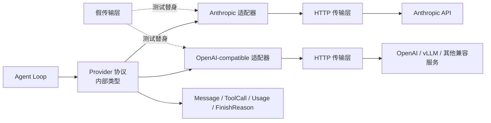
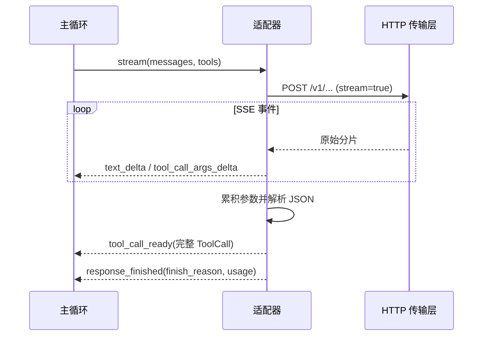

# 第 3 章 模型接入层与工具调用协议

## 本章导读

一个团队把模型从 A 厂商换到 B 厂商，主循环当天就崩了：工具调用字段名不同，结束原因从 `tool_calls` 变成 `tool_use`，流式参数的分片方式也不一样；更糟的是，限流和上下文超限被同一种重试策略吞掉，账单翻倍。本章解决一个问题：如何让主循环只看见一套稳定的模型协议。

## 学习目标

读完本章你将能够：

- 设计一个模型接入层（Provider Abstraction），把请求、响应、工具调用、用量和错误分别归一化；
- 解释 Anthropic 与 OpenAI-compatible 在工具协议、流式事件和响应结束原因上的关键差异；
- 对模型 API 错误分类，并实现带退避、抖动与重试上限的处理；
- 正确累积流式工具参数，只在完整 JSON 到达后触发执行；
- 为 MiniCoder 实现 `provider.py`，用假传输层离线测试两个适配器。

## 3.1 核心概念：接入层是主循环与厂商之间的防腐层

模型 API 不是一种协议。认证方式、请求结构、系统提示词的位置、工具 Schema 的字段名、工具结果的角色、响应结束原因、流式事件格式、用量字段、错误码，每家都可能不同。如果主循环直接读取 `response["choices"][0]["message"]["tool_calls"]`，那么每次换厂商都是一次重构。

模型接入层（Provider Abstraction）要做的，是在主循环和厂商之间加一层**防腐层（Anti-corruption Layer）**：厂商协议留在适配器里，主循环只依赖内部类型。这样换模型时，改动被限制在适配器和一个工厂函数内，循环、工具系统、上下文管理都不需要知道底层是谁。

这一层有两个边界，画清楚很重要。

**纵向边界**：主循环调用 `Provider.complete()` 或 `Provider.stream()`；适配器把内部请求翻译成厂商格式，把厂商响应翻译回内部类型；HTTP 传输层（HTTP Transport）负责 HTTP 与 SSE（Server-Sent Events，服务器推送事件）收发。适配器不执行工具，不检查权限，不管理上下文。

**横向边界**：接入层只处理“模型输入输出”，不处理“模型输出变成效果”的过程。工具调用是否允许执行、在哪个沙箱执行、结果如何截断，仍然属于第 5、10、11 章的主题。



归一化（Normalization）包含五个维度。只看“把请求发出去”是不够的，五个维度缺一个，都会在某个厂商上暴露。

| 维度 | 厂商差异 | 归一化结果 |
|---|---|---|
| 请求 | 系统提示词的位置、`max_tokens` 是否必填、消息角色与内容块格式 | `Message[]` 加统一的调用选项 |
| 响应 | `content` 块数组与 `message.content` 字符串 | `ModelResponse(text, tool_calls)` |
| 工具调用 | `tool_use/input` 与 `tool_calls/function.arguments` | `ToolCall(id, name, args)` |
| 用量 | 输入、输出、缓存读、缓存写、推理 token 的字段名不同 | `Usage` |
| 错误 | HTTP 状态、错误体结构、限流响应头 | `ProviderError` 层级 |


归一化是有损的。厂商的某些能力（扩展思考块、多模态内容、专有缓存参数）在内部类型里可能没有位置。适配器应当保留原始响应（`raw`），并提供受控的透传选项，而不是为了“统一”把能力全部抹平。


归一化层还有一个常被忽略的价值：**可测试性**。一旦 HTTP 被隔离到传输层，适配器就可以用固定 JSON 和固定 SSE 事件做离线测试，不访问网络、不消耗额度、不受厂商限流影响。这是后面所有章节能稳定复现实验的前提。

## 3.2 请求与响应归一化

### 3.2.1 内部类型：消息、工具调用、用量与结束原因

内部类型的设计目标不是“和某家厂商长得像”，而是“让主循环表达它真正关心的事”。下面五个类型构成了接入层的最小词汇表。

| 类型 | 关键字段 | 说明 |
|---|---|---|
| `Message` | `role`、`content`、`tool_call_id`、`tool_calls` | 进入上下文的消息；助手消息携带工具调用，工具消息携带对应的调用 ID |
| `ToolCall` | `id`、`name`、`args` | 一次结构化的工具调用，`args` 已经解析为字典 |
| `ToolSpec` | `name`、`description`、`parameters` | 工具定义，`parameters` 是 JSON Schema 子集 |
| `Usage` | 输入、输出、缓存读、缓存写、推理 token | 厂商返回的用量，原始值放在 `raw` |
| `ModelResponse` | `text`、`tool_calls`、`finish_reason`、`usage`、`raw` | 一轮模型响应的归一化结果 |

`Message` 的角色只需要 `user`、`assistant`、`tool`。系统提示词在内部作为单独的调用选项传入，由适配器放到厂商要求的位置：Anthropic 放在顶层 `system` 字段，OpenAI-compatible 放在 `messages` 的第一条 `system` 消息。

工具调用和工具结果之间的关联必须结构化保留。Anthropic 用 `tool_result` 块里的 `tool_use_id` 关联，OpenAI-compatible 用 `role="tool"` 消息的 `tool_call_id` 关联。两者语义相同，字段名不同。把工具结果压成一条普通用户文本，会丢掉关联，模型下一轮就无法把结果对应回具体调用。

第 2 章的 `Message` 是 `Message(role, content, tool_call_id)`。本章在保留前三个字段顺序的前提下增加 `tool_calls`，所以旧代码里的 `Message("tool", observation, call.id)` 仍然可用；助手消息则用关键字参数构造 `Message("assistant", text, tool_calls=[...])`。

### 3.2.2 工具 Schema：内部子集与厂商方言

工具 Schema 是模型选择工具、填充参数的依据。从这个角度看，它也是一种结构化输出（Structured Output）约束：把模型的参数生成限制在可校验的 JSON 形状内，而不是让模型自由生成一段文本再由 Harness 猜测。内部统一使用 JSON Schema 的一个**子集**，而不是把厂商的完整 Schema 直接透传。原因有三个：

- **跨厂商可移植**：不同厂商支持的 JSON Schema 关键字不同，取交集最稳定；
- **模型可靠性**：Schema 越复杂，模型生成非法参数的概率越高；`oneOf`、深层嵌套和循环引用尤其容易出错；
- **本地可校验**：子集足够小，Harness 可以在执行前用同一套校验器检查参数。

建议的初始子集如下：

| 关键字 | 是否支持 | 说明 |
|---|---|---|
| `type` | 是 | `object`、`string`、`number`、`integer`、`boolean`、`array` |
| `properties` | 是 | 对象字段定义 |
| `required` | 是 | 必填字段列表 |
| `description` | 是 | 字段用途，直接影响模型填参质量 |
| `enum` | 是 | 有限取值 |
| `items` | 是 | 数组元素类型 |
| `additionalProperties` | 是 | 建议显式设为 `false` |
| `oneOf` / `anyOf` / `allOf` | 谨慎 | 厂商与模型支持不一致，优先拆成多个工具 |
| `$ref` / `format` | 谨慎 | 支持程度因厂商而异，先不要依赖 |

工具名同样需要约束。统一使用动词开头的 `snake_case`，例如 `read_file`、`write_file`、`run_shell`。多数厂商接受字母、数字、下划线和连字符，长度上限常见为 64 字符；不同厂商的规则并不完全一致，适配器应当在启动时校验一次，而不是等模型调用失败才发现。

OpenAI-compatible（兼容 OpenAI Chat Completions 形状的服务）是当前最常见的方言，但它不是一份严格标准。两家主流协议的工具定义与工具结果映射如下：

| 维度 | Anthropic | OpenAI-compatible |
|---|---|---|
| 工具定义 | `tools[].name`、`description`、`input_schema` | `tools[].function.name`、`description`、`parameters` |
| 工具调用 | `content` 中的 `tool_use` 块，参数在 `input` 对象 | `message.tool_calls[]`，参数在 `function.arguments` JSON 字符串 |
| 工具结果 | 用户消息中的 `tool_result` 块，用 `tool_use_id` 关联 | `role="tool"` 消息，用 `tool_call_id` 关联 |
| 并行调用 | 一条助手消息里多个 `tool_use` 块 | 一条助手消息里多个 `tool_calls` |
| 参数增量 | `input_json_delta` 的 `partial_json` | `function.arguments` 字符串分片 |
| 严格模式 | 以官方文档为准 | 部分模型支持 `strict`，兼容服务不一定 |

有一个细节容易被忽略：OpenAI-compatible 的 `function.arguments` 是**字符串**，不是对象。适配器必须解析它，并在解析失败时把错误转成可观察的失败，而不是让主循环崩溃。模型偶尔会生成不完整的 JSON、带注释的 JSON，或者干脆返回空字符串；这些都属于“模型输出问题”，应当作为观察回填，让模型有机会修正。


“OpenAI-compatible”只保证大体形状兼容，不保证工具调用、流式用量、严格 Schema、结束原因完全一致。接入任何兼容服务前，先用一个小工具做冒烟测试，逐项核对本文列出的差异。具体字段与行为以厂商官方文档为准。


### 3.2.3 响应结束原因：FinishReason 与 LoopStopReason 是两回事

第 2 章的示例里有一个命名冲突：`StopReason` 表示“循环为什么退出”，而术语表里的“响应结束原因（Finish Reason）”指“模型响应为什么结束”。这是两个层次的概念，混用会让监控和调试都变得含糊。本章统一定名：

- **`FinishReason`**：模型单次响应的结束原因，由厂商返回，适配器归一化；
- **`LoopStopReason`**：主循环退出的原因，由 Harness 决定，例如完成、预算耗尽、无进展、取消。

两者的取值和语义完全不同。`FinishReason=TOOL_USE` 表示“模型这一轮想调用工具”，不表示“任务完成”；`LoopStopReason=COMPLETED` 表示“Harness 认为任务结束”，可能发生在模型返回最终文本之后，也可能发生在外部验证通过之后。

归一化映射如下：

| 厂商 | 原始值 | 归一化 `FinishReason` | 含义 |
|---|---|---|---|
| Anthropic | `end_turn` | `END_TURN` | 模型自然结束 |
| Anthropic | `tool_use` | `TOOL_USE` | 模型请求工具调用 |
| Anthropic | `max_tokens` | `MAX_TOKENS` | 达到输出长度上限 |
| Anthropic | `stop_sequence` | `STOP_SEQUENCE` | 命中停止序列 |
| Anthropic | `refusal` | `CONTENT_FILTER` | 模型拒绝或内容被拦截 |
| Anthropic | `pause_turn` | `UNKNOWN` | 服务端暂停长轮次，需要按文档续跑 |
| OpenAI-compatible | `stop` | `END_TURN` | 模型自然结束 |
| OpenAI-compatible | `length` | `MAX_TOKENS` | 达到输出长度上限 |
| OpenAI-compatible | `tool_calls` | `TOOL_USE` | 模型请求工具调用 |
| OpenAI-compatible | `function_call` | `TOOL_USE` | 旧版函数调用 |
| OpenAI-compatible | `content_filter` | `CONTENT_FILTER` | 内容被过滤 |
| OpenAI-compatible | `null` | `UNKNOWN` | 流式中间态或厂商未提供 |

这张表有两个工程含义。

第一，**不要只靠 `FinishReason` 判断有没有工具调用**。有些兼容服务在返回工具调用时仍然给 `finish_reason="stop"`，也有些服务在 `tool_calls` 为空时给 `tool_calls`。可靠的做法是以结构化的 `tool_calls` 字段为准：有调用就执行，没有调用才考虑结束；`FinishReason` 只作为辅助信号和日志字段。

第二，**不是所有结束原因都能重试**。`MAX_TOKENS` 可能可以通过“继续生成”补救，但这依赖厂商是否支持续写，不能当成通用策略；`CONTENT_FILTER` 通常应当直接返回给用户，重试同一请求往往得到同样结果；`UNKNOWN` 要先记录原始值，再决定是否重试。具体取值与行为以官方文档为准。

## 3.3 流式事件归一化

流式输出改变的是事件粒度，不改变循环语义。主循环仍然需要一轮完整响应才能决定下一步；流式只是让 UI 更早看到文本、让工具调用的准备过程更早可见。第 2 章已经讨论过循环层的流式事件与取消，本节只处理**模型边界**上的事件。

适配器向上层暴露六类事件：

| 事件 | 触发时机 | 上层用途 |
|---|---|---|
| `response_started` | 收到厂商的响应开始事件 | 记录模型名、输入用量，初始化 UI |
| `text_delta` | 文本增量到达 | 打字机效果，实时展示 |
| `tool_call_started` | 模型开始生成某个工具调用 | 展示“正在准备调用”，分配追踪 ID |
| `tool_call_args_delta` | 工具参数片段到达 | 可选展示进度，**不执行** |
| `tool_call_ready` | 参数完整且 JSON 可解析 | 进入执行队列，做 Schema 校验 |
| `response_finished` | 响应结束 | 带上 `FinishReason` 与 `Usage`，交给循环判定 |

这些事件与第 2 章的循环事件是包含关系：循环层还会产生 `tool_started`、`tool_finished`、`loop_stopped` 等事件，接入层只负责模型侧。两层的 `text_delta` 和 `tool_call_args_delta` 语义一致，不要重新起名。



流式工具调用的核心算法只有五步：

1. **建缓冲区**：按厂商提供的索引建立缓冲区。Anthropic 用内容块索引，OpenAI-compatible 用 `tool_calls[].index`。
2. **记录身份**：在 `tool_call_started` 或第一个参数分片到达时，记下调用 ID 和工具名；后续分片可能不再重复这两个字段。
3. **追加参数**：把每个参数分片原样追加到字符串缓冲区。此时**不要解析 JSON**，也不要执行工具。
4. **完成时解析**：收到内容块结束事件（Anthropic）或 `finish_reason`（OpenAI-compatible）后，把缓冲区拼成完整字符串，解析 JSON，做 Schema 校验，然后发出 `tool_call_ready`。
5. **稳定顺序**：多个并行调用按索引排序后发出，保证同一份轨迹每次运行的顺序一致。

两家厂商的流式事件映射如下：

| 归一化事件 | Anthropic 事件 | OpenAI-compatible 事件 |
|---|---|---|
| `response_started` | `message_start` | 首个 `choices[].delta` |
| `text_delta` | `content_block_delta` 且 `delta.type=text_delta` | `delta.content` |
| `tool_call_started` | `content_block_start` 且块类型为 `tool_use` | `delta.tool_calls[]` 首次出现 `id` 或 `name` |
| `tool_call_args_delta` | `content_block_delta` 且 `delta.type=input_json_delta` | `delta.tool_calls[].function.arguments` 分片 |
| `tool_call_ready` | `content_block_stop` | `finish_reason` 到达时统一收口 |
| `response_finished` | `message_delta` / `message_stop` | 流结束或收到用量分片后 |

SSE 的帧解析属于传输层：OpenAI-compatible 通常是 `data: {...}` 行，以 `data: [DONE]` 结束；Anthropic 使用带 `event:` 类型的事件流。适配器不应该直接处理 `data:` 前缀和换行，传输层应当把每一帧解析成字典再交给适配器。这样适配器只关心“事件语义”，不关心“字节流格式”。

用量在流式里通常到得比较晚。OpenAI-compatible 需要显式请求 `stream_options.include_usage`，用量可能在一个单独的末尾分片里到达；Anthropic 的输入用量在 `message_start`，输出用量在 `message_delta`。因此 `response_finished` 的发出时机要允许“先拿到结束原因，再拿到用量”，必要时把两者合并后再发给上层。顺序写进协议文档，不要让调用方猜。


不要在 `tool_call_args_delta` 上执行工具。参数只是字符串片段，JSON 可能还没闭合；提前解析得到的路径或命令可能是错的。UI 可以展示“正在准备调用”，但执行队列只能接收 `tool_call_ready`。


## 3.4 错误分类与重试

模型 API 的错误不是异常，而是协议的一部分。接入层必须把 HTTP 状态、错误体和限流响应头翻译成有语义的错误类型，主循环才能决定“重试、换模型、压缩上下文、还是直接返回”。

| 错误类别 | 典型状态码 | 可重试 | 处理方式 |
|---|---|---|---|
| 认证或权限失败 | 401、403 | 否 | 立即失败，检查密钥与权限；不要把密钥写进日志 |
| 限流 | 429 | 是 | 退避重试，优先遵守 `Retry-After` |
| 服务过载 | 529、503 | 是 | 退避重试，必要时切换模型或厂商 |
| 临时故障 | 408、500、502、504 | 是 | 退避重试，设置总时限与次数上限 |
| 上下文超限 | 400、413 | 否 | 压缩、截断或拆分上下文，不要原样重试 |
| 内容过滤 | 400 | 否 | 返回给用户或改写请求，不要重复撞同一过滤器 |
| 请求非法 | 400、404、409、422 | 否 | 修正请求参数、模型名或资源标识 |
| 未知错误 | 其他 4xx/5xx | 视情况 | 记录原始状态与错误体，人工判断 |

重试策略要回答四个问题。

**哪些能重试。** 模型推理请求本身是只读的，不会产生外部副作用，所以网络超时、限流、过载、5xx 通常可以重试。但“可以重试”不等于“应该重试”：每次重试都花钱，也可能让用户等待更久。上下文超限和内容过滤不属于临时故障，原样重试只会得到同样的结果。

**什么时候不能重试。** 如果流式响应已经向用户展示了部分文本，重试会从头再来，UI 会出现重复内容。此时更合理的做法是把错误作为事件上报，由 UI 决定是否清空重来；如果工具调用参数已经完整并进入执行队列，更不能重试模型请求，否则可能重复执行工具。重试的边界应当定义在“尚未消费任何输出”之前。

**退避怎么算。** 指数退避加随机抖动（Jitter）是通用做法：第 n 次重试等待 `base * 2^(n-1)`，再乘以 `0.5` 到 `1.5` 之间的随机因子，避免大量客户端在同一时刻同步重试。厂商给出 `Retry-After` 时优先使用它，但要把它换算成秒，并设一个上限，防止异常值让请求挂起过久。

**什么时候放弃。** 重试次数和总时限都要有上限，并且要和第 2 章的预算打通：如果任务的时间预算只剩 2 秒，就不应该再睡 8 秒重试。接入层可以把“剩余预算”作为选项传入，或者在抛出错误时带上已消耗的重试次数与等待时间，让循环统一判断。

`classify_http_error` 与 `with_retry` 的实现见 3.7 节。这里先记住一条原则：**错误分类是协议适配的一部分，不是主循环的职责**。主循环只应该看到 `RateLimitError`、`ContextLengthError` 这样的类型，而不是自己解析 HTTP 状态码。

## 3.5 Token、计费与用量

用量（Usage）是接入层最容易被低估的输出。它不只是账单，还是预算、路由、缓存策略和评测的数据来源。厂商返回的用量字段差异很大，需要归一化，但不能把不同口径的数字直接相加。

| 归一化字段 | Anthropic | OpenAI-compatible | 说明 |
|---|---|---|---|
| `input_tokens` | `input_tokens` | `prompt_tokens` | 输入 token |
| `output_tokens` | `output_tokens` | `completion_tokens` | 输出 token |
| `cache_read_tokens` | `cache_read_input_tokens` | `prompt_tokens_details.cached_tokens` | 命中缓存的输入 token |
| `cache_write_tokens` | `cache_creation_input_tokens` | 通常无对应字段 | 写入缓存的 token |
| `reasoning_tokens` | 视模型与版本 | `completion_tokens_details.reasoning_tokens` | 推理 token，可能已包含在输出中 |
| `raw` | 原始 `usage` | 原始 `usage` | 排障与厂商特有字段 |

三个口径问题必须提前想清楚。

**缓存 token 不能简单并入输入。** 缓存读和缓存写的单价通常不同，有些厂商还会区分缓存创建与缓存读取的有效期。如果只保留一个 `input_tokens`，事后就无法还原真实成本。归一化时保留 `cache_read_tokens` 和 `cache_write_tokens`，计费时按各自单价计算。

**推理 token 可能被重复计算。** 有的厂商把推理 token 包含在 `output_tokens` 里，有的单独列出。适配器应当以厂商文档为准，并在 `raw` 里保留原始字段；计费公式要明确“是否已经把推理 token 计入输出”，不要让两个字段相加。

部分模型支持扩展思考（Extended Thinking），会在最终回答前生成内部推理内容。推理内容是否可见、是否单独计费、是否计入 `output_tokens`，因厂商与模型而异；适配器只保留用量字段，不把推理内容当作控制信号。这与第 2 章的原则一致：循环只依赖结构化的工具调用和明确的完成信号。

**本地估算只能做预检。** 第 2 章已经强调过：最终结算以厂商返回的 usage 为准。本地分词器可以用来判断“这次请求会不会超窗口”，但不能替代账单。缓存命中、工具调用的计费方式、不同模型的分词器差异，都会让本地估算偏离实际。

流式场景下，用量可能缺失或延迟到达。OpenAI-compatible 需要 `stream_options.include_usage`，部分兼容服务不支持；Anthropic 的输入用量在流开始时、输出用量在流结束时。适配器应当把能拿到的用量累积起来，在 `response_finished` 中交给上层；拿不到时明确标记“用量未知”，而不是填零。

成本计算本身不应该硬编码价格。更合理的做法是维护一张可配置的单价表，按“输入、输出、缓存读、缓存写、推理”分别计价，再把 `Usage` 传进去。第 16 章会把这张表和预算、模型路由放在一起讲。

## 3.6 设计权衡

### 3.6.1 官方 SDK（Software Development Kit）还是原始 HTTP

| 维度 | 官方 SDK | 原始 HTTP |
|---|---|---|
| 开发速度 | 快，认证、重试、流式解析大多内置 | 慢，需要自己处理 SSE、错误与重试 |
| 协议透明度 | 低，细节被封装 | 高，能看清每个字段 |
| 依赖与版本 | 与 SDK 版本强耦合 | 依赖少，升级可控 |
| 多厂商统一 | 仍需再包一层 | 可以直接在传输层统一 |
| 排障 | 黑盒较多，问题定位依赖 SDK 日志 | 可以抓包、逐帧对照 |
| 适合场景 | 生产适配器、快速上线 | 协议教学、特殊网关、受限环境 |

本书的做法是“两层都讲”：正文用原始 HTTP 语义解释协议，代码用 `Transport` 接口隔离网络，生产实现可以换成官方 SDK 或 `httpx`。这样既不会把全书锁死在某个 SDK 版本，也不会让读者误以为必须手写 SSE 解析器。

### 3.6.2 内部规范 Schema 还是厂商原生透传

| 维度 | 内部规范 Schema | 厂商原生透传 |
|---|---|---|
| 主循环一致性 | 高，只依赖一套类型 | 低，需要到处判断厂商 |
| 厂商能力覆盖 | 取交集，可能丢失特性 | 完整保留 |
| 切换成本 | 低，改适配器即可 | 高，循环也要改 |
| 测试成本 | 低，可用假传输层 | 高，需要按厂商构造用例 |
| 实现复杂度 | 多一层转换 | 少一层转换，但耦合更深 |
| 适合场景 | 多厂商、长期维护 | 单厂商、深度绑定 |

推荐“规范核心加逃生舱”：主循环只依赖内部类型；适配器保留 `raw`；调用选项允许透传少量厂商特有参数。逃生舱要有明确边界，不能让厂商字段渗进主循环，否则规范层很快会被腐蚀。

### 3.6.3 同步还是异步

| 维度 | 同步 | 异步 |
|---|---|---|
| 流式处理 | 需要线程、回调或生成器包装 | 原生 `async iterator` |
| 取消传播 | 较难，阻塞调用不易中断 | 天然支持取消与超时 |
| 并行工具调用 | 线程池 | 任务组 |
| 代码复杂度 | 低 | 中，函数会“染色” |
| 适合场景 | 脚本、批处理、教学示例 | 生产服务、交互式 Agent |

第 2 章的循环是同步教学版，便于把注意力放在停止条件上。本章把 `Provider` 定义为异步接口，因为流式、取消和并行在生产环境里都更适合异步。迁移方式不是重写循环，而是把 `ScriptedModel.complete` 换成 `await provider.complete`，并在工具执行处使用异步版本；第 13 章会把两者统一。对只需要非流式调用的脚本，可以再包一个同步门面。

## 3.7 代码实践：Provider 协议与两个适配器

下面的代码分四段，按顺序拼成同一个 `provider.py`（TypeScript 版为 `provider.ts`）。它不访问网络，所有响应由 `FakeTransport` 提供，因此可以直接运行。真实 API 的冒烟测试放在 3.7.6 的折叠块里，通过环境变量启用。

### 3.7.1 类型、错误与协议

先定义归一化类型、错误层级、重试函数和 `Provider` 协议。注意 `Message` 的字段顺序保留了第 2 章的 `tool_call_id` 位置，避免旧代码失效。



```python
from __future__ import annotations

import asyncio
import json
import random
from dataclasses import dataclass, field
from enum import Enum
from typing import Any, AsyncIterator, Awaitable, Callable, Optional, Protocol, Sequence


class FinishReason(str, Enum):
    END_TURN = "end_turn"
    TOOL_USE = "tool_use"
    MAX_TOKENS = "max_tokens"
    CONTENT_FILTER = "content_filter"
    STOP_SEQUENCE = "stop_sequence"
    ERROR = "error"
    UNKNOWN = "unknown"


@dataclass(frozen=True)
class ToolCall:
    id: str
    name: str
    args: dict[str, Any]


@dataclass(frozen=True)
class ToolSpec:
    name: str
    description: str
    parameters: dict[str, Any]


@dataclass
class Message:
    role: str
    content: str = ""
    tool_call_id: Optional[str] = None
    tool_calls: list[ToolCall] = field(default_factory=list)


@dataclass
class Usage:
    input_tokens: int = 0
    output_tokens: int = 0
    cache_read_tokens: int = 0
    cache_write_tokens: int = 0
    reasoning_tokens: int = 0
    raw: dict[str, Any] = field(default_factory=dict)

    @property
    def total_tokens(self) -> int:
        return self.input_tokens + self.output_tokens


@dataclass
class ModelResponse:
    text: str = ""
    tool_calls: list[ToolCall] = field(default_factory=list)
    finish_reason: FinishReason = FinishReason.END_TURN
    usage: Usage = field(default_factory=Usage)
    raw: dict[str, Any] = field(default_factory=dict)


@dataclass
class ProviderEvent:
    kind: str
    text: str = ""
    call_id: str = ""
    name: str = ""
    args_delta: str = ""
    tool_call: Optional[ToolCall] = None
    finish_reason: Optional[FinishReason] = None
    usage: Optional[Usage] = None
    model: str = ""


class ProviderError(Exception):
    retryable = False

    def __init__(
        self,
        message: str,
        *,
        status: Optional[int] = None,
        retry_after: Optional[float] = None,
    ) -> None:
        super().__init__(message)
        self.status = status
        self.retry_after = retry_after


class RetryableProviderError(ProviderError):
    retryable = True


class RateLimitError(RetryableProviderError):
    pass


class OverloadedError(RetryableProviderError):
    pass


class TransientError(RetryableProviderError):
    pass


class AuthError(ProviderError):
    pass


class InvalidRequestError(ProviderError):
    pass


class ContextLengthError(ProviderError):
    pass


class ContentFilterError(ProviderError):
    pass


def classify_http_error(
    status: int,
    body: str = "",
    retry_after: Optional[float] = None,
) -> ProviderError:
    lower = body.lower()
    if status in (401, 403):
        return AuthError(f"认证或权限失败（HTTP {status}）", status=status)
    if status == 429:
        return RateLimitError("触发限流", status=status, retry_after=retry_after)
    if status == 529:
        return OverloadedError("服务过载", status=status, retry_after=retry_after)
    if status in (408, 500, 502, 503, 504):
        return TransientError(
            f"临时故障（HTTP {status}）", status=status, retry_after=retry_after
        )
    if status == 400 and "filter" in lower:
        return ContentFilterError("内容被过滤", status=status)
    if status in (400, 413) and any(
        token in lower for token in ("context", "token", "maximum", "too long")
    ):
        return ContextLengthError("输入超过模型上下文上限", status=status)
    if status in (400, 404, 409, 422):
        return InvalidRequestError(f"请求参数或资源非法（HTTP {status}）", status=status)
    if status >= 400:
        return ProviderError(f"请求失败（HTTP {status}）", status=status)
    return ProviderError("未知错误", status=status)


async def with_retry(
    fn: Callable[[], Awaitable[Any]],
    *,
    max_attempts: int = 4,
    base_delay: float = 0.5,
    max_delay: float = 8.0,
) -> Any:
    for attempt in range(1, max_attempts + 1):
        try:
            return await fn()
        except ProviderError as exc:
            if not exc.retryable or attempt == max_attempts:
                raise
            delay = exc.retry_after
            if delay is None:
                delay = min(max_delay, base_delay * 2 ** (attempt - 1))
            delay *= 0.5 + random.random()
            await asyncio.sleep(delay)
    raise AssertionError("unreachable")


class Transport(Protocol):
    async def post_json(
        self, url: str, headers: dict[str, str], body: dict[str, Any]
    ) -> dict[str, Any]: ...

    def post_sse(
        self, url: str, headers: dict[str, str], body: dict[str, Any]
    ) -> AsyncIterator[dict[str, Any]]: ...


class Provider(Protocol):
    async def complete(
        self, messages: Sequence[Message], tools: Sequence[ToolSpec], **options: Any
    ) -> ModelResponse: ...

    def stream(
        self, messages: Sequence[Message], tools: Sequence[ToolSpec], **options: Any
    ) -> AsyncIterator[ProviderEvent]: ...
```



```typescript
type FinishReason =
  | "end_turn"
  | "tool_use"
  | "max_tokens"
  | "content_filter"
  | "stop_sequence"
  | "error"
  | "unknown";

type ToolCall = { id: string; name: string; args: Record<string, unknown> };
type ToolSpec = {
  name: string;
  description: string;
  parameters: Record<string, unknown>;
};
type Message = {
  role: "user" | "assistant" | "tool";
  content?: string;
  toolCallId?: string;
  toolCalls?: ToolCall[];
};
type Usage = {
  inputTokens: number;
  outputTokens: number;
  cacheReadTokens: number;
  cacheWriteTokens: number;
  reasoningTokens: number;
  totalTokens: number;
  raw?: Record<string, unknown>;
};
type ModelResponse = {
  text: string;
  toolCalls: ToolCall[];
  finishReason: FinishReason;
  usage: Usage;
  raw?: unknown;
};
type ProviderEventKind =
  | "response_started"
  | "text_delta"
  | "tool_call_started"
  | "tool_call_args_delta"
  | "tool_call_ready"
  | "response_finished";
type ProviderEvent = {
  kind: ProviderEventKind;
  text?: string;
  callId?: string;
  name?: string;
  argsDelta?: string;
  toolCall?: ToolCall;
  finishReason?: FinishReason;
  usage?: Usage;
  model?: string;
};

function makeUsage(
  inputTokens = 0,
  outputTokens = 0,
  cacheReadTokens = 0,
  cacheWriteTokens = 0,
  reasoningTokens = 0,
  raw?: Record<string, unknown>,
): Usage {
  return {
    inputTokens,
    outputTokens,
    cacheReadTokens,
    cacheWriteTokens,
    reasoningTokens,
    totalTokens: inputTokens + outputTokens,
    raw,
  };
}

class ProviderError extends Error {
  readonly status?: number;
  readonly retryAfter?: number;
  readonly retryable: boolean;

  constructor(
    message: string,
    status?: number,
    retryAfter?: number,
    retryable = false,
  ) {
    super(message);
    this.name = new.target.name;
    this.status = status;
    this.retryAfter = retryAfter;
    this.retryable = retryable;
  }
}

class RetryableProviderError extends ProviderError {
  constructor(message: string, status?: number, retryAfter?: number) {
    super(message, status, retryAfter, true);
  }
}

class RateLimitError extends RetryableProviderError {}
class OverloadedError extends RetryableProviderError {}
class TransientError extends RetryableProviderError {}
class AuthError extends ProviderError {}
class InvalidRequestError extends ProviderError {}
class ContextLengthError extends ProviderError {}
class ContentFilterError extends ProviderError {}

function classifyHttpError(
  status: number,
  body = "",
  retryAfter?: number,
): ProviderError {
  const lower = body.toLowerCase();
  if (status === 401 || status === 403) {
    return new AuthError(`认证或权限失败（HTTP ${status}）`, status);
  }
  if (status === 429) return new RateLimitError("触发限流", status, retryAfter);
  if (status === 529) return new OverloadedError("服务过载", status, retryAfter);
  if ([408, 500, 502, 503, 504].includes(status)) {
    return new TransientError(`临时故障（HTTP ${status}）`, status, retryAfter);
  }
  if (status === 400 && lower.includes("filter")) {
    return new ContentFilterError("内容被过滤", status);
  }
  if (
    (status === 400 || status === 413) &&
    /(context|token|maximum|too long)/.test(lower)
  ) {
    return new ContextLengthError("输入超过模型上下文上限", status);
  }
  if ([400, 404, 409, 422].includes(status)) {
    return new InvalidRequestError(
      `请求参数或资源非法（HTTP ${status}）`,
      status,
    );
  }
  if (status >= 400) return new ProviderError(`请求失败（HTTP ${status}）`, status);
  return new ProviderError("未知错误", status);
}

async function withRetry<T>(
  fn: () => Promise<T>,
  options: { maxAttempts?: number; baseDelayMs?: number; maxDelayMs?: number } = {},
): Promise<T> {
  const maxAttempts = options.maxAttempts ?? 4;
  const baseDelayMs = options.baseDelayMs ?? 500;
  const maxDelayMs = options.maxDelayMs ?? 8000;

  for (let attempt = 1; attempt <= maxAttempts; attempt++) {
    try {
      return await fn();
    } catch (error) {
      if (
        !(error instanceof ProviderError) ||
        !error.retryable ||
        attempt === maxAttempts
      ) {
        throw error;
      }
      const base =
        error.retryAfter !== undefined
          ? error.retryAfter * 1000
          : Math.min(maxDelayMs, baseDelayMs * 2 ** (attempt - 1));
      const delay = base * (0.5 + Math.random());
      await new Promise((resolve) => setTimeout(resolve, delay));
    }
  }
  throw new Error("unreachable");
}

interface Transport {
  postJson(
    url: string,
    headers: Record<string, string>,
    body: unknown,
  ): Promise<any>;
  postSse(
    url: string,
    headers: Record<string, string>,
    body: unknown,
  ): AsyncGenerator<any>;
}

interface Provider {
  complete(
    messages: Message[],
    tools: ToolSpec[],
    options?: Record<string, unknown>,
  ): Promise<ModelResponse>;
  stream(
    messages: Message[],
    tools: ToolSpec[],
    options?: Record<string, unknown>,
  ): AsyncGenerator<ProviderEvent>;
}
```



### 3.7.2 Anthropic 适配器

Anthropic 的关键点有三个：系统提示词放在顶层 `system`，工具结果放在用户消息的 `tool_result` 块里，工具参数在 `tool_use` 块中以对象形式返回。连续同角色消息需要合并，否则会触发协议错误。



```python
ANTHROPIC_STOP = {
    "end_turn": FinishReason.END_TURN,
    "tool_use": FinishReason.TOOL_USE,
    "max_tokens": FinishReason.MAX_TOKENS,
    "stop_sequence": FinishReason.STOP_SEQUENCE,
    "refusal": FinishReason.CONTENT_FILTER,
}


def _merge_same_role(messages: list[dict[str, Any]]) -> list[dict[str, Any]]:
    merged: list[dict[str, Any]] = []
    for message in messages:
        if merged and merged[-1]["role"] == message["role"]:
            prev = merged[-1]
            prev_content = prev["content"]
            cur_content = message["content"]
            left = (
                prev_content
                if isinstance(prev_content, list)
                else [{"type": "text", "text": prev_content}]
            )
            right = (
                cur_content
                if isinstance(cur_content, list)
                else [{"type": "text", "text": cur_content}]
            )
            prev["content"] = left + right
            continue
        merged.append(message)
    return merged


class AnthropicAdapter:
    def __init__(
        self,
        transport: Transport,
        *,
        api_key: str,
        model: str,
        base_url: str = "https://api.anthropic.com",
        version: str = "2023-06-01",
    ) -> None:
        self.transport = transport
        self.api_key = api_key
        self.model = model
        self.base_url = base_url.rstrip("/")
        self.version = version

    def _headers(self) -> dict[str, str]:
        return {
            "x-api-key": self.api_key,
            "anthropic-version": self.version,
            "content-type": "application/json",
        }

    def _payload(
        self,
        messages: Sequence[Message],
        tools: Sequence[ToolSpec],
        *,
        system: str,
        max_tokens: int,
        stream: bool,
    ) -> dict[str, Any]:
        converted: list[dict[str, Any]] = []
        for message in messages:
            if message.role == "tool":
                converted.append({
                    "role": "user",
                    "content": [{
                        "type": "tool_result",
                        "tool_use_id": message.tool_call_id or "",
                        "content": message.content,
                    }],
                })
            elif message.role == "assistant":
                blocks: list[dict[str, Any]] = []
                if message.content:
                    blocks.append({"type": "text", "text": message.content})
                for call in message.tool_calls:
                    blocks.append({
                        "type": "tool_use",
                        "id": call.id,
                        "name": call.name,
                        "input": call.args,
                    })
                converted.append({"role": "assistant", "content": blocks})
            else:
                converted.append({"role": "user", "content": message.content})

        payload: dict[str, Any] = {
            "model": self.model,
            "max_tokens": max_tokens,
            "messages": _merge_same_role(converted),
            "stream": stream,
        }
        if system:
            payload["system"] = system
        if tools:
            payload["tools"] = [
                {
                    "name": tool.name,
                    "description": tool.description,
                    "input_schema": tool.parameters,
                }
                for tool in tools
            ]
        return payload

    def _to_response(self, data: dict[str, Any]) -> ModelResponse:
        text_parts: list[str] = []
        tool_calls: list[ToolCall] = []
        for block in data.get("content", []):
            if block.get("type") == "text":
                text_parts.append(block.get("text", ""))
            elif block.get("type") == "tool_use":
                tool_calls.append(
                    ToolCall(block["id"], block["name"], block.get("input", {}))
                )

        usage_raw = data.get("usage", {})
        usage = Usage(
            input_tokens=int(usage_raw.get("input_tokens", 0)),
            output_tokens=int(usage_raw.get("output_tokens", 0)),
            cache_read_tokens=int(usage_raw.get("cache_read_input_tokens", 0)),
            cache_write_tokens=int(usage_raw.get("cache_creation_input_tokens", 0)),
            raw=usage_raw,
        )
        return ModelResponse(
            text="".join(text_parts),
            tool_calls=tool_calls,
            finish_reason=ANTHROPIC_STOP.get(
                str(data.get("stop_reason")), FinishReason.UNKNOWN
            ),
            usage=usage,
            raw=data,
        )

    async def complete(
        self, messages: Sequence[Message], tools: Sequence[ToolSpec], **options: Any
    ) -> ModelResponse:
        payload = self._payload(
            messages,
            tools,
            system=str(options.get("system", "")),
            max_tokens=int(options.get("max_tokens", 4096)),
            stream=False,
        )
        data = await self.transport.post_json(
            f"{self.base_url}/v1/messages", self._headers(), payload
        )
        return self._to_response(data)

    async def stream(
        self, messages: Sequence[Message], tools: Sequence[ToolSpec], **options: Any
    ) -> AsyncIterator[ProviderEvent]:
        payload = self._payload(
            messages,
            tools,
            system=str(options.get("system", "")),
            max_tokens=int(options.get("max_tokens", 4096)),
            stream=True,
        )
        buffers: dict[int, dict[str, str]] = {}
        input_usage = Usage()

        async for event in self.transport.post_sse(
            f"{self.base_url}/v1/messages", self._headers(), payload
        ):
            kind = event.get("type")
            if kind == "message_start":
                message = event.get("message", {})
                usage_raw = message.get("usage", {})
                input_usage = Usage(
                    input_tokens=int(usage_raw.get("input_tokens", 0)),
                    cache_read_tokens=int(
                        usage_raw.get("cache_read_input_tokens", 0)
                    ),
                    cache_write_tokens=int(
                        usage_raw.get("cache_creation_input_tokens", 0)
                    ),
                    raw=usage_raw,
                )
                yield ProviderEvent(
                    kind="response_started",
                    model=message.get("model", self.model),
                    usage=input_usage,
                )
            elif kind == "content_block_start":
                index = int(event.get("index", 0))
                block = event.get("content_block", {})
                if block.get("type") == "tool_use":
                    buffers[index] = {
                        "id": block.get("id", ""),
                        "name": block.get("name", ""),
                        "json": "",
                    }
                    yield ProviderEvent(
                        kind="tool_call_started",
                        call_id=block.get("id", ""),
                        name=block.get("name", ""),
                    )
            elif kind == "content_block_delta":
                index = int(event.get("index", 0))
                delta = event.get("delta", {})
                if delta.get("type") == "text_delta":
                    yield ProviderEvent(kind="text_delta", text=delta.get("text", ""))
                elif delta.get("type") == "input_json_delta":
                    buffer = buffers.get(index)
                    piece = delta.get("partial_json", "")
                    if buffer is not None:
                        buffer["json"] += piece
                    yield ProviderEvent(
                        kind="tool_call_args_delta",
                        call_id=buffer["id"] if buffer else "",
                        args_delta=piece,
                    )
            elif kind == "content_block_stop":
                index = int(event.get("index", 0))
                buffer = buffers.pop(index, None)
                if buffer is not None:
                    try:
                        args = json.loads(buffer["json"] or "{}")
                    except json.JSONDecodeError as exc:
                        raise InvalidRequestError(
                            f"工具参数不是合法 JSON：{exc}"
                        ) from exc
                    yield ProviderEvent(
                        kind="tool_call_ready",
                        call_id=buffer["id"],
                        name=buffer["name"],
                        tool_call=ToolCall(buffer["id"], buffer["name"], args),
                    )
            elif kind == "message_delta":
                delta = event.get("delta", {})
                usage_raw = event.get("usage", {})
                yield ProviderEvent(
                    kind="response_finished",
                    finish_reason=ANTHROPIC_STOP.get(
                        str(delta.get("stop_reason")), FinishReason.UNKNOWN
                    ),
                    usage=Usage(
                        input_tokens=input_usage.input_tokens,
                        output_tokens=int(usage_raw.get("output_tokens", 0)),
                        cache_read_tokens=input_usage.cache_read_tokens,
                        cache_write_tokens=input_usage.cache_write_tokens,
                        raw={**input_usage.raw, **usage_raw},
                    ),
                )
            elif kind == "error":
                error = event.get("error", {})
                raise ProviderError(error.get("message", "流式响应错误"))
```



```typescript
const ANTHROPIC_STOP: Record<string, FinishReason> = {
  end_turn: "end_turn",
  tool_use: "tool_use",
  max_tokens: "max_tokens",
  stop_sequence: "stop_sequence",
  refusal: "content_filter",
};

function mapAnthropicStop(value: unknown): FinishReason {
  return ANTHROPIC_STOP[String(value)] ?? "unknown";
}

function mergeSameRole(messages: any[]): any[] {
  const merged: any[] = [];
  for (const message of messages) {
    const last = merged[merged.length - 1];
    if (last && last.role === message.role) {
      const left = Array.isArray(last.content)
        ? last.content
        : [{ type: "text", text: last.content }];
      const right = Array.isArray(message.content)
        ? message.content
        : [{ type: "text", text: message.content }];
      last.content = [...left, ...right];
      continue;
    }
    merged.push({ ...message });
  }
  return merged;
}

class AnthropicAdapter implements Provider {
  private readonly transport: Transport;
  private readonly apiKey: string;
  private readonly model: string;
  private readonly baseUrl: string;

  constructor(
    transport: Transport,
    apiKey: string,
    model: string,
    baseUrl = "https://api.anthropic.com",
  ) {
    this.transport = transport;
    this.apiKey = apiKey;
    this.model = model;
    this.baseUrl = baseUrl;
  }

  private headers(): Record<string, string> {
    return {
      "x-api-key": this.apiKey,
      "anthropic-version": "2023-06-01",
      "content-type": "application/json",
    };
  }

  private payload(
    messages: Message[],
    tools: ToolSpec[],
    stream: boolean,
    options: Record<string, unknown> = {},
  ): any {
    const converted: any[] = [];
    for (const message of messages) {
      if (message.role === "tool") {
        converted.push({
          role: "user",
          content: [
            {
              type: "tool_result",
              tool_use_id: message.toolCallId ?? "",
              content: message.content ?? "",
            },
          ],
        });
      } else if (message.role === "assistant") {
        const blocks: any[] = [];
        if (message.content) blocks.push({ type: "text", text: message.content });
        for (const call of message.toolCalls ?? []) {
          blocks.push({
            type: "tool_use",
            id: call.id,
            name: call.name,
            input: call.args,
          });
        }
        converted.push({ role: "assistant", content: blocks });
      } else {
        converted.push({ role: "user", content: message.content ?? "" });
      }
    }

    const payload: any = {
      model: this.model,
      max_tokens: Number(options.max_tokens ?? 4096),
      messages: mergeSameRole(converted),
      stream,
    };
    if (options.system) payload.system = options.system;
    if (tools.length) {
      payload.tools = tools.map((tool) => ({
        name: tool.name,
        description: tool.description,
        input_schema: tool.parameters,
      }));
    }
    return payload;
  }

  private toResponse(data: any): ModelResponse {
    const content = data.content ?? [];
    const text = content
      .filter((block: any) => block.type === "text")
      .map((block: any) => block.text)
      .join("");
    const toolCalls = content
      .filter((block: any) => block.type === "tool_use")
      .map((block: any) => ({
        id: block.id,
        name: block.name,
        args: block.input ?? {},
      }));
    const usage = data.usage ?? {};
    return {
      text,
      toolCalls,
      finishReason: mapAnthropicStop(data.stop_reason),
      usage: makeUsage(
        usage.input_tokens,
        usage.output_tokens,
        usage.cache_read_input_tokens,
        usage.cache_creation_input_tokens,
        0,
        usage,
      ),
      raw: data,
    };
  }

  async complete(
    messages: Message[],
    tools: ToolSpec[],
    options: Record<string, unknown> = {},
  ): Promise<ModelResponse> {
    const data = await this.transport.postJson(
      `${this.baseUrl}/v1/messages`,
      this.headers(),
      this.payload(messages, tools, false, options),
    );
    return this.toResponse(data);
  }

  async *stream(
    messages: Message[],
    tools: ToolSpec[],
    options: Record<string, unknown> = {},
  ): AsyncGenerator<ProviderEvent> {
    const buffers = new Map<number, { id: string; name: string; json: string }>();
    let inputUsage = makeUsage();

    for await (const event of this.transport.postSse(
      `${this.baseUrl}/v1/messages`,
      this.headers(),
      this.payload(messages, tools, true, options),
    )) {
      const type = event.type;
      if (type === "message_start") {
        const message = event.message ?? {};
        const usage = message.usage ?? {};
        inputUsage = makeUsage(
          usage.input_tokens,
          0,
          usage.cache_read_input_tokens,
          usage.cache_creation_input_tokens,
          0,
          usage,
        );
        yield {
          kind: "response_started",
          model: message.model ?? this.model,
          usage: inputUsage,
        };
      } else if (type === "content_block_start") {
        const index = Number(event.index ?? 0);
        const block = event.content_block ?? {};
        if (block.type === "tool_use") {
          buffers.set(index, {
            id: block.id ?? "",
            name: block.name ?? "",
            json: "",
          });
          yield {
            kind: "tool_call_started",
            callId: block.id ?? "",
            name: block.name ?? "",
          };
        }
      } else if (type === "content_block_delta") {
        const index = Number(event.index ?? 0);
        const delta = event.delta ?? {};
        if (delta.type === "text_delta") {
          yield { kind: "text_delta", text: delta.text ?? "" };
        } else if (delta.type === "input_json_delta") {
          const buffer = buffers.get(index);
          const piece = delta.partial_json ?? "";
          if (buffer) buffer.json += piece;
          yield {
            kind: "tool_call_args_delta",
            callId: buffer?.id ?? "",
            argsDelta: piece,
          };
        }
      } else if (type === "content_block_stop") {
        const index = Number(event.index ?? 0);
        const buffer = buffers.get(index);
        if (buffer) {
          buffers.delete(index);
          let args: Record<string, unknown>;
          try {
            args = JSON.parse(buffer.json || "{}");
          } catch (error) {
            throw new InvalidRequestError(
              `工具参数不是合法 JSON：${(error as Error).message}`,
            );
          }
          yield {
            kind: "tool_call_ready",
            callId: buffer.id,
            name: buffer.name,
            toolCall: { id: buffer.id, name: buffer.name, args },
          };
        }
      } else if (type === "message_delta") {
        const delta = event.delta ?? {};
        const usage = event.usage ?? {};
        yield {
          kind: "response_finished",
          finishReason: mapAnthropicStop(delta.stop_reason),
          usage: makeUsage(
            inputUsage.inputTokens,
            usage.output_tokens,
            inputUsage.cacheReadTokens,
            inputUsage.cacheWriteTokens,
            0,
            { ...(inputUsage.raw ?? {}), ...usage },
          ),
        };
      } else if (type === "error") {
        throw new ProviderError(event.error?.message ?? "流式响应错误");
      }
    }
  }
}
```



### 3.7.3 OpenAI-compatible 适配器

OpenAI-compatible 的关键点有三个：系统提示词是 `messages` 里的 `system` 消息，工具结果用 `role="tool"` 消息关联，工具参数是 JSON 字符串。流式工具调用按 `index` 分组，`finish_reason` 到达时统一收口。



```python
OPENAI_FINISH = {
    "stop": FinishReason.END_TURN,
    "length": FinishReason.MAX_TOKENS,
    "tool_calls": FinishReason.TOOL_USE,
    "function_call": FinishReason.TOOL_USE,
    "content_filter": FinishReason.CONTENT_FILTER,
}


def _parse_args(raw: str) -> dict[str, Any]:
    try:
        return json.loads(raw or "{}")
    except json.JSONDecodeError as exc:
        raise InvalidRequestError(f"工具参数不是合法 JSON：{exc}") from exc


class OpenAICompatibleAdapter:
    def __init__(
        self,
        transport: Transport,
        *,
        api_key: str,
        model: str,
        base_url: str = "https://api.openai.com/v1",
    ) -> None:
        self.transport = transport
        self.api_key = api_key
        self.model = model
        self.base_url = base_url.rstrip("/")

    def _headers(self) -> dict[str, str]:
        return {
            "authorization": f"Bearer {self.api_key}",
            "content-type": "application/json",
        }

    def _payload(
        self,
        messages: Sequence[Message],
        tools: Sequence[ToolSpec],
        *,
        stream: bool,
    ) -> dict[str, Any]:
        converted: list[dict[str, Any]] = []
        for message in messages:
            if message.role == "tool":
                converted.append({
                    "role": "tool",
                    "tool_call_id": message.tool_call_id or "",
                    "content": message.content,
                })
            elif message.role == "assistant":
                item: dict[str, Any] = {
                    "role": "assistant",
                    "content": message.content or None,
                }
                if message.tool_calls:
                    item["tool_calls"] = [
                        {
                            "id": call.id,
                            "type": "function",
                            "function": {
                                "name": call.name,
                                "arguments": json.dumps(
                                    call.args, ensure_ascii=False
                                ),
                            },
                        }
                        for call in message.tool_calls
                    ]
                converted.append(item)
            else:
                converted.append({
                    "role": message.role,
                    "content": message.content,
                })

        payload: dict[str, Any] = {
            "model": self.model,
            "messages": converted,
            "stream": stream,
        }
        if stream:
            # 部分 OpenAI-compatible 服务不支持该选项，接入时按厂商文档处理
            payload["stream_options"] = {"include_usage": True}
        if tools:
            payload["tools"] = [
                {
                    "type": "function",
                    "function": {
                        "name": tool.name,
                        "description": tool.description,
                        "parameters": tool.parameters,
                    },
                }
                for tool in tools
            ]
        return payload

    def _usage(self, raw: dict[str, Any]) -> Usage:
        prompt_details = raw.get("prompt_tokens_details", {}) or {}
        completion_details = raw.get("completion_tokens_details", {}) or {}
        return Usage(
            input_tokens=int(raw.get("prompt_tokens", 0)),
            output_tokens=int(raw.get("completion_tokens", 0)),
            cache_read_tokens=int(prompt_details.get("cached_tokens", 0)),
            reasoning_tokens=int(completion_details.get("reasoning_tokens", 0)),
            raw=raw,
        )

    def _to_response(self, data: dict[str, Any]) -> ModelResponse:
        choice = (data.get("choices") or [{}])[0]
        message = choice.get("message", {})
        tool_calls: list[ToolCall] = []
        for item in message.get("tool_calls", []) or []:
            function = item.get("function", {})
            tool_calls.append(
                ToolCall(
                    item.get("id", ""),
                    function.get("name", ""),
                    _parse_args(function.get("arguments", "{}")),
                )
            )
        return ModelResponse(
            text=message.get("content") or "",
            tool_calls=tool_calls,
            finish_reason=OPENAI_FINISH.get(
                str(choice.get("finish_reason")), FinishReason.UNKNOWN
            ),
            usage=self._usage(data.get("usage", {}) or {}),
            raw=data,
        )

    async def complete(
        self, messages: Sequence[Message], tools: Sequence[ToolSpec], **options: Any
    ) -> ModelResponse:
        payload = self._payload(messages, tools, stream=False)
        data = await self.transport.post_json(
            f"{self.base_url}/chat/completions", self._headers(), payload
        )
        return self._to_response(data)

    async def stream(
        self, messages: Sequence[Message], tools: Sequence[ToolSpec], **options: Any
    ) -> AsyncIterator[ProviderEvent]:
        payload = self._payload(messages, tools, stream=True)
        buffers: dict[int, dict[str, str]] = {}
        usage: Optional[Usage] = None
        finish_reason = FinishReason.UNKNOWN

        async for chunk in self.transport.post_sse(
            f"{self.base_url}/chat/completions", self._headers(), payload
        ):
            for choice in chunk.get("choices", []) or []:
                delta = choice.get("delta", {}) or {}
                if delta.get("content"):
                    yield ProviderEvent(kind="text_delta", text=delta["content"])
                for item in delta.get("tool_calls", []) or []:
                    index = int(item.get("index", 0))
                    buffer = buffers.setdefault(
                        index, {"id": "", "name": "", "json": ""}
                    )
                    if item.get("id"):
                        buffer["id"] = item["id"]
                    function = item.get("function", {}) or {}
                    if function.get("name"):
                        buffer["name"] = function["name"]
                        yield ProviderEvent(
                            kind="tool_call_started",
                            call_id=buffer["id"],
                            name=buffer["name"],
                        )
                    piece = function.get("arguments", "")
                    if piece:
                        buffer["json"] += piece
                        yield ProviderEvent(
                            kind="tool_call_args_delta",
                            call_id=buffer["id"],
                            args_delta=piece,
                        )
                if choice.get("finish_reason"):
                    finish_reason = OPENAI_FINISH.get(
                        str(choice["finish_reason"]), FinishReason.UNKNOWN
                    )
                    for index in sorted(buffers):
                        buffer = buffers[index]
                        yield ProviderEvent(
                            kind="tool_call_ready",
                            call_id=buffer["id"],
                            name=buffer["name"],
                            tool_call=ToolCall(
                                buffer["id"],
                                buffer["name"],
                                _parse_args(buffer["json"]),
                            ),
                        )
                    buffers.clear()
            if chunk.get("usage"):
                usage = self._usage(chunk["usage"])

        yield ProviderEvent(
            kind="response_finished",
            finish_reason=finish_reason,
            usage=usage,
        )
```



```typescript
const OPENAI_FINISH: Record<string, FinishReason> = {
  stop: "end_turn",
  length: "max_tokens",
  tool_calls: "tool_use",
  function_call: "tool_use",
  content_filter: "content_filter",
};

function mapOpenAIFinish(value: unknown): FinishReason {
  return OPENAI_FINISH[String(value)] ?? "unknown";
}

function parseArgs(raw: string): Record<string, unknown> {
  try {
    return JSON.parse(raw || "{}");
  } catch (error) {
    throw new InvalidRequestError(
      `工具参数不是合法 JSON：${(error as Error).message}`,
    );
  }
}

class OpenAICompatibleAdapter implements Provider {
  private readonly transport: Transport;
  private readonly apiKey: string;
  private readonly model: string;
  private readonly baseUrl: string;

  constructor(
    transport: Transport,
    apiKey: string,
    model: string,
    baseUrl = "https://api.openai.com/v1",
  ) {
    this.transport = transport;
    this.apiKey = apiKey;
    this.model = model;
    this.baseUrl = baseUrl;
  }

  private headers(): Record<string, string> {
    return {
      authorization: `Bearer ${this.apiKey}`,
      "content-type": "application/json",
    };
  }

  private payload(
    messages: Message[],
    tools: ToolSpec[],
    stream: boolean,
  ): any {
    const converted = messages.map((message) => {
      if (message.role === "tool") {
        return {
          role: "tool",
          tool_call_id: message.toolCallId ?? "",
          content: message.content ?? "",
        };
      }
      if (message.role === "assistant") {
        const item: any = {
          role: "assistant",
          content: message.content || null,
        };
        if ((message.toolCalls ?? []).length) {
          item.tool_calls = message.toolCalls!.map((call) => ({
            id: call.id,
            type: "function",
            function: {
              name: call.name,
              arguments: JSON.stringify(call.args),
            },
          }));
        }
        return item;
      }
      return { role: message.role, content: message.content ?? "" };
    });

    const payload: any = { model: this.model, messages: converted, stream };
    if (stream) {
      // 部分 OpenAI-compatible 服务不支持该选项，接入时按厂商文档处理
      payload.stream_options = { include_usage: true };
    }
    if (tools.length) {
      payload.tools = tools.map((tool) => ({
        type: "function",
        function: {
          name: tool.name,
          description: tool.description,
          parameters: tool.parameters,
        },
      }));
    }
    return payload;
  }

  private toUsage(raw: any): Usage {
    return makeUsage(
      raw.prompt_tokens,
      raw.completion_tokens,
      raw.prompt_tokens_details?.cached_tokens,
      0,
      raw.completion_tokens_details?.reasoning_tokens,
      raw,
    );
  }

  private toResponse(data: any): ModelResponse {
    const choice = (data.choices ?? [{}])[0] ?? {};
    const message = choice.message ?? {};
    const toolCalls = (message.tool_calls ?? []).map((item: any) => {
      const fn = item.function ?? {};
      return {
        id: item.id ?? "",
        name: fn.name ?? "",
        args: parseArgs(fn.arguments ?? "{}"),
      };
    });
    return {
      text: message.content ?? "",
      toolCalls,
      finishReason: mapOpenAIFinish(choice.finish_reason),
      usage: this.toUsage(data.usage ?? {}),
      raw: data,
    };
  }

  async complete(
    messages: Message[],
    tools: ToolSpec[],
    _options: Record<string, unknown> = {},
  ): Promise<ModelResponse> {
    const data = await this.transport.postJson(
      `${this.baseUrl}/chat/completions`,
      this.headers(),
      this.payload(messages, tools, false),
    );
    return this.toResponse(data);
  }

  async *stream(
    messages: Message[],
    tools: ToolSpec[],
    _options: Record<string, unknown> = {},
  ): AsyncGenerator<ProviderEvent> {
    const buffers = new Map<number, { id: string; name: string; json: string }>();
    let usage: Usage | undefined;
    let finishReason: FinishReason = "unknown";

    for await (const chunk of this.transport.postSse(
      `${this.baseUrl}/chat/completions`,
      this.headers(),
      this.payload(messages, tools, true),
    )) {
      for (const choice of chunk.choices ?? []) {
        const delta = choice.delta ?? {};
        if (delta.content) {
          yield { kind: "text_delta", text: delta.content };
        }
        for (const item of delta.tool_calls ?? []) {
          const index = Number(item.index ?? 0);
          const buffer = buffers.get(index) ?? { id: "", name: "", json: "" };
          buffers.set(index, buffer);
          if (item.id) buffer.id = item.id;
          const fn = item.function ?? {};
          if (fn.name) {
            buffer.name = fn.name;
            yield {
              kind: "tool_call_started",
              callId: buffer.id,
              name: buffer.name,
            };
          }
          const piece = fn.arguments ?? "";
          if (piece) {
            buffer.json += piece;
            yield {
              kind: "tool_call_args_delta",
              callId: buffer.id,
              argsDelta: piece,
            };
          }
        }
        if (choice.finish_reason) {
          finishReason = mapOpenAIFinish(choice.finish_reason);
          for (const [, buffer] of [...buffers.entries()].sort(
            (a, b) => a[0] - b[0],
          )) {
            yield {
              kind: "tool_call_ready",
              callId: buffer.id,
              name: buffer.name,
              toolCall: {
                id: buffer.id,
                name: buffer.name,
                args: parseArgs(buffer.json),
              },
            };
          }
          buffers.clear();
        }
      }
      if (chunk.usage) usage = this.toUsage(chunk.usage);
    }

    yield { kind: "response_finished", finishReason, usage };
  }
}
```



### 3.7.4 假传输层与离线演示

`FakeTransport` 按顺序返回预设的 JSON 或 SSE 事件。它记录每次调用的 URL 和请求体，方便断言适配器发出的载荷。下面的演示覆盖四条路径：Anthropic 非流式归一化、OpenAI-compatible 非流式归一化、OpenAI-compatible 流式参数累积、限流重试与认证失败。



```python
class FakeTransport:
    def __init__(
        self,
        responses: Optional[list[Any]] = None,
        streams: Optional[list[list[dict[str, Any]]]] = None,
    ) -> None:
        self.responses = list(responses or [])
        self.streams = list(streams or [])
        self.calls: list[dict[str, Any]] = []

    async def post_json(
        self, url: str, headers: dict[str, str], body: dict[str, Any]
    ) -> dict[str, Any]:
        self.calls.append({"url": url, "body": body})
        item = self.responses.pop(0)
        if isinstance(item, BaseException):
            raise item
        return item

    async def post_sse(
        self, url: str, headers: dict[str, str], body: dict[str, Any]
    ) -> AsyncIterator[dict[str, Any]]:
        self.calls.append({"url": url, "body": body})
        for chunk in self.streams.pop(0):
            if isinstance(chunk, BaseException):
                raise chunk
            yield chunk


async def main() -> None:
    tool = ToolSpec(
        "read_file",
        "读取文件内容",
        {
            "type": "object",
            "properties": {"path": {"type": "string"}},
            "required": ["path"],
        },
    )

    anthropic_payload = {
        "id": "msg_1",
        "type": "message",
        "role": "assistant",
        "model": "claude-sonnet-4-6",
        "content": [
            {"type": "text", "text": "我先读取文件。"},
            {
                "type": "tool_use",
                "id": "toolu_1",
                "name": "read_file",
                "input": {"path": "a.txt"},
            },
        ],
        "stop_reason": "tool_use",
        "usage": {
            "input_tokens": 120,
            "output_tokens": 24,
            "cache_read_input_tokens": 80,
        },
    }
    anthropic = AnthropicAdapter(
        FakeTransport([anthropic_payload]),
        api_key="test",
        model="claude-sonnet-4-6",
    )
    first = await anthropic.complete(
        [Message("user", "读取 a.txt")], [tool], system="你是编码助手"
    )
    print(
        first.finish_reason.value,
        first.text,
        first.tool_calls[0].args,
        "usage",
        first.usage.input_tokens,
        first.usage.cache_read_tokens,
    )

    openai_payload = {
        "id": "chatcmpl_1",
        "choices": [{
            "index": 0,
            "message": {
                "role": "assistant",
                "content": None,
                "tool_calls": [{
                    "id": "call_1",
                    "type": "function",
                    "function": {
                        "name": "read_file",
                        "arguments": "{\"path\":\"a.txt\"}",
                    },
                }],
            },
            "finish_reason": "tool_calls",
        }],
        "usage": {
            "prompt_tokens": 90,
            "completion_tokens": 18,
            "prompt_tokens_details": {"cached_tokens": 64},
        },
    }
    openai = OpenAICompatibleAdapter(
        FakeTransport([openai_payload]), api_key="test", model="gpt-4.1"
    )
    second = await openai.complete([Message("user", "读取 a.txt")], [tool])
    print(
        second.finish_reason.value,
        second.tool_calls[0].name,
        second.tool_calls[0].args,
    )

    chunks = [
        {"choices": [{
            "index": 0,
            "delta": {"role": "assistant", "content": "读取中"},
        }]},
        {"choices": [{
            "index": 0,
            "delta": {"tool_calls": [{
                "index": 0,
                "id": "call_7",
                "type": "function",
                "function": {"name": "read_file", "arguments": "{\"path\":"},
            }]},
        }]},
        {"choices": [{
            "index": 0,
            "delta": {"tool_calls": [{
                "index": 0,
                "function": {"arguments": "\"a.txt\"}"},
            }]},
        }]},
        {"choices": [{
            "index": 0,
            "delta": {},
            "finish_reason": "tool_calls",
        }]},
        {
            "choices": [],
            "usage": {"prompt_tokens": 70, "completion_tokens": 20},
        },
    ]
    streaming = OpenAICompatibleAdapter(
        FakeTransport([], [chunks]), api_key="test", model="gpt-4.1"
    )
    async for event in streaming.stream([Message("user", "读取 a.txt")], [tool]):
        if event.kind == "tool_call_ready":
            print(event.kind, event.tool_call.name, event.tool_call.args)
        elif event.kind == "response_finished":
            print(
                event.kind,
                event.finish_reason.value if event.finish_reason else "unknown",
                event.usage.output_tokens if event.usage else 0,
            )
        else:
            print(event.kind, event.text or event.args_delta or event.name)

    attempts = {"n": 0}

    async def flaky() -> str:
        attempts["n"] += 1
        if attempts["n"] < 3:
            raise RateLimitError("限流", status=429, retry_after=0.01)
        return "ok"

    result = await with_retry(
        flaky, max_attempts=4, base_delay=0.01, max_delay=0.01
    )
    print("retry", result, attempts["n"])

    async def denied() -> str:
        raise AuthError("无效密钥", status=401)

    try:
        await with_retry(denied, max_attempts=4, base_delay=0.01)
    except AuthError as exc:
        print("terminal", exc.status)


if __name__ == "__main__":
    asyncio.run(main())
```



```typescript
class FakeTransport implements Transport {
  responses: any[];
  streams: any[][];
  calls: any[] = [];

  constructor(responses: any[] = [], streams: any[][] = []) {
    this.responses = [...responses];
    this.streams = [...streams];
  }

  async postJson(
    url: string,
    _headers: Record<string, string>,
    body: unknown,
  ): Promise<any> {
    this.calls.push({ url, body });
    const item = this.responses.shift();
    if (item instanceof Error) throw item;
    return item;
  }

  async *postSse(
    url: string,
    _headers: Record<string, string>,
    body: unknown,
  ): AsyncGenerator<any> {
    this.calls.push({ url, body });
    for (const chunk of this.streams.shift() ?? []) {
      if (chunk instanceof Error) throw chunk;
      yield chunk;
    }
  }
}

async function main(): Promise<void> {
  const tool: ToolSpec = {
    name: "read_file",
    description: "读取文件内容",
    parameters: {
      type: "object",
      properties: { path: { type: "string" } },
      required: ["path"],
    },
  };

  const anthropicPayload = {
    id: "msg_1",
    type: "message",
    role: "assistant",
    model: "claude-sonnet-4-6",
    content: [
      { type: "text", text: "我先读取文件。" },
      {
        type: "tool_use",
        id: "toolu_1",
        name: "read_file",
        input: { path: "a.txt" },
      },
    ],
    stop_reason: "tool_use",
    usage: {
      input_tokens: 120,
      output_tokens: 24,
      cache_read_input_tokens: 80,
    },
  };
  const anthropic = new AnthropicAdapter(
    new FakeTransport([anthropicPayload]),
    "test",
    "claude-sonnet-4-6",
  );
  const first = await anthropic.complete(
    [{ role: "user", content: "读取 a.txt" }],
    [tool],
    { system: "你是编码助手" },
  );
  console.log(
    first.finishReason,
    first.text,
    first.toolCalls[0].args,
    "usage",
    first.usage.inputTokens,
    first.usage.cacheReadTokens,
  );

  const openaiPayload = {
    id: "chatcmpl_1",
    choices: [
      {
        index: 0,
        message: {
          role: "assistant",
          content: null,
          tool_calls: [
            {
              id: "call_1",
              type: "function",
              function: {
                name: "read_file",
                arguments: '{"path":"a.txt"}',
              },
            },
          ],
        },
        finish_reason: "tool_calls",
      },
    ],
    usage: {
      prompt_tokens: 90,
      completion_tokens: 18,
      prompt_tokens_details: { cached_tokens: 64 },
    },
  };
  const openai = new OpenAICompatibleAdapter(
    new FakeTransport([openaiPayload]),
    "test",
    "gpt-4.1",
  );
  const second = await openai.complete(
    [{ role: "user", content: "读取 a.txt" }],
    [tool],
  );
  console.log(
    second.finishReason,
    second.toolCalls[0].name,
    second.toolCalls[0].args,
  );

  const chunks = [
    {
      choices: [
        {
          index: 0,
          delta: { role: "assistant", content: "读取中" },
        },
      ],
    },
    {
      choices: [
        {
          index: 0,
          delta: {
            tool_calls: [
              {
                index: 0,
                id: "call_7",
                type: "function",
                function: { name: "read_file", arguments: '{"path":' },
              },
            ],
          },
        },
      ],
    },
    {
      choices: [
        {
          index: 0,
          delta: {
            tool_calls: [
              { index: 0, function: { arguments: '"a.txt"}' } },
            ],
          },
        },
      ],
    },
    {
      choices: [
        { index: 0, delta: {}, finish_reason: "tool_calls" },
      ],
    },
    {
      choices: [],
      usage: { prompt_tokens: 70, completion_tokens: 20 },
    },
  ];
  const streaming = new OpenAICompatibleAdapter(
    new FakeTransport([], [chunks]),
    "test",
    "gpt-4.1",
  );
  for await (const event of streaming.stream(
    [{ role: "user", content: "读取 a.txt" }],
    [tool],
  )) {
    if (event.kind === "tool_call_ready") {
      console.log(event.kind, event.toolCall!.name, event.toolCall!.args);
    } else if (event.kind === "response_finished") {
      console.log(event.kind, event.finishReason, event.usage?.outputTokens);
    } else {
      console.log(event.kind, event.text ?? event.argsDelta ?? event.name ?? "");
    }
  }

  let attempts = 0;
  const result = await withRetry(
    async () => {
      attempts += 1;
      if (attempts < 3) throw new RateLimitError("限流", 429, 0.01);
      return "ok";
    },
    { baseDelayMs: 10, maxDelayMs: 10 },
  );
  console.log("retry", result, attempts);

  try {
    await withRetry(
      async () => {
        throw new AuthError("无效密钥", 401);
      },
      { baseDelayMs: 10 },
    );
  } catch (error) {
    console.log(
      "terminal",
      error instanceof ProviderError ? error.status : "unknown",
    );
  }
}

main().catch((error) => {
  console.error(error);
  process.exit(1);
});
```



### 3.7.5 运行结果与解读

Python 版运行输出（TypeScript 版的字典打印风格略有不同，语义一致）：

```text
tool_use 我先读取文件。 {'path': 'a.txt'} usage 120 80
tool_use read_file {'path': 'a.txt'}
text_delta 读取中
tool_call_started read_file
tool_call_args_delta {"path":
tool_call_args_delta "a.txt"}
tool_call_ready read_file {'path': 'a.txt'}
response_finished tool_use 20
retry ok 3
terminal 401
```

这段输出对应六个设计点：

| 输出/代码位置 | 设计意图 |
|---|---|
| `tool_use 我先读取文件。 {'path': 'a.txt'}` | Anthropic 的文本与 `tool_use` 块被归一化为 `text` 加 `ToolCall` |
| `usage 120 80` | 输入 token 与缓存读 token 分开保留，不合并成一个数 |
| `tool_call_args_delta {"path":` | 参数分片只上报，不解析、不执行 |
| `tool_call_ready read_file {'path': 'a.txt'}` | 完整 JSON 到达后才产生可执行的 `ToolCall` |
| `response_finished tool_use 20` | 结束原因与输出用量在流结束时一起交付 |
| `retry ok 3` / `terminal 401` | 限流按退避重试两次后成功；认证失败立即终止 |

`FakeTransport` 还记录了请求载荷，测试里可以断言：Anthropic 请求的 `system` 在顶层、工具结果在 `user` 消息的 `tool_result` 块里；OpenAI-compatible 请求的 `system` 在 `messages` 里、工具结果用 `role="tool"`。这些断言比“最终答案对不对”更能防止协议回归。

### 3.7.6 接回 MiniCoder

第 2 章的 `ScriptedModel` 在本章降级为测试替身，改名为 `ScriptedProvider`，实现同一个 `Provider` 协议。主循环的签名从“依赖具体类”改为“依赖协议”：

```python
class ScriptedProvider:
    def __init__(self, responses: list[ModelResponse]) -> None:
        self.responses = list(responses)
        self.cursor = 0

    async def complete(
        self, messages: Sequence[Message], tools: Sequence[ToolSpec], **options: Any
    ) -> ModelResponse:
        if self.cursor >= len(self.responses):
            return ModelResponse(text="脚本已耗尽")
        response = self.responses[self.cursor]
        self.cursor += 1
        return response

    async def stream(
        self, messages: Sequence[Message], tools: Sequence[ToolSpec], **options: Any
    ) -> AsyncIterator[ProviderEvent]:
        response = await self.complete(messages, tools, **options)
        if response.text:
            yield ProviderEvent(kind="text_delta", text=response.text)
        for call in response.tool_calls:
            yield ProviderEvent(kind="tool_call_ready", tool_call=call)
        yield ProviderEvent(
            kind="response_finished",
            finish_reason=response.finish_reason,
            usage=response.usage,
        )


# SYSTEM_PROMPT 由上下文模块提供；CancelToken、LoopResult 沿用第 2 章
async def run_loop(
    task: str,
    provider: Provider,
    tools: Sequence[ToolSpec],
    *,
    max_steps: int = 6,
) -> LoopResult:
    messages = [Message("user", task)]
    for step in range(1, max_steps + 1):
        response = await provider.complete(messages, tools, system=SYSTEM_PROMPT)
        # 判断 tool_calls、执行、回填、检查预算，与第 2 章一致
        ...
```

命名统一如下，后续章节都按右列使用：

| 第 2 章 | 第 3 章 | 原因 |
|---|---|---|
| `StopReason` | `LoopStopReason` | 与厂商的 `FinishReason` 区分层次 |
| `ScriptedModel` | `ScriptedProvider` | 明确它是 `Provider` 的一种实现 |
| `Message(role, content, tool_call_id)` | 增加 `tool_calls` | 保留结构化的工具调用，不再压成文本 |
| `events: list[str]` | 暂保留 | 第 14 章替换为结构化 `TraceEvent` |

`LoopResult` 可以增加 `usage` 字段，把整次任务的用量带回给调用方；第 16 章做成本优化时会用到。工具结果目前仍是字符串，第 5 章会升级为 `ToolResult`，`Provider` 协议不需要因此改变。


真实 API 冒烟测试只能通过环境变量读取密钥，不要把密钥写进代码、配置文件、日志或追踪。请求头里包含密钥，打印请求或响应时先脱敏。下面的示例默认跳过，只有显式设置环境变量才会发起网络请求。


<details>
<summary>展开查看：可选的真实 API 冒烟测试（Python）</summary>

```python
import os

import httpx


class HttpxTransport:
    def __init__(self) -> None:
        self.client = httpx.AsyncClient(timeout=60.0)

    async def post_json(
        self, url: str, headers: dict[str, str], body: dict[str, Any]
    ) -> dict[str, Any]:
        response = await self.client.post(url, headers=headers, json=body)
        if response.status_code >= 400:
            retry_after = response.headers.get("retry-after")
            raise classify_http_error(
                response.status_code,
                response.text,
                float(retry_after) if retry_after else None,
            )
        return response.json()

    def post_sse(self, url, headers, body):
        raise NotImplementedError("流式传输实现见仓库")


async def smoke() -> None:
    key = os.environ.get("MINICODER_API_KEY")
    if not key:
        print("未设置 MINICODER_API_KEY，跳过真实 API 冒烟测试")
        return

    provider = OpenAICompatibleAdapter(
        HttpxTransport(),
        api_key=key,
        model=os.environ.get("MINICODER_MODEL", "gpt-4.1-mini"),
        base_url=os.environ.get(
            "MINICODER_BASE_URL", "https://api.openai.com/v1"
        ),
    )
    response = await provider.complete(
        [Message("user", "只回复 pong")], [], system="你是一个简洁的助手。"
    )
    print(response.text, response.usage.total_tokens)


if __name__ == "__main__":
    asyncio.run(smoke())
```

运行前安装 `httpx`，并设置 `MINICODER_API_KEY`。如果要测试 Anthropic，把适配器换成 `AnthropicAdapter`，并把 `MINICODER_BASE_URL` 指到 Anthropic 的端点。具体端点与模型名以厂商官方文档为准。

</details>

## 3.8 业界案例：LiteLLM 与 OpenAI-compatible 生态

接入层不是本书发明的概念，它在真实生态里以两种形态存在：一种是库或服务，另一种是事实标准。

**OpenAI-compatible 已经成为事实协议。** 大量推理服务（vLLM、Ollama、Together、Groq、OpenRouter 等）都暴露 `/v1/chat/completions` 形状的接口，许多国产模型服务也提供兼容模式。这让“一次适配、多处运行”变得可行。但“兼容”通常只覆盖最常用的 80%：工具调用的参数格式、流式用量、严格 Schema、结束原因、错误码都可能有差异。真实项目里最常见的故障不是“完全不兼容”，而是“看起来兼容，边界行为不同”。这正是本章坚持先做冒烟测试、再逐项核对差异的原因。

**LiteLLM 把接入层做成了服务。** 它提供统一的调用接口，在内部维护各厂商的适配器，并叠加路由、回退、重试、预算与花费统计。对上层来说，它像是一个 OpenAI-compatible 网关；对下层来说，它替你把不同厂商的请求和响应翻译成统一格式。它的价值不只在“少写适配器”，更在于把限流、回退、用量统计这些横切能力集中到一层。具体功能与配置项以官方文档为准。

**Vercel AI SDK 把接入层做成了类型化协议。** 它用提供方注册表（provider registry）管理不同模型提供方，用归一化的流式片段（文本增量、工具调用、工具结果、结束）向 UI 交付事件，并提供中间件做日志、缓存与重试。它的设计取向与本章一致：上层消费语义事件，不消费厂商原始分片。具体 API 可能随版本变化，使用前以官方文档为准。

三者可以放在一张表里对照：

| 机制 | 本章对应概念 | 解决的问题 |
|---|---|---|
| 统一请求与响应 | `Provider` 协议、`ModelResponse` | 主循环不依赖厂商 |
| 适配器与注册表 | `AnthropicAdapter`、`OpenAICompatibleAdapter` | 按厂商翻译协议 |
| 路由与回退 | 错误分类、适配器工厂 | 限流或故障时切换 |
| 流式归一化 | `ProviderEvent` | UI 与循环消费稳定事件 |
| 用量与花费 | `Usage`、预算 | 成本可见、可控制 |

这个案例的启示是：**归一化层本身可以成为产品，但前提是保留逃生舱**。LiteLLM 和 AI SDK 都没有把厂商能力完全抹平，而是提供透传选项、原始响应和中间件。本书的 `raw` 与 `options` 就是同一个思路的最小版本。

## 3.9 常见陷阱

**陷阱一：把厂商协议泄漏进主循环。**
症状是循环里出现 `response["content"][0]["type"] == "tool_use"` 或 `choices[0].message.tool_calls` 这样的厂商字段。每换一家厂商，循环就要改一次；测试也要按厂商各写一套。正确做法是把所有厂商字段关在适配器里，循环只认 `ModelResponse` 和 `ToolCall`。

**陷阱二：只看 `FinishReason`，不看 `tool_calls`。**
有些兼容服务在返回工具调用时给 `stop`，有些在空参数时给 `tool_calls`。只信结束原因会导致“该执行时没执行”或“该结束时又执行一轮”。可靠的不变量是：以结构化的 `tool_calls` 为准，`FinishReason` 只做辅助判断与日志。

**陷阱三：流式参数没累积完就解析。**
在 `tool_call_args_delta` 上调用 `json.loads`，轻则解析失败，重则拿到半截路径或命令并执行。参数必须按索引累积，等内容块结束或 `finish_reason` 到达后再解析、校验、执行。UI 可以展示进度，但执行队列只能接收 `tool_call_ready`。

**陷阱四：所有错误都重试，或者流式输出了还重试。**
认证失败、上下文超限、内容过滤重试多少次都不会成功，只会浪费时间与额度。流式已经输出一半文本后重试，会让 UI 出现重复内容；工具调用已经进入执行队列后重试，可能重复执行副作用。重试必须分类，并且只在“尚未消费输出”的边界内进行。

**陷阱五：用本地估算替代厂商 usage。**
本地分词器可以用来预检上下文是否超限，但不能替代账单。缓存命中、推理 token、工具调用的计费口径在不同厂商之间不一致；用估算值结算，预算会对不上，成本分析也会失真。最终结算只认厂商返回的 `Usage`，拿不到时明确标记“未知”。

## 3.10 本章小结

- 模型接入层是主循环与厂商之间的防腐层，负责请求、响应、工具调用、用量和错误五个维度的归一化。
- 适配器只处理模型输入输出，不执行工具、不检查权限；传输层单独隔离 HTTP 与 SSE，使离线测试成为可能。
- 工具 Schema 使用 JSON Schema 子集；工具名、参数解析和工具结果关联都要在适配器里处理。
- `FinishReason` 是厂商响应的结束原因，`LoopStopReason` 是主循环的退出原因，两者不能混用；判断工具调用应以结构化字段为准。
- 流式工具参数按索引累积，完整 JSON 解析并校验后才发出 `tool_call_ready`；参数增量只用于展示。
- 错误要分为可重试与终止两类；重试使用指数退避加抖动，遵守 `Retry-After`，并受次数、总时限和预算约束。
- 用量以厂商返回的 `Usage` 为准，缓存读、缓存写与推理 token 要分开保留，不能简单相加。
- 生产适配器可以用官方 SDK 实现，但协议教学与排障用原始 HTTP 更清楚；内部规范 Schema 加 `raw`/`options` 逃生舱是更稳妥的折中。
- `ScriptedProvider` 取代 `ScriptedModel`，主循环依赖 `Provider` 协议，后续章节不再直接依赖具体厂商。

## 3.11 思考题

1. 你的产品需要在一周内支持第二家模型厂商。列出内部协议必须包含的字段，以及你愿意牺牲的厂商特性。逃生舱应该开在哪里，才能既保留特性又不让主循环被污染？
2. 一个流式工具调用在参数累计到 80% 时网络中断。你会选择重试、续传还是失败？UI 应该展示什么？哪些状态必须保留，才能保证恢复后不重复执行副作用？
3. 厂商 A 在返回工具调用时给 `finish_reason="stop"`，厂商 B 在 `tool_calls` 里返回空参数。请为适配器和主循环各写一条不变量，使这两种异常都不会导致“漏执行”或“空转”。
