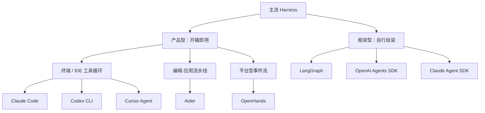

# 第 4 章 主流 Harness 横向对比

## 本章导读

一个团队同时试用三款编码 Agent，演示都能通过。上线后问题各不相同：一款频繁停在权限确认，一款把文件改到了工作区之外，还有一款跑到第四十轮时忘了最初的目标。三款产品用的模型差不多，差异不在模型分数，而在每个 Harness 把控制权、工具执行和上下文管理的边界画在了哪里。本章建立一套比较框架，用同一条任务拆开这些差异。

## 学习目标

读完本章你将能够：

- 用六个边界比较任意一个 Harness，而不是停留在功能清单；
- 区分产品型、平台型与框架型 Harness，判断控制权和运维责任归谁；
- 解释模型驱动循环、编辑-应用流水线、显式状态图、多代理交接四种控制流的取舍；
- 识别一个 Harness 的隔离边界、扩展面与锁定点；
- 针对给定任务选择 Harness，并列出必须自建的能力。

## 4.1 核心概念：比较 Harness 的六个边界

先看一个常见的比较方式：列一张功能表，逐项打勾——支持 MCP（Model Context Protocol）、支持沙箱、支持子代理、支持 Hooks。这张表几乎无法指导选型，因为同一个词在不同产品里可能完全不是一回事。

两款产品都写“支持沙箱”，一款只是在进程内检查路径前缀，另一款用操作系统能力限制文件与网络，还有一款把工具放进独立容器。三者的隔离强度差了几个数量级，功能表上却都是一个勾。两款产品都写“支持子代理”，一款共享主代理的上下文，另一款给子代理独立上下文、只回传摘要，行为也完全不同。

所以比较 Harness，不应该问“有没有这个功能”，而要问“这条边界画在哪里，责任归谁”。本书用六个边界来拆：

| 边界 | 要回答的问题 | 为什么决定实际表现 |
|---|---|---|
| 控制权边界 | 下一步由模型、代码还是图决定？ | 决定灵活性、方差与可审计性 |
| 动作边界（动作面） | 工具是通用 Shell 还是专用操作？在哪里执行？ | 决定能力范围与副作用风险 |
| 上下文边界 | 每轮放什么进去？谁负责压缩和检索？ | 决定长任务是否迷失、成本是否失控 |
| 隔离边界 | 权限检查与沙箱在哪一层？ | 决定一次错误会不会变成事故 |
| 扩展边界（扩展面） | 能在哪些生命周期节点插入自己的逻辑？ | 决定能否适配团队流程，以及锁定程度 |
| 交付边界（交付形态） | 是 CLI、IDE、云服务，还是库与 SDK？ | 决定谁部署、谁运维、谁升级 |

**一个 Harness 的能力，不是它支持多少功能，而是它在每个边界上把责任放在了哪里。** 这句话是本章的分析主线。


本章涉及的产品事实截至 2026 年 11 月，依据各项目官方文档与公开源码整理。权限模式名称、默认值、工具清单与云服务能力都可能随版本变化，具体以实现和官方文档为准。本章关注的是架构位置，不是某个版本的完整功能表。




这张分类图不是严格的产品谱系。Claude Agent SDK 就是一个混合体：它以库的形式交付，内部却嵌入了 Claude Code 这套完整的产品型 Harness。分类的目的是帮助判断“哪些能力默认就有，哪些需要自己补”，而不是给产品贴标签。

## 4.2 四类架构原型

### 4.2.1 终端 / IDE 工具循环

Claude Code、Codex CLI、Cursor Agent 是三个有代表性的终端/IDE 编码 Agent，属于这一类。它们的共同骨架是一个模型驱动的工具循环：模型返回工具调用，Harness 执行，结果回填，继续下一轮，直到模型不再请求工具或触发停止条件。

这类 Harness 的竞争力不在循环本身——循环只有几十行——而在循环外面的默认设施：

- **动作面**：文件读写、搜索、Shell、Web、MCP。工具越通用，能做的事越多，参数校验和权限设计也越难。
- **权限与沙箱**：多档权限模式、审批策略、操作系统级沙箱。它们决定“模型能做什么”和“做错了会怎样”。
- **上下文设施**：项目记忆文件、自动压缩、会话恢复。它们决定长任务能不能保持方向。
- **扩展面**：Hooks、Skills、插件、子代理。它们决定团队能不能把约定写进产品。

三款产品的主要差异不在这套循环骨架，而在这四个设施上做了不同的默认选择。

### 4.2.2 编辑-应用流水线

Aider 是一个在本地 Git 仓库上工作的终端结对编程工具，也是这一类最典型的代表。它不以工具调用循环为中心：用户把文件加入对话，模型返回特定格式的编辑块，Aider 解析、应用、自动提交，再运行配置好的检查。

这种架构把“模型生成”和“文件修改”拆成了两个可分别校验的阶段。编辑块是结构化输出，应用失败可以反馈重试；Git 提供回滚；Lint/Test 提供验证。代价是它不适合开放式任务——模型不能自由决定“下一步先搜索还是先跑测试”，流程由编辑动作主导。

第 1 章已经拆过 Aider 的仓库地图、编辑格式、Git 提交与测试回路，这里不再重复。它在对比中的位置是：**用结构化编辑协议换取稳定性，用失去工具循环换取可预测性。**

### 4.2.3 平台型事件流

OpenHands 是一个开源的自主软件工程平台，属于这一类。它把一次执行建模为事件流（Event Stream）：模型产生动作（Action），运行时执行并产生观察（Observation），两者依次追加到会话事件里，由 Agent 的 `step()` 或会话控制器推进下一步。

与终端产品相比，平台型 Harness 多了一层**运行时（Runtime）**：动作不直接在 Harness 进程里执行，而是交给 Docker、远程运行时或本地运行时中的动作执行服务。运行时负责文件系统、Shell 会话、浏览器等环境，平台负责事件、会话、UI 与多用户。

这层分离带来两个好处：隔离边界更清楚，事件流天然适合回放与调试。代价是部署更重、延迟更高，而且“通用计算机使用”会产生大量 token 与观察，需要压缩器控制上下文。

### 4.2.4 框架型编排层

LangGraph、OpenAI Agents SDK、Claude Agent SDK 属于这一类，但三者的“框架程度”差别很大。

- **LangGraph** 是低层编排库：你定义状态、节点和边，它负责按图执行、检查点、中断与流式输出（第 2 章已拆过这些机制，本章只看定位）。它不提供内置工具集、沙箱或上下文压缩，这些都由你实现。
- **OpenAI Agents SDK** 是轻量多代理库：它提供 Runner 循环、工具封装、交接（Handoff）、护栏（Guardrail）、会话与追踪，但不提供操作系统级沙箱。它的抽象很少，默认把执行环境留给调用方。
- **Claude Agent SDK** 是“把产品 Harness 装进库”：它复用 Claude Code 的循环、工具、权限、上下文与扩展机制，通过子进程运行固定版本的 Harness。它不是直接调用 Messages API 的客户端 SDK，而是把整套 Harness 作为运行时嵌入。它比前两者提供更多默认能力，也因此与 Claude Code 的版本和配置绑定得更紧。

框架型 Harness 的共同点是：**它们卖的不是默认行为，而是边界的选择权。** 你可以在控制流、工具、状态上做更细的设计，但也要为沙箱、上下文、权限和运维负责。

## 4.3 控制流：谁决定下一步

控制流是六个边界里最根本的一个。它决定了系统的灵活性、方差和可审计性。

| 控制流 | 谁决定下一步 | 代表 | 优点 | 代价 |
|---|---|---|---|---|
| 编辑-应用流水线 | 开发者与用户定义流程，模型生成编辑块 | Aider | 稳定、可审查、易回滚 | 不适合开放式探索 |
| 模型驱动工具循环 | 模型逐步决定 | Claude Code、Codex CLI、Cursor Agent、OpenHands | 灵活，能处理信息不全的任务 | 方差大，需要停止条件与验证 |
| 显式状态图 | 开发者定义的节点与边 | LangGraph | 可审计、可恢复、可强制验证 | 流程僵化，覆盖不到的情况要改图 |
| 多代理交接 | 模型或规则触发交接 | OpenAI Agents SDK | 分工清晰，子任务上下文可隔离 | 责任链与上下文传递复杂 |

这张表不是一条“先进程度”的阶梯。编辑-应用流水线在“改一个小 Bug”上可能比自由循环更稳；显式图在“必须按合规顺序执行”的场景里比模型驱动更可靠；模型驱动在“不知道下一步该查什么”的探索任务里仍然最强。

一个容易被忽略的事实是：**很多产品同时使用多种控制流。** Claude Code 的主循环是模型驱动，但子代理是受控派生，Skills 是渐进加载的扩展，Hooks 可以在生命周期节点强制插入检查。把它们简单归为“ReAct Agent”会丢掉最重要的设计。

选择控制流时，先问三个问题：

1. **任务是否可预先分解？** 可以，显式图或流水线更稳；不可以，模型驱动更合适。
2. **失败是否可逆？** 写文件、发请求、改数据库，最好有强制验证边或审批；只读探索可以让模型自由走。
3. **是否需要向审计方解释每一步？** 需要，显式边和事件流比“模型当时这么想”更容易交代。

## 4.4 动作面与隔离边界

动作面（Action Surface）是 Harness 暴露给模型的全部动作：文件读写、Shell、浏览器、Web、MCP 工具、子代理派生。动作面越大，Agent 越像“能操作计算机的人”，能力越强，攻击面也越大。

隔离边界（Isolation Boundary）决定动作在哪里执行、受什么约束。两者必须一起看：一个只有只读工具的 Agent，进程内执行也许够用；一个能执行任意 Shell 的 Agent，如果没有隔离，一次提示词注入就可能变成主机上的真实命令。

| 隔离方式 | 工具运行位置 | 代表 | 隔离强度 | 主要代价 |
|---|---|---|---|---|
| 进程内或宿主环境（无独立沙箱） | Harness 进程或宿主机 | OpenAI Agents SDK、LangGraph、Aider | 弱 | 实现简单、延迟低 |
| 操作系统沙箱 | 命令在受约束的子进程，文件工具受权限层约束 | Claude Code、Codex CLI、Cursor Agent | 中高 | 需要适配 macOS/Linux/Windows |
| 容器 / 远程运行时 | 独立容器或远端环境 | OpenHands | 高 | 部署、镜像、延迟与运维 |
| 厂商托管工具 | 厂商侧执行环境 | OpenAI 托管工具 | 高（厂商边界） | 数据出域、与厂商 API 耦合 |

操作系统沙箱通常约束的是 Shell 或命令子进程，文件读写工具是否也走沙箱，因产品而异。不要把“有沙箱”理解为“所有工具都在沙箱内执行”；权限层与沙箱层要分别检查。

几个关键判断：

**“有沙箱”不等于“隔离足够”。** 关键要看沙箱约束了什么。只限制工作目录、不限制网络，仍然可能把代码或密钥外传；只限制网络、不限制文件系统，仍然可能改坏主机。Claude Code、Codex CLI、Cursor Agent 都使用操作系统能力做文件与网络约束，但具体策略、默认值和平台支持不同，使用前要以官方文档为准。

**审批不是沙箱。** 审批解决“这个动作要不要让人确认”，沙箱解决“即使人确认错了，最坏能坏到哪里”。两者不能互相替代。Codex CLI 的一个值得注意的设计是：如果策略无法被强制执行，它宁可拒绝运行，也不降级为无沙箱执行。这是把隔离边界当成硬约束，而不是提示。

**分类器不是安全边界。** 一些产品提供“自动审查”模式，用模型判断某个命令是否危险。它可以降低打扰，但不能替代权限策略和沙箱。Cursor 的官方文档也明确说明，自动审查的分类器不应被视为安全边界。把它当安全机制，是把概率判断放在了确定性策略的位置上。

**Aider 是另一种取舍。** 它没有沙箱，工具直接在本地仓库执行，安全网是 Git：自动提交、`/undo`、dry-run。这适合“用户就在旁边、改动可回滚”的结对编程场景，不适合无人值守的自主执行。

## 4.5 上下文策略：每轮给模型看什么

上下文边界决定长任务能否保持方向，也决定成本。主流 Harness 大致有六种上下文来源，它们可以组合使用。

| 策略 | 主要来源 | 代表 | 优点 | 风险 |
|---|---|---|---|---|
| 项目记忆文件 | `CLAUDE.md`、`AGENTS.md`、规则目录 | Claude Code、Codex CLI、Cursor Agent | 约定稳定、可版本化 | 文件腐化、多来源优先级冲突 |
| 仓库地图 | 符号与引用关系图 | Aider | 在预算内选出相关代码 | 构建成本、语言覆盖有限 |
| 代码库索引 | 本地搜索索引 | Cursor Agent | 大仓库检索快 | 索引新鲜度、隐私与实现差异 |
| 对话压缩 | 摘要、滚动压缩、压缩子代理 | Claude Code、Codex CLI、OpenHands | 支持长会话 | 有损，可能丢关键状态 |
| 显式图状态 | 类型化状态、检查点 | LangGraph | 可恢复、可审计 | 需要建模，状态设计成本高 |
| 会话存储 | 消息历史、Session | OpenAI Agents SDK、Claude Agent SDK | 跨轮连续 | 会话历史不等于任务状态 |

几个差异值得单独说。

**项目记忆文件的优先级是一个架构问题。** Claude Code 会按托管策略、用户、项目、本地等层级加载 `CLAUDE.md`，还支持规则目录；Codex CLI 从最近的 Git 根目录向下发现 `AGENTS.md`，并有覆盖文件。两者都解决了“团队约定放在哪里”，但多来源冲突时谁覆盖谁、子目录规则何时加载，是需要读文档确认的细节，不能假设。

**索引与搜索是两条路线。** Cursor 强调本地搜索索引与规则；Aider 用仓库地图；Claude Code 与 Codex CLI 更多依赖模型调用搜索工具与 Shell。索引路线降低每一步的探索成本，但引入新鲜度与隐私问题；工具搜索路线更简单，但更依赖模型的检索策略。哪条更好，取决于仓库规模、语言和团队对数据出域的容忍度。

**压缩是有损的，必须知道丢了什么。** Claude Code 的自动压缩、OpenHands 的压缩器（Condenser）、Codex CLI 的压缩子代理，目标都是把长历史压到窗口内。它们通常会保留近期消息与摘要，但计划、约束、失败原因可能被压掉。生产系统应当把关键状态外置到文件或检查点，而不是指望压缩器永远保留。

**会话不等于任务状态。** OpenAI Agents SDK 的 Session、Claude Agent SDK 的会话恢复，解决的是“下一轮还能接上”，不自动解决“这个任务做到哪一步、哪些文件改过、验证是否通过”。第 2 章已经区分过会话与任务，第 7 章会把状态管理展开。

## 4.6 扩展面与交付形态

扩展面决定团队能否把自有流程塞进 Harness，也决定锁定程度。

| 扩展面 | 典型机制 | 代表 | 锁定点 |
|---|---|---|---|
| 配置与约定 | 配置文件、规则、conventions | Aider、Cursor Agent | 行为随产品版本变化 |
| 生命周期钩子 | 工具调用前后、会话开始/结束等 | Claude Code、Cursor Agent、OpenHands | 事件语义由产品定义 |
| 技能与插件 | 打包的指令、脚本、资源 | Claude Code、OpenHands | 打包格式与加载规则 |
| MCP | 标准化工具、资源、提示 | 多数产品 | 工具可移植，循环不可移植 |
| SDK 回调 | 审批回调、钩子、交接 | Claude Agent SDK、OpenAI Agents SDK | API 与运行时版本 |
| 图与节点 | 自定义节点、边、检查点 | LangGraph | 状态 Schema 与运行时 |

这里有一个常见误解：**用了 MCP 就没有锁定。** MCP 标准化的是工具接口，不是循环、上下文、权限和事件语义。你可以把同一个 MCP 工具接到多个 Harness，但它在不同 Harness 里何时被调用、结果如何截断、权限如何检查，仍然由各家的 Harness 决定。MCP 降低的是工具迁移成本，不是整体迁移成本。

交付形态则决定谁运维：

- **CLI / IDE / 云产品**：安装即用，厂商负责升级与模型接入；团队要接受产品的默认边界与发布节奏。
- **平台**：除了 Agent 循环，还提供运行时、会话、UI 与多租户；适合要快速上线自主执行的团队，但部署与隔离由平台承载。
- **库 / SDK**：嵌入现有服务，控制力最强；沙箱、上下文、权限、追踪、评测都要自己补。

## 4.7 设计权衡

### 4.7.1 产品型 Harness 还是框架型 Harness

| 维度 | 产品型 | 框架型 |
|---|---|---|
| 上手成本 | 低，默认设施齐全 | 高，需要自己组装 |
| 默认安全 | 通常内置权限与沙箱 | 多数只给原语，安全自建 |
| 控制粒度 | 受产品接口限制 | 高，可改循环与状态 |
| 升级路径 | 跟随厂商 | 自行维护与迁移 |
| 锁定风险 | 行为、生态与数据格式 | API、运行时与状态 Schema |
| 适用场景 | 团队直接用于编码、运维 | 嵌入产品、特殊流程、深度定制 |

产品型卖的是**默认边界**，框架型卖的是**边界的选择权**。没有特殊流程时，产品型的默认设施往往比自研更成熟；流程特殊、需要嵌入自有系统时，框架型更合适。最差的组合是“用产品型却想改它的核心循环”——既付了产品的成本，又没有得到框架的自由。

### 4.7.2 模型驱动循环还是显式状态图

| 维度 | 模型驱动循环 | 显式状态图 |
|---|---|---|
| 控制权 | 模型 | 开发者 |
| 适应性 | 高，能随观察改路线 | 低，偏离需要改图 |
| 可审计性 | 依赖追踪与提示 | 节点与边天然可审计 |
| 强制验证 | 需要工具/Hook 设计 | 可以做成必经边 |
| 失败模式 | 迷失、空转、假完成 | 流程僵化、覆盖不足 |
| 适用场景 | 探索、开放任务、信息不全 | 合规流程、固定阶段、强验证 |

生产系统常见的折中是“图里放循环”：外层用显式节点保证阶段与验证，内层某一个节点允许模型自由调用工具。这样既保留探索能力，又给关键阶段加上硬边界。

### 4.7.3 进程内工具还是隔离运行时

| 维度 | 进程内工具 | 隔离运行时 |
|---|---|---|
| 延迟 | 低 | 较高，含启动与网络开销 |
| 隔离强度 | 弱，依赖代码检查 | 强，系统级约束 |
| 文件与网络控制 | 由工具实现自行保证 | 由沙箱/容器策略保证 |
| 运维复杂度 | 低 | 高，需要镜像、配额、回收 |
| 适用场景 | 只读、可信环境、原型 | 写操作、多租户、不可信代码 |

如果 Agent 只读文件、只查检索，进程内工具可以接受；只要它能执行 Shell、写文件、访问网络，就应该把隔离边界当成和循环同等重要的设计对象。

## 4.8 代码实践：同一任务，两种 Harness 风格

下面用第 3 章的 `Provider` 接口做一个最小对比。为了把注意力放在控制流上，这里只保留 `complete()`，省略流式、错误分类和真实传输；这些在第 3 章已经实现。

任务相同、工具相同、脚本模型相同，唯一变化是**谁决定下一步**：

- 自由循环：模型返回工具调用，循环执行；模型不再调用工具就结束。
- 显式图：节点与边由代码定义；`verify` 是必经节点，失败就回到 `draft`。

脚本模型会让自由循环写一份错误的报告，然后自称完成；图的验证节点会发现错误并要求重写。这不是说自由循环做不到验证，而是说**验证是否发生取决于模型的选择；图把它变成了不可绕过的边**。即使给自由循环也提供一个验证工具，模型仍然可以跳过它；要让验证不可跳过，必须在循环外加强制检查。



```python
from __future__ import annotations

import asyncio
from dataclasses import dataclass, field
from pathlib import Path
from typing import Any, Callable, Optional


@dataclass(frozen=True)
class ToolCall:
    id: str
    name: str
    args: dict[str, Any]


@dataclass
class ModelResponse:
    text: str = ""
    tool_calls: list[ToolCall] = field(default_factory=list)


@dataclass
class Message:
    role: str
    content: str
    tool_call_id: Optional[str] = None


class ScriptedProvider:
    """第 3 章 Provider 协议的最小化版本：只保留 complete()。"""

    def __init__(self, responses: list[ModelResponse]) -> None:
        self.responses = list(responses)
        self.cursor = 0

    async def complete(
        self,
        messages: list[Message],
        tools: Optional[list[dict[str, Any]]] = None,
    ) -> ModelResponse:
        if self.cursor >= len(self.responses):
            return ModelResponse(text="脚本已耗尽")
        response = self.responses[self.cursor]
        self.cursor += 1
        return response


def read_file(path: str) -> str:
    return Path(path).read_text(encoding="utf-8")


def write_file(path: str, content: str) -> str:
    Path(path).write_text(content, encoding="utf-8")
    return f"wrote {len(content)} chars"


TOOLS: dict[str, Callable[..., str]] = {
    "read_file": read_file,
    "write_file": write_file,
}

TASK = "统计 demo.txt 的行数，并写一份 report.md"


async def run_free(
    provider: ScriptedProvider, max_turns: int = 6
) -> tuple[str, str]:
    messages = [Message("user", TASK)]
    print("[free] 控制权在模型：每轮由模型决定下一步")

    for turn in range(1, max_turns + 1):
        response = await provider.complete(messages, [])
        if not response.tool_calls:
            print(f"[free] turn {turn}: final -> {response.text}")
            return "completed", response.text

        names = ", ".join(call.name for call in response.tool_calls)
        messages.append(Message("assistant", f"[calls: {names}]"))
        for call in response.tool_calls:
            try:
                observation = TOOLS[call.name](**call.args)
            except Exception as exc:
                observation = f"错误：{type(exc).__name__}: {exc}"
            messages.append(Message("tool", observation, call.id))
            print(f"[free] turn {turn}: {call.name} -> {observation[:40]!r}")

    return "max_turns", ""


@dataclass
class GraphState:
    content: str = ""
    report: str = ""
    attempts: int = 0
    passed: bool = False


async def node_collect(state: GraphState) -> str:
    state.content = read_file("demo.txt")
    return "draft"


async def node_draft(state: GraphState, provider: ScriptedProvider) -> str:
    response = await provider.complete(
        [Message("user", f"根据以下内容写报告：\n{state.content}")], []
    )
    state.report = response.text
    return "verify"


async def node_verify(state: GraphState) -> str:
    state.attempts += 1
    state.passed = "3 行" in state.report
    print(
        f"[graph] verify -> {'pass' if state.passed else 'retry'}"
        f" (attempt {state.attempts})"
    )
    return "done" if state.passed else "draft"


async def run_graph(
    provider: ScriptedProvider, max_nodes: int = 6
) -> tuple[str, GraphState]:
    state = GraphState()
    nodes: dict[str, Callable[[GraphState], Any]] = {
        "collect": node_collect,
        "draft": lambda s: node_draft(s, provider),
        "verify": node_verify,
    }
    current = "collect"
    print("[graph] 控制权在边：节点固定，验证是必经边")

    for _ in range(1, max_nodes + 1):
        if current != "verify":
            print(f"[graph] node {current}")
        nxt = await nodes[current](state)
        if nxt == "done":
            return "completed", state
        current = nxt

    return "max_nodes", state


async def main() -> None:
    Path("demo.txt").write_text("alpha\nbeta\ngamma\n", encoding="utf-8")

    free_provider = ScriptedProvider(
        [
            ModelResponse(
                tool_calls=[ToolCall("c1", "read_file", {"path": "demo.txt"})]
            ),
            ModelResponse(
                tool_calls=[
                    ToolCall(
                        "c2",
                        "write_file",
                        {
                            "path": "report.md",
                            "content": "demo.txt has some lines\n",
                        },
                    )
                ]
            ),
            ModelResponse(text="已完成"),
        ]
    )
    free_status, _ = await run_free(free_provider)
    free_report = Path("report.md").read_text(encoding="utf-8").strip()
    print(f"[free] stop={free_status}, verified=False, report={free_report!r}")

    graph_provider = ScriptedProvider(
        [
            ModelResponse(text="demo.txt 有多行"),
            ModelResponse(text="demo.txt 共 3 行"),
        ]
    )
    graph_status, graph_state = await run_graph(graph_provider)
    print(
        f"[graph] stop={graph_status}, attempts={graph_state.attempts}, "
        f"report={graph_state.report!r}"
    )

    Path("report.md").write_text(graph_state.report + "\n", encoding="utf-8")


if __name__ == "__main__":
    asyncio.run(main())
```



```typescript
import { readFile, writeFile } from "node:fs/promises";

type ToolCall = { id: string; name: string; args: Record<string, unknown> };
type ModelResponse = { text?: string; toolCalls?: ToolCall[] };
type Message = {
  role: "user" | "assistant" | "tool";
  content: string;
  toolCallId?: string;
};

class ScriptedProvider {
  private responses: ModelResponse[];
  private cursor = 0;

  constructor(responses: ModelResponse[]) {
    this.responses = responses;
  }

  async complete(
    _messages: Message[],
    _tools: unknown[] = [],
  ): Promise<ModelResponse> {
    return this.responses[this.cursor++] ?? { text: "脚本已耗尽" };
  }
}

const tools: Record<
  string,
  (args: Record<string, unknown>) => Promise<string>
> = {
  read_file: async ({ path }) => readFile(String(path), "utf-8"),
  write_file: async ({ path, content }) => {
    const text = String(content);
    await writeFile(String(path), text, "utf-8");
    return `wrote ${text.length} chars`;
  },
};

const TASK = "统计 demo.txt 的行数，并写一份 report.md";

async function runFree(
  provider: ScriptedProvider,
  maxTurns = 6,
): Promise<[string, string]> {
  const messages: Message[] = [{ role: "user", content: TASK }];
  console.log("[free] 控制权在模型：每轮由模型决定下一步");

  for (let turn = 1; turn <= maxTurns; turn++) {
    const response = await provider.complete(messages);
    const calls = response.toolCalls ?? [];
    if (calls.length === 0) {
      console.log(`[free] turn ${turn}: final -> ${response.text ?? ""}`);
      return ["completed", response.text ?? ""];
    }

    messages.push({
      role: "assistant",
      content: `[calls: ${calls.map((c) => c.name).join(", ")}]`,
    });
    for (const call of calls) {
      let observation: string;
      try {
        const fn = tools[call.name];
        observation = fn
          ? await fn(call.args)
          : `错误：未知工具 ${call.name}`;
      } catch (error) {
        observation = `错误：${(error as Error).message}`;
      }
      messages.push({ role: "tool", content: observation, toolCallId: call.id });
      console.log(
        `[free] turn ${turn}: ${call.name} -> ${JSON.stringify(observation.slice(0, 40))}`,
      );
    }
  }

  return ["max_turns", ""];
}

type GraphState = {
  content: string;
  report: string;
  attempts: number;
  passed: boolean;
};

async function nodeCollect(state: GraphState): Promise<string> {
  state.content = await readFile("demo.txt", "utf-8");
  return "draft";
}

async function nodeDraft(
  state: GraphState,
  provider: ScriptedProvider,
): Promise<string> {
  const response = await provider.complete([
    { role: "user", content: `根据以下内容写报告：\n${state.content}` },
  ]);
  state.report = response.text ?? "";
  return "verify";
}

async function nodeVerify(state: GraphState): Promise<string> {
  state.attempts++;
  state.passed = state.report.includes("3 行");
  console.log(
    `[graph] verify -> ${state.passed ? "pass" : "retry"} (attempt ${state.attempts})`,
  );
  return state.passed ? "done" : "draft";
}

async function runGraph(
  provider: ScriptedProvider,
  maxNodes = 6,
): Promise<[string, GraphState]> {
  const state: GraphState = {
    content: "",
    report: "",
    attempts: 0,
    passed: false,
  };
  const nodes: Record<string, (s: GraphState) => Promise<string>> = {
    collect: nodeCollect,
    draft: (s) => nodeDraft(s, provider),
    verify: nodeVerify,
  };
  let current = "collect";
  console.log("[graph] 控制权在边：节点固定，验证是必经边");

  for (let i = 0; i < maxNodes; i++) {
    if (current !== "verify") console.log(`[graph] node ${current}`);
    const next = await nodes[current](state);
    if (next === "done") return ["completed", state];
    current = next;
  }

  return ["max_nodes", state];
}

await writeFile("demo.txt", "alpha\nbeta\ngamma\n", "utf-8");

const freeProvider = new ScriptedProvider([
  { toolCalls: [{ id: "c1", name: "read_file", args: { path: "demo.txt" } }] },
  {
    toolCalls: [
      {
        id: "c2",
        name: "write_file",
        args: { path: "report.md", content: "demo.txt has some lines\n" },
      },
    ],
  },
  { text: "已完成" },
]);
const [freeStatus] = await runFree(freeProvider);
const freeReport = (await readFile("report.md", "utf-8")).trim();
console.log(
  `[free] stop=${freeStatus}, verified=false, report=${JSON.stringify(freeReport)}`,
);

const graphProvider = new ScriptedProvider([
  { text: "demo.txt 有多行" },
  { text: "demo.txt 共 3 行" },
]);
const [graphStatus, graphState] = await runGraph(graphProvider);
console.log(
  `[graph] stop=${graphStatus}, attempts=${graphState.attempts}, report=${JSON.stringify(graphState.report)}`,
);

await writeFile("report.md", `${graphState.report}\n`, "utf-8");
```



为了让轨迹易读，示例把 assistant 的工具调用压成了文本摘要；生产实现应保留第 3 章的 `Message.tool_calls` 结构，否则适配器无法把工具结果正确关联回调用。

Python 版运行输出（TypeScript 版仅引号与布尔拼写不同，语义一致）：

```text
[free] 控制权在模型：每轮由模型决定下一步
[free] turn 1: read_file -> 'alpha\nbeta\ngamma\n'
[free] turn 2: write_file -> 'wrote 24 chars'
[free] turn 3: final -> 已完成
[free] stop=completed, verified=False, report='demo.txt has some lines'
[graph] 控制权在边：节点固定，验证是必经边
[graph] node collect
[graph] node draft
[graph] verify -> retry (attempt 1)
[graph] node draft
[graph] verify -> pass (attempt 2)
[graph] stop=completed, attempts=2, report='demo.txt 共 3 行'
```

两段代码的差异可以归到四点：

| 对比点 | 自由循环 | 显式图 |
|---|---|---|
| 谁决定下一步 | 模型 | 边 |
| 验证是否发生 | 取决于模型是否调用验证工具 | 必经节点，失败回退 |
| 失败恢复 | 模型根据观察自行调整 | 条件边显式回退，状态保留 |
| 适用任务 | 探索、开放、信息不全 | 合规、固定阶段、强验证 |

自由循环的 `stop=completed` 是一个真实的风险：循环只检查了“没有工具调用”，没有检查“报告是否正确”。生产环境可以给自由循环加验证工具、Hook 或后置检查，但那仍然是 Harness 的设计选择，不会因为用了某个框架自动出现。

## 4.9 业界案例：同一条修复任务在四类 Harness 中的走法

把任务换成“修复一个失败的单元测试”，更容易看出边界差异。下表列的是每类 Harness 的可用机制，不是默认保证；产品型 Harness 是否真的跑测试，通常仍取决于模型是否选择调用测试工具，除非你用 Hooks、CI 或外部验证把它变成强制环节。

| 阶段 | Claude Code | Codex CLI | OpenHands | LangGraph |
|---|---|---|---|---|
| 上下文 | `CLAUDE.md` 层级 + 搜索工具 | `AGENTS.md` 发现 + 持久线程 | 对话历史 + 压缩器 | 你定义的图状态 |
| 探索 | Read / Grep / Glob | Shell 中的搜索命令 | Bash + 文件编辑器 | 你实现的节点与工具 |
| 修改 | Edit / Write | `apply_patch` | 文件编辑器动作 | 工具节点 |
| 验证 | Bash 跑测试 | Shell 跑测试 | Bash 跑测试 | 你实现的 verify 节点 |
| 安全 | 权限模式 + 操作系统沙箱 | 审批策略 + 操作系统沙箱 | 容器/远程运行时 | 无默认，自行实现 |
| 停止 | 无工具调用 + 可选验证 | 循环结束 + 可选验证 | Agent 步结束 | 条件边 |
| 扩展 | Hooks / Skills / MCP | 配置 / MCP | 插件 / MCP | 节点 / 检查点 |

四类走法的差异，可以压缩成三组对比。

**Claude Code 与 Codex CLI：同一类产品，不同的默认边界。** 两者都是终端编码 Agent，都用模型驱动的工具循环，也都提供操作系统级沙箱。差异在于产品重心：Claude Code 把 Hooks、Skills、插件、子代理和项目记忆文件做成显眼的扩展面，适合把团队约定写进产品；Codex CLI 更强调配置、审批策略与“策略无法强制执行就拒绝运行”的硬约束，适合把执行环境管得更死。一个偏“可扩展的产品”，一个偏“可配置的执行器”。具体功能与默认值以各自官方文档为准。

**OpenHands 与 LangGraph：平台与库的分工。** OpenHands 提供运行时、容器隔离、事件流、会话与 UI，你拿到的是一个能跑起来的自主 Agent 平台；LangGraph 提供状态图、检查点、中断与流式，你拿到的是编排骨架，工具、沙箱、上下文压缩都要自己补。需要快速上线通用自主执行，平台更省事；需要把特定业务流程嵌入现有系统，库更合适。两者的隔离边界不在同一层：OpenHands 把隔离放在运行时，LangGraph 把隔离留给部署方。

**Aider 与 Cursor Agent：两种交互模型。** Aider 是编辑-应用流水线，优势在编辑可靠性与 Git 回滚，默认由用户驱动、用户通常在回路里；Cursor Agent 是 IDE 内的工具循环，优势在代码库检索、编辑器上下文与低摩擦交互，代价是更多编排逻辑不公开。它们优化的瓶颈不同：一个优化“改得准、回得去”，一个优化“找得到、改得快”。

最后是 **Claude Agent SDK** 这个混合体。它把 Claude Code 的循环、工具、权限、上下文和扩展机制装进 Python/TypeScript 库，适合“想要产品级默认能力，又要程序化控制”的场景。代价是 SDK 与固定版本的 Harness 绑定，默认系统提示词、审批回调和子代理文本的可见性都有迁移细节，接入前要读官方迁移文档。

这一节的核心判断是：**产品型 Harness 卖的是默认边界，框架型 Harness 卖的是边界的选择权。** 选型时先列出你必须自己掌控的边界——通常是隔离、上下文和验证——再看候选产品把这三条边界放在了哪里。功能表只能告诉你“能不能做”，边界才告诉你“出了事谁负责”。

## 4.10 常见陷阱

**陷阱一：用功能清单代替架构比较。**
“支持 MCP、支持沙箱、支持子代理”三个勾，可能对应完全不同的隔离强度和控制粒度。正确做法是顺着六个边界逐项问：工具在哪执行、上下文谁压缩、权限在哪检查、扩展点能否改变控制流。功能表适合排除明显不合适的候选，不适合做最终决策。

**陷阱二：把 SDK 当成完整 Harness。**
OpenAI Agents SDK 和 LangGraph 提供循环或图执行、工具封装、状态与交接，但不提供操作系统沙箱、上下文压缩和权限策略。把它们直接接到生产环境的 Shell 上，等于把最危险的部分留空。Claude Agent SDK 是例外，它嵌入的是完整的产品 Harness；但也要确认它的权限、沙箱与版本绑定是否符合你的部署要求。

**陷阱三：把“有沙箱”当成“隔离足够”。**
只限制工作目录、不限制网络，或者只在应用层检查路径、不限制子进程，都不等于隔离。要看沙箱约束了哪些系统资源、默认策略是什么、策略无法执行时会不会拒绝运行。对能执行任意 Shell 的 Agent，隔离边界应当和循环一样被当作核心设计。

**陷阱四：把扩展点当成反锁定保险。**
Hooks、插件、MCP 确实提高了可移植性，但它们都依附于宿主的事件语义与生命周期。工具可以迁移，循环、权限、上下文策略和追踪格式未必能迁移。评估锁定时，要分别问“工具能不能带走”“状态能不能导出”“行为能不能复现”，而不是只看有没有 MCP。

**陷阱五：用单一 benchmark 选型。**
SWE-bench 之类的基准测的是特定任务、特定 Harness 下的通过率，不测权限模型、沙箱强度、上下文成本与运维复杂度。一个在基准上高几分的产品，可能在你最关心的“无人值守写操作”上根本没有隔离。选型应该用自己的任务集做小规模 A/B，同时记录失败类型与人工介入次数。

## 4.11 本章小结

- 比较 Harness 要看六个边界：控制权、动作面、上下文、隔离、扩展与交付，而不是功能清单。
- 主流 Harness 可分为四类原型：终端/IDE 工具循环、编辑-应用流水线、平台型事件流、框架型编排层。
- 控制流没有先进与否，只有任务匹配：模型驱动适合探索，显式图适合合规与强验证，流水线适合稳定编辑，交接适合分工。
- 动作面越大，隔离边界越重要；审批、分类器与沙箱解决的是不同问题，不能互相替代。
- 上下文策略各有代价：项目记忆、仓库地图、代码索引、压缩、图状态、会话存储可以组合，但要明确谁负责保留关键状态。
- 产品型 Harness 提供默认边界，框架型 Harness 提供边界的选择权；锁定点通常在循环、状态与事件语义，而不只是工具接口。
- 同一任务在自由循环与显式图中的结果可能不同：自由循环让模型决定验证是否发生，显式图把验证变成必经边。
- 选型时先确定必须自己掌控的边界，再看候选产品把隔离、上下文和验证放在了哪里。

## 4.12 思考题

1. 你正在为一个已有后端系统选 Agent Harness。列出三项必须由你掌控的边界，并判断哪些候选产品把它们放在了你能接受的位置。哪些能力你愿意交给产品默认实现？
2. 同一条任务在一个产品型 Harness 和一个框架型 Harness 中都失败了：一个在第 30 轮重复读文件，另一个在第 3 个节点卡住。分别指出它们最可能出问题的边界，并给出两种不同的修复方向。
3. 如果模型的长程规划能力提升十倍，本章哪些差异会缩小，哪些不会？请从控制权、隔离和验证三个边界分别回答。
