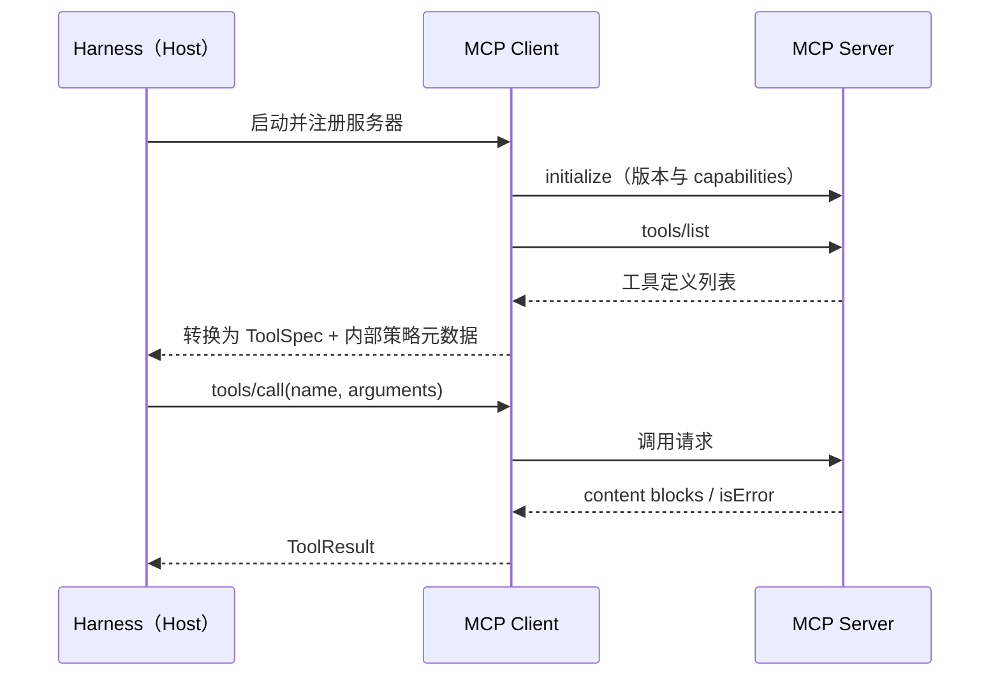

# 第 5 章 工具系统设计

## 本章导读

MiniCoder 在前四章已经有了循环、模型接入层和两个演示工具。把它接到一个真实仓库后，问题很快出现：模型把日志路径写成绝对路径，读到了工作区外面；一个 40 万行的日志被原样塞回上下文，下一轮直接超限；工具失败只返回 `FileNotFoundError`，模型连续三次重试同一个路径；两个工具的职责重叠，模型在它们之间反复摇摆。这些都不是模型能力问题，而是工具接口的含糊被执行循环放大了。本章讨论如何把“给模型几个函数”变成一套可设计、可校验、可治理的工具系统。

## 学习目标

读完本章你将能够：

- 设计工具 Schema：命名、参数、描述与粒度；
- 设计成功、错误与截断结果，使模型能在下一轮自我修正；
- 实现 `ToolRegistry` 与 `ToolExecutor`，把校验、授权、超时、并行安全收口到一处；
- 判断何时自建工具、何时接入 MCP，并识别 MCP 的信任边界；
- 评估工具集的动作面、风险与重叠，避免“工具越多越好”。

## 5.1 核心概念：工具是模型的感官和手

模型只能看到文本，也只能输出文本与结构化调用。它不能读文件、不能执行命令、不能访问网络；所有这些能力都必须由 Harness 以工具的形式提供。因此，工具不是“给模型加几个函数”，而是模型感知环境、作用于环境的全部接口。接口设计得含糊，模型就只能在猜测中行动。

第 1 章说过，模型输出是提案，Harness 决定是否变成效果。工具系统正是这条边界最集中的地方。

### 5.1.1 三个平面

一个工具同时存在于三个平面上，混在一起思考是大多数工具 bug 的来源。

| 平面 | 内容 | 谁消费 | 典型失败 |
|---|---|---|---|
| 定义面 | 名称、描述、参数 Schema | 模型 | 选错工具、漏填参数、填错格式 |
| 执行面 | 校验、授权、执行、超时 | Harness | 路径越界、越权、进程挂起 |
| 观察面 | 成功内容、错误、截断标记 | 模型 | 无法判断结果、重复调用、上下文撑爆 |

定义面是提示词的一部分。模型对工具的全部理解来自 `name`、`description` 和 `parameters`，它看不到你的实现。执行面是普通工程代码：参数要校验，路径要解析，权限要检查，进程要有超时。观察面则决定模型下一步：同样是失败，“文件不存在”和“权限被拒绝”应该导向完全不同的动作。

三个平面不能互相替代：

- **Schema 不是校验。** Schema 约束模型的输出，但模型仍可能返回缺字段、类型错误、多余字段的 JSON；工具执行器（Tool Executor）必须再校验一次。
- **校验不是授权。** 参数形状合法，不代表这个路径、这条命令允许执行。路径 `../../etc/passwd` 完全符合 `string` 类型。
- **授权不是沙箱。** 权限层决定“要不要做”，沙箱决定“做错了最坏坏到哪里”。第 10、11 章分别展开。


### 5.1.2 工具调用只是传输格式

函数调用（Function Calling）标准化的是“模型如何把一次动作请求表达成 JSON”。它不规定工具做什么、失败怎么返回、结果多长、能否并行、需要什么权限。两个工具可以共享同一份 Schema 形状，行为却完全不同。

这也是为什么“接上 MCP 就有工具生态”是一种过度简化。MCP 标准化的是工具的发现与调用协议，不是工具语义、结果质量和权限策略。同样一个 `search_code`，有的服务返回精确行号，有的返回一大段 HTML；模型的表现会差很多。

### 5.1.3 粒度：一次可验证的动作

工具粒度是最容易被忽略的设计决策。太粗，执行器无法校验，权限无法分级，失败后模型不知道该改什么；太细，工具数量和描述成本上升，模型选择困难，每一步都多一次往返。

判断粒度可以问三个问题：

1. 这个动作的结果能否被清晰地验证？例如 `read_file` 返回内容与行号，`edit_file` 返回替换是否唯一命中。
2. 失败时，模型能否根据观察修正？`read_file` 可以改用 `offset`，`run_shell("cat x | head")` 失败后模型往往只能重试。
3. 它是否对应一个清晰的权限决策？“读这个文件”可以按路径授权，“执行任意命令”只能整体放行或整体拒绝。

| 粒度 | 例子 | 优点 | 代价 |
|---|---|---|---|
| 粗 | `run_shell(command)` | 覆盖一切 | 难校验、难授权、错误不可行动 |
| 中 | `read_file`、`edit_file`、`search_text` | 可校验、可分级、观察稳定 | 需要为每类动作设计接口 |
| 细 | `read_line`、`stat_file` | 权限极细 | 步数膨胀，模型组合成本高 |

实践中通常保留一个通用 Shell 作为逃生口，但把它标成最高风险、放进沙箱、默认需要审批（第 10、11 章）。核心高频动作则做成专用工具，因为专用接口能承载校验、权限和更好的观察格式。

## 5.2 工具 Schema：写给模型的接口说明

Schema 由模型消费，不是由编译器消费。判断一份 Schema 好不好，标准不是“形式正确”，而是“模型能否稳定选对工具、填对参数”。

### 5.2.1 命名

工具名是模型选择工具时最强的信号。约定如下：

- 动词开头，`snake_case`：`read_file`、`write_file`、`search_text`、`run_command`。
- 名字表达动作与对象，不用内部实现名：`fetch_user` 好于 `call_user_service`。
- 同一概念只用一个名字：不要同时出现 `read_file`、`cat_file`、`open_file`。
- 保持稳定。改名会破坏提示词、评测集、权限规则和历史轨迹的可比性。

当工具来自多个来源时，需要工具命名空间（Tool Namespace）。Claude Code 对 MCP 工具采用 `mcp__<server>__<tool>` 这类带服务名前缀的命名，避免不同服务器的 `search` 互相覆盖。无论采用哪种分隔符，规则要固定、可逆，并写进文档。

### 5.2.2 参数：少、平、可枚举

模型填参的可靠性随参数数量与嵌套深度下降。经验规则：

- 参数控制在 5 个左右；超过 7 个通常说明动作太大，应该拆分。
- 优先扁平结构。嵌套对象让模型更容易漏层级，也让错误信息更难定位。
- 用 `enum` 代替自由字符串表达模式：`mode: "content" | "files_with_matches" | "count"`。
- 必填参数尽量少；默认值写进描述，而不是让模型猜。
- 路径统一相对于工作区，禁用绝对路径作为默认输入。
- 禁止把 Shell 片段塞进专用工具的参数里，例如 `read_file(path="x; rm -rf /")`。
- 显式设置 `additionalProperties: false`，让多余字段在本地就失败。

参数名也要一致。`path` 就是路径，`pattern` 就是正则，不要让一个工具叫 `file`、另一个叫 `filepath`、第三个叫 `filename`。

`edit_file` 是一个值得单独看的设计。它通常只有四个参数：`path`、`old_string`、`new_string`、`replace_all`。`old_string` 同时承担两个职责：定位修改位置，以及证明模型看到的确实是当前内容。如果 `old_string` 在文件中出现多次，工具应当失败并返回命中数量或候选行，而不是猜一个位置改掉。**把“改哪里”变成可校验的输入，比让模型输出行号可靠得多。**

### 5.2.3 描述：模型唯一的说明书

工具描述不是 API 文档，更不是营销文案。它要回答四个问题：

1. 这个工具做什么；
2. 什么时候该用它；
3. 什么时候不该用它、应该用什么替代；
4. 有什么副作用，返回什么形状。

一到三句话足够。描述里最有价值的信息往往是否定与边界：“只读”、“会覆盖已有内容”、“不递归子目录”、“结果超过 200 行会截断”。

| 反例 | 问题 | 改进 |
|---|---|---|
| “强大的文件读取工具” | 没有信息量 | “读取工作区的 UTF-8 文件，返回带行号内容，默认最多 200 行” |
| “执行命令” | 不说明副作用与边界 | “在工作区执行 Shell 命令；会改变文件系统，需要审批，默认 15 秒超时” |
| “搜索” | 不知道搜什么、怎么搜 | “按正则搜索文本文件，返回 文件:行号: 内容；忽略 .git 与 node_modules” |

参数描述同样重要。`"limit": "行数"` 不如 `"最多返回的行数，默认 200；文件更长时用 offset 继续"`。单位、范围、默认值、示例都属于描述的一部分。


工具描述是提示词。修改一个词就可能改变模型的工具选择，因此描述变更应当像提示词变更一样进入评测（第 15 章），而不是当作普通注释随手改。


### 5.2.4 Schema 是合同的草稿，校验在执行器

即使厂商提供严格模式（Strict Mode），也不能假设参数一定合法。兼容服务对严格模式的支持不一致；模型在长上下文、并行调用或参数被截断时仍可能输出坏 JSON；工具还可能被其他 Harness 或脚本直接调用。

工具执行器需要自己做一层参数校验（Argument Validation），并且只实现第 3 章约定的那个 Schema 子集。校验失败不要抛到循环外，而应转成一条可行动的观察：

```text
[invalid_args] 参数不合法：缺少必填参数 $.content。请按工具 Schema 修正后重试
```

还有一类约束无法写进 JSON Schema：文件是否存在、路径是否在工作区、`old_string` 是否唯一、命令是否被允许。这些属于语义校验，必须在 handler 或执行器里完成，并把结果同样格式化成观察。

## 5.3 工具结果：回填给模型的第二次提示

工具执行完，模型看到的不是返回值，而是一段新的上下文。结果设计得好，模型下一步就能修正；设计得差，模型只能在错误信息里猜。

### 5.3.1 为什么需要 ToolResult

前几章的演示工具直接返回字符串，够用，但丢掉了太多信息。生产实现至少需要五个维度：

| 字段 | 作用 |
|---|---|
| `ok` | 成功还是失败；不要用空字符串表示失败 |
| `content` | 成功时的正文，格式稳定、可引用 |
| `error` / `error_code` | 给人看的说明与给机器统计的稳定代码 |
| `truncated` | 结果是否被截断（Truncation），避免模型误以为看到了全部 |
| `metadata` | 行数、匹配数、原始长度等，供 Harness 与追踪使用 |

失败不要用异常穿透整个循环。工具失败是正常业务的一部分，异常只应表示 Harness 自身的 bug。执行器捕获工具异常，转成 `ToolResult`，循环才能继续给模型修正的机会。

### 5.3.2 成功结果：稳定、可引用、够用

成功结果的目标不是“把数据全给模型”，而是“给模型足够完成下一步、且能引用的信息”。

- **带行号。** `read_file` 返回 `行号\t内容`，模型后续可以用行号讨论，也更容易发现片段缺口。
- **用相对路径。** 工作区内的路径统一显示为相对路径，减少噪声，也避免泄露主机目录结构。
- **说明变化。** `write_file` 不只返回 “ok”，而返回“已写入 N 个字符到 notes.md”，让模型确认目标与规模。
- **稳定格式。** 同样的工具每次用同样的格式，模型才能比较两次结果。搜索返回 `文件:行号: 内容`，不要这次用 JSON、下次用表格。
- **不要回显输入。** 模型刚写的内容不需要原样返回；返回摘要与验证线索更有价值。

结果用稳定文本还是 JSON，取决于模型下一步如何使用它；完整权衡见 5.6.2。

### 5.3.3 错误结果：让模型能修正，而不是猜

错误信息是工具设计里回报最高的一部分。一个好的错误至少回答三件事：什么失败了、为什么、下一步可以怎么做。

| 错误代码 | 触发场景 | 回填示例 |
|---|---|---|
| `unknown_tool` | 模型拼错工具名 | `未知工具 'read_flie'。可用工具：read_file, search_text, write_file` |
| `invalid_args` | 缺字段、类型错、多余字段 | `参数不合法：缺少必填参数 $.content。请按 Schema 修正后重试` |
| `not_found` | 文件或目录不存在 | `文件不存在：missing.md；可先用 search_text 确认路径` |
| `path_outside_workspace` | 路径越界 | `路径 '../x' 超出工作区；所有路径必须位于工作区内` |
| `permission_denied` | 策略拒绝 | `策略拒绝：read_file 不允许访问 secrets/ 目录` |
| `timeout` | 超过单工具时限 | `执行超过 15 秒，已终止；可缩小范围后重试` |
| `execution_failed` | 未预期异常 | `工具内部错误：ValueError；请调整输入或换一种方式` |

几条规则：

- **区分稳定代码与人类可读文案。** `error_code` 用于监控、评测和重试策略；文案用于模型理解。
- **不要泄露堆栈、密钥与主机细节。** 堆栈对模型没有帮助，却可能把内部路径、令牌带进上下文。
- **不要指责模型。** 中性描述事实与出路，避免“你错了”这类措辞。
- **不要鼓励盲目重试。** 超时和限流可以重试，参数错误、权限拒绝、文件不存在通常重试无益，应该换动作。
- **未知工具时列出可用工具。** 这是最低成本的自我修正线索。


工具返回内容本身是不可信输入。文件里可能写着“忽略之前的指令”，搜索结果可能包含注入文本。错误信息与成功结果都要按不可信数据处理，第 11 章会展开防御。


### 5.3.4 截断：宁可少给，也不要静默截断

一个 40 万行的日志足以让下一轮直接上下文超限；一个 10 MB 的 JSON 可能让模型在解析上浪费几千 token。截断不是可选项，但**静默截断比不截断更危险**：模型会以为看到了全部，基于缺失信息下结论。

推荐策略：

- 按行截断优先于按字节截断，避免把一行或一个 UTF-8 字符切成两半。
- 保留头部与尾部，中间用明确的省略标记，例如 `...（省略 3987 行）...`。
- 在结果末尾追加可执行的续读提示，并设置 `truncated=true`。
- 续读提示要工具相关：`read_file` 用 `offset/limit`，搜索用更精确的 pattern 或更小范围，命令用重定向到文件再分页读取。
- 对 JSON 要么保持结构完整，要么整体转成文本摘要；不要把 JSON 截成非法片段再交给模型。

| 策略 | 优点 | 风险 |
|---|---|---|
| 只保留头部 | 实现简单 | 丢失结尾结论、错误堆栈 |
| 头尾保留 | 兼顾开头与结论 | 中间关键行可能被省略 |
| 按 token 预算动态截断 | 与上下文管理联动 | 需要准确的 token 估算 |
| 写入文件并返回路径 | 不丢信息 | 多一次读取，路径需可访问 |

第 6 章会把截断纳入上下文预算统一管理；本章只要求工具自己声明“我截断了”，并给出续读方式。

### 5.3.5 幂等与副作用

读工具天然幂等；`write_file` 覆盖写入在内容相同时近似幂等；`edit_file` 依赖 `old_string` 的唯一性；`run_command` 往往完全不幂等。这个差异直接影响失败处理：

- 超时后自动重试 `read_file` 是安全的，重试 `run_command` 可能重复发送邮件或重复提交。
- 写工具执行到一半失败时，文件可能处于部分写入状态；要么用临时文件加原子替换，要么在结果里明确告知不确定性。
- 需要重试的写操作，应在更高层使用幂等键（第 17 章）或先读后写做对账。

工具系统不能假装所有动作都可以安全重试。**在工具元数据里标注副作用与幂等性，比在循环里统一重试更可靠。**

## 5.4 注册与执行：把约定变成代码

有了 Schema 与结果契约，还需要一个地方把它们收口：注册表负责“有哪些工具”，执行器负责“一次调用如何发生”。

### 5.4.1 ToolRegistry：对外 Schema 与内部策略分离

工具注册表（Tool Registry，即代码中的 `ToolRegistry`）负责其中“有哪些工具”这一半。一个常见的做法是给 `ToolSpec` 加字段，把 `parallel_safe`、`risk` 直接塞进给模型的 Schema。本章选择组合而不是扩张：

- `ToolSpec` 只有 `name`、`description`、`parameters`，它是 Provider 协议的一部分，第 3 章已经定稿；
- 内部 `Tool` 由 `spec`、`handler`、`parallel_safe`、`risk`、`timeout_s` 组成，这些是实现细节，不必暴露给模型。

这样做有两个好处。第一，Provider 协议不需要因为工具治理而改变。第二，内部策略可以随部署调整，而不影响模型看到的接口。代价是多一层包装，但换来的是清晰的边界。

注册表在启动时完成校验，而不是等模型调用失败才发现：

- 工具名符合 `snake_case` 规则、无重复；
- 参数根节点是 `object`，`properties` 存在；
- `additionalProperties` 必须显式为 `false`；
- `required` 中的每个字段都在 `properties` 里定义；
- `parallel_safe` 只允许声明在 `risk` 为 `read` 的工具上；写操作要并行，必须先单独审查并修改这条规则。

`specs()` 返回按名称排序的稳定列表，保证每次请求发给模型的工具定义顺序一致，便于缓存与轨迹对比。

### 5.4.2 执行流水线

一次工具调用的完整路径是：

1. **解析**：按名称查找工具，未找到返回 `unknown_tool` 并列出可用工具。
2. **校验**：按 Schema 子集检查参数，失败返回 `invalid_args`。
3. **授权**：调用策略钩子。钩子返回拒绝结果则直接结束；不返回拒绝结果表示放行。
4. **执行**：带超时调用 handler；捕获 `ToolFailure` 与未预期异常。
5. **格式化**：统一截断、补充续读提示、收集 metadata。
6. **回填**：转成观察文本，写回 `Message("tool", ..., call.id)`。

顺序很重要。先校验形状，再做授权，因为授权逻辑不应该处理任意类型的输入。但授权必须在路径规范化之后：如果只检查原始字符串是否以 `secrets/` 开头，`./secrets/x`、`src/../secrets/x`、绝对路径都能绕过。正确做法是先解析出真实路径，再基于相对路径做判断。

另一个容易忽略的点是：**授权钩子是接缝，不是策略本身。** 本章的 `authorize` 回调只演示“执行器在哪里让出控制权”，完整的权限模型、审批流与审计在第 11 章。

### 5.4.3 并行安全（Parallel Safety）：声明，而不是猜测

模型可以在一轮里返回多个工具调用。要不要并行执行，不能靠工具名的直觉，而要靠显式声明。

- 只读工具可以并行：多个 `read_file`、多个 `search_text` 互不影响。
- 写工具默认串行：两个 `write_file` 可能写同一个文件，顺序改变结果。
- 声明 `parallel_safe` 的工具必须真的无副作用；如果内部有缓存、计数器、日志追加，也要考虑并发影响。

批量执行还有一个顺序陷阱。不能简单地把所有安全调用放前面并行、所有不安全调用放后面串行：一次写之后的读必须看到写的结果。正确做法是**按原顺序切分连续的安全段**，段内并行，段与段之间、以及任何不安全调用之间严格串行。这样既利用了并发，又保留了 happens-before 关系。

结果顺序也必须与调用顺序一致。Provider 要求每个 `tool_call_id` 都有对应结果；乱序回填会让模型把观察对应到错误的调用上。

### 5.4.4 风险等级（Risk Level）与执行器钩子

`risk` 不是给模型看的，是给 Harness 用的。一个够用的初始分级是：

| 等级 | 例子 | 默认策略 |
|---|---|---|
| `read` | `read_file`、`search_text` | 可自动执行 |
| `write` | `write_file`、`edit_file` | 可自动执行或按路径审批 |
| `destructive` | 删除、覆盖目录、强制推送 | 必须审批 |
| `external` | 网络请求、发消息、第三方 API | 审批并限制出站目标 |

风险等级由工具注册时声明，不由模型输出推断，也不根据名称字符串猜测。部署方可以覆盖默认值，例如在只读镜像里把所有 `write` 直接拒绝。第 11 章会把这些等级接到具体策略上。

### 5.4.5 超时、取消与进程边界

执行器要为每个工具设置超时，而不是只给整个任务一个总超时。一个挂起的 `run_command` 会阻塞整个循环，即使总预算还很充裕。

但超时通常只停止等待，不停止实际工作。Python 的 `asyncio.wait_for` 会取消协程，却不保证杀掉它启动的子进程；TypeScript 的 `Promise.race` 甚至不会取消原任务。如果 handler 启动了外部进程，超时后必须显式终止进程组，否则会出现“循环继续、后台进程还在写文件”的僵尸状态。


超时只终止等待，不保证终止副作用。工具作者必须保证取消信号能传到实际工作单元；进程、网络连接、文件写入都要有明确的终止与清理路径，否则“已超时”的观察可能掩盖仍在进行的外部操作。


## 5.5 MCP：工具系统的外部总线

当工具不再由你编写，而由其他进程、其他团队甚至第三方提供时，就需要一个发现与调用的标准协议。MCP（Model Context Protocol）就是当前最广泛采用的一种。

第 4 章已经从选型角度讨论过 MCP 的边界：它标准化工具接口，不标准化循环、上下文与权限。本节只看它如何映射到本章的工具模型。

### 5.5.1 角色与能力

MCP 采用客户端—服务器结构：

- **宿主（Host）**：运行 Agent 的应用，例如一个编码 CLI；
- **客户端（Client）**：宿主内负责与某个服务器建立连接、发现并调用能力的一方；
- **服务器（Server）**：通过 MCP 暴露工具、资源（Resources）与提示（Prompts）的进程或服务；
- **传输层（Transport）**：常见为本地 stdio 与基于 HTTP 的远程传输。



服务器还可以暴露资源与提示。资源是可由客户端决定何时读取的数据，提示是可复用的模板；它们不直接进入工具调用路径，但会影响上下文构造（第 6 章）。采样（Sampling）允许服务器请求客户端代为调用模型，支持程度依客户端与服务器实现而定。

### 5.5.2 映射到内部工具模型

接入 MCP 不是把远端工具直接透传，而是把它翻译成本章的内部模型：

| MCP 概念 | 内部映射 | 注意点 |
|---|---|---|
| 工具名 | `mcp__<server>__<tool>` | 避免多服务器重名；名称要可逆解析 |
| 描述 | `ToolSpec.description` | 不可信，可能被投毒；审批时展示给用户 |
| 输入 Schema | 参数定义 | 不保证落在你的子集内，需要兼容或拒绝 |
| 调用结果 content | `ToolResult.content` | 多内容块要合并；二进制不直接进上下文 |
| `isError` | `ok=false` | 区分协议错误与工具执行错误 |
| 注解（readOnlyHint 等） | `risk` 的参考 | 只是提示，不是保证；默认按高风险处理 |

三个默认值应当保守：

- **`parallel_safe` 默认 `false`。** 远端工具是否无副作用，服务器说了不算，除非你有额外证据。
- **`risk` 默认至少 `write`，涉及网络时标 `external`。** 远程服务器可以读写它自己的环境，影响范围不只在你的工作区。
- **工具定义在会话期间可能变化。** 不要在启动时缓存一次就永远相信；重新 `tools/list` 并 diff，变化时重新审批。

### 5.5.3 信任边界

MCP 把工具从“你写的代码”变成“别人提供的服务”，信任模型随之改变。常见风险：

- **工具投毒（Tool Poisoning）**：工具描述或返回内容中夹带指令，诱导模型偏离任务或泄露信息。
- **定义漂移**：批准时是只读工具，调用时变成写工具；或者同名工具的实现被替换。
- **混淆代理（Confused Deputy）**：MCP 服务器借用 Harness 的权限，执行用户本不允许的操作。
- **数据外泄**：`external` 工具把工作区内容发送到第三方。

防御思路不是“只信任好服务器”，而是把不可信当成默认：

1. 服务器白名单与版本固定；
2. 首次连接与定义变更时，把工具描述展示给用户确认；
3. 对远端工具单独设置权限与出站策略，不复用本地工具的授权；
4. 工具结果按不可信输入处理，不因为来自 MCP 就跳过注入检查；
5. 高风险动作仍然走审批，不依赖服务器声明的 `readOnlyHint`。


MCP 的传输方式、能力协商与注解字段仍在演进，不同客户端与服务器的支持程度差异较大。接入前以 MCP 官方规范和目标实现的文档为准，不要假设所有服务器都支持同一组能力。


### 5.5.4 自建还是接入

| 维度 | 进程内自建 | MCP |
|---|---|---|
| 延迟 | 最低 | 多一次进程或网络往返 |
| 权限粒度 | 可与工作区、路径、命令白名单深度结合 | 通常只能按服务器或工具整体授权 |
| 可校验性 | 完全可控 | 依赖远端 Schema 与实现 |
| 可移植性 | 与 Harness 绑定 | 可跨客户端复用 |
| 运维 | 随应用发布 | 需要管理服务器进程、版本与凭据 |
| 适用场景 | 核心高频动作：读、写、搜索、执行 | 组织共享能力、第三方集成、生态工具 |

一个实用的划分是：**核心动作自建，生态能力走 MCP。** 读文件、改文件、跑测试这些动作直接决定 Agent 的可靠性，值得自己实现并深度优化；Jira、Slack、内部知识库这类集成适合用 MCP 复用。不要为了“统一”把核心工具也搬到远端，那会同时增加延迟和信任面。

## 5.6 设计权衡

### 5.6.1 专用结构化工具还是通用 Shell

| 维度 | 专用工具 | 通用 Shell |
|---|---|---|
| 参数校验 | 可按字段校验 | 只能做字符串检查 |
| 权限粒度 | 按工具、路径、参数授权 | 通常整体放行或整体拒绝 |
| 结果格式 | 可设计成稳定观察 | 原始 stdout/stderr，噪声大 |
| 能力覆盖 | 需要为每类动作设计 | 几乎无限 |
| 模型负担 | 工具多时选择困难 | 需要自己拼命令，易出错 |
| 安全风险 | 可控 | 最高，必须沙箱 |

结论不是二选一，而是分层：专用工具承担高频、可验证、可授权的动作；Shell 作为逃生口，标成 `destructive` 或 `external`，放进沙箱并默认审批。

### 5.6.2 文本结果还是 JSON 结果

| 维度 | 稳定文本 | JSON |
|---|---|---|
| Token 成本 | 较低 | 较高，括号与引号占空间 |
| 可读性 | 模型与人都易读 | 结构清晰但冗长 |
| 稳定性 | 依赖约定语法 | 依赖字段契约 |
| 解析可靠性 | 不需要解析 | 截断后容易变成非法 JSON |
| 适用场景 | 读文件、搜索、命令输出 | 需要精确计算或结构遍历 |

默认用稳定文本；确实需要结构时，返回短小、完整的 JSON，并在描述里说明字段含义。不要在同一个工具里混用两种格式而不告知模型。

## 5.7 代码实践：MiniCoder 的工具注册表与执行器

下面的实现基于第 3 章的 `ToolCall` 与 `ToolSpec`，不修改 `Provider` 协议。它包含三个内置工具、一个注册表、一个执行器，以及七个调用场景的演示。全部离线运行，不访问网络。



```python
from __future__ import annotations

import asyncio
import os
import re
import tempfile
from dataclasses import dataclass, field
from pathlib import Path
from typing import Any, Awaitable, Callable, Optional, Sequence


# ---------- 沿用第 3 章的接入层类型 ----------
@dataclass(frozen=True)
class ToolCall:
    id: str
    name: str
    args: dict[str, Any]


@dataclass(frozen=True)
class ToolSpec:
    name: str
    description: str
    parameters: dict[str, Any]


@dataclass
class Message:
    role: str
    content: str = ""
    tool_call_id: Optional[str] = None
    tool_calls: list[ToolCall] = field(default_factory=list)


# ---------- 第 5 章新增：结果、错误、内部工具 ----------
@dataclass
class ToolResult:
    ok: bool
    content: str = ""
    error: Optional[str] = None
    error_code: str = ""
    truncated: bool = False
    metadata: dict[str, Any] = field(default_factory=dict)

    def to_observation(self) -> str:
        body = self.content if self.ok else f"[{self.error_code}] {self.error}"
        if self.truncated:
            body += "\n[结果已截断；请缩小查询范围或分段读取]"
        return body


class ToolFailure(Exception):
    def __init__(self, code: str, message: str) -> None:
        super().__init__(message)
        self.code = code


Handler = Callable[[dict[str, Any]], Awaitable[ToolResult]]


@dataclass(frozen=True)
class Tool:
    spec: ToolSpec
    handler: Handler
    parallel_safe: bool = False
    risk: str = "read"  # read / write / destructive / external
    timeout_s: float = 15.0


# ---------- 参数校验：只覆盖第 3 章约定的 Schema 子集 ----------
class SchemaError(Exception):
    pass


_TYPE_CHECKS = {
    "object": lambda v: isinstance(v, dict),
    "array": lambda v: isinstance(v, list),
    "string": lambda v: isinstance(v, str),
    "integer": lambda v: isinstance(v, int) and not isinstance(v, bool),
    "number": lambda v: isinstance(v, (int, float)) and not isinstance(v, bool),
    "boolean": lambda v: isinstance(v, bool),
}


def validate_args(schema: dict[str, Any], args: Any, path: str = "$") -> None:
    expected = schema.get("type")
    if expected in _TYPE_CHECKS and not _TYPE_CHECKS[expected](args):
        raise SchemaError(f"{path} 应为 {expected}")
    if "enum" in schema and args not in schema["enum"]:
        raise SchemaError(f"{path} 必须是 {schema['enum']} 之一")
    if expected == "object":
        props = schema.get("properties", {})
        for key in schema.get("required", []):
            if key not in args:
                raise SchemaError(f"缺少必填参数 {path}.{key}")
        if schema.get("additionalProperties") is False:
            extra = sorted(set(args) - set(props))
            if extra:
                raise SchemaError(f"出现未定义参数 {path}.{extra[0]}")
        for key, sub in props.items():
            if key in args:
                validate_args(sub, args[key], f"{path}.{key}")
    if expected == "array" and "items" in schema:
        for index, item in enumerate(args):
            validate_args(schema["items"], item, f"{path}[{index}]")


# ---------- 注册表：启动时校验，运行时不猜 ----------
_NAME_RE = re.compile(r"^[a-z][a-z0-9_]{0,63}$")


class ToolRegistry:
    def __init__(self) -> None:
        self._tools: dict[str, Tool] = {}

    def register(self, tool: Tool) -> None:
        name = tool.spec.name
        if not _NAME_RE.match(name):
            raise ValueError(f"工具名 {name!r} 不合法：需为小写 snake_case，1～64 字符")
        if name in self._tools:
            raise ValueError(f"工具名 {name!r} 重复注册")
        params = tool.spec.parameters
        if params.get("type") != "object" or not isinstance(params.get("properties"), dict):
            raise ValueError(f"工具 {name} 的参数 Schema 必须是 object")
        if params.get("additionalProperties") is not False:
            raise ValueError(f"工具 {name} 必须显式设置 additionalProperties=false")
        for key in params.get("required", []):
            if key not in params["properties"]:
                raise ValueError(f"工具 {name} 的 required 字段 {key!r} 未定义")
        if tool.parallel_safe and tool.risk != "read":
            raise ValueError(
                f"工具 {name} 声明了 parallel_safe，但风险等级为 {tool.risk}；"
                "写操作并行需显式审查后再放开"
            )
        self._tools[name] = tool

    def get(self, name: str) -> Optional[Tool]:
        return self._tools.get(name)

    def specs(self) -> list[ToolSpec]:
        return [self._tools[name].spec for name in sorted(self._tools)]


# ---------- 工作区：所有路径先解析，再检查前缀 ----------
class Workspace:
    def __init__(self, root: str | Path) -> None:
        self.root = Path(root).resolve()

    def resolve(self, raw: Any) -> Path:
        if not isinstance(raw, str) or not raw.strip():
            raise ToolFailure("invalid_args", "path 必须是非空字符串")
        candidate = Path(raw).resolve() if os.path.isabs(raw) else (self.root / raw).resolve()
        try:
            candidate.relative_to(self.root)
        except ValueError:
            raise ToolFailure(
                "path_outside_workspace",
                f"路径 {raw!r} 超出工作区；所有路径必须位于工作区内",
            ) from None
        return candidate


# ---------- 结果截断：保留头尾，给出继续读取的线索 ----------
def truncate_text(
    text: str, *, max_chars: int, head: int = 5, tail: int = 5
) -> tuple[str, bool]:
    if len(text) <= max_chars:
        return text, False
    lines = text.splitlines()
    if len(lines) > head + tail + 1:
        omitted = len(lines) - head - tail
        text = "\n".join(
            lines[:head] + [f"...（省略 {omitted} 行）..."] + lines[-tail:]
        )
    else:
        text = text[:max_chars] + "\n...（省略部分内容）..."
    return text, True


def numbered(lines: list[str], start: int) -> str:
    return "\n".join(f"{i:>5}\t{line}" for i, line in enumerate(lines, start=start))


# ---------- 内置工具 ----------
def make_read_file(ws: Workspace) -> Handler:
    async def read_file(args: dict[str, Any]) -> ToolResult:
        path = ws.resolve(args["path"])
        if not path.exists():
            raise ToolFailure("not_found", f"文件不存在：{args['path']}；可先用 search_text 确认路径")
        if not path.is_file():
            raise ToolFailure("not_a_file", f"{args['path']} 不是普通文件；目录请用 list_dir")
        try:
            text = path.read_text(encoding="utf-8")
        except UnicodeDecodeError:
            raise ToolFailure("not_text", f"{args['path']} 不是 UTF-8 文本")
        offset = int(args.get("offset", 1))
        limit = int(args.get("limit", 200))
        if offset < 1 or limit < 1:
            raise ToolFailure("invalid_args", "offset 与 limit 必须大于等于 1")
        lines = text.splitlines()
        start = offset - 1
        window = lines[start : start + limit]
        return ToolResult(
            ok=True,
            content=numbered(window, start=offset),
            truncated=start + len(window) < len(lines),
            metadata={"total_lines": len(lines), "returned_lines": len(window)},
        )

    return read_file


def make_write_file(ws: Workspace) -> Handler:
    async def write_file(args: dict[str, Any]) -> ToolResult:
        path = ws.resolve(args["path"])
        content = args["content"]
        if not path.parent.exists():
            raise ToolFailure("parent_missing", f"父目录不存在：{path.parent}")
        path.write_text(content, encoding="utf-8")
        return ToolResult(
            ok=True,
            content=f"已写入 {len(content)} 个字符到 {path.relative_to(ws.root)}",
            metadata={"path": str(path.relative_to(ws.root)), "chars": len(content)},
        )

    return write_file


_SKIP_DIRS = {".git", "node_modules", "__pycache__"}


def make_search_text(ws: Workspace) -> Handler:
    async def search_text(args: dict[str, Any]) -> ToolResult:
        pattern = args["pattern"]
        try:
            regex = re.compile(pattern)
        except re.error as exc:
            raise ToolFailure("invalid_args", f"正则表达式不合法：{exc}")
        base = ws.resolve(args.get("path", "."))
        if not base.is_dir():
            raise ToolFailure("not_a_directory", f"{args.get('path', '.')} 不是目录")
        limit = int(args.get("limit", 50))
        if limit < 1:
            raise ToolFailure("invalid_args", "limit 必须大于等于 1")

        matches: list[str] = []
        for path in sorted(base.rglob("*")):
            if any(part in _SKIP_DIRS for part in path.parts) or not path.is_file():
                continue
            try:
                text = path.read_text(encoding="utf-8")
            except (UnicodeDecodeError, OSError):
                continue
            for number, line in enumerate(text.splitlines(), 1):
                if regex.search(line):
                    matches.append(f"{path.relative_to(ws.root)}:{number}: {line}")
                    if len(matches) >= limit:
                        return ToolResult(
                            ok=True,
                            content="\n".join(matches),
                            truncated=True,
                            metadata={"returned_matches": len(matches)},
                        )
        return ToolResult(
            ok=True,
            content="\n".join(matches) if matches else "（无匹配）",
            metadata={"returned_matches": len(matches)},
        )

    return search_text


# ---------- 执行器：解析、校验、授权、执行、格式化、截断 ----------
Authorizer = Callable[[Tool, dict[str, Any]], Optional[ToolResult]]
MAX_RESULT_CHARS = 1200  # 演示值；生产环境应按上下文预算计算


class ToolExecutor:
    def __init__(
        self,
        registry: ToolRegistry,
        *,
        authorize: Optional[Authorizer] = None,
        max_result_chars: int = MAX_RESULT_CHARS,
    ) -> None:
        self.registry = registry
        self.authorize = authorize
        self.max_result_chars = max_result_chars

    async def execute(self, call: ToolCall) -> ToolResult:
        tool = self.registry.get(call.name)
        if tool is None:
            known = ", ".join(spec.name for spec in self.registry.specs())
            return ToolResult(
                ok=False,
                error=f"未知工具 {call.name!r}。可用工具：{known}",
                error_code="unknown_tool",
            )

        try:
            validate_args(tool.spec.parameters, call.args)
        except SchemaError as exc:
            return ToolResult(
                ok=False,
                error=f"参数不合法：{exc}。请按工具 Schema 修正后重试",
                error_code="invalid_args",
            )

        if self.authorize is not None:
            denied = self.authorize(tool, call.args)
            if denied is not None:
                return denied

        try:
            result = await asyncio.wait_for(tool.handler(call.args), timeout=tool.timeout_s)
        except asyncio.TimeoutError:
            return ToolResult(
                ok=False,
                error=f"执行超过 {tool.timeout_s:g} 秒，已终止；可缩小范围后重试",
                error_code="timeout",
            )
        except ToolFailure as exc:
            return ToolResult(ok=False, error=str(exc), error_code=exc.code)
        except Exception as exc:  # 不把堆栈与内部细节回填给模型
            return ToolResult(
                ok=False,
                error=f"工具内部错误：{type(exc).__name__}；请调整输入或换一种方式",
                error_code="execution_failed",
            )

        content, cut = truncate_text(result.content, max_chars=self.max_result_chars)
        metadata = dict(result.metadata)
        if cut:
            metadata["original_chars"] = len(result.content)
        return ToolResult(
            ok=result.ok,
            content=content,
            error=result.error,
            error_code=result.error_code,
            truncated=result.truncated or cut,
            metadata=metadata,
        )

    async def execute_batch(self, calls: Sequence[ToolCall]) -> list[ToolResult]:
        results: list[ToolResult] = []
        index = 0
        while index < len(calls):
            if self._is_parallel_safe(calls[index]):
                end = index
                while end < len(calls) and self._is_parallel_safe(calls[end]):
                    end += 1
                results.extend(
                    await asyncio.gather(*(self.execute(call) for call in calls[index:end]))
                )
                index = end
            else:
                results.append(await self.execute(calls[index]))
                index += 1
        return results

    def _is_parallel_safe(self, call: ToolCall) -> bool:
        tool = self.registry.get(call.name)
        return bool(tool and tool.parallel_safe)


# ---------- 组装 MiniCoder 的工具集 ----------
def build_registry(ws: Workspace) -> ToolRegistry:
    registry = ToolRegistry()
    registry.register(
        Tool(
            spec=ToolSpec(
                name="read_file",
                description=(
                    "读取工作区内的 UTF-8 文本文件，返回带行号的内容。"
                    "默认最多 200 行；文件更长时用 offset/limit 分段读取。"
                    "只读，不修改文件。"
                ),
                parameters={
                    "type": "object",
                    "properties": {
                        "path": {
                            "type": "string",
                            "description": "相对工作区的文件路径，例如 src/app.py",
                        },
                        "offset": {
                            "type": "integer",
                            "description": "起始行号，从 1 开始，默认 1",
                        },
                        "limit": {
                            "type": "integer",
                            "description": "最多返回的行数，默认 200",
                        },
                    },
                    "required": ["path"],
                    "additionalProperties": False,
                },
            ),
            handler=make_read_file(ws),
            parallel_safe=True,
            risk="read",
        )
    )
    registry.register(
        Tool(
            spec=ToolSpec(
                name="write_file",
                description=(
                    "把完整内容写入工作区内的文件，会覆盖已有内容。"
                    "修改已有文件优先用 edit_file；新建文件或整体重写时使用。"
                    "写入前请确认父目录存在。"
                ),
                parameters={
                    "type": "object",
                    "properties": {
                        "path": {
                            "type": "string",
                            "description": "相对工作区的文件路径，例如 notes.md",
                        },
                        "content": {
                            "type": "string",
                            "description": "要写入的完整文本内容",
                        },
                    },
                    "required": ["path", "content"],
                    "additionalProperties": False,
                },
            ),
            handler=make_write_file(ws),
            parallel_safe=False,
            risk="write",
        )
    )
    registry.register(
        Tool(
            spec=ToolSpec(
                name="search_text",
                description=(
                    "在工作区内的文本文件中按正则搜索，返回 文件:行号: 内容。"
                    "适合定位符号或 TODO；只读。结果超过 limit 时会截断。"
                ),
                parameters={
                    "type": "object",
                    "properties": {
                        "pattern": {
                            "type": "string",
                            "description": "Python 风格的正则表达式",
                        },
                        "path": {
                            "type": "string",
                            "description": "搜索起点，默认为工作区根目录",
                        },
                        "limit": {
                            "type": "integer",
                            "description": "最多返回的匹配数，默认 50",
                        },
                    },
                    "required": ["pattern"],
                    "additionalProperties": False,
                },
            ),
            handler=make_search_text(ws),
            parallel_safe=True,
            risk="read",
        )
    )
    return registry


def make_demo_authorizer(ws: Workspace) -> Authorizer:
    def authorize(tool: Tool, args: dict[str, Any]) -> Optional[ToolResult]:
        raw = args.get("path")
        if not isinstance(raw, str):
            return None
        try:
            resolved = ws.resolve(raw)
        except ToolFailure:
            return None  # 交给 handler 统一返回 path_outside_workspace
        parts = resolved.relative_to(ws.root).parts
        if parts and parts[0] == "secrets":
            return ToolResult(
                ok=False,
                error=f"策略拒绝：{tool.spec.name} 不允许访问 secrets/ 目录",
                error_code="permission_denied",
            )
        return None

    return authorize


async def main() -> None:
    root = Path(tempfile.mkdtemp(prefix="minicoder-ch5-"))
    (root / "src").mkdir()
    (root / "secrets").mkdir()
    (root / "src" / "app.py").write_text(
        "\n".join(
            [
                "import os",
                "",
                "TODO = 'load config'",
                "",
                "def main():",
                "    print('hello')",
                "",
                "if __name__ == '__main__':",
                "    main()",
                "",
            ]
        ),
        encoding="utf-8",
    )
    (root / "src" / "util.py").write_text(
        "\n".join(
            [
                "def add(a, b):",
                "    # TODO: 处理 None",
                "    return a + b",
                "",
                "# TODO: 补测试",
                "",
            ]
        ),
        encoding="utf-8",
    )
    (root / "secrets" / "token.txt").write_text("sk-demo-do-not-read", encoding="utf-8")

    workspace = Workspace(root)
    registry = build_registry(workspace)
    executor = ToolExecutor(registry, authorize=make_demo_authorizer(workspace))

    cases = [
        ("正常读取（分页）", ToolCall("c1", "read_file", {"path": "src/app.py", "offset": 1, "limit": 3})),
        ("路径越界", ToolCall("c2", "read_file", {"path": "../outside.txt"})),
        ("缺少必填参数", ToolCall("c3", "write_file", {"path": "notes.md"})),
        ("策略拒绝", ToolCall("c4", "read_file", {"path": "secrets/token.txt"})),
        ("文件不存在", ToolCall("c5", "read_file", {"path": "missing.md"})),
        ("搜索截断", ToolCall("c6", "search_text", {"pattern": "TODO", "limit": 3})),
        ("未知工具", ToolCall("c7", "delete_everything", {})),
    ]

    print("== 单次调用 ==")
    for label, call in cases:
        result = await executor.execute(call)
        print(f"\n-- {label}: ok={result.ok} code={result.error_code or '-'} truncated={result.truncated}")
        print(result.to_observation())

    batch = [
        ToolCall("b1", "read_file", {"path": "src/app.py", "limit": 2}),
        ToolCall("b2", "read_file", {"path": "src/util.py", "limit": 2}),
        ToolCall("b3", "write_file", {"path": "notes.md", "content": "checked\n"}),
        ToolCall("b4", "read_file", {"path": "notes.md", "limit": 2}),
    ]
    print("\n-- 批量调用：两个读取并行，写入与后续读取串行保序")
    for call, result in zip(batch, await executor.execute_batch(batch)):
        first = result.to_observation().splitlines()[0] if result.to_observation() else ""
        print(f"{call.name} -> ok={result.ok} first={first!r}")

    print("\n-- 交给 Provider 的工具定义")
    for spec in registry.specs():
        print(f"{spec.name}: required={spec.parameters.get('required', [])}")


if __name__ == "__main__":
    asyncio.run(main())
```


```typescript
import { mkdir, mkdtemp, readFile, readdir, realpath, stat, writeFile } from "node:fs/promises";
import { tmpdir } from "node:os";
import { dirname, isAbsolute, join, relative, resolve, sep } from "node:path";

// ---------- 沿用第 3 章的接入层类型 ----------
type ToolCall = { id: string; name: string; args: Record<string, unknown> };

type JsonSchema = {
  type?: string;
  description?: string;
  properties?: Record<string, JsonSchema>;
  required?: string[];
  enum?: unknown[];
  items?: JsonSchema;
  additionalProperties?: boolean;
};

type ToolSpec = {
  name: string;
  description: string;
  parameters: JsonSchema;
};

type Message = {
  role: "user" | "assistant" | "tool";
  content: string;
  toolCallId?: string;
  toolCalls?: ToolCall[];
};

// ---------- 第 5 章新增：结果、错误、内部工具 ----------
type ToolResultInit = {
  ok: boolean;
  content?: string;
  error?: string;
  errorCode?: string;
  truncated?: boolean;
  metadata?: Record<string, unknown>;
};

class ToolResult {
  ok: boolean;
  content: string;
  error?: string;
  errorCode: string;
  truncated: boolean;
  metadata: Record<string, unknown>;

  constructor(init: ToolResultInit) {
    this.ok = init.ok;
    this.content = init.content ?? "";
    this.error = init.error;
    this.errorCode = init.errorCode ?? "";
    this.truncated = init.truncated ?? false;
    this.metadata = init.metadata ?? {};
  }

  toObservation(): string {
    let body = this.ok ? this.content : `[${this.errorCode}] ${this.error ?? ""}`;
    if (this.truncated) {
      body += "\n[结果已截断；请缩小查询范围或分段读取]";
    }
    return body;
  }
}

class ToolFailure extends Error {
  code: string;

  constructor(code: string, message: string) {
    super(message);
    this.code = code;
  }
}

type Handler = (args: Record<string, unknown>) => Promise<ToolResult>;
type Risk = "read" | "write" | "destructive" | "external";

type Tool = {
  spec: ToolSpec;
  handler: Handler;
  parallelSafe?: boolean;
  risk?: Risk;
  timeoutMs?: number;
};

// ---------- 参数校验：只覆盖第 3 章约定的 Schema 子集 ----------
class SchemaError extends Error {}

const typeChecks: Record<string, (value: unknown) => boolean> = {
  object: (v) => typeof v === "object" && v !== null && !Array.isArray(v),
  array: (v) => Array.isArray(v),
  string: (v) => typeof v === "string",
  integer: (v) => typeof v === "number" && Number.isInteger(v),
  number: (v) => typeof v === "number" && Number.isFinite(v),
  boolean: (v) => typeof v === "boolean",
};

function validateArgs(schema: JsonSchema, args: unknown, path = "$"): void {
  const expected = schema.type;
  if (expected && typeChecks[expected] && !typeChecks[expected](args)) {
    throw new SchemaError(`${path} 应为 ${expected}`);
  }
  if (schema.enum && !schema.enum.includes(args)) {
    throw new SchemaError(`${path} 必须是 ${JSON.stringify(schema.enum)} 之一`);
  }
  if (expected === "object") {
    const value = args as Record<string, unknown>;
    const props = schema.properties ?? {};
    for (const key of schema.required ?? []) {
      if (!(key in value)) throw new SchemaError(`缺少必填参数 ${path}.${key}`);
    }
    if (schema.additionalProperties === false) {
      const extra = Object.keys(value).filter((key) => !(key in props)).sort();
      if (extra.length > 0) throw new SchemaError(`出现未定义参数 ${path}.${extra[0]}`);
    }
    for (const [key, sub] of Object.entries(props)) {
      if (key in value) validateArgs(sub, value[key], `${path}.${key}`);
    }
  }
  if (expected === "array" && schema.items) {
    (args as unknown[]).forEach((item, index) =>
      validateArgs(schema.items!, item, `${path}[${index}]`),
    );
  }
}

// ---------- 注册表：启动时校验，运行时不猜 ----------
const namePattern = /^[a-z][a-z0-9_]{0,63}$/;

class ToolRegistry {
  private tools = new Map<string, Tool>();

  register(tool: Tool): void {
    const { name, parameters } = tool.spec;
    if (!namePattern.test(name)) {
      throw new Error(`工具名 ${name} 不合法：需为小写 snake_case，1～64 字符`);
    }
    if (this.tools.has(name)) throw new Error(`工具名 ${name} 重复注册`);
    if (parameters.type !== "object" || !parameters.properties) {
      throw new Error(`工具 ${name} 的参数 Schema 必须是 object`);
    }
    if (parameters.additionalProperties !== false) {
      throw new Error(`工具 ${name} 必须显式设置 additionalProperties=false`);
    }
    for (const key of parameters.required ?? []) {
      if (!(key in parameters.properties)) {
        throw new Error(`工具 ${name} 的 required 字段 ${key} 未定义`);
      }
    }
    if (tool.parallelSafe && tool.risk !== "read") {
      throw new Error(
        `工具 ${name} 声明了 parallelSafe，但风险等级为 ${tool.risk}；写操作并行需显式审查后再放开`,
      );
    }
    this.tools.set(name, tool);
  }

  get(name: string): Tool | undefined {
    return this.tools.get(name);
  }

  specs(): ToolSpec[] {
    return [...this.tools.values()]
      .map((tool) => tool.spec)
      .sort((a, b) => a.name.localeCompare(b.name));
  }
}

// ---------- 工作区：先解析真实路径，再检查前缀 ----------
class Workspace {
  root: string;

  private constructor(root: string) {
    this.root = root;
  }

  static async open(root: string): Promise<Workspace> {
    return new Workspace(await realpath(root));
  }

  async resolve(raw: unknown): Promise<string> {
    if (typeof raw !== "string" || raw.trim() === "") {
      throw new ToolFailure("invalid_args", "path 必须是非空字符串");
    }
    const candidate = isAbsolute(raw) ? resolve(raw) : resolve(this.root, raw);
    const real = await realpath(candidate).catch(() => candidate);
    const rel = relative(this.root, real);
    if (rel === ".." || rel.startsWith(`..${sep}`) || isAbsolute(rel)) {
      throw new ToolFailure(
        "path_outside_workspace",
        `路径 ${JSON.stringify(raw)} 超出工作区；所有路径必须位于工作区内`,
      );
    }
    return real;
  }
}

// ---------- 结果截断：保留头尾，给出继续读取的线索 ----------
function truncateText(
  text: string,
  maxChars: number,
  head = 5,
  tail = 5,
): [string, boolean] {
  if (text.length <= maxChars) return [text, false];
  const lines = splitLines(text);
  if (lines.length > head + tail + 1) {
    const omitted = lines.length - head - tail;
    text = [...lines.slice(0, head), `...（省略 ${omitted} 行）...`, ...lines.slice(-tail)].join("\n");
  } else {
    // 没有足够多的行可保留时，退化为字符截断；按码点切分，避免拆开代理对
    const safe = Array.from(text).slice(0, maxChars).join("");
    text = `${safe}\n...（省略部分内容）...`;
  }
  return [text, true];
}

function splitLines(text: string): string[] {
  const lines = text.split(/\r?\n/);
  if (lines.length > 0 && lines[lines.length - 1] === "") lines.pop();
  return lines;
}

function numbered(lines: string[], start: number): string {
  return lines.map((line, index) => `${String(start + index).padStart(5)}\t${line}`).join("\n");
}

// ---------- 内置工具 ----------
function makeReadFile(ws: Workspace): Handler {
  return async (args) => {
    const path = await ws.resolve(args.path);
    const info = await stat(path).catch(() => null);
    if (!info) throw new ToolFailure("not_found", `文件不存在：${String(args.path)}；可先用 search_text 确认路径`);
    if (!info.isFile()) {
      throw new ToolFailure("not_a_file", `${String(args.path)} 不是普通文件；目录请用 list_dir`);
    }
    let text: string;
    try {
      text = await readFile(path, "utf-8");
    } catch {
      throw new ToolFailure("not_text", `${String(args.path)} 不是 UTF-8 文本`);
    }
    const offset = Number(args.offset ?? 1);
    const limit = Number(args.limit ?? 200);
    if (offset < 1 || limit < 1) {
      throw new ToolFailure("invalid_args", "offset 与 limit 必须大于等于 1");
    }
    const lines = splitLines(text);
    const window = lines.slice(offset - 1, offset - 1 + limit);
    return new ToolResult({
      ok: true,
      content: numbered(window, offset),
      truncated: offset - 1 + window.length < lines.length,
      metadata: { total_lines: lines.length, returned_lines: window.length },
    });
  };
}

function makeWriteFile(ws: Workspace): Handler {
  return async (args) => {
    const path = await ws.resolve(args.path);
    const content = String(args.content);
    const parent = await stat(dirname(path)).catch(() => null);
    if (!parent || !parent.isDirectory()) {
      throw new ToolFailure("parent_missing", `父目录不存在：${dirname(path)}`);
    }
    await writeFile(path, content, "utf-8");
    return new ToolResult({
      ok: true,
      content: `已写入 ${content.length} 个字符到 ${relative(ws.root, path)}`,
      metadata: { path: relative(ws.root, path), chars: content.length },
    });
  };
}

const skipDirs = new Set([".git", "node_modules", "__pycache__"]);

async function* walk(dir: string): AsyncGenerator<string> {
  const entries = await readdir(dir, { withFileTypes: true });
  entries.sort((a, b) => a.name.localeCompare(b.name));
  for (const entry of entries) {
    const full = join(dir, entry.name);
    if (entry.isDirectory()) {
      if (!skipDirs.has(entry.name)) yield* walk(full);
    } else if (entry.isFile()) {
      yield full;
    }
  }
}

function makeSearchText(ws: Workspace): Handler {
  return async (args) => {
    let regex: RegExp;
    try {
      regex = new RegExp(String(args.pattern));
    } catch (error) {
      throw new ToolFailure("invalid_args", `正则表达式不合法：${(error as Error).message}`);
    }
    const base = await ws.resolve(args.path ?? ".");
    const info = await stat(base).catch(() => null);
    if (!info || !info.isDirectory()) {
      throw new ToolFailure("not_a_directory", `${String(args.path ?? ".")} 不是目录`);
    }
    const limit = Number(args.limit ?? 50);
    if (limit < 1) throw new ToolFailure("invalid_args", "limit 必须大于等于 1");

    const matches: string[] = [];
    for await (const path of walk(base)) {
      let text: string;
      try {
        text = await readFile(path, "utf-8");
      } catch {
        continue;
      }
      const lines = splitLines(text);
      for (let index = 0; index < lines.length; index++) {
        if (regex.test(lines[index])) {
          matches.push(`${relative(ws.root, path)}:${index + 1}: ${lines[index]}`);
          if (matches.length >= limit) {
            return new ToolResult({
              ok: true,
              content: matches.join("\n"),
              truncated: true,
              metadata: { returned_matches: matches.length },
            });
          }
        }
      }
    }
    return new ToolResult({
      ok: true,
      content: matches.length > 0 ? matches.join("\n") : "（无匹配）",
      metadata: { returned_matches: matches.length },
    });
  };
}

// ---------- 执行器：解析、校验、授权、执行、格式化、截断 ----------
type Authorizer = (tool: Tool, args: Record<string, unknown>) => Promise<ToolResult | undefined> | ToolResult | undefined;
const MAX_RESULT_CHARS = 1200; // 演示值；生产环境应按上下文预算计算

class ToolExecutor {
  private registry: ToolRegistry;
  private authorize?: Authorizer;
  private maxResultChars: number;

  constructor(registry: ToolRegistry, options: { authorize?: Authorizer; maxResultChars?: number } = {}) {
    this.registry = registry;
    this.authorize = options.authorize;
    this.maxResultChars = options.maxResultChars ?? MAX_RESULT_CHARS;
  }

  async execute(call: ToolCall): Promise<ToolResult> {
    const tool = this.registry.get(call.name);
    if (!tool) {
      const known = this.registry.specs().map((spec) => spec.name).join(", ");
      return new ToolResult({
        ok: false,
        error: `未知工具 ${JSON.stringify(call.name)}。可用工具：${known}`,
        errorCode: "unknown_tool",
      });
    }

    try {
      validateArgs(tool.spec.parameters, call.args);
    } catch (error) {
      if (error instanceof SchemaError) {
        return new ToolResult({
          ok: false,
          error: `参数不合法：${error.message}。请按工具 Schema 修正后重试`,
          errorCode: "invalid_args",
        });
      }
      throw error;
    }

    if (this.authorize) {
      const denied = await this.authorize(tool, call.args);
      if (denied) return denied;
    }

    const timeoutMs = tool.timeoutMs ?? 15_000;
    let timer: ReturnType<typeof setTimeout> | undefined;
    const timeout = new Promise<ToolResult>((_, reject) => {
      timer = setTimeout(
        () => reject(new ToolFailure("timeout", `执行超过 ${timeoutMs / 1000} 秒，已终止；可缩小范围后重试`)),
        timeoutMs,
      );
    });

    let result: ToolResult;
    try {
      result = await Promise.race([tool.handler(call.args), timeout]);
    } catch (error) {
      if (error instanceof ToolFailure) {
        return new ToolResult({ ok: false, error: error.message, errorCode: error.code });
      }
      return new ToolResult({
        ok: false,
        error: `工具内部错误：${(error as Error).name}；请调整输入或换一种方式`,
        errorCode: "execution_failed",
      });
    } finally {
      if (timer) clearTimeout(timer);
    }

    const [content, cut] = truncateText(result.content, this.maxResultChars);
    const metadata = { ...result.metadata };
    if (cut) metadata.original_chars = result.content.length;
    return new ToolResult({
      ok: result.ok,
      content,
      error: result.error,
      errorCode: result.errorCode,
      truncated: result.truncated || cut,
      metadata,
    });
  }

  async executeBatch(calls: ToolCall[]): Promise<ToolResult[]> {
    const results: ToolResult[] = [];
    let index = 0;
    while (index < calls.length) {
      if (this.isParallelSafe(calls[index])) {
        let end = index;
        while (end < calls.length && this.isParallelSafe(calls[end])) end++;
        results.push(...(await Promise.all(calls.slice(index, end).map((call) => this.execute(call)))));
        index = end;
      } else {
        results.push(await this.execute(calls[index]));
        index++;
      }
    }
    return results;
  }

  private isParallelSafe(call: ToolCall): boolean {
    return this.registry.get(call.name)?.parallelSafe === true;
  }
}

// ---------- 组装 MiniCoder 的工具集 ----------
function buildRegistry(ws: Workspace): ToolRegistry {
  const registry = new ToolRegistry();
  registry.register({
    spec: {
      name: "read_file",
      description:
        "读取工作区内的 UTF-8 文本文件，返回带行号的内容。" +
        "默认最多 200 行；文件更长时用 offset/limit 分段读取。只读，不修改文件。",
      parameters: {
        type: "object",
        properties: {
          path: { type: "string", description: "相对工作区的文件路径，例如 src/app.py" },
          offset: { type: "integer", description: "起始行号，从 1 开始，默认 1" },
          limit: { type: "integer", description: "最多返回的行数，默认 200" },
        },
        required: ["path"],
        additionalProperties: false,
      },
    },
    handler: makeReadFile(ws),
    parallelSafe: true,
    risk: "read",
  });
  registry.register({
    spec: {
      name: "write_file",
      description:
        "把完整内容写入工作区内的文件，会覆盖已有内容。" +
        "修改已有文件优先用 edit_file；新建文件或整体重写时使用。写入前请确认父目录存在。",
      parameters: {
        type: "object",
        properties: {
          path: { type: "string", description: "相对工作区的文件路径，例如 notes.md" },
          content: { type: "string", description: "要写入的完整文本内容" },
        },
        required: ["path", "content"],
        additionalProperties: false,
      },
    },
    handler: makeWriteFile(ws),
    parallelSafe: false,
    risk: "write",
  });
  registry.register({
    spec: {
      name: "search_text",
      description:
        "在工作区内的文本文件中按正则搜索，返回 文件:行号: 内容。" +
        "适合定位符号或 TODO；只读。结果超过 limit 时会截断。",
      parameters: {
        type: "object",
        properties: {
          pattern: { type: "string", description: "JavaScript 风格的正则表达式" },
          path: { type: "string", description: "搜索起点，默认为工作区根目录" },
          limit: { type: "integer", description: "最多返回的匹配数，默认 50" },
        },
        required: ["pattern"],
        additionalProperties: false,
      },
    },
    handler: makeSearchText(ws),
    parallelSafe: true,
    risk: "read",
  });
  return registry;
}

function makeDemoAuthorizer(ws: Workspace): Authorizer {
  return async (tool, args) => {
    if (typeof args.path !== "string") return undefined;
    let resolved: string;
    try {
      resolved = await ws.resolve(args.path);
    } catch {
      return undefined; // 交给 handler 统一返回 path_outside_workspace
    }
    const [first] = relative(ws.root, resolved).split(/[\\/]/);
    if (first === "secrets") {
      return new ToolResult({
        ok: false,
        error: `策略拒绝：${tool.spec.name} 不允许访问 secrets/ 目录`,
        errorCode: "permission_denied",
      });
    }
    return undefined;
  };
}

const root = await mkdtemp(join(tmpdir(), "minicoder-ch5-"));
await mkdir(join(root, "src"));
await mkdir(join(root, "secrets"));
await writeFile(
  join(root, "src", "app.py"),
  [
    "import os",
    "",
    "TODO = 'load config'",
    "",
    "def main():",
    "    print('hello')",
    "",
    "if __name__ == '__main__':",
    "    main()",
    "",
  ].join("\n"),
  "utf-8",
);
await writeFile(
  join(root, "src", "util.py"),
  ["def add(a, b):", "    # TODO: 处理 None", "    return a + b", "", "# TODO: 补测试", ""].join("\n"),
  "utf-8",
);
await writeFile(join(root, "secrets", "token.txt"), "sk-demo-do-not-read", "utf-8");

const workspace = await Workspace.open(root);
const registry = buildRegistry(workspace);
const executor = new ToolExecutor(registry, { authorize: makeDemoAuthorizer(workspace) });

const cases: Array<[string, ToolCall]> = [
  ["正常读取（分页）", { id: "c1", name: "read_file", args: { path: "src/app.py", offset: 1, limit: 3 } }],
  ["路径越界", { id: "c2", name: "read_file", args: { path: "../outside.txt" } }],
  ["缺少必填参数", { id: "c3", name: "write_file", args: { path: "notes.md" } }],
  ["策略拒绝", { id: "c4", name: "read_file", args: { path: "secrets/token.txt" } }],
  ["文件不存在", { id: "c5", name: "read_file", args: { path: "missing.md" } }],
  ["搜索截断", { id: "c6", name: "search_text", args: { pattern: "TODO", limit: 3 } }],
  ["未知工具", { id: "c7", name: "delete_everything", args: {} }],
];

console.log("== 单次调用 ==");
for (const [label, call] of cases) {
  const result = await executor.execute(call);
  console.log(
    `\n-- ${label}: ok=${result.ok} code=${result.errorCode || "-"} truncated=${result.truncated}`,
  );
  console.log(result.toObservation());
}

const batch: ToolCall[] = [
  { id: "b1", name: "read_file", args: { path: "src/app.py", limit: 2 } },
  { id: "b2", name: "read_file", args: { path: "src/util.py", limit: 2 } },
  { id: "b3", name: "write_file", args: { path: "notes.md", content: "checked\n" } },
  { id: "b4", name: "read_file", args: { path: "notes.md", limit: 2 } },
];
console.log("\n-- 批量调用：两个读取并行，写入与后续读取串行保序");
const batchResults = await executor.executeBatch(batch);
batch.forEach((call, index) => {
  const first = batchResults[index].toObservation().split("\n")[0] ?? "";
  console.log(`${call.name} -> ok=${batchResults[index].ok} first=${JSON.stringify(first)}`);
});

console.log("\n-- 交给 Provider 的工具定义");
for (const spec of registry.specs()) {
  console.log(`${spec.name}: required=${JSON.stringify(spec.parameters.required ?? [])}`);
}
```



Python 版输出（TypeScript 版只有布尔拼写与引号差异）：

```text
== 单次调用 ==

-- 正常读取（分页）: ok=True code=- truncated=True
    1	import os
    2	
    3	TODO = 'load config'
[结果已截断；请缩小查询范围或分段读取]

-- 路径越界: ok=False code=path_outside_workspace truncated=False
[path_outside_workspace] 路径 '../outside.txt' 超出工作区；所有路径必须位于工作区内

-- 缺少必填参数: ok=False code=invalid_args truncated=False
[invalid_args] 参数不合法：缺少必填参数 $.content。请按工具 Schema 修正后重试

-- 策略拒绝: ok=False code=permission_denied truncated=False
[permission_denied] 策略拒绝：read_file 不允许访问 secrets/ 目录

-- 文件不存在: ok=False code=not_found truncated=False
[not_found] 文件不存在：missing.md；可先用 search_text 确认路径

-- 搜索截断: ok=True code=- truncated=True
src/app.py:3: TODO = 'load config'
src/util.py:2:     # TODO: 处理 None
src/util.py:5: # TODO: 补测试
[结果已截断；请缩小查询范围或分段读取]

-- 未知工具: ok=False code=unknown_tool truncated=False
[unknown_tool] 未知工具 'delete_everything'。可用工具：read_file, search_text, write_file

-- 批量调用：两个读取并行，写入与后续读取串行保序
read_file -> ok=True first='    1\timport os'
read_file -> ok=True first='    1\tdef add(a, b):'
write_file -> ok=True first='已写入 8 个字符到 notes.md'
read_file -> ok=True first='    1\tchecked'

-- 交给 Provider 的工具定义
read_file: required=['path']
search_text: required=['pattern']
write_file: required=['path', 'content']
```

几个设计点在代码里可以直接对应：

| 代码位置 | 设计点 | 为什么 |
|---|---|---|
| `Tool` 组合 `spec` 与 `handler` | 对外接口与内部策略分离 | 不改 Provider 协议，策略可独立演进 |
| `ToolRegistry.register` | 启动时校验名称、Schema、必填字段 | 把配置错误挡在第一次模型调用之前 |
| `validate_args` | 只实现约定的 Schema 子集 | 与厂商方言解耦，执行前统一失败 |
| `make_demo_authorizer` | 授权前先解析真实路径 | `./secrets/x` 与 `src/../secrets/x` 绕不过去 |
| `ToolExecutor.execute` | 每一步失败都映射成 `ToolResult` | 循环不中断，模型能根据观察修正 |
| `execute_batch` | 连续安全段并行，其余串行保序 | 兼顾吞吐与读写顺序 |
| `truncate_text` | 头尾保留 + 显式标记 + 续读提示 | 不静默丢信息 |

接回主循环只需要改一处：工具结果从字符串变成 `ToolResult`，回填时调用 `to_observation()`。

```python
tools = registry.specs()                      # 传给 Provider 的仍是 ToolSpec
response = await provider.complete(messages, tools)
for call in response.tool_calls:
    result = await executor.execute(call)     # 校验、授权、执行、截断都在这里
    messages.append(Message("tool", result.to_observation(), call.id))
```

`ToolResult` 是循环与工具之间的新契约，`Provider` 完全不需要知道它。第 13 章组装 MiniCoder 时，这些工具会接到真实的文件系统与沙箱上。

## 5.8 业界案例：Claude Code 的工具面

Claude Code 的工具集不大：读、写、编辑、搜索、执行命令、派生任务，外加 Web 与 MCP。从这个集合里能看出几条与本章一致的设计选择。（产品能力随版本变化，具体工具名、默认值与权限规则以官方文档为准。）

**第一，工具按可验证动作切分，而不是按内部模块切分。** `Read` 返回带行号的内容并提示用 offset/limit 分段读取；`Edit` 要求提供精确的 `old_string`，命中多次就失败并要求提供更多上下文。这些约束把“模型想改什么”变成了可校验的输入，也让失败信息天然可行动。

**第二，Shell 是逃生口，不是默认路径。** 大量高频动作有专用工具，`Bash` 承担组合与兜底；正因为能力最大，它也对应最严格的权限与沙箱策略。专用工具让常见的读、改、搜可以被细粒度授权，而不必为每一个动作都放行一个 Shell。

**第三，MCP 工具带命名空间。** 以 `mcp__<server>__<tool>` 的形式暴露，既避免重名，也让权限规则可以按服务器配置。这与 5.5.2 的映射方式一致。

**第四，权限绑在工具上，而不是绑在循环上。** 允许什么、询问什么、拒绝什么，可以按工具与参数模式配置；同一次会话里，读操作可以放行，写操作可以要求确认。工具的风险等级是配置的输入，而不是模型运行时才判断的事情。

这些做法的共同点是：**把可靠性写进工具接口，而不是指望模型每次都做对。** 模型仍然决定调用哪个工具，但工具的形状让错误更早暴露、更容易修正。

## 5.9 常见陷阱

**陷阱一：把工具描述写成 API 文档或营销文案。**
“提供高效的文件操作能力”对模型没有任何帮助。描述要写清何时用、何时不用、副作用与返回形状，并且像提示词一样纳入评测。

**陷阱二：结果不截断，或者静默截断。**
直接把日志、搜索结果、命令输出原样回填，迟早撑爆上下文；截断却不告知，模型会基于残缺信息下结论。两者都会把工具问题伪装成模型问题。

**陷阱三：错误只返回异常类型。**
`FileNotFoundError` 告诉模型失败了，却没告诉它该换路径还是该建文件。错误必须包含下一步可执行的信息，并用稳定代码供 Harness 统计。

**陷阱四：工具职责重叠。**
`read_file`、`cat_file`、`open_file` 同时存在时，模型会在它们之间摇摆，评测结果也会变得不可解释。同一动作只保留一个规范工具，别名最多作为兼容层。

**陷阱五：把 Schema 校验当成安全边界。**
参数类型正确不等于操作安全。路径穿越、符号链接逃逸、命令注入都发生在“合法参数”之内。校验解决形状，授权解决许可，沙箱解决影响范围，三者缺一不可。

## 5.10 本章小结

- 工具是模型感知与作用于世界的全部接口，分为定义、执行、观察三个平面；三者不能互相替代。
- 工具粒度以“一次可验证的动作”为准；专用工具承担核心动作，Shell 作为受控逃生口。
- Schema 为模型而写：动词开头的稳定命名、少而平的参数、可枚举的取值，以及说明边界与副作用的描述。
- 结果契约至少包含成功标志、内容、错误代码、截断标记与元数据；失败要转成可行动的观察，而不是异常穿透循环。
- 截断必须显式、按行边界、保留头尾，并给出与工具相关的续读方式。
- 注册表在启动时校验，执行器统一完成解析、校验、授权、执行、格式化与截断；并行安全与风险等级由工具显式声明。
- 授权必须发生在路径规范化之后；执行器提供接缝，完整权限模型在第 11 章。
- MCP 标准化工具发现与调用，不标准化语义、权限与信任；默认把远端工具当作不可信，核心高频动作优先自建。

## 5.11 思考题

1. 你的 Agent 需要新增一个“运行测试并返回失败用例”的工具。你会把它设计成一个工具还是两个（运行 + 解析）？从可验证性、权限和结果长度三个角度说明理由。
2. 一个 MCP 服务器在批准时声明所有工具都是只读，运行十分钟后新增了一个同名但会写文件的工具。你的 Harness 应该在哪一层发现并阻止它？需要保存哪些状态？
3. 如果模型的工具调用成功率从 70% 提升到 95%，本章哪些设计会变得不那么重要，哪些反而更重要？请至少从描述、错误返回和截断三方面回答。
