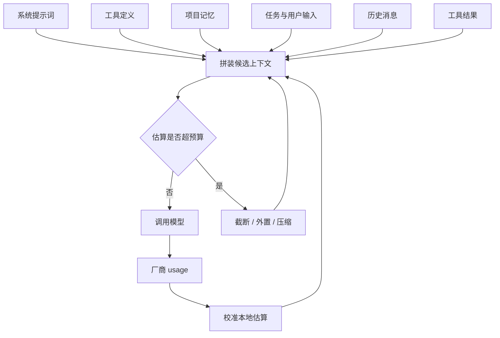
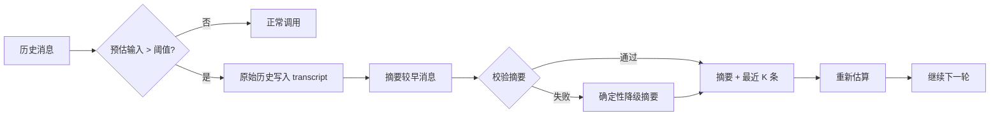

# 第 6 章 上下文工程

## 本章导读

一个重构任务跑到第 30 轮。前面反复出现过一条约束：不要改 `migrations/`。为了腾出窗口，Harness 把最早的历史压成一句摘要，摘要里没有这条约束。模型随后改了一个迁移文件，测试全绿，评审时才发现。上下文工程要解决的不是“把更多 token 塞进去”，而是每一轮该让模型看见什么、以什么形式看见，以及被丢掉的信息如何留底。

## 学习目标

读完本章你将能够：

- 估算并分配上下文窗口预算，区分稳定前缀、可变历史与输出预留；
- 设计稳定、冲突少、可缓存的系统提示词；
- 把第 5 章的单次工具截断纳入总预算，在截断、外置与摘要之间做选择；
- 实现可恢复的上下文压缩：触发、保留清单、摘要校验与失败降级；
- 用渐进式披露与外部状态缓解上下文腐化。

## 6.1 上下文是每轮重新支付的预算

上下文窗口（Context Window）是一次模型调用能接受的最大 token 数，包含输入与输出。它看起来像内存，实际更像每轮都要重新购买的带宽：上一轮发过的内容，这一轮还要再发一遍；发得越多，越贵、越慢，模型也越难从中抓住重点。

上下文工程（Context Engineering）不是提示词工程的同义词。提示词工程关心“这句话怎么说”，上下文工程关心“这一轮到底放什么进去”：哪些内容常驻，哪些按需加载，哪些压缩，哪些外置，哪些直接丢弃。它的目标不是让模型看到尽可能多的信息，而是让模型在每一步看到足够且相关的信息。

### 6.1.1 四类成本

上下文不是免费的。它同时消耗四类资源：

| 成本 | 表现 | 主要控制手段 |
|---|---|---|
| 费用 | 输入 token 每轮重复计费，长前缀反复付费 | 稳定前缀缓存、压缩、外置 |
| 延迟 | 首 token 时间随输入增长，长上下文更明显 | 预算、减少无效历史、并行工具 |
| 注意力 | 关键指令被长文中段淹没，指令冲突增多 | 短提示、重述关键约束、去噪 |
| 信息损失 | 压缩或截断丢掉关键事实，模型据此做出错误判断 | 结构化状态、原始记录留底 |

前三类容易理解，第四类最容易被忽略。压缩不是无损操作，截断也不是。上下文工程必须把“丢了什么、还能不能找回来”当作一等公民，而不是假设模型会记得或会自己发现缺失。

### 6.1.2 预算公式

一次调用的输入预算可以写成：

```text
可用输入 = 窗口 - 输出预留 - 安全边际
固定前缀 = 系统提示词 + 工具定义 + 项目记忆
可变部分 = 任务与用户输入 + 历史消息 + 工具结果
```

输出预留不是可选项。模型要生成回答、工具调用参数，部分模型还会产生推理 token；如果输入占满窗口，生成会被截断，工具调用可能只输出半截 JSON。安全边际用于吸收估算误差与厂商的隐藏开销，例如消息包装、工具定义序列化、缓存字段。

预算要按“下一轮”而不是“这一轮”来计算。当前调用刚好放下，不代表执行完一个工具、把观察追加进来之后还放得下。一个常见的线上事故是：本轮模型成功返回了一个大范围搜索，下一轮把整份结果回填后直接超限，循环卡死。



### 6.1.3 两种结算方式

上下文预算有两套账：调用前用本地估算，调用后用厂商用量（Usage）结算。

- **本地估算负责决策。** 在调用之前，你必须决定是否压缩、是否外置、是否丢弃，此时拿不到厂商 usage，只能用近似值。
- **厂商 usage 负责纠偏。** 调用之后拿到的输入 token 是准的，至少对这家厂商是准的；把它与本地估算比较，可以算出一个校准比例，下一轮用这个比例修正估算。

第 3 章已经定义 `Usage` 字段，第 2 章已经讲过预算的五个维度。本章不重复那些清单，只讨论其中与上下文窗口直接相关的部分：如何估算、如何分配、如何在超限前做决定。

## 6.2 系统提示词：把稳定性设计进去

系统提示词（System Prompt）是每轮都在最前面的固定成本。它的目标不是把所有规则写进去，而是用最少的 token 让模型稳定地做对三类决定：怎么推进任务、什么时候用哪个工具、哪些边界不能碰。

### 6.2.1 结构

一个够用的系统提示词通常包含六个区块：

| 区块 | 回答的问题 | 典型内容 | 变化频率 |
|---|---|---|---|
| 身份与目标 | 你是谁、为谁服务 | 角色、任务域、成功标准 | 低 |
| 工作方式 | 怎么推进 | 先读后写、改完验证、卡住先问 | 低 |
| 工具规范 | 何时用哪个 | 选择顺序、禁止事项、结果如何引用 | 低 |
| 项目约束 | 本仓库特有规则 | 目录、命令、风格、禁改路径 | 中 |
| 输出格式 | 交付什么 | 改动摘要、验证结果、引用格式 | 中 |
| 安全边界 | 什么绝对不能做 | 密钥、破坏性操作、越界路径 | 低 |

区块顺序应当稳定，且从“最不可能变化”到“最可能变化”排列。任务描述、当前文件内容、时间戳这类每轮都变的内容，不要放进系统提示词，而应放在用户消息或独立的上下文块里。这样做有两个好处：一是稳定前缀更容易命中厂商的提示词缓存（第 16 章），二是减少模型把“临时数据”误当成“长期规则”。

### 6.2.2 四条规则

**第一，不要在系统提示词里重复工具描述。** 工具描述回答“这个工具做什么、什么时候不该用”，系统提示词回答“全局策略是什么”，例如“修改前先读文件”、“搜索结果不足以定位时再扩大范围”。两处重复同一句话既浪费 token，也会在版本更新时产生冲突。

**第二，显式写出冲突优先级。** 多条规则同时存在时，模型会自己猜谁优先。与其让它猜，不如写明：安全与合规边界不可覆盖；用户在当前任务中的明确指令优先于项目默认约定；同一层级以更具体者为准。这个顺序不是唯一正确答案，但必须是一个被写下来、被评测过的答案。

**第三，把项目约束放在固定位置。** `CLAUDE.md`、`AGENTS.md` 这类项目记忆文件的发现与优先级属于第 7 章。本章只关心位置：它们应该作为独立、带标题的块放在系统提示之后、任务之前，而不是散落在历史消息里。这样压缩时更容易识别和保留。

**第四，像版本化代码一样管理提示词。** 改一个词就可能改变工具选择与失败模式，因此系统提示词的变更应进入评测（第 15 章），而不是当作普通注释随手改。提示词越长，越需要评测，因为任何一处冲突都可能在长上下文里被放大。


稳定前缀不只是为了省钱。它让同一版本的行为可复现：提示词、工具定义、项目记忆的顺序固定后，两次运行的输入差异才能被归因到任务本身，而不是“这次工具定义恰好排得不一样”。


## 6.3 工具结果预算：从单次截断到总预算

第 5 章解决了“单个工具结果太长”：`ToolResult.truncated` 标记截断，并给出续读方式。本章要解决的是“所有工具结果加起来太长”，以及“这一轮的结果会不会挤掉下一轮的输出空间”。

工具结果是上下文中方差最大的部分。一个 `read_file` 可能只返回三行，一个搜索可能返回三千条，一个命令可能输出几十兆日志。正因为不可预测，工具结果必须有独立预算，而不是等总窗口快满了再处理。

### 6.3.1 四级降级

从轻到重，处理顺序如下：

| 级别 | 做法 | 适用场景 | 代价 |
|---|---|---|---|
| 1 适配 | 完整返回 | 小于单工具上限，且剩余预算足够 | 无 |
| 2 截断 | 头尾保留、显式标记、给出续读方式 | 中等超出 | 中段信息丢失 |
| 3 外置 | 全文写入文件，回填预览与路径 | 大结果，后面可能还要看 | 多一次读取 |
| 4 收窄 | 要求更精确的 pattern、路径或时间窗 | 搜索、日志、目录遍历 | 多一轮交互 |

外置（Externalization）是本章新增的关键手段：把完整结果写到工作区文件，观察里只保留“已写入哪里、前几行是什么、如何继续读”。这样信息没有离开系统，只是从“占满窗口”变成“按需加载”。第 5 章的 `truncate_text` 负责第 2 级，本章的 `ContextBuilder` 负责第 3 级。

### 6.3.2 按工具分配上限

不同工具需要不同的默认上限：

| 工具 | 结果形态 | 建议 |
|---|---|---|
| `read_file` | 带行号的文本窗口 | 默认 200 行；超出用 `offset/limit` |
| `search_text` | 文件、行号与匹配行 | 默认 50 条；优先返回位置而非全文 |
| `run_command` | stdout、stderr、退出码 | 保留退出码与尾部；完整日志外置 |
| `list_dir` | 目录项 | 限制深度与条目数 |
| MCP 工具 | 远端返回，形态不可控 | 默认外置，只回预览 |

上限不是拍脑袋的数字，而是从评测里调出来的。判断标准不是“模型是否抱怨信息不够”，而是“任务成功率是否因为多给或少给而改变”。如果某个工具的结果经常被模型忽略，通常不是给少了，而是给了太多噪声。

### 6.3.3 动态分配与陈旧观察

固定上限简单，但会浪费预算。更实用的做法是给工具结果留一个全局池，再按单次上限与剩余额度取最小值：

```text
单次结果预算 = min(单工具上限, 剩余工具池, 剩余总预算 - 输出预留)
```

错误结果与副作用确认应当绕过这个池子。它们通常很短，却决定模型下一步能否修正；为了省几十个 token 把错误信息截掉，是最不划算的优化。

还有一类内容需要主动清理：陈旧观察。模型已经基于某条观察做出决策，甚至已经修改了文件，那条几千行的原始输出就不再需要每轮携带。可以把它折叠成一行“已读取 `src/parser.py`，结论是 X”，或者直接外置。但涉及副作用的工具调用与验证结果必须保留证据，否则模型会重复执行或误以为没做过。完整原文应进入轨迹记录（第 14 章），而不是从系统里消失。

## 6.4 压缩：把长历史变成可继续的状态

压缩（Compaction）是在历史即将挤占输出与下一轮空间时，把较早的消息替换成摘要与结构化状态。它不是“每隔 N 轮清一次历史”，而是一个有触发条件、有保留清单、有校验、有降级路径的工程流程。

### 6.4.1 触发

常见的触发条件有两个：

- **主动触发。** 预估输入超过可用窗口的某个比例，例如 75%～85%。此时还有空间生成摘要，失败也能重试。
- **被动兜底。** 厂商返回长度超限错误，或被截断的响应。此时当前轮可能已经受损，只能压缩后重试。

生产系统应当以主动触发为主、被动兜底为辅。只在报错后压缩，会把“预算问题”变成“故障恢复问题”：当前轮的输出可能已经被截断，工具调用参数可能只到了一半。压缩本身也要花一次模型调用，这部分成本应计入预算，而不是假设压缩是免费的。

### 6.4.2 保留清单

压缩是有损的，关键在于“有意识地保留”。一份够用的保留清单如下：

| 保留项 | 原因 | 建议形式 |
|---|---|---|
| 目标与验收标准 | 防止后续跑偏 | 1～3 句 |
| 硬约束 | 例如禁改目录、必须保持的 API | 原样列出 |
| 关键决策与理由 | 防止反复推翻 | 要点 |
| 计划与进度 | 知道下一步做什么 | TODO 或步骤状态 |
| 已改文件与验证结果 | 避免重复劳动 | 路径、测试命令、结果 |
| 失败原因与结论 | 避免重复踩坑 | 错误、定位、结论 |
| 未决问题 | 继续推进的入口 | 问题列表 |
| 最近 K 条消息 | 保持语气、指代与即时上下文 | 原文保留 |

需要丢弃的是：冗长的工具输出、重复的搜索、已经解决的死胡同、中间推理过程、重复的指令。注意“中间推理”不等于“决策理由”：前者可以丢，后者往往决定后续为什么不能走另一条路。

### 6.4.3 流程



顺序里有两个细节值得强调。

第一，**先落盘，再摘要。** 在调用摘要模型之前，把原始历史写入 transcript 文件。摘要失败、模型返回空、上下文被再次压缩，原始记录都还在。这是压缩可恢复的前提。

第二，**摘要之后要重新估算。** 摘要不是免费的压缩，它本身也占 token；如果摘要太长、最近消息太多，压缩后可能仍然超限。此时要么再压一次，要么缩短最近窗口，不能假设“压过就好了”。

### 6.4.4 摘要提示词与校验

摘要提示词应当把模型定位成“压缩器”，而不是“助手”。它需要明确：必须保留哪些字段、长度上限、不得编造、不得逐字保留工具输出。一个可用的结构是：

```text
目标：……
约束：……
已完成：……
当前：……
下一步：……
```

生成之后必须校验，至少检查四项：

1. **非空且不超长。** 空摘要等于丢失全部历史；超长摘要会把压缩变成形式主义。
2. **必填项存在。** 例如“目标”“约束”“下一步”是否出现。缺失时标记降级，不要假装摘要完整。
3. **不与事实冲突。** 如果摘要说“测试通过”，而最近一条工具结果是“2 failed”，应当拒绝或标记冲突。这类检查可以由 Harness 用结构化事实完成，不必完全依赖模型。
4. **不把摘要当证据。** 摘要是一段声称，不是验证结果。压缩后第一次修改前，应重新读取相关文件；第一次声称完成前，应重新运行测试。

摘要的注入方式也有讲究。把模型生成的摘要伪装成用户消息，等于把派生内容提升到用户指令的权威级别，容易被摘要里的错误或注入内容带偏。更稳妥的做法是把它标记为系统级的“压缩摘要”，并写明来源与完整历史的位置。

### 6.4.5 压缩后的状态一致性

压缩只改变“模型看到的历史”，不改变“世界发生了什么”。两者可能不一致：摘要说改了三个文件，实际磁盘上可能有五个；摘要说测试通过，实际最后一次运行失败了。因此，压缩后需要一份独立于摘要的结构化状态，至少包括：

- 已修改的文件与路径；
- 最近一次验证的命令与结果；
- 当前计划中已完成、进行中、待办的步骤；
- 已知失败与未决问题。

这份状态可以放在工作区文件、检查点或会话存储中（第 7 章展开），不依赖模型记忆。压缩时把它渲染进摘要或紧随摘要的块里；恢复时以它为准，而不是以摘要的自然语言为准。

## 6.5 渐进式披露：先索引，后细节

渐进式披露（Progressive Disclosure）的核心是：先给模型一个可导航的索引，等它需要时再加载细节。它同时缓解预算压力和上下文腐化。

常见的三层索引：

1. **仓库层。** 目录树、模块列表、仓库地图。让模型知道“东西大概在哪”。
2. **文件层。** 搜索结果返回 `文件:行号: 摘要`，而不是整份文件。让模型决定读哪一段。
3. **片段层。** `read_file` 用 `offset/limit` 返回窗口。让模型在需要时扩大范围。

工具描述本身也是渐进式披露：名称和一句话描述常驻，完整参数与边界按需展开；技能（Skill）与斜杠命令则在触发时才加载（第 12 章）。这不是偷懒，而是把有限的注意力留给当前决策。

文件系统是 Agent 最便宜的外部上下文。计划、笔记、搜索结果、测试日志、生成报告都可以写到工作区文件，模型需要时用工具读取。这样做有三个好处：不占常驻窗口；内容可被用户和其他工具检查；跨轮、跨会话都能复用。要注意的是，外部文件不是“写完就完事”：路径要可发现，格式要稳定，过期内容要清理，否则只是把上下文噪声搬到了磁盘上。

渐进式披露也有代价。多一次读取就多一轮延迟；索引过期会让模型找错地方；分页太碎会增加往返次数。判断标准仍然是任务成功率与总成本，而不是“索引看起来更优雅”。

## 6.6 上下文腐化：长上下文不是免费的午餐

上下文腐化（Context Rot）指输入变长后，模型对中段信息的注意力下降、指令遵循变差、容易被无关内容带偏。它不是某个模型的 bug，而是长上下文的一般性工程现象；严重程度随模型、任务与内容结构变化。

常见的症状与处理方式：

| 症状 | 可能原因 | 缓解 |
|---|---|---|
| 忘记早期约束 | 中段注意力下降，或压缩时丢失 | 在关键位置重述约束；结构化状态保留 |
| 重复调用同一工具 | 观察被截断或外置后没读到 | 预览给足线索；显式标记“已外置” |
| 前后结论矛盾 | 新旧观察冲突，旧观察未过期 | 删除或折叠陈旧观察；标注时间与版本 |
| 被无关内容带偏 | 一次性灌入太多文件或日志 | 渐进式披露；任务分段 |
| 指令遵循变差 | 系统提示过长、规则互相冲突 | 精简提示；明确优先级；评测回归 |

缓解手段可以归纳为四条：

- **重述关键约束。** 不只放在系统提示开头，也在相关任务块的末尾重复一次。长上下文中，位置本身就是一种权重。
- **去重与过期。** 同一文件读了三次，只保留最新一次；旧搜索结果被新结果取代后，旧结果折叠或删除。
- **分段与隔离。** 长任务拆成阶段，每个阶段只带当前阶段需要的上下文；探索性任务交给子代理，只回传摘要（第 9 章）。
- **外部状态与验证。** 关键事实写在文件或检查点里，不依赖模型记忆；声称完成前用测试或检查器验证。

需要提醒的是，“长上下文一定导致中段丢失”并不是一条可以无条件套用的定律。不同模型、不同任务、不同内容结构的表现差异很大。工程上应当用自己的任务集做长上下文评测（第 15 章），而不是根据一条流行结论决定预算。

## 6.7 设计权衡

### 6.7.1 固定预算还是动态预算

| 维度 | 固定预算 | 动态预算 |
|---|---|---|
| 可预测性 | 高，每类内容上限明确 | 低，取决于当轮结果 |
| 利用率 | 可能浪费，也可能让某类内容饿死 | 高，剩余额度可以借用 |
| 实现复杂度 | 低 | 中，需要处理借还与下限 |
| 调试难度 | 低 | 高，同样的输入可能得到不同分配 |
| 适用场景 | 工具输出稳定、团队需要可复现 | 工具输出方差大、追求吞吐 |

推荐的做法是折中：给每类内容一个固定下限与默认上限，允许在剩余额度内借用，但不允许长期挤占输出预留与安全边际。这样既有可预测性，又不会在某个大结果上浪费整轮预算。

### 6.7.2 摘要压缩还是结构化状态外置

| 维度 | 摘要压缩 | 结构化状态外置 |
|---|---|---|
| 成本 | 低，一次模型调用 | 中，需要设计与维护 Schema |
| 信息密度 | 高，但依赖模型判断 | 精确，字段可校验 |
| 可恢复性 | 差，摘要丢了就难还原 | 好，原始状态可读可审计 |
| 适用内容 | 叙事、决策理由、阶段性结论 | 目标、约束、文件列表、测试结果 |
| 主要风险 | 遗漏关键约束、编造事实 | 状态腐化、字段与真实世界不同步 |

两者不是替代关系。推荐混合：摘要负责“讲清楚发生过什么”，结构化状态负责“记准确哪些事实不能丢”。压缩时把结构化状态渲染进摘要块或紧随其后；恢复时以结构化状态为准。

### 6.7.3 本地估算还是厂商 usage

| 维度 | 本地估算 | 厂商 usage |
|---|---|---|
| 时机 | 调用前，可用于决策 | 调用后，只能用于下一轮 |
| 准确性 | 近似，依赖分词器与经验值 | 对当前厂商准确 |
| 依赖 | 需要 tokenizer 或启发式规则 | 需要厂商返回 usage |
| 隐藏开销 | 容易漏掉消息包装、工具定义序列化 | 通常已包含在输入计数里 |
| 适用 | 预算分配、是否压缩 | 校准、计费、容量规划 |

正确用法是两者结合：本地估算做即时决策，厂商 usage 做滑动校准。校准比例要按模型与厂商分别维护，不要用一个全局系数套所有模型。

### 6.7.4 主动压缩还是被动压缩

主动压缩在阈值处触发，代价是可能压得过早、多花一次摘要调用；被动压缩在报错后触发，代价是当前轮可能已经受损。生产系统通常以主动为主：在 80% 左右触发，保留足够的输出与下一轮空间；同时保留被动兜底，用于处理估算偏差与突发大结果。

## 6.8 代码实践：MiniCoder 的 ContextBudget、ContextBuilder 与 compact

下面的实现把本章的四件事落成代码：估算与校准、预算组装、工具结果外置、压缩与降级。它只依赖第 3、5 章的类型，不修改 `Provider` 与 `ToolResult`。演示在临时目录中离线运行，不需要 API Key。



```python
from __future__ import annotations

import asyncio
import json
import math
import tempfile
from dataclasses import dataclass, field
from pathlib import Path
from typing import Any, Optional, Protocol, Sequence


# ---------- 沿用第 3、5 章的类型 ----------
@dataclass(frozen=True)
class ToolCall:
    id: str
    name: str
    args: dict[str, Any]


@dataclass
class Message:
    role: str
    content: str = ""
    tool_call_id: Optional[str] = None
    tool_calls: list[ToolCall] = field(default_factory=list)


@dataclass
class ToolResult:
    ok: bool
    content: str = ""
    error: Optional[str] = None
    error_code: str = ""
    truncated: bool = False
    metadata: dict[str, Any] = field(default_factory=dict)

    def to_observation(self) -> str:
        body = self.content if self.ok else f"[{self.error_code}] {self.error}"
        if self.truncated:
            body += "\n[结果已截断；请缩小查询范围或分段读取]"
        return body


@dataclass
class Usage:
    input_tokens: int = 0
    output_tokens: int = 0
    cache_read_tokens: int = 0
    cache_write_tokens: int = 0
    reasoning_tokens: int = 0
    raw: dict[str, Any] = field(default_factory=dict)


@dataclass
class ModelResponse:
    text: str = ""
    usage: Usage = field(default_factory=Usage)


class Provider(Protocol):
    async def complete(
        self,
        messages: Sequence[Message],
        tools: Sequence[Any] = (),
        **options: Any,
    ) -> ModelResponse: ...


# ---------- 第 6 章新增：估算、预算、组装、压缩 ----------
def _is_cjk(ch: str) -> bool:
    code = ord(ch)
    return 0x3400 <= code <= 0x9FFF or 0xF900 <= code <= 0xFAFF


def estimate_tokens(text: str) -> int:
    """粗略估算：一个 CJK 字符约 1 token，4 个其他字符约 1 token。"""
    if not text:
        return 1
    cjk = sum(1 for ch in text if _is_cjk(ch))
    other = len(text) - cjk
    return max(1, cjk + math.ceil(other / 4)) + 4


class TokenCalibrator:
    """用厂商 usage 校准本地估算，避免长期系统性低估。"""

    def __init__(self) -> None:
        self.ratio = 1.0
        self.samples = 0

    def observe(self, estimated: int, actual: int) -> None:
        if estimated <= 0 or actual <= 0:
            return
        sample = actual / estimated
        self.ratio = sample if self.samples == 0 else 0.7 * self.ratio + 0.3 * sample
        self.samples += 1

    def apply(self, estimated: int) -> int:
        return math.ceil(estimated * self.ratio)


@dataclass(frozen=True)
class ContextBudget:
    window: int = 2400
    output_reserve: int = 480
    safety_margin: int = 160
    tool_result_cap: int = 320
    compact_at: float = 0.8

    @property
    def usable_input(self) -> int:
        return self.window - self.output_reserve - self.safety_margin

    @property
    def compact_threshold(self) -> int:
        return int(self.usable_input * self.compact_at)


@dataclass
class BuildReport:
    messages: list[Message]
    estimated_tokens: int
    fixed_tokens: int
    history_tokens: int
    dropped: int
    externalized: list[str]


class ContextBuilder:
    def __init__(
        self,
        budget: ContextBudget,
        *,
        system_prompt: str,
        tool_specs: str,
        memory: str = "",
        workspace: Optional[Path] = None,
        calibrator: Optional[TokenCalibrator] = None,
    ) -> None:
        self.budget = budget
        self.system_prompt = system_prompt
        self.tool_specs = tool_specs
        self.memory = memory
        self.workspace = Path(workspace) if workspace is not None else Path.cwd()
        self.calibrator = calibrator or TokenCalibrator()
        self.external_dir = self.workspace / ".minicoder" / "observations"

    def assemble(self, history: Sequence[Message]) -> BuildReport:
        fixed = [Message("system", self.system_prompt)]
        if self.tool_specs:
            fixed.append(Message("system", self.tool_specs))
        if self.memory:
            fixed.append(Message("system", self.memory))
        fixed_tokens = self.calibrator.apply(
            sum(estimate_tokens(m.content) for m in fixed)
        )
        allowance = self.budget.usable_input - fixed_tokens

        kept: list[Message] = []
        used = 0
        dropped = 0
        externalized: list[str] = []

        for message in reversed(history):
            content = message.content
            tokens = self.calibrator.apply(estimate_tokens(content))
            if message.role == "tool" and tokens > self.budget.tool_result_cap:
                content, rel = self._externalize(message, content, len(externalized))
                tokens = self.calibrator.apply(estimate_tokens(content))
                externalized.append(rel)
            if used + tokens > allowance:
                dropped = len(history) - len(kept)
                break
            kept.append(
                Message(message.role, content, message.tool_call_id, message.tool_calls)
            )
            used += tokens

        kept.reverse()
        messages = fixed + kept
        return BuildReport(
            messages=messages,
            estimated_tokens=fixed_tokens + used,
            fixed_tokens=fixed_tokens,
            history_tokens=used,
            dropped=dropped,
            externalized=externalized,
        )

    def _externalize(
        self, message: Message, content: str, index: int
    ) -> tuple[str, str]:
        self.external_dir.mkdir(parents=True, exist_ok=True)
        name = f"{message.tool_call_id or 'observation'}-{index}.txt"
        path = self.external_dir / name
        path.write_text(content, encoding="utf-8")
        rel = path.relative_to(self.workspace)
        head = "\n".join(content.splitlines()[:5])
        preview = (
            f"[观察已外置] 原始内容 {len(content)} 字符，已写入 {rel}。"
            f"前 5 行：\n{head}\n"
            "需要更多内容时，用 read_file 指定 offset/limit 读取该文件。"
        )
        return preview, str(rel)


def needs_compaction(
    history: Sequence[Message],
    budget: ContextBudget,
    fixed_tokens: int = 0,
    calibrator: Optional[TokenCalibrator] = None,
) -> bool:
    raw = sum(estimate_tokens(m.content) for m in history) + fixed_tokens
    estimated = calibrator.apply(raw) if calibrator else raw
    return estimated > budget.compact_threshold


SUMMARY_PROMPT = (
    "你是上下文压缩器。把给定历史压缩成不超过 200 字的摘要，必须保留：\n"
    "1. 任务目标与硬约束；2. 已完成的修改与验证结果；3. 当前计划与未决问题；\n"
    "4. 失败原因与下一步。不要编造未发生的事实，不要保留冗长的工具输出。"
)

_REQUIRED_MARKERS = ("目标", "约束", "下一步")


@dataclass
class CompactionResult:
    messages: list[Message]
    summary: str
    before_tokens: int
    after_tokens: int
    kept_recent: int
    degraded: bool
    transcript_path: str
    summary_estimated_input: int = 0
    summary_actual_input: int = 0


class ScriptedProvider:
    """离线演示用：返回固定摘要，并模拟厂商 usage。"""

    def __init__(self, summary: str, *, usage_ratio: float = 1.12) -> None:
        self.summary = summary
        self.usage_ratio = usage_ratio
        self.calls = 0

    async def complete(
        self,
        messages: Sequence[Message],
        tools: Sequence[Any] = (),
        **options: Any,
    ) -> ModelResponse:
        self.calls += 1
        prompt_tokens = sum(estimate_tokens(m.content) for m in messages)
        actual = int(prompt_tokens * self.usage_ratio)
        return ModelResponse(
            text=self.summary,
            usage=Usage(
                input_tokens=actual,
                output_tokens=estimate_tokens(self.summary),
            ),
        )


def _render_message(message: Message) -> str:
    if message.role == "tool":
        return f"[tool {message.tool_call_id or ''}] {message.content}"
    return f"[{message.role}] {message.content}"


def _fallback_summary(messages: Sequence[Message]) -> str:
    users = [m.content for m in messages if m.role == "user"]
    last_user = users[-1][:120] if users else "（无用户消息）"
    return (
        f"摘要生成失败，已降级为确定性摘要。原历史 {len(messages)} 条；"
        f"最近一次用户输入：{last_user}。请重新检查工作区与验证结果后再继续。"
    )


def _validate_summary(summary: str, limit: int) -> tuple[str, bool]:
    text = summary.strip()
    degraded = False
    if len(text) > limit:
        text = text[:limit] + "…"
        degraded = True
    missing = [marker for marker in _REQUIRED_MARKERS if marker not in text]
    if missing:
        degraded = True
        text += "\n[校验提示] 摘要缺少：" + "、".join(missing) + "；请以工作区与验证结果为准。"
    return text, degraded


async def compact(
    history: Sequence[Message],
    budget: ContextBudget,
    provider: Provider,
    *,
    workspace: Path,
    keep_recent: int = 4,
) -> CompactionResult:
    before_tokens = sum(estimate_tokens(m.content) for m in history)
    recent = list(history[-keep_recent:])
    older = list(history[:-keep_recent])

    transcript = workspace / ".minicoder" / "transcript.jsonl"
    transcript.parent.mkdir(parents=True, exist_ok=True)
    with transcript.open("a", encoding="utf-8") as handle:
        for message in older:
            record = {
                "role": message.role,
                "content": message.content,
                "tool_call_id": message.tool_call_id,
            }
            handle.write(json.dumps(record, ensure_ascii=False) + "\n")
    transcript_rel = str(transcript.relative_to(workspace))

    if not older:
        return CompactionResult(
            messages=list(history),
            summary="",
            before_tokens=before_tokens,
            after_tokens=before_tokens,
            kept_recent=len(recent),
            degraded=False,
            transcript_path=transcript_rel,
        )

    prompt = [
        Message("system", SUMMARY_PROMPT),
        Message("user", "\n".join(_render_message(m) for m in older)),
    ]
    estimated_input = sum(estimate_tokens(m.content) for m in prompt)
    response: Optional[ModelResponse] = None
    degraded = False

    try:
        response = await provider.complete(prompt)
        summary, too_long = _validate_summary(
            response.text, limit=max(80, budget.usable_input // 6)
        )
        degraded = too_long
        if not summary:
            raise ValueError("empty summary")
    except Exception:
        summary = _fallback_summary(older)
        degraded = True

    summary_message = Message(
        "system",
        f"[压缩摘要]\n{summary}\n[完整历史] {transcript_rel}",
    )
    new_history = [summary_message] + recent
    after_tokens = sum(estimate_tokens(m.content) for m in new_history)
    return CompactionResult(
        messages=new_history,
        summary=summary,
        before_tokens=before_tokens,
        after_tokens=after_tokens,
        kept_recent=len(recent),
        degraded=degraded,
        transcript_path=transcript_rel,
        summary_estimated_input=estimated_input,
        summary_actual_input=response.usage.input_tokens if response else 0,
    )


async def main() -> None:
    root = Path(tempfile.mkdtemp(prefix="minicoder-ch6-"))
    budget = ContextBudget(
        window=2400,
        output_reserve=480,
        safety_margin=160,
        tool_result_cap=320,
        compact_at=0.8,
    )

    system_prompt = (
        "你是 MiniCoder，一个谨慎的编码助手。\n"
        "工作方式：先读相关文件，再做最小修改；每次修改后运行测试。\n"
        "约束：不要修改 migrations/；不要删除用户未要求删除的文件；不确定时先提问。\n"
        "输出：先说明将做什么，再调用工具；结束时给出改动与验证摘要。"
    )
    tool_specs = (
        "read_file(path, offset, limit)；write_file(path, content)；"
        "search_text(pattern, path, limit)；run_command(command)"
    )
    memory = "项目约定：Python 3.11；测试命令 pytest -q；提交信息用英文。"

    large_output = "\n".join(
        f"src/module_{i}.py:{i}: TODO: refactor parser branch {i}"
        for i in range(1, 201)
    )
    history: list[Message] = [
        Message("user", "重构 parser，补齐测试，并保持公共 API 不变。"),
        Message("assistant", "先定位所有 parser 分支与现有测试。"),
        Message(
            "tool",
            ToolResult(ok=True, content=large_output).to_observation(),
            "call-1",
        ),
        Message("user", "补充约束：不要修改 migrations/ 下的任何文件。"),
        Message("assistant", "明白，migrations/ 保持只读。"),
    ]
    for i in range(1, 9):
        history.append(Message("assistant", f"第 {i} 轮：检查模块 {i}，记录发现并更新计划。"))
        history.append(
            Message(
                "tool",
                f"module_{i}: OK；检查了 {i * 7} 个符号，未发现新的未定义引用。",
                f"call-{i + 1}",
            )
        )
    history += [
        Message("tool", "12 passed", "call-20"),
        Message("assistant", "第一轮重构完成，测试通过。"),
        Message("user", "继续补边界测试，并记录失败原因。"),
        Message(
            "tool",
            ToolResult(
                ok=True,
                content=(
                    "2 failed, 10 passed\n"
                    "- test_empty: AssertionError\n"
                    "- test_unicode: ValueError"
                ),
                metadata={"returned_lines": 3},
            ).to_observation(),
            "call-21",
        ),
        Message("assistant", "两个失败：空输入与 Unicode 边界；先修空输入。"),
    ]

    calibrator = TokenCalibrator()
    builder = ContextBuilder(
        budget,
        system_prompt=system_prompt,
        tool_specs=tool_specs,
        memory=memory,
        workspace=root,
        calibrator=calibrator,
    )

    raw_history = sum(estimate_tokens(m.content) for m in history)
    before = builder.assemble(history)
    print("== 压缩前 ==")
    print(
        f"原始历史={raw_history} 固定前缀={before.fixed_tokens} "
        f"阈值={budget.compact_threshold} "
        f"需要压缩={needs_compaction(history, budget, before.fixed_tokens, calibrator)}"
    )
    print(
        f"本次组装：估算={before.estimated_tokens}/{budget.usable_input} "
        f"丢弃={before.dropped} 外置={len(before.externalized)}"
    )
    for rel in before.externalized:
        print(f"外置文件：{rel}")

    provider = ScriptedProvider(
        "目标：重构 parser 并补齐测试，保持公共 API 不变。\n"
        "约束：不要修改 migrations/。\n"
        "已完成：第一轮重构完成，12 项测试通过。\n"
        "当前：2 项失败（test_empty 的 AssertionError、test_unicode 的 ValueError）；"
        "先修空输入。\n"
        "下一步：修复两个失败用例并重新运行 pytest。"
    )
    result = await compact(history, budget, provider, workspace=root, keep_recent=4)
    calibrator.observe(result.summary_estimated_input, result.summary_actual_input)

    print("\n== 压缩后 ==")
    print(
        f"压缩前={result.before_tokens} 压缩后={result.after_tokens} "
        f"保留最近={result.kept_recent} 降级={result.degraded}"
    )
    print(f"摘要：{result.summary}")
    print(
        f"摘要输入估算={result.summary_estimated_input} "
        f"厂商 usage={result.summary_actual_input} "
        f"校准比例={calibrator.ratio:.2f} "
        f"校准后历史估算={calibrator.apply(raw_history)}"
    )
    print(f"完整历史：{result.transcript_path}")

    after = builder.assemble(result.messages)
    print(
        f"重新组装：估算={after.estimated_tokens}/{budget.usable_input} "
        f"丢弃={after.dropped} 外置={len(after.externalized)}"
    )

    result.messages.append(Message("user", "继续：先修 test_empty，再修 test_unicode。"))
    final = builder.assemble(result.messages)
    print(
        f"追加新轮后：估算={final.estimated_tokens}/{budget.usable_input} "
        f"丢弃={final.dropped}"
    )

    print("\n== 回填给模型的上下文 ==")
    for message in final.messages:
        label = message.role if not message.tool_call_id else f"tool:{message.tool_call_id}"
        first = message.content.splitlines()[0] if message.content else ""
        print(f"{label} | {first[:70]}")


if __name__ == "__main__":
    asyncio.run(main())
```


```typescript
import { appendFile, mkdir, mkdtemp, writeFile } from "node:fs/promises";
import { tmpdir } from "node:os";
import { join, relative } from "node:path";

// ---------- 沿用第 3、5 章的类型 ----------
type ToolCall = { id: string; name: string; args: Record<string, unknown> };

type Message = {
  role: "system" | "user" | "assistant" | "tool";
  content?: string;
  toolCallId?: string;
  toolCalls?: ToolCall[];
};

type ToolResultInit = {
  ok: boolean;
  content?: string;
  error?: string;
  errorCode?: string;
  truncated?: boolean;
  metadata?: Record<string, unknown>;
};

class ToolResult {
  ok: boolean;
  content: string;
  error?: string;
  errorCode: string;
  truncated: boolean;
  metadata: Record<string, unknown>;

  constructor(init: ToolResultInit) {
    this.ok = init.ok;
    this.content = init.content ?? "";
    this.error = init.error;
    this.errorCode = init.errorCode ?? "";
    this.truncated = init.truncated ?? false;
    this.metadata = init.metadata ?? {};
  }

  toObservation(): string {
    let body = this.ok ? this.content : `[${this.errorCode}] ${this.error ?? ""}`;
    if (this.truncated) {
      body += "\n[结果已截断；请缩小查询范围或分段读取]";
    }
    return body;
  }
}

type Usage = {
  inputTokens: number;
  outputTokens: number;
  cacheReadTokens?: number;
  cacheWriteTokens?: number;
  reasoningTokens?: number;
  raw?: Record<string, unknown>;
};

type ModelResponse = { text: string; usage: Usage };

interface Provider {
  complete(
    messages: Message[],
    tools?: unknown[],
    options?: Record<string, unknown>,
  ): Promise<ModelResponse>;
}

// ---------- 第 6 章新增：估算、预算、组装、压缩 ----------
function isCjk(code: number): boolean {
  return (code >= 0x3400 && code <= 0x9fff) || (code >= 0xf900 && code <= 0xfaff);
}

function estimateTokens(text: string): number {
  if (!text) return 1;
  let cjk = 0;
  let other = 0;
  for (const ch of text) {
    if (isCjk(ch.codePointAt(0)!)) cjk += 1;
    else other += 1;
  }
  return Math.max(1, cjk + Math.ceil(other / 4)) + 4;
}


class TokenCalibrator {
  ratio = 1.0;
  samples = 0;

  observe(estimated: number, actual: number): void {
    if (estimated <= 0 || actual <= 0) return;
    const sample = actual / estimated;
    this.ratio = this.samples === 0 ? sample : 0.7 * this.ratio + 0.3 * sample;
    this.samples += 1;
  }

  apply(estimated: number): number {
    return Math.ceil(estimated * this.ratio);
  }
}

type BudgetOptions = {
  window?: number;
  outputReserve?: number;
  safetyMargin?: number;
  toolResultCap?: number;
  compactAt?: number;
};

class ContextBudget {
  window: number;
  outputReserve: number;
  safetyMargin: number;
  toolResultCap: number;
  compactAt: number;

  constructor(options: BudgetOptions = {}) {
    this.window = options.window ?? 2400;
    this.outputReserve = options.outputReserve ?? 480;
    this.safetyMargin = options.safetyMargin ?? 160;
    this.toolResultCap = options.toolResultCap ?? 320;
    this.compactAt = options.compactAt ?? 0.8;
  }

  get usableInput(): number {
    return this.window - this.outputReserve - this.safetyMargin;
  }

  get compactThreshold(): number {
    return Math.floor(this.usableInput * this.compactAt);
  }
}

type BuildReport = {
  messages: Message[];
  estimatedTokens: number;
  fixedTokens: number;
  historyTokens: number;
  dropped: number;
  externalized: string[];
};

type BuilderOptions = {
  systemPrompt: string;
  toolSpecs: string;
  memory?: string;
  workspace: string;
  calibrator?: TokenCalibrator;
};

class ContextBuilder {
  budget: ContextBudget;
  systemPrompt: string;
  toolSpecs: string;
  memory: string;
  workspace: string;
  calibrator: TokenCalibrator;
  externalDir: string;

  constructor(budget: ContextBudget, options: BuilderOptions) {
    this.budget = budget;
    this.systemPrompt = options.systemPrompt;
    this.toolSpecs = options.toolSpecs;
    this.memory = options.memory ?? "";
    this.workspace = options.workspace;
    this.calibrator = options.calibrator ?? new TokenCalibrator();
    this.externalDir = join(this.workspace, ".minicoder", "observations");
  }

  async assemble(history: Message[]): Promise<BuildReport> {
    const fixed: Message[] = [{ role: "system", content: this.systemPrompt }];
    if (this.toolSpecs) fixed.push({ role: "system", content: this.toolSpecs });
    if (this.memory) fixed.push({ role: "system", content: this.memory });
    const fixedTokens = this.calibrator.apply(
      fixed.reduce((sum, m) => sum + estimateTokens(m.content ?? ""), 0),
    );
    const allowance = this.budget.usableInput - fixedTokens;

    const kept: Message[] = [];
    let used = 0;
    let dropped = 0;
    const externalized: string[] = [];

    for (let index = history.length - 1; index >= 0; index--) {
      const message = history[index];
      let content = message.content ?? "";
      let tokens = this.calibrator.apply(estimateTokens(content));
      if (message.role === "tool" && tokens > this.budget.toolResultCap) {
        const [preview, rel] = await this.externalize(message, content, externalized.length);
        content = preview;
        tokens = this.calibrator.apply(estimateTokens(content));
        externalized.push(rel);
      }
      if (used + tokens > allowance) {
        dropped = history.length - kept.length;
        break;
      }
      kept.push({ ...message, content });
      used += tokens;
    }

    kept.reverse();
    const messages = [...fixed, ...kept];
    return {
      messages,
      estimatedTokens: fixedTokens + used,
      fixedTokens,
      historyTokens: used,
      dropped,
      externalized,
    };
  }

  private async externalize(
    message: Message,
    content: string,
    index: number,
  ): Promise<[string, string]> {
    await mkdir(this.externalDir, { recursive: true });
    const name = `${message.toolCallId || "observation"}-${index}.txt`;
    const path = join(this.externalDir, name);
    await writeFile(path, content, "utf-8");
    const rel = relative(this.workspace, path);
    const head = content.split(/\r?\n/).slice(0, 5).join("\n");
    const preview =
      `[观察已外置] 原始内容 ${content.length} 字符，已写入 ${rel}。` +
      `前 5 行：\n${head}\n` +
      "需要更多内容时，用 read_file 指定 offset/limit 读取该文件。";
    return [preview, rel];
  }
}

function needsCompaction(
  history: Message[],
  budget: ContextBudget,
  fixedTokens = 0,
  calibrator?: TokenCalibrator,
): boolean {
  const raw = history.reduce((sum, m) => sum + estimateTokens(m.content ?? ""), 0) + fixedTokens;
  const estimated = calibrator ? calibrator.apply(raw) : raw;
  return estimated > budget.compactThreshold;
}

const SUMMARY_PROMPT =
  "你是上下文压缩器。把给定历史压缩成不超过 200 字的摘要，必须保留：\n" +
  "1. 任务目标与硬约束；2. 已完成的修改与验证结果；3. 当前计划与未决问题；\n" +
  "4. 失败原因与下一步。不要编造未发生的事实，不要保留冗长的工具输出。";

const REQUIRED_MARKERS = ["目标", "约束", "下一步"];

type CompactionResult = {
  messages: Message[];
  summary: string;
  beforeTokens: number;
  afterTokens: number;
  keptRecent: number;
  degraded: boolean;
  transcriptPath: string;
  summaryEstimatedInput: number;
  summaryActualInput: number;
};

class ScriptedProvider implements Provider {
  summary: string;
  usageRatio: number;
  calls = 0;

  constructor(summary: string, usageRatio = 1.12) {
    this.summary = summary;
    this.usageRatio = usageRatio;
  }

  async complete(messages: Message[]): Promise<ModelResponse> {
    this.calls += 1;
    const promptTokens = messages.reduce(
      (sum, m) => sum + estimateTokens(m.content ?? ""),
      0,
    );
    const actual = Math.floor(promptTokens * this.usageRatio);
    return {
      text: this.summary,
      usage: {
        inputTokens: actual,
        outputTokens: estimateTokens(this.summary),
      },
    };
  }
}

function renderMessage(message: Message): string {
  if (message.role === "tool") {
    return `[tool ${message.toolCallId ?? ""}] ${message.content ?? ""}`;
  }
  return `[${message.role}] ${message.content ?? ""}`;
}

function fallbackSummary(messages: Message[]): string {
  const users = messages.filter((m) => m.role === "user").map((m) => m.content ?? "");
  const lastUser = users.length > 0 ? users[users.length - 1].slice(0, 120) : "（无用户消息）";
  return (
    `摘要生成失败，已降级为确定性摘要。原历史 ${messages.length} 条；` +
    `最近一次用户输入：${lastUser}。请重新检查工作区与验证结果后再继续。`
  );
}

function validateSummary(summary: string, limit: number): [string, boolean] {
  let text = summary.trim();
  let degraded = false;
  if (text.length > limit) {
    text = text.slice(0, limit) + "…";
    degraded = true;
  }
  const missing = REQUIRED_MARKERS.filter((marker) => !text.includes(marker));
  if (missing.length > 0) {
    degraded = true;
    text += `\n[校验提示] 摘要缺少：${missing.join("、")}；请以工作区与验证结果为准。`;
  }
  return [text, degraded];
}

async function compact(
  history: Message[],
  budget: ContextBudget,
  provider: Provider,
  options: { workspace: string; keepRecent?: number },
): Promise<CompactionResult> {
  const keepRecent = options.keepRecent ?? 4;
  const beforeTokens = history.reduce((sum, m) => sum + estimateTokens(m.content ?? ""), 0);
  const recent = history.slice(-keepRecent);
  const older = history.slice(0, -keepRecent);

  const transcript = join(options.workspace, ".minicoder", "transcript.jsonl");
  await mkdir(join(options.workspace, ".minicoder"), { recursive: true });
  const records = older.map((message) =>
    JSON.stringify({
      role: message.role,
      content: message.content ?? "",
      tool_call_id: message.toolCallId,
    }),
  );
  if (records.length > 0) {
    await appendFile(transcript, `${records.join("\n")}\n`, "utf-8");
  }
  const transcriptRel = relative(options.workspace, transcript);

  if (older.length === 0) {
    return {
      messages: [...history],
      summary: "",
      beforeTokens,
      afterTokens: beforeTokens,
      keptRecent: recent.length,
      degraded: false,
      transcriptPath: transcriptRel,
      summaryEstimatedInput: 0,
      summaryActualInput: 0,
    };
  }

  const prompt: Message[] = [
    { role: "system", content: SUMMARY_PROMPT },
    { role: "user", content: older.map(renderMessage).join("\n") },
  ];
  const estimatedInput = prompt.reduce((sum, m) => sum + estimateTokens(m.content ?? ""), 0);
  let response: ModelResponse | undefined;
  let degraded = false;
  let summary = "";

  try {
    response = await provider.complete(prompt);
    const [validated, tooLong] = validateSummary(
      response.text,
      Math.max(80, Math.floor(budget.usableInput / 6)),
    );
    summary = validated;
    degraded = tooLong;
    if (!summary) throw new Error("empty summary");
  } catch {
    summary = fallbackSummary(older);
    degraded = true;
  }

  const summaryMessage: Message = {
    role: "system",
    content: `[压缩摘要]\n${summary}\n[完整历史] ${transcriptRel}`,
  };
  const newHistory = [summaryMessage, ...recent];
  const afterTokens = newHistory.reduce(
    (sum, m) => sum + estimateTokens(m.content ?? ""),
    0,
  );
  return {
    messages: newHistory,
    summary,
    beforeTokens,
    afterTokens,
    keptRecent: recent.length,
    degraded,
    transcriptPath: transcriptRel,
    summaryEstimatedInput: estimatedInput,
    summaryActualInput: response?.usage.inputTokens ?? 0,
  };
}

const root = await mkdtemp(join(tmpdir(), "minicoder-ch6-"));
const budget = new ContextBudget({
  window: 2400,
  outputReserve: 480,
  safetyMargin: 160,
  toolResultCap: 320,
  compactAt: 0.8,
});

const systemPrompt =
  "你是 MiniCoder，一个谨慎的编码助手。\n" +
  "工作方式：先读相关文件，再做最小修改；每次修改后运行测试。\n" +
  "约束：不要修改 migrations/；不要删除用户未要求删除的文件；不确定时先提问。\n" +
  "输出：先说明将做什么，再调用工具；结束时给出改动与验证摘要。";
const toolSpecs =
  "read_file(path, offset, limit)；write_file(path, content)；" +
  "search_text(pattern, path, limit)；run_command(command)";
const memory = "项目约定：Python 3.11；测试命令 pytest -q；提交信息用英文。";

const largeOutput = Array.from(
  { length: 200 },
  (_, i) => `src/module_${i + 1}.py:${i + 1}: TODO: refactor parser branch ${i + 1}`,
).join("\n");

const history: Message[] = [
  { role: "user", content: "重构 parser，补齐测试，并保持公共 API 不变。" },
  { role: "assistant", content: "先定位所有 parser 分支与现有测试。" },
  {
    role: "tool",
    content: new ToolResult({ ok: true, content: largeOutput }).toObservation(),
    toolCallId: "call-1",
  },
  { role: "user", content: "补充约束：不要修改 migrations/ 下的任何文件。" },
  { role: "assistant", content: "明白，migrations/ 保持只读。" },
];
for (let i = 1; i <= 8; i++) {
  history.push({ role: "assistant", content: `第 ${i} 轮：检查模块 ${i}，记录发现并更新计划。` });
  history.push({
    role: "tool",
    content: `module_${i}: OK；检查了 ${i * 7} 个符号，未发现新的未定义引用。`,
    toolCallId: `call-${i + 1}`,
  });
}
history.push(
  { role: "tool", content: "12 passed", toolCallId: "call-20" },
  { role: "assistant", content: "第一轮重构完成，测试通过。" },
  { role: "user", content: "继续补边界测试，并记录失败原因。" },
  {
    role: "tool",
    content: new ToolResult({
      ok: true,
      content: "2 failed, 10 passed\n- test_empty: AssertionError\n- test_unicode: ValueError",
      metadata: { returned_lines: 3 },
    }).toObservation(),
    toolCallId: "call-21",
  },
  { role: "assistant", content: "两个失败：空输入与 Unicode 边界；先修空输入。" },
);

const calibrator = new TokenCalibrator();
const builder = new ContextBuilder(budget, {
  systemPrompt,
  toolSpecs,
  memory,
  workspace: root,
  calibrator,
});

const rawHistory = history.reduce((sum, m) => sum + estimateTokens(m.content ?? ""), 0);
const before = await builder.assemble(history);
console.log("== 压缩前 ==");
console.log(
  `原始历史=${rawHistory} 固定前缀=${before.fixedTokens} ` +
    `阈值=${budget.compactThreshold} ` +
    `需要压缩=${needsCompaction(history, budget, before.fixedTokens, calibrator)}`,
);
console.log(
  `本次组装：估算=${before.estimatedTokens}/${budget.usableInput} ` +
    `丢弃=${before.dropped} 外置=${before.externalized.length}`,
);
for (const rel of before.externalized) {
  console.log(`外置文件：${rel}`);
}

const provider = new ScriptedProvider(
  "目标：重构 parser 并补齐测试，保持公共 API 不变。\n" +
    "约束：不要修改 migrations/。\n" +
    "已完成：第一轮重构完成，12 项测试通过。\n" +
    "当前：2 项失败（test_empty 的 AssertionError、test_unicode 的 ValueError）；先修空输入。\n" +
    "下一步：修复两个失败用例并重新运行 pytest。",
);
const result = await compact(history, budget, provider, {
  workspace: root,
  keepRecent: 4,
});
calibrator.observe(result.summaryEstimatedInput, result.summaryActualInput);

console.log("\n== 压缩后 ==");
console.log(
  `压缩前=${result.beforeTokens} 压缩后=${result.afterTokens} ` +
    `保留最近=${result.keptRecent} 降级=${result.degraded}`,
);
console.log(`摘要：${result.summary}`);
console.log(
  `摘要输入估算=${result.summaryEstimatedInput} ` +
    `厂商 usage=${result.summaryActualInput} ` +
    `校准比例=${calibrator.ratio.toFixed(2)} ` +
    `校准后历史估算=${calibrator.apply(rawHistory)}`,
);
console.log(`完整历史：${result.transcriptPath}`);

const after = await builder.assemble(result.messages);
console.log(
  `重新组装：估算=${after.estimatedTokens}/${budget.usableInput} ` +
    `丢弃=${after.dropped} 外置=${after.externalized.length}`,
);

result.messages.push({ role: "user", content: "继续：先修 test_empty，再修 test_unicode。" });
const final = await builder.assemble(result.messages);
console.log(
  `追加新轮后：估算=${final.estimatedTokens}/${budget.usableInput} ` +
    `丢弃=${final.dropped}`,
);

console.log("\n== 回填给模型的上下文 ==");
for (const message of final.messages) {
  const label = message.toolCallId ? `tool:${message.toolCallId}` : message.role;
  const first = (message.content ?? "").split(/\r?\n/)[0] ?? "";
  console.log(`${label} | ${first.slice(0, 70)}`);
}
```



Python 版输出（TypeScript 版只有布尔拼写与引号差异）：

```text
== 压缩前 ==
原始历史=3254 固定前缀=161 阈值=1408 需要压缩=True
本次组装：估算=810/1760 丢弃=0 外置=1
外置文件：.minicoder/observations/call-1-0.txt

== 压缩后 ==
压缩前=3254 压缩后=192 保留最近=4 降级=False
摘要：目标：重构 parser 并补齐测试，保持公共 API 不变。
约束：不要修改 migrations/。
已完成：第一轮重构完成，12 项测试通过。
当前：2 项失败（test_empty 的 AssertionError、test_unicode 的 ValueError）；先修空输入。
下一步：修复两个失败用例并重新运行 pytest。
摘要输入估算=3254 厂商 usage=3644 校准比例=1.12 校准后历史估算=3644
完整历史：.minicoder/transcript.jsonl
重新组装：估算=398/1760 丢弃=0 外置=0
追加新轮后：估算=418/1760 丢弃=0

== 回填给模型的上下文 ==
system | 你是 MiniCoder，一个谨慎的编码助手。
system | read_file(path, offset, limit)；write_file(path, content)；search_text(p
system | 项目约定：Python 3.11；测试命令 pytest -q；提交信息用英文。
system | [压缩摘要]
assistant | 第一轮重构完成，测试通过。
user | 继续补边界测试，并记录失败原因。
tool:call-21 | 2 failed, 10 passed
assistant | 两个失败：空输入与 Unicode 边界；先修空输入。
user | 继续：先修 test_empty，再修 test_unicode。
```

几个设计点在代码里可以直接对应：

| 代码位置 | 设计点 | 为什么 |
|---|---|---|
| `estimate_tokens` + `TokenCalibrator` | 先估算、后校准 | 调用前要决策，调用后要纠偏 |
| `ContextBudget` | 输出预留 + 安全边际 | 防止生成被截断、吸收估算误差 |
| `assemble` 从新到旧 | 保留最近消息 | 最近的上下文通常最相关 |
| `_externalize` | 全文写文件 + 预览 + 路径 | 不丢信息，模型可按需读取 |
| `needs_compaction` | 用原始历史判断 | 单次能放下，不代表轨迹健康 |
| `compact` 先写 transcript | 压缩可恢复 | 摘要失败也不丢原始历史 |
| `_validate_summary` | 必填项 + 长度校验 | 防止摘要漏掉约束或无限膨胀 |
| 摘要作为 system 消息 | 不冒充用户指令 | 降低注入与越权风险 |

接回主循环时，顺序是“先组装、再判断压缩、再调用模型”：

```python
report = builder.assemble(messages)
if needs_compaction(messages, budget, report.fixed_tokens):
    compacted = await compact(messages, budget, provider, workspace=workspace)
    messages = compacted.messages
    report = builder.assemble(messages)

response = await provider.complete(report.messages, registry.specs())
calibrator.observe(report.estimated_tokens, response.usage.input_tokens)

for call in response.tool_calls:
    result = await executor.execute(call)
    messages.append(Message("tool", result.to_observation(), call.id))
```

演示里的 `compact` 复用主模型生成摘要，生产环境可以换成更便宜的小模型；关键不是模型大小，而是“摘要失败时有确定性降级、原始历史始终可恢复”。第 7 章会把压缩后的结构化状态接到会话与检查点上，第 13 章会把这段代码装进 MiniCoder 的 `context.py`。

## 6.9 业界案例：Claude Code 的上下文管理

Claude Code 的上下文管理可以拆成几层，与本章的结构基本对应。产品能力、具体阈值与命令行为随版本变化，以下只讲相对稳定的设计，细节以官方文档为准。

**第一，系统提示与项目记忆分层。** 固定的工作方式与工具使用规范放在系统提示里；项目约定放在 `CLAUDE.md` 等记忆文件中，按目录层级加载。第 4 章已经比较过各家的记忆文件发现机制，这里只看位置：它们位于稳定前缀之后、任务之前，压缩时更容易被识别和保留。

**第二，工具结果在源头受限。** 读文件返回带行号的窗口，并提示用 `offset/limit` 继续；搜索返回位置而非整份文件；命令输出有截断。这比“先全部回填、再统一截断”更便宜，也更稳定，因为工具作者最清楚哪些信息可以省。

**第三，压缩是显式机制。** 会话变长后，较早的历史会被摘要，近期消息保留；用户也可以主动触发 `/compact`。自动压缩解决的是“还能不能继续”，而不是“上下文是否最优”。重要状态仍然需要外置，不能指望压缩器永远保留。

**第四，子代理隔离上下文。** 探索性任务可以交给子代理，子代理在自己的上下文里读大量文件，只把结论回传主代理。这是用隔离换预算，而不是用更大的窗口硬扛（第 9 章展开）。

**第五，稳定前缀服务缓存。** 系统提示、工具定义与项目记忆的稳定排序，既降低每轮成本，也为提示词缓存创造条件（第 16 章）。

这些做法共同的判断是：**上下文不是越多越好，而是越可解释越好。** 用户应当能看到当前占用、为什么压缩、压缩掉了什么；开发者应当能定位“模型为什么忘了那条约束”。可解释性是上下文工程的一部分，不是事后附加的日志。


Claude Code 的具体命令、阈值与压缩策略可能随版本调整；接入或对标时，应以官方文档与目标版本的实测为准，不要把本文的描述当作固定契约。


## 6.10 常见陷阱

**陷阱一：把上下文当仓库。**
把整个仓库、整份日志、所有搜索结果一次性塞进去，指望模型自己筛。结果是费用上升、延迟变长、关键指令被淹没。正确做法是先索引、按需加载，并给每类内容设预算。

**陷阱二：只在溢出后压缩。**
等到厂商报长度超限才处理，当前轮的输出可能已经被截断，工具参数可能只到一半。压缩应当在阈值处主动发生，报错只作为兜底。

**陷阱三：压缩只留自然语言摘要。**
摘要读起来很顺，却丢了文件列表、测试结果、禁改路径这类结构化事实。模型下一轮可能重复修改、重复验证，甚至违反约束。摘要要与结构化状态一起保留，事实以结构化状态为准。

**陷阱四：只按字符数估算 token。**
中英文比例、代码与自然语言比例、工具定义序列化、消息包装都会影响真实 token 数。字符数只能做粗略排序，不能作为预算决策的唯一依据。用本地估算做决策，用厂商 usage 做校准。

**陷阱五：截断或外置后不给续读线索。**
模型看到“结果已截断”却不知道下一步怎么读，只能重复调用或放弃。截断要带标记与范围，外置要给路径、预览和读取方式；否则信息虽然还在磁盘上，对模型等于不存在。

## 6.11 本章小结

- 上下文是每轮重新支付的预算，同时消耗费用、延迟、注意力与信息完整性；预算要按下一轮而非当前轮计算。
- 上下文 = 固定前缀 + 可变部分；输出预留与安全边际必须提前扣除。
- 系统提示词应按稳定性排序，明确冲突优先级，不重复工具描述，不塞动态数据。
- 工具结果是方差最大的部分；按“适配 → 截断 → 外置 → 收窄”四级降级，并给工具结果独立预算。
- 压缩要有触发条件、保留清单、摘要校验与失败降级；先落盘再摘要，压缩后以结构化状态为准。
- 渐进式披露用索引换预算；文件系统是最便宜的外部上下文，但需要可发现、可清理。
- 上下文腐化是长上下文的一般现象；用重述、去重、分段、隔离与验证缓解，并用评测确认。
- 本地估算负责决策，厂商 usage 负责校准；两者结合，才能既有提前量又不长期漂移。

## 6.12 思考题

1. 你的 Agent 需要阅读一个 20 万行的日志来定位一次线上错误。你会如何组合 `search_text`、`read_file` 与外置文件，使模型既不超限，又不会漏掉关键堆栈？请给出前五步的上下文预算分配。
2. 一次压缩后，摘要说“测试已通过”，但结构化状态显示最近一次运行是失败。模型接下来要求提交代码。你的 Harness 应该在哪一层阻止，依据是什么？如果两者都没有记录，又该如何处理？
3. 如果模型支持 100 万 token 的上下文窗口，本章哪些机制会变得不重要，哪些反而更重要？请至少从系统提示、工具结果预算与压缩三方面回答。
