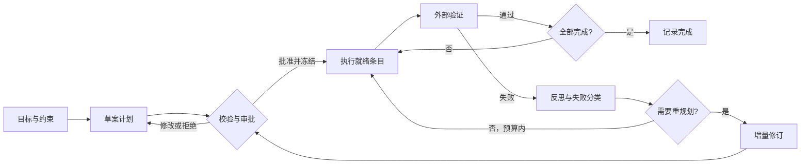
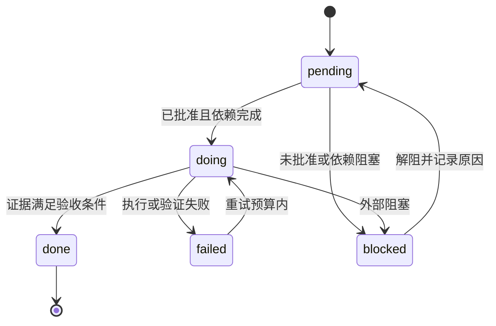

# 第 8 章 规划与任务分解

## 本章导读

一个“把支付回调的重试补上”的任务跑到第 24 轮，Agent 在对话里列过一份清单，但压缩后只剩一句“继续修复”。它不记得哪一步已经验证，于是重读文件、重改同一段代码；模型说“完成”时，测试其实从未跑过。问题不在模型不会列清单，而在 Harness 从未把计划变成可验证、可恢复的状态。

## 学习目标

读完本章你将能够：

- 把目标拆成“一次可验证的结果”，并为每个条目写出可执行的验收条件；
- 设计 TODO 的字段、依赖关系与状态机，并说明它和第 7 章 `TaskState` 的分工；
- 实现计划模式的全量批准、部分批准与拒绝流程，划清计划冻结与偏离的边界；
- 基于外部证据做有限反思，按触发条件进行增量重规划，而不是推倒重来；
- 让计划块进入上下文预算，并在压缩与重启后仍然可重建。

## 8.1 规划：把“想做什么”变成“如何证明做完了”

长任务最常见的失败不是模型想不出来，而是**计划只存在于自然语言里**。自然语言计划有三个致命问题：没有稳定的身份，压缩后无法逐条核对；没有验收条件，“完成”只能靠模型自述；没有依赖关系，执行顺序由当下的上下文随机决定。

规划（Planning）在 Harness 里的含义应当更窄：把目标拆成一组**有依赖关系的、可验证的子目标**，并把它们写入结构化状态。一个可执行的计划至少要满足三个性质：

1. **可验证**：每个条目都有验收条件，能由命令、检查或明确的证据判定；
2. **有依赖**：条目之间构成有向无环图（DAG），执行顺序不靠模型临场发挥；
3. **可重放**：计划变更以事件记录，崩溃或重启后能从事件重建，而不是从摘要里猜。

这三条也解释了为什么“让模型先想一想”不等于规划。思考是模型内部的过程，计划是 Harness 外部可检查的工件。

### 8.1.1 计划、TODO 与任务状态的分工

第 7 章已经把状态分成五层。本章不再重复分层，只明确三个相邻概念的职责：

| 概念 | 回答的问题 | 权威内容 | 存储与更新 |
|---|---|---|---|
| 计划（Plan） | 接下来做什么、按什么顺序、怎样算做完 | 条目标题、验收条件、依赖、版本、批准范围 | 计划事件；可修订 |
| 待办列表（TODO List） | 当前进行到哪一步 | 每个条目的状态与简短描述 | 投影到 `TaskState.todos`；随进度更新 |
| 任务状态（Task State） | 已经确认了哪些事实 | 目标、约束、已改文件、验证结果、未决调用 | 第 7 章事件日志与快照；只由类型化事件更新 |

三者的关系是单向的：

```text
计划事件 → Plan（未来工作图）
进度事件 → TaskState.todos（当前进度投影）
Plan + TaskState → 上下文中的状态块与计划块 → 模型
```

计划不是事实。计划说“打算把重试次数改成 3”，任务状态说“`client.py` 的当前哈希是 `6ae556ae`，`pytest` 最近一次退出码是 1”。**完成与否以任务状态和验证证据为准，不以计划条目的文字为准。**


如果你写不出一个条目的验收条件，它大概率不是“执行项”，而是“探索项”。把它改写成“读哪些文件、回答什么问题、留下什么证据”，例如“定位 retry 循环次数的根因，输出 `client.py:42` 与失败断言”。探索项也需要证据，只是证据从命令输出变成了 `file:line` 与结论。


### 8.1.2 规划闭环

完整的规划不是一次性动作，而是一个带刹车的闭环：草案、审批、执行、验证、反思、重规划。图 8-1 给出本章的实现视角。



注意两个边：验证失败不一定触发重规划，预算内可以先重试；重规划之后必须重新校验和批准，不能由模型直接改完继续执行。第 2 章已经讨论过“先规划还是边做边想”的原则，这里不再重复，只讨论混合模式下的操作规则。

## 8.2 条目设计：一次可验证的结果

### 8.2.1 粒度

TODO 的粒度是规划质量的第一决定因素。太粗，进度不可见，失败无法定位；太细，条目数量爆炸，维护成本超过收益。推荐的粒度是**一次可验证的结果**：它可以跨多个工具调用、跨多轮，但结束时必须有一个明确的检查点。

| 写法 | 问题 | 更好的写法 |
|---|---|---|
| 修复重试 bug | 无法判断何时结束 | 把 retry 次数改为 3，`test_retry` 通过 |
| 修改 `client.py` | 按动作拆分，不是按结果 | 定位 off-by-one 根因，输出 `client.py:42` |
| 运行测试 | 是验证动作，不是交付结果 | 全量 `pytest -q` 通过，且公共 API diff 为空 |
| 实现重试、补测试、跑 CI | 一个条目混了三个结果 | 拆成实现、补测试、全量验证三项 |

粒度可以用三个问题检验：这个条目能否用一个命令或一次检查判定？它是否只改变一个可描述的结果？失败时能否定位到具体文件或断言？三个问题有一个答不上来，就继续拆。

### 8.2.2 字段与状态机

本章的 `PlanItem` 在第 7 章 `Todo` 的 `id / text / status` 之上增加了执行所需的字段，但不改变 `Todo` 本身：

| 字段 | 作用 | 设计要点 |
|---|---|---|
| `id` | 稳定身份 | 一旦分配不再复用；修订项用 `p2b` 这类后缀 |
| `title` | 给人看的结果描述 | 动词开头，描述结果而非动作 |
| `acceptance` | 验收条件 | 必须是命令、检查或可核对证据 |
| `depends_on` | 硬依赖 | 只放真正阻塞执行的依赖，不放“相关” |
| `status` | 当前状态 | `pending / doing / done / failed / blocked` |
| `evidence` | 验收证据 | 命令、退出码、关键输出或 `file:line` |
| `attempts` | 失败次数 | 由 Harness 计数，不由模型自报 |
| `note` | 阻塞或重试原因 | 人类决策、环境问题、未获批准 |

状态机如图 8-2。`done` 是终态；要改已完成的内容，只能新建条目或发起重规划，不能把 `done` 改回 `doing`。



每次迁移都有守卫条件，不能由模型自由设置：

| 迁移 | 守卫 | 失败时的处理 |
|---|---|---|
| `pending → doing` | 条目已批准，所有依赖为 `done` | 返回“依赖未完成”，不执行 |
| `doing → done` | 必须有非空证据 | 拒绝标记完成，继续验证或转失败 |
| `doing → failed` | 记录失败签名与尝试次数 | 达到预算后触发重规划 |
| `failed → doing` | 仍在重试预算内，且带新证据 | 相同签名重复失败则升级 |
| `pending/doing → blocked` | 写明阻塞原因 | 依赖方递归标记阻塞 |
| `blocked → pending` | 记录解阻原因 | 重新检查依赖 |

### 8.2.3 依赖与 `next_ready`

依赖关系必须是 DAG：不能自依赖，不能成环，不能引用不存在的条目。运行时只需要一个函数：

```python
def next_ready(plan):
    return [
        item for item in plan.items
        if item.status == "pending"
        and item.id in plan.approved_ids
        and all(status[dep] == "done" for dep in item.depends_on)
    ]
```

`next_ready` 返回当前可以开始的条目。如果没有就绪条目、但仍有未完成项，说明计划陷入死锁：可能是依赖环、未批准项阻塞，或者外部条件不满足。此时不要循环空转，应进入重规划或询问用户。

### 8.2.4 与第 7 章状态的衔接

`TaskState.todos` 是计划在状态层的投影，只保留 `id / text / status`。之所以不把 `acceptance`、`depends_on` 直接塞进 `Todo`，有两个原因：第 7 章的快照与恢复接口已经定型，不该为一个模块改全局结构；计划是“未来”，任务状态是“事实”，两者生命周期不同，混在一张表里会让恢复逻辑变复杂。

衔接方式是两个事件：

```text
plan_item_updated  → 更新 Plan 条目的状态与证据
state_changed      → 更新 TaskState.todos 的 id/text/status
```

一次状态变更同时写两条事件，前者供计划重放，后者供状态重放。恢复时分别重建 `Plan` 与 `TaskState`；如果两者对同一 `id` 的状态不一致，**以 `TaskState` 为准**，因为它的更新绑定验证证据，而计划可能停留在旧版本。冲突本身要记录成事件，供审计。


不要把“模型说完成了”写成 `done`。`doing → done` 的守卫必须检查证据；没有证据就只能停在 `doing`，或者转 `failed` 并分类为“验证缺失”。验收条件可以写“测试通过”，但不能写成“看起来正确”。


## 8.3 计划模式：先只读，再批准，后执行

### 8.3.1 为什么需要计划模式

写操作有副作用，读操作没有。计划模式（Plan Mode）利用这个不对称：先让 Agent 在只读范围内探索，产出一份可审阅的计划；用户确认后，再开放写工具。它解决的不是“模型不会规划”，而是“执行前没有共同预期”。

一个完整的计划模式流程包含六步：

1. 接收目标与硬约束，明确哪些文件、命令、外部系统不允许触碰；
2. 只读探索：列目录、读文件、查测试、看 `git status`，不写任何文件；
3. 生成草案：按 8.2 的字段输出 `Plan`，并给出条目依赖；
4. 静态校验：目标非空、条目数量合理、验收条件齐全、依赖无环；
5. 展示与审批：全量批准、部分批准、修改后批准或拒绝；
6. 冻结版本：记录批准范围与事件序号，进入执行。

### 8.3.2 审批模式

| 模式 | 语义 | 未批准项 | 依赖未批准项 | 适用场景 |
|---|---|---|---|---|
| 全量批准 | 所有条目可执行 | 无 | 无 | 计划完整、风险可控 |
| 部分批准 | 只执行指定子集 | `blocked`，原因“未获批准” | 递归 `blocked` | 分批交付、权限只覆盖部分文件 |
| 修改后批准 | 编辑标题、验收或依赖，生成新版本 | 按新版本处理 | 重新校验 | 计划方向对，细节需要调整 |
| 拒绝 | 不执行任何条目 | 全部 `blocked` | 全部阻塞 | 目标错误、风险过高 |

部分批准不是“先跑一部分再说”。未批准的条目及其下游必须显式阻塞，否则执行器会误以为依赖已满足。后续如果扩大批准范围，应追加一条新的 `plan_approved` 事件，而不是修改旧事件。

<details>
<summary>示例：部分批准后的事件与状态</summary>

```json
{
  "seq": 4,
  "type": "plan_approved",
  "data": {
    "plan_id": "plan-1",
    "mode": "partial",
    "approved_ids": ["p1", "p2"],
    "blocked": [
      {"id": "p3", "note": "依赖未批准或阻塞"}
    ]
  }
}
```

重放时，`p1`、`p2` 保持可执行，`p3` 进入 `blocked`。如果之后批准 `p3`，追加一条新的批准事件，而不是回写第 4 条事件。

</details>

### 8.3.3 冻结、偏离与重新批准

批准的本质是冻结一个版本：`Plan.version` 与 `frozen_seq` 一起记录“用户批准的是哪一版”。执行中可以发生偏离，但要区分三类：

- **允许的偏离**：实现细节、变量名、内部函数拆分，验收条件与文件范围不变；
- **需要修订的偏离**：新增依赖、改变验收条件、删除条目、修改文件范围；
- **需要重新批准的偏离**：扩大权限范围、引入新的外部副作用、提高风险等级。

前两类由 Harness 记录 `plan_revised` 并校验；第三类必须回到审批。**计划冻结不是禁止变化，而是禁止静默变化。**


计划模式必须由工具权限强制执行，不能只靠系统提示。探索阶段只注册只读工具；写工具即使被模型调用，也应被执行器拒绝。否则模型一句“我需要先写个临时文件”就能绕过整个审批流程。权限模型的具体实现放在第 11 章，本章只保留“探索只读、执行需批准”的接缝。


## 8.4 执行：混合模式与进度投影

### 8.4.1 粗粒度计划，条目级细化

第 2 章比较过“先规划后执行”与“交错式执行”。生产系统通常采用混合模式：**计划保持在粗粒度，细化发生在条目边界**。

- 初始计划控制在 3～7 项，覆盖任务的主要阶段；
- 每个条目内部允许模型自主选择工具与步骤，不再逐工具审批；
- 只有到达条目边界、需要改变验收或依赖时，才修订计划；
- 一个 Agent 同一时刻只保持一个 `doing`；并行执行只在工具声明 `parallel_safe` 且写入文件不相交时启用（第 5 章已定义该标记）。

这样既避免“每一步都要计划”的开销，也避免“计划太粗，执行完全失控”。

### 8.4.2 进度是状态，不是叙述

判断进度只看三个数：`done / total`、`failed` 的条目与尝试次数、`blocked` 的条目及原因。模型的“已完成 80%”不进入状态，最多作为上下文里的一句说明。

每次状态迁移写两条事件并落一次检查点：

```python
plan_event = store.append("plan_item_updated", item_event(plan, item))
state_event = store.append("state_changed", {
    "kind": "todo",
    "id": item.id,
    "status": item.status,
})
checkpoint(store, state, session, reason=f"item_{item.status}")
```

这里调用的 `store.append`、`checkpoint` 都是第 7 章的接口，本章不重复其实现。关键是顺序：先写计划事件，再写状态投影，最后落检查点；崩溃恢复时，事件日志能重建两者。

### 8.4.3 何时拆分、何时合并

| 信号 | 动作 | 理由 |
|---|---|---|
| 一个条目有多个验收条件 | 拆分 | 失败时无法定位是哪一条不满足 |
| 要改多个互不相干的文件 | 拆分 | 一个失败会掩盖另一个 |
| 预计超过 8～10 次工具调用 | 拆分或降为探索项 | 条目太长，进度不可见 |
| 两个条目的验收命令相同 | 合并 | 重复验证同一事实 |
| 后一条目只是前一条的“再检查一遍” | 合并到验收证据 | 避免机械式清单 |


一个 TODO 可以跨多轮，不等于一次工具调用。把 TODO 绑定到工具调用会让计划变成执行日志：步骤一多，列表就爆炸，用户看不到真正的阶段目标。


## 8.5 反思：外部证据驱动的有限纠错

### 8.5.1 反思的定义

反思（Reflection）常被写成“让模型再想一想”。在生产 Agent 里，这个定义太弱：模型可以反复检查自己的错误结论，却始终不接触失败证据。本章采用更窄的定义：

> 反思是一次受预算约束的证据解释过程：接收结构化失败，分类原因，提出可检验的下一步，然后回到执行。

反思的输入不是“模型觉得哪里不对”，而是验证器返回的 `Failure`：条目、稳定签名、失败分类、证据摘要。输出不是一段自我批评，而是 `Reflection`：假设、下一步动作、是否允许重试。

### 8.5.2 证据等级

| 证据 | 强度 | 能证明什么 | 局限 |
|---|---|---|---|
| 测试通过 | 高 | 被测行为符合断言 | 测试可能缺失或写错 |
| 类型检查 / Lint | 中高 | 静态约束成立 | 不证明运行时行为 |
| Schema 校验 | 中高 | 结构与参数合法 | 不证明语义正确 |
| `git diff` / 文件哈希 | 中 | 改动范围符合预期 | 不证明功能正确 |
| 模型自述 | 低 | 只能作为线索 | 不能作为完成证据 |

完成判定优先使用高等级证据。没有测试时，退而使用类型检查、Schema 校验或人工审批；但必须在 `evidence` 里写清楚用了什么，不能把“模型检查过”写成证据。

### 8.5.3 失败分类与反思预算

| 分类 | 典型信号 | 第一步 | 禁止动作 |
|---|---|---|---|
| 环境 | 解释器缺失、依赖未装、端口占用 | 修复环境，记录命令 | 改业务代码“绕过”环境 |
| 参数 | Schema 不匹配、路径错误、断言参数错 | 对照 Schema 与调用点 | 放宽校验器 |
| 逻辑 | 断言失败、边界条件错 | 用最小失败用例定位 | 反复重跑同一命令 |
| 验证缺失 | 没有测试、没有可执行证据 | 补测试或静态检查 | 直接标记完成 |

预算建议：

- 单个条目最多 2 次失败尝试；
- 单个计划最多 2 次重规划；
- 同一失败签名出现 2 次，视为“没有新信息”，停止重试；
- 总验证时间设上限，超时交给用户；
- 每次重试必须带新证据，否则按无进展处理。

这与第 2 章的无进展检测兼容：反思预算耗尽时，循环应带类型化原因退出或升级，而不是继续消耗预算。


不要让模型在反思阶段修改验收条件。验收条件是用户批准过的契约；模型可以提出修改建议，但必须经过重规划和重新批准。否则“测试失败”会被改写成“测试预期不合理”，失败被话术消化掉。


## 8.6 重规划：增量修正与审计

### 8.6.1 触发条件

| 触发 | 判定 | 典型处理 |
|---|---|---|
| 重复失败 | 同一签名出现 2 次 | 停止重试，发起重规划 |
| 重试耗尽 | 单条目 `attempts ≥ 2` | 重规划或交给人 |
| 依赖阻塞 | 无就绪条目且有未完成项 | 检查依赖、请求批准或重规划 |
| 假设被推翻 | 新观察与计划前提冲突 | 修订受影响条目 |
| 预算压力 | 已用预算达到 80% | 缩减范围或请求新预算 |
| 人类拒绝 | 审批被拒绝或要求修改 | 生成新草案，重新审批 |

触发条件应由 Harness 判定，而不是让模型“感觉需要重规划”。模型可以提出重规划请求，但必须给出触发依据；Harness 校验依据是否成立。

### 8.6.2 增量重规划的合并规则

重规划不是让模型重写整份计划然后覆盖旧版本。模型返回的是一份修订草案，Harness 负责合并：

1. **目标与硬约束不可变**：修订草案改了目标或删了约束，直接拒绝；
2. **已完成条目原样保留**：即使模型在草案里漏掉，也要从旧计划补回；
3. **失败、执行中、阻塞条目回到 `pending`**：保留 `attempts`，在 `note` 里记录原状态；
4. **新增条目必须重新校验**：验收条件、依赖、数量上限；
5. **依赖重新检查**：修订可能引入新依赖或改变顺序；
6. **计算差异并判断是否需要重新批准**：新增、删除或改变验收/依赖，都需要重新批准；
7. **记录 `plan_revised` 事件并落检查点**：包含新旧版本、差异摘要与触发原因。

```python
new_plan, revision = replan(old_plan, revised, reason=failure.signature)
store.append("plan_revised", {
    "plan": asdict(new_plan),
    "diff": asdict(revision),
})
checkpoint(store, state, session, reason="plan_revised")
```

差异至少记录五类信息：

| 字段 | 含义 | 用途 |
|---|---|---|
| `added` | 新增条目 | 审计范围扩张 |
| `removed` | 删除条目 | 确认不是误删 |
| `changed` | 标题、验收或依赖变化 | 判断是否需重新批准 |
| `kept_done` | 保留的已完成项 | 证明没有推倒重来 |
| `reapproval_required` | 是否需要重新批准 | 控制执行门禁 |

### 8.6.3 重规划的边界

- 不要为了“让计划看起来完成”而删除失败条目；
- 不要把验收条件改成当前实现刚好满足的版本；
- 不要清空 `attempts`，否则重复失败会被重新计数；
- 不要在一次重规划里重写全部条目，除非任务目标确实变了；
- 达到重规划预算后，停止自动修订，把当前计划、失败证据与建议交给用户。


模型是修订草案的提出者，不是合并者。让模型直接输出“新计划”并覆盖旧计划，会出现三类事故：已完成项被删、硬约束被遗漏、失败证据被抹掉。Harness 必须做合并与守卫，模型只负责提出候选。


## 8.7 计划在上下文与压缩中的存活

### 8.7.1 权威归属

计划块与状态块同时进入上下文，必须明确谁说了算：

| 信息 | 权威来源 | 冲突处理 |
|---|---|---|
| 目标、硬约束 | `TaskState` | 计划不得覆盖；冲突时拒绝修订 |
| 条目的完成状态 | `TaskState.todos` + 验证证据 | 状态优先，计划标记漂移 |
| 验收条件、依赖、尝试次数 | `Plan` | 以最新批准版本为准 |
| 验证证据 | 事件日志 / `verifications` | 上下文只放摘要，详情回查日志 |
| 批准范围 | `plan_approved` 事件 | 不得由模型推断 |

### 8.7.2 注入顺序与渲染

推荐的上下文顺序是：

```text
系统提示（稳定规则）
→ 任务状态块（目标、约束、待办、已改文件、最近错误）
→ 计划块（未完成/失败/阻塞条目 + 验收 + 依赖）
→ 压缩摘要（叙述性背景）
→ 最近消息
```

状态块在前，因为它是事实摘要；计划块在后，因为它是执行细节。两者不能互相替代：状态块回答“现在到哪了”，计划块回答“下一步为什么是它、怎样算完成”。

`render_plan_block(plan, compact=...)` 有两种模式：

- **完整模式**：所有条目，`done` 条目附证据，适合审批与调试；
- **压缩模式**：`done` 条目折叠成计数，只保留 `pending / doing / failed / blocked` 的标题、验收与依赖，适合每轮注入。

压缩模式应当有硬上限：约 300～500 token（示例实现用 600 字符），超限时优先保留失败与阻塞条目，其次保留就绪队列，最后才截断标题。

### 8.7.3 压缩与重启后哪些字段必须存活

| 内容 | 压缩后 | 重启后 | 存放位置 |
|---|---|---|---|
| 目标与硬约束 | 必须 | 必须 | `TaskState` + 状态块 |
| 条目状态 | 必须 | 必须 | `TaskState.todos` |
| 验收条件 | 必须 | 必须 | `Plan` 条目 |
| 依赖关系 | 必须 | 必须 | `Plan` 条目 |
| 失败证据摘要 | 必须 | 必须 | `Plan.evidence` + 事件 |
| 已完成条目的详细证据 | 可折叠 | 保留在日志 | 事件日志 / transcript |
| 批准范围与版本 | 必须 | 必须 | `plan_approved` 事件 |
| 模型的计划叙述 | 可丢弃 | 可丢弃 | 摘要，非权威 |


压缩摘要不能承载验收条件。摘要由模型生成，可能把“测试通过”写成模糊的“验证完成”；一旦摘要成为验收条件的唯一来源，恢复后 Agent 就无法判断某个条目是否真的满足。压缩后应从 `Plan` 与 `TaskState` 重建计划块，而不是从摘要里提取。


集成时不需要修改第 7 章的 `rebuild_context` 签名，只需在状态块之后插入计划块：

```python
messages = rebuild_context(state, system_prompt, recent)
messages.insert(2, Message("system", render_plan_block(plan, compact=True)))
context = builder.assemble(messages)
```

顺序上的 `insert(2)` 对应“系统提示、状态块”之后。如果 `ContextBuilder` 已有固定的 memory 槽位，也可以把计划块放进去；关键是它必须每轮从结构化数据重建，而不是作为普通历史消息被压缩掉。

## 8.8 设计权衡

### 8.8.1 粗粒度计划与细粒度计划

| 维度 | 粗粒度（3～7 项） | 细粒度（15 项以上） |
|---|---|---|
| 进度可见性 | 中，按阶段 | 高，按动作 |
| 上下文成本 | 低 | 高，每轮都要注入 |
| 维护成本 | 低，只在阶段边界修订 | 高，频繁更新 |
| 失败定位 | 较差，需要条目内诊断 | 较好，直接定位 |
| 典型风险 | 目标漂移、条目内失控 | 清单爆炸、机械执行 |
| 适用场景 | 长任务、探索性强 | 流程固定、合规要求高 |

推荐“粗粒度计划 + 条目级验收”：计划层保持 3～7 项，验收条件写到可以执行的程度。这样既控制上下文成本，又保留可验证性。

### 8.8.2 全量重规划与增量重规划

| 维度 | 全量重规划 | 增量重规划 |
|---|---|---|
| 模型自由度 | 高，可以彻底换思路 | 中，受旧计划约束 |
| 已完成项保护 | 弱，容易被覆盖 | 强，强制保留 |
| 审计清晰度 | 差，差异难比较 | 好，有 added/changed/removed |
| 上下文成本 | 高，需重读全部状态 | 低，只带相关条目与失败 |
| 适用场景 | 目标本身改变 | 执行受阻、局部假设失效 |

默认选增量；只有目标或硬约束发生变化时，才允许全量重规划，并且必须重新走审批。

### 8.8.3 计划模式与直接执行

| 维度 | 计划模式 | 直接执行 |
|---|---|---|
| 首次响应延迟 | 高，需要探索与审批 | 低 |
| 副作用风险 | 低，执行前有共同预期 | 高，边做边改 |
| 用户打扰 | 高，需要确认 | 低 |
| 适用场景 | 写文件、删除、外部请求、多文件重构 | 只读分析、低风险问答、单步操作 |

不需要对所有任务都开计划模式。判断标准是“最坏情况下会重复或破坏什么”：如果答案是“没有”，直接执行更高效；如果答案是“文件、数据或外部状态”，先计划。

### 8.8.4 模型自评与外部验证

| 维度 | 模型自评 | 外部验证 |
|---|---|---|
| 成本 | 低 | 中高，需要运行命令 |
| 假阳性 | 高，容易把“看起来对”当完成 | 低，有可执行证据 |
| 延迟 | 低 | 取决于测试时长 |
| 适用场景 | 草稿、低风险建议 | 代码修改、数据变更、运维操作 |

与第 2 章的结论一致：完成是声明，验证是证据。本章把它落到计划条目上——`done` 必须有 `evidence`，而不是必须有模型的一句话。

## 8.9 代码实践：MiniCoder 的 planning.py

下面的实现把本章的机制落成代码：计划模型、校验、审批、状态机、依赖队列、反思分类、增量重规划、计划块渲染与事件重放。它不修改第 3、5、7 章的 `Provider`、`ToolResult`、`TaskState` 接口；计划作为独立结构存在，事件通过一个与 `SessionStore.append` 同签名的接收器写入。

实现要点：

- `PlanItem` 保留 `acceptance`、`depends_on`、`evidence`、`attempts`，`TaskState.todos` 仍只存 `id/text/status`；
- `approve_plan` 支持 `full / partial / reject`，并对未批准条目的下游做递归阻塞；
- `update_plan` 用守卫条件约束状态迁移，`done` 必须带证据；
- `should_replan` 按“重规划预算 → 重复签名 → 重试耗尽 → 依赖阻塞 → 预算压力”的顺序判定；
- `replan` 负责合并：保留目标、约束与已完成项，失败项回到 `pending`，差异写入 `PlanRevision`；
- `apply_plan_event` / `rebuild_plan` 让计划能从事件流恢复，与第 7 章的状态重放并列。



```python
from __future__ import annotations

import asyncio
import json
from dataclasses import asdict, dataclass, field
from typing import Any, Iterable, Optional, Protocol


SCHEMA_VERSION = 1
ITEM_STATUSES = {"pending", "doing", "done", "failed", "blocked"}


class PlanError(ValueError):
    pass


@dataclass
class Message:
    role: str
    content: str


@dataclass
class ModelResponse:
    text: str = ""


class Provider(Protocol):
    async def complete(
        self, messages: list[Message], tools: list[dict[str, Any]]
    ) -> ModelResponse: ...


class ScriptedProvider:
    """离线测试替身：按脚本依次返回模型文本。"""

    def __init__(self, responses: list[str]) -> None:
        self._responses = list(responses)

    async def complete(
        self, messages: list[Message], tools: list[dict[str, Any]]
    ) -> ModelResponse:
        if not self._responses:
            raise RuntimeError("脚本响应已用尽")
        return ModelResponse(self._responses.pop(0))


@dataclass
class PlanItem:
    id: str
    title: str
    acceptance: str
    depends_on: list[str] = field(default_factory=list)
    status: str = "pending"
    evidence: str = ""
    attempts: int = 0
    note: str = ""


@dataclass
class Plan:
    plan_id: str
    goal: str
    constraints: list[str]
    items: list[PlanItem]
    version: int = 1
    state: str = "draft"
    approved_ids: list[str] = field(default_factory=list)
    frozen_seq: int = 0
    revised_from: int = 0

    @classmethod
    def from_json(cls, data: dict[str, Any]) -> "Plan":
        return cls(
            plan_id=str(data["plan_id"]),
            goal=str(data["goal"]),
            constraints=[str(c) for c in data.get("constraints", [])],
            items=[PlanItem(**item) for item in data.get("items", [])],
            version=int(data.get("version", 1)),
            state=str(data.get("state", "draft")),
            approved_ids=[str(x) for x in data.get("approved_ids", [])],
            frozen_seq=int(data.get("frozen_seq", 0)),
            revised_from=int(data.get("revised_from", 0)),
        )

    def by_id(self, item_id: str) -> PlanItem:
        for item in self.items:
            if item.id == item_id:
                return item
        raise PlanError(f"计划中不存在条目 {item_id}")


@dataclass
class PlanRevision:
    added: list[str]
    removed: list[str]
    changed: list[str]
    kept_done: list[str]
    reason: str
    reapproval_required: bool


@dataclass
class Failure:
    item_id: str
    signature: str
    category: str
    detail: str


@dataclass
class Reflection:
    category: str
    hypothesis: str
    next_action: str
    retry_allowed: bool


_REFLECTIONS = {
    "environment": (
        "运行环境或依赖不满足",
        "先修复环境；不要改业务代码",
        True,
    ),
    "parameters": (
        "调用参数与工具 Schema 或断言不匹配",
        "对照 Schema 与调用点修正参数",
        True,
    ),
    "logic": (
        "实现与验收条件不一致",
        "用最小失败用例定位，再修改实现",
        True,
    ),
    "missing_verification": (
        "缺少可执行证据，无法判断完成",
        "补测试或类型检查后重跑",
        False,
    ),
}


def reflect(failure: Failure) -> Reflection:
    if failure.category not in _REFLECTIONS:
        raise PlanError(f"未知失败分类 {failure.category}")
    hypothesis, action, retry_allowed = _REFLECTIONS[failure.category]
    return Reflection(failure.category, hypothesis, action, retry_allowed)


def _has_cycle(items: list[PlanItem]) -> bool:
    graph = {item.id: item.depends_on for item in items}
    visiting: set[str] = set()
    visited: set[str] = set()

    def visit(node: str) -> bool:
        if node in visiting:
            return True
        if node in visited:
            return False
        visiting.add(node)
        for dep in graph.get(node, []):
            if visit(dep):
                return True
        visiting.remove(node)
        visited.add(node)
        return False

    return any(visit(node) for node in graph)


def validate_plan(plan: Plan, *, max_items: int = 8) -> list[str]:
    errors: list[str] = []
    if not plan.goal.strip():
        errors.append("目标不能为空")
    if not 1 <= len(plan.items) <= max_items:
        errors.append(f"计划条目数应在 1～{max_items} 之间")
    ids: set[str] = set()
    for item in plan.items:
        if not item.id.strip():
            errors.append("条目 id 不能为空")
        elif item.id in ids:
            errors.append(f"条目 id 重复：{item.id}")
        ids.add(item.id)
        if not item.title.strip():
            errors.append(f"条目 {item.id or '?'} 缺少标题")
        if not item.acceptance.strip():
            errors.append(f"条目 {item.id or '?'} 缺少验收条件")
        if item.status not in ITEM_STATUSES:
            errors.append(f"条目 {item.id} 的状态非法：{item.status}")
        if item.id in item.depends_on:
            errors.append(f"条目 {item.id} 不能依赖自身")
    for item in plan.items:
        for dep in item.depends_on:
            if dep not in ids:
                errors.append(f"条目 {item.id} 依赖不存在的 {dep}")
    if _has_cycle(plan.items):
        errors.append("依赖关系存在环")
    return errors


def _strip_fence(text: str) -> str:
    value = text.strip()
    if value.startswith("```"):
        value = value.split("\n", 1)[1] if "\n" in value else ""
        if value.endswith("```"):
            value = value[:-3]
    return value.strip()


def parse_plan(
    text: str,
    *,
    goal: str,
    constraints: list[str],
    plan_id: str = "plan-1",
    version: int = 1,
) -> Plan:
    try:
        data = json.loads(_strip_fence(text))
    except json.JSONDecodeError as exc:
        raise PlanError(f"计划不是合法 JSON：{exc}") from exc
    raw_items = data.get("items")
    if not isinstance(raw_items, list):
        raise PlanError("计划缺少 items 数组")
    items: list[PlanItem] = []
    for raw in raw_items:
        if not isinstance(raw, dict):
            raise PlanError("计划条目必须是对象")
        items.append(
            PlanItem(
                id=str(raw.get("id", "")),
                title=str(raw.get("title", "")),
                acceptance=str(raw.get("acceptance", "")),
                depends_on=[str(dep) for dep in raw.get("depends_on") or []],
            )
        )
    return Plan(
        plan_id=plan_id,
        goal=goal,
        constraints=list(constraints),
        items=items,
        version=version,
    )


def approve_plan(
    plan: Plan, approved_ids: Optional[list[str]] = None, *, mode: str = "full"
) -> Plan:
    ids = [item.id for item in plan.items]
    if mode == "reject":
        plan.state = "rejected"
        plan.approved_ids = []
        for item in plan.items:
            item.status = "blocked"
            item.note = "计划被拒绝"
        return plan
    if mode == "full":
        approved = list(ids)
    elif mode == "partial":
        approved = [item_id for item_id in (approved_ids or []) if item_id in ids]
        if not approved:
            raise PlanError("部分批准必须至少包含一个条目")
    else:
        raise PlanError(f"未知批准模式 {mode}")

    approved_set = set(approved)
    plan.approved_ids = [item_id for item_id in ids if item_id in approved_set]
    plan.state = "approved"
    for item in plan.items:
        if item.id not in approved_set:
            item.status = "blocked"
            item.note = "未获批准"

    blocked = {item.id for item in plan.items if item.status == "blocked"}
    changed = True
    while changed:
        changed = False
        for item in plan.items:
            if item.status == "blocked":
                continue
            if any(dep in blocked for dep in item.depends_on):
                item.status = "blocked"
                item.note = "依赖未批准或阻塞"
                blocked.add(item.id)
                changed = True
    return plan


def next_ready(plan: Plan) -> list[PlanItem]:
    status = {item.id: item.status for item in plan.items}
    ready: list[PlanItem] = []
    for item in plan.items:
        if item.status != "pending" or item.id not in plan.approved_ids:
            continue
        if all(status[dep] == "done" for dep in item.depends_on):
            ready.append(item)
    return ready


def update_plan(
    plan: Plan,
    item_id: str,
    *,
    status: Optional[str] = None,
    evidence: Optional[str] = None,
    note: Optional[str] = None,
) -> PlanItem:
    item = plan.by_id(item_id)
    if status is None:
        if evidence is not None:
            item.evidence = evidence
        if note is not None:
            item.note = note
        return item
    if status not in ITEM_STATUSES:
        raise PlanError(f"非法状态 {status}")
    if item.status == "done":
        raise PlanError("已完成条目不可修改")
    statuses = {entry.id: entry.status for entry in plan.items}
    if status == "doing":
        if item.status not in {"pending", "failed"}:
            raise PlanError(f"条目 {item.id} 不能从 {item.status} 进入 doing")
        if item.id not in plan.approved_ids:
            raise PlanError("未批准条目不能执行")
        if any(statuses[dep] != "done" for dep in item.depends_on):
            raise PlanError("依赖未完成，不能开始")
        if plan.state == "approved":
            plan.state = "executing"
    elif status == "done":
        if item.status != "doing":
            raise PlanError("只有 doing 可以进入 done")
        final_evidence = (evidence if evidence is not None else item.evidence).strip()
        if not final_evidence:
            raise PlanError("标记完成必须附验收证据")
    elif status == "failed":
        if item.status not in {"doing", "pending"}:
            raise PlanError("只有 doing 或 pending 可以失败")
        item.attempts += 1
    elif status == "blocked":
        if item.status == "done":
            raise PlanError("已完成条目不能阻塞")
    elif status == "pending":
        if item.status not in {"failed", "blocked"}:
            raise PlanError("只有 failed 或 blocked 可以回到 pending")
        if note is None:
            raise PlanError("重试或解阻必须记录原因")
    item.status = status
    if evidence is not None:
        item.evidence = evidence
    if note is not None:
        item.note = note
    return item


def complete_plan(plan: Plan) -> Plan:
    if any(item.status != "done" for item in plan.items):
        raise PlanError("仍有未完成条目")
    plan.state = "completed"
    return plan


def should_replan(
    plan: Plan,
    *,
    signature_history: Iterable[str] = (),
    max_attempts: int = 2,
    max_replans: int = 2,
    budget_ratio: float = 0.0,
) -> str:
    if plan.version - 1 >= max_replans:
        return "replan_budget_exhausted"
    counts: dict[str, int] = {}
    for signature in signature_history:
        counts[signature] = counts.get(signature, 0) + 1
    if any(count >= 2 for count in counts.values()):
        return "repeated_failure"
    if any(
        item.status == "failed" and item.attempts >= max_attempts
        for item in plan.items
    ):
        return "retry_exhausted"
    retryable = any(
        item.status == "failed" and item.attempts < max_attempts
        for item in plan.items
    )
    unfinished = [
        item
        for item in plan.items
        if item.status in {"pending", "doing", "failed", "blocked"}
    ]
    if unfinished and not retryable and not next_ready(plan):
        return "dependency_blocked"
    if budget_ratio >= 0.8:
        return "budget_pressure"
    return ""


def replan(
    old: Plan, revised: Plan, *, reason: str
) -> tuple[Plan, PlanRevision]:
    if revised.goal.strip() != old.goal.strip():
        raise PlanError("重规划不得改变任务目标")
    old_items = {item.id: item for item in old.items}
    new_items: list[PlanItem] = []
    added: list[str] = []
    changed: list[str] = []
    kept_done: list[str] = []
    seen: set[str] = set()

    for item in revised.items:
        base = old_items.get(item.id)
        if base is None:
            added.append(item.id)
            new_items.append(item)
            seen.add(item.id)
            continue
        if base.status == "done":
            new_items.append(PlanItem(**asdict(base)))
            kept_done.append(item.id)
            seen.add(item.id)
            continue
        if (
            base.title != item.title
            or base.acceptance != item.acceptance
            or base.depends_on != item.depends_on
        ):
            changed.append(item.id)
        item.attempts = base.attempts
        if base.status in {"failed", "doing", "blocked"}:
            item.status = "pending"
            item.note = f"重规划后重试（原状态：{base.status}）"
        new_items.append(item)
        seen.add(item.id)

    removed: list[str] = []
    for item_id, base in old_items.items():
        if item_id in seen:
            continue
        if base.status == "done":
            new_items.append(PlanItem(**asdict(base)))
            kept_done.append(item_id)
        else:
            removed.append(item_id)

    reapproval = bool(added or changed or removed)
    new_plan = Plan(
        plan_id=old.plan_id,
        goal=old.goal,
        constraints=list(old.constraints),
        items=new_items,
        version=old.version + 1,
        state="draft" if reapproval else old.state,
        approved_ids=[] if reapproval else list(old.approved_ids),
        frozen_seq=old.frozen_seq,
        revised_from=old.version,
    )
    revision = PlanRevision(
        added=added,
        removed=removed,
        changed=changed,
        kept_done=kept_done,
        reason=reason,
        reapproval_required=reapproval,
    )
    return new_plan, revision


PLAN_PROMPT = """你是编码 Agent 的规划器。只输出 JSON，不要解释。
格式：{"items":[{"id":"p1","title":"...","acceptance":"...","depends_on":[]}]}
要求：3～7 项；每项是一次可验证的结果；acceptance 必须能通过命令或检查判断。"""


class Planner:
    def __init__(self, provider: Provider) -> None:
        self.provider = provider

    async def propose(
        self, goal: str, constraints: list[str]
    ) -> Plan:
        prompt = (
            f"{PLAN_PROMPT}\n目标：{goal}\n约束：{'；'.join(constraints)}"
        )
        response = await self.provider.complete(
            [Message("user", prompt)], []
        )
        plan = parse_plan(response.text, goal=goal, constraints=constraints)
        errors = validate_plan(plan)
        if errors:
            raise PlanError("；".join(errors))
        return plan

    async def revise(
        self, plan: Plan, failure: Failure, reflection: Reflection
    ) -> tuple[Plan, PlanRevision]:
        prompt = (
            f"{PLAN_PROMPT}\n目标：{plan.goal}\n"
            f"当前计划：{json.dumps(asdict(plan), ensure_ascii=False)}\n"
            f"失败：{failure.signature}（{failure.category}）{failure.detail}\n"
            f"反思：{reflection.hypothesis}；下一步：{reflection.next_action}"
        )
        response = await self.provider.complete(
            [Message("user", prompt)], []
        )
        revised = parse_plan(
            response.text,
            goal=plan.goal,
            constraints=plan.constraints,
            plan_id=plan.plan_id,
            version=plan.version + 1,
        )
        errors = validate_plan(revised)
        if errors:
            raise PlanError("；".join(errors))
        return replan(plan, revised, reason=failure.signature)


def render_plan_block(
    plan: Plan,
    *,
    compact: bool = False,
    max_items: int = 8,
    max_chars: int = 600,
) -> str:
    total = len(plan.items)
    done = sum(1 for item in plan.items if item.status == "done")
    lines = [
        f"[执行计划 v{plan.version} | {plan.state}]",
        f"目标：{plan.goal}",
        f"约束：{'；'.join(plan.constraints) or '（无）'}",
    ]
    if compact and done:
        lines.append(f"已完成 {done}/{total} 项（详情见事件日志）")
    visible = [
        item
        for item in plan.items
        if not (compact and item.status == "done")
    ]
    for item in visible[:max_items]:
        deps = f" | 依赖：{','.join(item.depends_on)}" if item.depends_on else ""
        evidence = (
            f" | 证据：{item.evidence}"
            if not compact and item.evidence
            else ""
        )
        lines.append(
            f"- [{item.status}] {item.id} {item.title}"
            f" | 验收：{item.acceptance}{deps}{evidence}"
        )
    text = "\n".join(lines)
    if len(text) > max_chars:
        text = text[: max_chars - 12].rstrip() + "\n…（已截断）"
    return text


def apply_plan_event(plan: Optional[Plan], event: dict[str, Any]) -> Optional[Plan]:
    kind = event["type"]
    data = event["data"]
    if kind == "plan_created":
        return Plan.from_json(data)
    if plan is None:
        return None
    if kind == "plan_approved":
        plan.state = "approved"
        plan.approved_ids = [str(x) for x in data.get("approved_ids", [])]
        plan.frozen_seq = int(event.get("seq", 0))
        blocked = {x["id"]: x["note"] for x in data.get("blocked", [])}
        for item in plan.items:
            if item.id in blocked:
                item.status = "blocked"
                item.note = blocked[item.id]
    elif kind == "plan_item_updated":
        item = plan.by_id(str(data["item_id"]))
        item.status = str(data["status"])
        item.evidence = str(data.get("evidence", ""))
        item.attempts = int(data.get("attempts", 0))
        item.note = str(data.get("note", ""))
    elif kind == "plan_revised":
        plan = Plan.from_json(data["plan"])
    elif kind == "plan_completed":
        plan.state = "completed"
    return plan


def rebuild_plan(events: Iterable[dict[str, Any]]) -> Plan:
    plan: Optional[Plan] = None
    for event in events:
        plan = apply_plan_event(plan, event)
    if plan is None:
        raise PlanError("事件流中缺少 plan_created")
    return plan


class MemorySink:
    """演示用事件接收器；生产环境换成第 7 章的 SessionStore。"""

    def __init__(self) -> None:
        self.seq = 0
        self.events: list[dict[str, Any]] = []

    def append(self, type_: str, data: dict[str, Any]) -> dict[str, Any]:
        self.seq += 1
        event = {
            "seq": self.seq,
            "type": type_,
            "data": data,
            "schema_version": SCHEMA_VERSION,
        }
        self.events.append(event)
        return event


def item_event(plan: Plan, item: PlanItem) -> dict[str, Any]:
    return {
        "plan_id": plan.plan_id,
        "item_id": item.id,
        "status": item.status,
        "evidence": item.evidence,
        "attempts": item.attempts,
        "note": item.note,
    }


SNIPPET_INITIAL = json.dumps(
    {
        "items": [
            {
                "id": "p1",
                "title": "读取 client.py 与现有测试",
                "acceptance": "能指出 retry 分支与失败断言",
                "depends_on": [],
            },
            {
                "id": "p2",
                "title": "修正 retry 次数",
                "acceptance": "test_retry 覆盖 3 次尝试",
                "depends_on": ["p1"],
            },
            {
                "id": "p3",
                "title": "运行测试与 API 检查",
                "acceptance": "pytest 通过且公共 API 不变",
                "depends_on": ["p2"],
            },
        ]
    },
    ensure_ascii=False,
)

SNIPPET_REVISED = json.dumps(
    {
        "items": [
            {
                "id": "p1",
                "title": "读取 client.py 与现有测试",
                "acceptance": "能指出 retry 分支与失败断言",
                "depends_on": [],
            },
            {
                "id": "p2",
                "title": "修正 retry 边界并补齐断言",
                "acceptance": "test_retry 覆盖 3 次尝试且断言通过",
                "depends_on": ["p1"],
            },
            {
                "id": "p2b",
                "title": "复跑失败测试",
                "acceptance": "pytest -q test_client.py 通过",
                "depends_on": ["p2"],
            },
            {
                "id": "p3",
                "title": "运行全量测试与 API 检查",
                "acceptance": "pytest -q 通过且公共 API 无变化",
                "depends_on": ["p2b"],
            },
        ]
    },
    ensure_ascii=False,
)


async def main() -> None:
    goal = "让 retry 测试通过并保持公共 API 不变"
    constraints = ["不修改公共 API", "只改 client.py 与 test_client.py"]
    provider = ScriptedProvider([SNIPPET_INITIAL, SNIPPET_REVISED])
    planner = Planner(provider)
    sink = MemorySink()
    signatures: list[str] = []

    print("== 1. 生成计划 ==")
    plan = await planner.propose(goal, constraints)
    sink.append("plan_created", asdict(plan))
    print(f"{plan.plan_id} v{plan.version} {plan.state}：{len(plan.items)} 项")
    for item in plan.items:
        deps = f" | deps={','.join(item.depends_on)}" if item.depends_on else ""
        print(f"- {item.id} {item.title} | 验收：{item.acceptance}{deps}")

    print("\n== 2. 计划模式：校验与批准 ==")
    errors = validate_plan(plan)
    print(f"校验：{'通过' if not errors else '；'.join(errors)}")
    approve_plan(plan, mode="full")
    blocked = [
        {"id": item.id, "note": item.note}
        for item in plan.items
        if item.status == "blocked"
    ]
    sink.append(
        "plan_approved",
        {
            "plan_id": plan.plan_id,
            "approved_ids": plan.approved_ids,
            "mode": "full",
            "blocked": blocked,
        },
    )
    print(f"批准：full，{len(plan.approved_ids)} 项可执行；计划冻结 v{plan.version}")
    print(f"当前可执行：{', '.join(item.id for item in next_ready(plan))}")

    print("\n== 3. 执行与首次失败 ==")
    update_plan(plan, "p1", status="doing")
    sink.append("plan_item_updated", item_event(plan, plan.by_id("p1")))
    update_plan(
        plan,
        "p1",
        status="done",
        evidence="read client.py: retry() 使用 range(2)",
    )
    sink.append("plan_item_updated", item_event(plan, plan.by_id("p1")))
    print(f"p1 done：{plan.by_id('p1').evidence}")

    update_plan(plan, "p2", status="doing")
    sink.append("plan_item_updated", item_event(plan, plan.by_id("p2")))
    failure = Failure(
        item_id="p2",
        signature="test_retry:attempts",
        category="logic",
        detail="期望 3 次尝试，实际 2 次",
    )
    update_plan(plan, "p2", status="failed", evidence=failure.detail)
    signatures.append(failure.signature)
    sink.append("plan_item_updated", item_event(plan, plan.by_id("p2")))
    print(f"p2 failed（第 {plan.by_id('p2').attempts} 次）：{failure.detail}")
    reflection = reflect(failure)
    print(
        f"反思：category={reflection.category}；假设={reflection.hypothesis}；"
        f"下一步={reflection.next_action}"
    )
    reason = should_replan(plan, signature_history=signatures)
    print(f"重规划判断：{reason or '无（继续重试）'}")

    update_plan(plan, "p2", status="pending", note="按反思重试一次")
    sink.append("plan_item_updated", item_event(plan, plan.by_id("p2")))
    update_plan(plan, "p2", status="doing")
    sink.append("plan_item_updated", item_event(plan, plan.by_id("p2")))
    update_plan(plan, "p2", status="failed", evidence="同一签名再次失败")
    signatures.append(failure.signature)
    sink.append("plan_item_updated", item_event(plan, plan.by_id("p2")))

    print("\n== 4. 重复失败与重规划 ==")
    print(
        f"p2 failed（第 {plan.by_id('p2').attempts} 次）：同一签名再次失败"
    )
    reason = should_replan(plan, signature_history=signatures)
    print(f"重规划判断：{reason}")
    plan, revision = await planner.revise(plan, failure, reflection)
    sink.append(
        "plan_revised",
        {"plan": asdict(plan), "diff": asdict(revision)},
    )
    print(
        "计划差异："
        f"+{','.join(revision.added) or '无'}；"
        f"~{','.join(revision.changed) or '无'}；"
        f"-{','.join(revision.removed) or '无'}；"
        f"保留完成项={','.join(revision.kept_done) or '无'}"
    )
    print(
        f"重规划完成：v{plan.version} draft（需重新批准："
        f"{str(revision.reapproval_required).lower()}）"
    )
    approve_plan(plan, mode="full")
    blocked = [
        {"id": item.id, "note": item.note}
        for item in plan.items
        if item.status == "blocked"
    ]
    sink.append(
        "plan_approved",
        {
            "plan_id": plan.plan_id,
            "approved_ids": plan.approved_ids,
            "mode": "full",
            "blocked": blocked,
        },
    )
    print(f"批准 v{plan.version}：{len(plan.approved_ids)} 项可执行")

    print("\n== 5. 计划块：完整与压缩 ==")
    full_block = render_plan_block(plan)
    compact_block = render_plan_block(plan, compact=True)
    print(f"完整计划块 {len(full_block)} 字符；压缩后 {len(compact_block)} 字符")
    print(compact_block)

    print("\n== 6. 执行修正并验证 ==")
    for item_id, evidence in [
        ("p2", "client.py retry 使用 range(3)"),
        ("p2b", "pytest -q test_client.py -> 1 passed"),
        ("p3", "pytest -q -> 3 passed；git diff --stat 公共 API 无变化"),
    ]:
        update_plan(plan, item_id, status="doing")
        sink.append("plan_item_updated", item_event(plan, plan.by_id(item_id)))
        update_plan(plan, item_id, status="done", evidence=evidence)
        sink.append("plan_item_updated", item_event(plan, plan.by_id(item_id)))
        print(f"{item_id} done：{evidence}")
    complete_plan(plan)
    sink.append("plan_completed", {"plan_id": plan.plan_id})
    done = sum(1 for item in plan.items if item.status == "done")
    print(f"计划完成：{done}/{len(plan.items)}，状态={plan.state}")

    print("\n== 7. 事件与重放 ==")
    counts: dict[str, int] = {}
    for event in sink.events:
        counts[event["type"]] = counts.get(event["type"], 0) + 1
    summary = " ".join(f"{key}={counts[key]}" for key in sorted(counts))
    print(f"事件 {len(sink.events)} 条：{summary}")
    replayed = rebuild_plan(sink.events)
    replayed_done = sum(1 for item in replayed.items if item.status == "done")
    same = (
        replayed.version == plan.version
        and replayed.state == plan.state
        and replayed_done == done
    )
    print(
        f"重放校验：plan v{replayed.version} {replayed.state}，"
        f"{replayed_done}/{len(replayed.items)}，匹配={str(same).lower()}"
    )


if __name__ == "__main__":
    asyncio.run(main())
```



```typescript
type Message = { role: string; content: string };
type ModelResponse = { text: string };

interface Provider {
  complete(messages: Message[], tools: Record<string, unknown>[]): Promise<ModelResponse>;
}

class ScriptedProvider implements Provider {
  private responses: string[];

  constructor(responses: string[]) {
    this.responses = [...responses];
  }

  async complete(_messages: Message[], _tools: Record<string, unknown>[]): Promise<ModelResponse> {
    if (this.responses.length === 0) throw new Error("脚本响应已用尽");
    return { text: this.responses.shift()! };
  }
}

class PlanError extends Error {}

const SCHEMA_VERSION = 1;
const ITEM_STATUSES = new Set(["pending", "doing", "done", "failed", "blocked"]);

type PlanItem = {
  id: string;
  title: string;
  acceptance: string;
  dependsOn: string[];
  status: string;
  evidence: string;
  attempts: number;
  note: string;
};

type Plan = {
  planId: string;
  goal: string;
  constraints: string[];
  items: PlanItem[];
  version: number;
  state: string;
  approvedIds: string[];
  frozenSeq: number;
  revisedFrom: number;
};

function makeItem(init: Partial<PlanItem> & { id: string; title: string; acceptance: string }): PlanItem {
  return {
    id: init.id,
    title: init.title,
    acceptance: init.acceptance,
    dependsOn: init.dependsOn ?? [],
    status: init.status ?? "pending",
    evidence: init.evidence ?? "",
    attempts: init.attempts ?? 0,
    note: init.note ?? "",
  };
}

function makePlan(init: Partial<Plan> & { planId: string; goal: string; constraints: string[]; items: PlanItem[] }): Plan {
  return {
    planId: init.planId,
    goal: init.goal,
    constraints: init.constraints,
    items: init.items,
    version: init.version ?? 1,
    state: init.state ?? "draft",
    approvedIds: init.approvedIds ?? [],
    frozenSeq: init.frozenSeq ?? 0,
    revisedFrom: init.revisedFrom ?? 0,
  };
}

function itemFromJson(data: any): PlanItem {
  return makeItem({
    id: String(data.id),
    title: String(data.title),
    acceptance: String(data.acceptance),
    dependsOn: (data.depends_on ?? []).map((dep: unknown) => String(dep)),
    status: String(data.status ?? "pending"),
    evidence: String(data.evidence ?? ""),
    attempts: Number(data.attempts ?? 0),
    note: String(data.note ?? ""),
  });
}

function planFromJson(data: any): Plan {
  return makePlan({
    planId: String(data.plan_id),
    goal: String(data.goal),
    constraints: (data.constraints ?? []).map((value: unknown) => String(value)),
    items: (data.items ?? []).map((item: any) => itemFromJson(item)),
    version: Number(data.version ?? 1),
    state: String(data.state ?? "draft"),
    approvedIds: (data.approved_ids ?? []).map((value: unknown) => String(value)),
    frozenSeq: Number(data.frozen_seq ?? 0),
    revisedFrom: Number(data.revised_from ?? 0),
  });
}

function itemToJson(item: PlanItem): Record<string, unknown> {
  return {
    id: item.id,
    title: item.title,
    acceptance: item.acceptance,
    depends_on: item.dependsOn,
    status: item.status,
    evidence: item.evidence,
    attempts: item.attempts,
    note: item.note,
  };
}

function planToJson(plan: Plan): Record<string, unknown> {
  return {
    plan_id: plan.planId,
    goal: plan.goal,
    constraints: plan.constraints,
    items: plan.items.map(itemToJson),
    version: plan.version,
    state: plan.state,
    approved_ids: plan.approvedIds,
    frozen_seq: plan.frozenSeq,
    revised_from: plan.revisedFrom,
  };
}

function byId(plan: Plan, itemId: string): PlanItem {
  const item = plan.items.find((entry) => entry.id === itemId);
  if (!item) throw new PlanError(`计划中不存在条目 ${itemId}`);
  return item;
}

type PlanRevision = {
  added: string[];
  removed: string[];
  changed: string[];
  keptDone: string[];
  reason: string;
  reapprovalRequired: boolean;
};

function revisionToJson(revision: PlanRevision): Record<string, unknown> {
  return {
    added: revision.added,
    removed: revision.removed,
    changed: revision.changed,
    kept_done: revision.keptDone,
    reason: revision.reason,
    reapproval_required: revision.reapprovalRequired,
  };
}

type Failure = { itemId: string; signature: string; category: string; detail: string };
type Reflection = { category: string; hypothesis: string; nextAction: string; retryAllowed: boolean };

const REFLECTIONS: Record<string, [string, string, boolean]> = {
  environment: ["运行环境或依赖不满足", "先修复环境；不要改业务代码", true],
  parameters: ["调用参数与工具 Schema 或断言不匹配", "对照 Schema 与调用点修正参数", true],
  logic: ["实现与验收条件不一致", "用最小失败用例定位，再修改实现", true],
  missing_verification: ["缺少可执行证据，无法判断完成", "补测试或类型检查后重跑", false],
};

function reflect(failure: Failure): Reflection {
  const entry = REFLECTIONS[failure.category];
  if (!entry) throw new PlanError(`未知失败分类 ${failure.category}`);
  return {
    category: failure.category,
    hypothesis: entry[0],
    nextAction: entry[1],
    retryAllowed: entry[2],
  };
}

function hasCycle(items: PlanItem[]): boolean {
  const graph = new Map(items.map((item) => [item.id, item.dependsOn]));
  const visiting = new Set<string>();
  const visited = new Set<string>();
  const visit = (node: string): boolean => {
    if (visiting.has(node)) return true;
    if (visited.has(node)) return false;
    visiting.add(node);
    for (const dep of graph.get(node) ?? []) {
      if (visit(dep)) return true;
    }
    visiting.delete(node);
    visited.add(node);
    return false;
  };
  return [...graph.keys()].some(visit);
}

function validatePlan(plan: Plan, maxItems = 8): string[] {
  const errors: string[] = [];
  if (plan.goal.trim() === "") errors.push("目标不能为空");
  if (plan.items.length < 1 || plan.items.length > maxItems) {
    errors.push(`计划条目数应在 1～${maxItems} 之间`);
  }
  const ids = new Set<string>();
  for (const item of plan.items) {
    if (item.id.trim() === "") errors.push("条目 id 不能为空");
    else if (ids.has(item.id)) errors.push(`条目 id 重复：${item.id}`);
    ids.add(item.id);
    if (item.title.trim() === "") errors.push(`条目 ${item.id || "?"} 缺少标题`);
    if (item.acceptance.trim() === "") errors.push(`条目 ${item.id || "?"} 缺少验收条件`);
    if (!ITEM_STATUSES.has(item.status)) errors.push(`条目 ${item.id} 的状态非法：${item.status}`);
    if (item.dependsOn.includes(item.id)) errors.push(`条目 ${item.id} 不能依赖自身`);
  }
  for (const item of plan.items) {
    for (const dep of item.dependsOn) {
      if (!ids.has(dep)) errors.push(`条目 ${item.id} 依赖不存在的 ${dep}`);
    }
  }
  if (hasCycle(plan.items)) errors.push("依赖关系存在环");
  return errors;
}

function stripFence(text: string): string {
  let value = text.trim();
  if (value.startsWith("```")) {
    const newline = value.indexOf("\n");
    value = newline >= 0 ? value.slice(newline + 1) : "";
    if (value.endsWith("```")) value = value.slice(0, -3);
  }
  return value.trim();
}

function parsePlan(
  text: string,
  options: { goal: string; constraints: string[]; planId?: string; version?: number },
): Plan {
  let data: any;
  try {
    data = JSON.parse(stripFence(text));
  } catch (error) {
    throw new PlanError(`计划不是合法 JSON：${String(error)}`);
  }
  if (!Array.isArray(data.items)) throw new PlanError("计划缺少 items 数组");
  const items = data.items.map((raw: any) => {
    if (typeof raw !== "object" || raw === null) throw new PlanError("计划条目必须是对象");
    return makeItem({
      id: String(raw.id ?? ""),
      title: String(raw.title ?? ""),
      acceptance: String(raw.acceptance ?? ""),
      dependsOn: (raw.depends_on ?? []).map((dep: unknown) => String(dep)),
    });
  });
  return makePlan({
    planId: options.planId ?? "plan-1",
    goal: options.goal,
    constraints: [...options.constraints],
    items,
    version: options.version ?? 1,
  });
}

function approvePlan(
  plan: Plan,
  approvedIds?: string[],
  mode: "full" | "partial" | "reject" = "full",
): Plan {
  const ids = plan.items.map((item) => item.id);
  if (mode === "reject") {
    plan.state = "rejected";
    plan.approvedIds = [];
    for (const item of plan.items) {
      item.status = "blocked";
      item.note = "计划被拒绝";
    }
    return plan;
  }
  let approved: string[];
  if (mode === "full") {
    approved = [...ids];
  } else if (mode === "partial") {
    approved = (approvedIds ?? []).filter((itemId) => ids.includes(itemId));
    if (approved.length === 0) throw new PlanError("部分批准必须至少包含一个条目");
  } else {
    throw new PlanError(`未知批准模式 ${String(mode)}`);
  }
  const approvedSet = new Set(approved);
  plan.approvedIds = ids.filter((itemId) => approvedSet.has(itemId));
  plan.state = "approved";
  for (const item of plan.items) {
    if (!approvedSet.has(item.id)) {
      item.status = "blocked";
      item.note = "未获批准";
    }
  }
  const blocked = new Set(plan.items.filter((item) => item.status === "blocked").map((item) => item.id));
  let changed = true;
  while (changed) {
    changed = false;
    for (const item of plan.items) {
      if (item.status === "blocked") continue;
      if (item.dependsOn.some((dep) => blocked.has(dep))) {
        item.status = "blocked";
        item.note = "依赖未批准或阻塞";
        blocked.add(item.id);
        changed = true;
      }
    }
  }
  return plan;
}

function nextReady(plan: Plan): PlanItem[] {
  const status = new Map(plan.items.map((item) => [item.id, item.status]));
  return plan.items.filter(
    (item) =>
      item.status === "pending" &&
      plan.approvedIds.includes(item.id) &&
      item.dependsOn.every((dep) => status.get(dep) === "done"),
  );
}

function updatePlan(
  plan: Plan,
  itemId: string,
  options: { status?: string; evidence?: string; note?: string } = {},
): PlanItem {
  const item = byId(plan, itemId);
  if (options.status === undefined) {
    if (options.evidence !== undefined) item.evidence = options.evidence;
    if (options.note !== undefined) item.note = options.note;
    return item;
  }
  const status = options.status;
  if (!ITEM_STATUSES.has(status)) throw new PlanError(`非法状态 ${status}`);
  if (item.status === "done") throw new PlanError("已完成条目不可修改");
  const statuses = new Map(plan.items.map((entry) => [entry.id, entry.status]));
  if (status === "doing") {
    if (item.status !== "pending" && item.status !== "failed") {
      throw new PlanError(`条目 ${item.id} 不能从 ${item.status} 进入 doing`);
    }
    if (!plan.approvedIds.includes(item.id)) throw new PlanError("未批准条目不能执行");
    if (item.dependsOn.some((dep) => statuses.get(dep) !== "done")) {
      throw new PlanError("依赖未完成，不能开始");
    }
    if (plan.state === "approved") plan.state = "executing";
  } else if (status === "done") {
    if (item.status !== "doing") throw new PlanError("只有 doing 可以进入 done");
    if ((options.evidence ?? item.evidence).trim() === "") {
      throw new PlanError("标记完成必须附验收证据");
    }
  } else if (status === "failed") {
    if (item.status !== "doing" && item.status !== "pending") {
      throw new PlanError("只有 doing 或 pending 可以失败");
    }
    item.attempts += 1;
  } else if (status === "blocked") {
    if (item.status === "done") throw new PlanError("已完成条目不能阻塞");
  } else if (status === "pending") {
    if (item.status !== "failed" && item.status !== "blocked") {
      throw new PlanError("只有 failed 或 blocked 可以回到 pending");
    }
    if (options.note === undefined) throw new PlanError("重试或解阻必须记录原因");
  }
  item.status = status;
  if (options.evidence !== undefined) item.evidence = options.evidence;
  if (options.note !== undefined) item.note = options.note;
  return item;
}

function completePlan(plan: Plan): Plan {
  if (plan.items.some((item) => item.status !== "done")) throw new PlanError("仍有未完成条目");
  plan.state = "completed";
  return plan;
}

function shouldReplan(
  plan: Plan,
  options: { signatureHistory?: string[]; maxAttempts?: number; maxReplans?: number; budgetRatio?: number } = {},
): string {
  const maxAttempts = options.maxAttempts ?? 2;
  const maxReplans = options.maxReplans ?? 2;
  if (plan.version - 1 >= maxReplans) return "replan_budget_exhausted";
  const counts = new Map<string, number>();
  for (const signature of options.signatureHistory ?? []) {
    counts.set(signature, (counts.get(signature) ?? 0) + 1);
  }
  if ([...counts.values()].some((count) => count >= 2)) return "repeated_failure";
  if (plan.items.some((item) => item.status === "failed" && item.attempts >= maxAttempts)) {
    return "retry_exhausted";
  }
  const retryable = plan.items.some((item) => item.status === "failed" && item.attempts < maxAttempts);
  const unfinished = plan.items.some((item) => ["pending", "doing", "failed", "blocked"].includes(item.status));
  if (unfinished && !retryable && nextReady(plan).length === 0) return "dependency_blocked";
  if ((options.budgetRatio ?? 0) >= 0.8) return "budget_pressure";
  return "";
}

function replan(
  oldPlan: Plan,
  revised: Plan,
  reason: string,
): { plan: Plan; revision: PlanRevision } {
  if (revised.goal.trim() !== oldPlan.goal.trim()) throw new PlanError("重规划不得改变任务目标");
  const oldItems = new Map(oldPlan.items.map((item) => [item.id, item]));
  const newItems: PlanItem[] = [];
  const added: string[] = [];
  const changed: string[] = [];
  const keptDone: string[] = [];
  const seen = new Set<string>();

  for (const item of revised.items) {
    const base = oldItems.get(item.id);
    if (!base) {
      added.push(item.id);
      newItems.push(item);
      seen.add(item.id);
      continue;
    }
    if (base.status === "done") {
      newItems.push(itemFromJson(itemToJson(base)));
      keptDone.push(item.id);
      seen.add(item.id);
      continue;
    }
    if (
      base.title !== item.title ||
      base.acceptance !== item.acceptance ||
      base.dependsOn.join(" ") !== item.dependsOn.join(" ")
    ) {
      changed.push(item.id);
    }
    item.attempts = base.attempts;
    if (["failed", "doing", "blocked"].includes(base.status)) {
      item.status = "pending";
      item.note = `重规划后重试（原状态：${base.status}）`;
    }
    newItems.push(item);
    seen.add(item.id);
  }

  const removed: string[] = [];
  for (const [itemId, base] of oldItems) {
    if (seen.has(itemId)) continue;
    if (base.status === "done") {
      newItems.push(itemFromJson(itemToJson(base)));
      keptDone.push(itemId);
    } else {
      removed.push(itemId);
    }
  }

  const reapproval = added.length > 0 || changed.length > 0 || removed.length > 0;
  const newPlan = makePlan({
    planId: oldPlan.planId,
    goal: oldPlan.goal,
    constraints: [...oldPlan.constraints],
    items: newItems,
    version: oldPlan.version + 1,
    state: reapproval ? "draft" : oldPlan.state,
    approvedIds: reapproval ? [] : [...oldPlan.approvedIds],
    frozenSeq: oldPlan.frozenSeq,
    revisedFrom: oldPlan.version,
  });
  return {
    plan: newPlan,
    revision: { added, removed, changed, keptDone, reason, reapprovalRequired: reapproval },
  };
}

const PLAN_PROMPT = `你是编码 Agent 的规划器。只输出 JSON，不要解释。
格式：{"items":[{"id":"p1","title":"...","acceptance":"...","depends_on":[]}]}
要求：3～7 项；每项是一次可验证的结果；acceptance 必须能通过命令或检查判断。`;

class Planner {
  private provider: Provider;

  constructor(provider: Provider) {
    this.provider = provider;
  }

  async propose(goal: string, constraints: string[]): Promise<Plan> {
    const prompt = `${PLAN_PROMPT}\n目标：${goal}\n约束：${constraints.join("；")}`;
    const response = await this.provider.complete([{ role: "user", content: prompt }], []);
    const plan = parsePlan(response.text, { goal, constraints });
    const errors = validatePlan(plan);
    if (errors.length > 0) throw new PlanError(errors.join("；"));
    return plan;
  }

  async revise(plan: Plan, failure: Failure, reflection: Reflection): Promise<{ plan: Plan; revision: PlanRevision }> {
    const prompt =
      `${PLAN_PROMPT}\n目标：${plan.goal}\n` +
      `当前计划：${JSON.stringify(planToJson(plan))}\n` +
      `失败：${failure.signature}（${failure.category}）${failure.detail}\n` +
      `反思：${reflection.hypothesis}；下一步：${reflection.nextAction}`;
    const response = await this.provider.complete([{ role: "user", content: prompt }], []);
    const revised = parsePlan(response.text, {
      goal: plan.goal,
      constraints: plan.constraints,
      planId: plan.planId,
      version: plan.version + 1,
    });
    const errors = validatePlan(revised);
    if (errors.length > 0) throw new PlanError(errors.join("；"));
    return replan(plan, revised, failure.signature);
  }
}

function renderPlanBlock(
  plan: Plan,
  options: { compact?: boolean; maxItems?: number; maxChars?: number } = {},
): string {
  const compact = options.compact ?? false;
  const maxItems = options.maxItems ?? 8;
  const maxChars = options.maxChars ?? 600;
  const total = plan.items.length;
  const done = plan.items.filter((item) => item.status === "done").length;
  const lines = [
    `[执行计划 v${plan.version} | ${plan.state}]`,
    `目标：${plan.goal}`,
    `约束：${plan.constraints.join("；") || "（无）"}`,
  ];
  if (compact && done > 0) lines.push(`已完成 ${done}/${total} 项（详情见事件日志）`);
  for (const item of plan.items.filter((entry) => !(compact && entry.status === "done")).slice(0, maxItems)) {
    const deps = item.dependsOn.length > 0 ? ` | 依赖：${item.dependsOn.join(",")}` : "";
    const evidence = !compact && item.evidence ? ` | 证据：${item.evidence}` : "";
    lines.push(`- [${item.status}] ${item.id} ${item.title} | 验收：${item.acceptance}${deps}${evidence}`);
  }
  let text = lines.join("\n");
  if (text.length > maxChars) text = text.slice(0, maxChars - 12).trimEnd() + "\n…（已截断）";
  return text;
}

function applyPlanEvent(plan: Plan | null, event: any): Plan | null {
  if (event.type === "plan_created") return planFromJson(event.data);
  if (plan === null) return null;
  const data = event.data;
  if (event.type === "plan_approved") {
    plan.state = "approved";
    plan.approvedIds = (data.approved_ids ?? []).map((value: unknown) => String(value));
    plan.frozenSeq = Number(event.seq ?? 0);
    for (const entry of data.blocked ?? []) {
      const item = byId(plan, String(entry.id));
      item.status = "blocked";
      item.note = String(entry.note);
    }
  } else if (event.type === "plan_item_updated") {
    const item = byId(plan, String(data.item_id));
    item.status = String(data.status);
    item.evidence = String(data.evidence ?? "");
    item.attempts = Number(data.attempts ?? 0);
    item.note = String(data.note ?? "");
  } else if (event.type === "plan_revised") {
    plan = planFromJson(data.plan);
  } else if (event.type === "plan_completed") {
    plan.state = "completed";
  }
  return plan;
}

function rebuildPlan(events: any[]): Plan {
  let plan: Plan | null = null;
  for (const event of events) plan = applyPlanEvent(plan, event);
  if (plan === null) throw new PlanError("事件流中缺少 plan_created");
  return plan;
}

class MemorySink {
  seq = 0;
  events: any[] = [];

  append(type: string, data: Record<string, unknown>): any {
    this.seq += 1;
    const event = { seq: this.seq, type, data, schema_version: SCHEMA_VERSION };
    this.events.push(event);
    return event;
  }
}

function itemEvent(plan: Plan, item: PlanItem): Record<string, unknown> {
  return {
    plan_id: plan.planId,
    item_id: item.id,
    status: item.status,
    evidence: item.evidence,
    attempts: item.attempts,
    note: item.note,
  };
}

const SNIPPET_INITIAL = JSON.stringify({
  items: [
    { id: "p1", title: "读取 client.py 与现有测试", acceptance: "能指出 retry 分支与失败断言", depends_on: [] },
    { id: "p2", title: "修正 retry 次数", acceptance: "test_retry 覆盖 3 次尝试", depends_on: ["p1"] },
    { id: "p3", title: "运行测试与 API 检查", acceptance: "pytest 通过且公共 API 不变", depends_on: ["p2"] },
  ],
});

const SNIPPET_REVISED = JSON.stringify({
  items: [
    { id: "p1", title: "读取 client.py 与现有测试", acceptance: "能指出 retry 分支与失败断言", depends_on: [] },
    { id: "p2", title: "修正 retry 边界并补齐断言", acceptance: "test_retry 覆盖 3 次尝试且断言通过", depends_on: ["p1"] },
    { id: "p2b", title: "复跑失败测试", acceptance: "pytest -q test_client.py 通过", depends_on: ["p2"] },
    { id: "p3", title: "运行全量测试与 API 检查", acceptance: "pytest -q 通过且公共 API 无变化", depends_on: ["p2b"] },
  ],
});

async function main(): Promise<void> {
  const goal = "让 retry 测试通过并保持公共 API 不变";
  const constraints = ["不修改公共 API", "只改 client.py 与 test_client.py"];
  const planner = new Planner(new ScriptedProvider([SNIPPET_INITIAL, SNIPPET_REVISED]));
  const sink = new MemorySink();
  const signatures: string[] = [];

  console.log("== 1. 生成计划 ==");
  let plan = await planner.propose(goal, constraints);
  sink.append("plan_created", planToJson(plan));
  console.log(`${plan.planId} v${plan.version} ${plan.state}：${plan.items.length} 项`);
  for (const item of plan.items) {
    const deps = item.dependsOn.length > 0 ? ` | deps=${item.dependsOn.join(",")}` : "";
    console.log(`- ${item.id} ${item.title} | 验收：${item.acceptance}${deps}`);
  }

  console.log("\n== 2. 计划模式：校验与批准 ==");
  const errors = validatePlan(plan);
  console.log(`校验：${errors.length === 0 ? "通过" : errors.join("；")}`);
  approvePlan(plan, undefined, "full");
  sink.append("plan_approved", {
    plan_id: plan.planId,
    approved_ids: plan.approvedIds,
    mode: "full",
    blocked: plan.items.filter((item) => item.status === "blocked").map((item) => ({ id: item.id, note: item.note })),
  });
  console.log(`批准：full，${plan.approvedIds.length} 项可执行；计划冻结 v${plan.version}`);
  console.log(`当前可执行：${nextReady(plan).map((item) => item.id).join(", ")}`);

  console.log("\n== 3. 执行与首次失败 ==");
  updatePlan(plan, "p1", { status: "doing" });
  sink.append("plan_item_updated", itemEvent(plan, byId(plan, "p1")));
  updatePlan(plan, "p1", { status: "done", evidence: "read client.py: retry() 使用 range(2)" });
  sink.append("plan_item_updated", itemEvent(plan, byId(plan, "p1")));
  console.log(`p1 done：${byId(plan, "p1").evidence}`);

  updatePlan(plan, "p2", { status: "doing" });
  sink.append("plan_item_updated", itemEvent(plan, byId(plan, "p2")));
  const failure: Failure = { itemId: "p2", signature: "test_retry:attempts", category: "logic", detail: "期望 3 次尝试，实际 2 次" };
  updatePlan(plan, "p2", { status: "failed", evidence: failure.detail });
  signatures.push(failure.signature);
  sink.append("plan_item_updated", itemEvent(plan, byId(plan, "p2")));
  console.log(`p2 failed（第 ${byId(plan, "p2").attempts} 次）：${failure.detail}`);
  const reflection = reflect(failure);
  console.log(`反思：category=${reflection.category}；假设=${reflection.hypothesis}；下一步=${reflection.nextAction}`);
  let reason = shouldReplan(plan, { signatureHistory: signatures });
  console.log(`重规划判断：${reason || "无（继续重试）"}`);

  updatePlan(plan, "p2", { status: "pending", note: "按反思重试一次" });
  sink.append("plan_item_updated", itemEvent(plan, byId(plan, "p2")));
  updatePlan(plan, "p2", { status: "doing" });
  sink.append("plan_item_updated", itemEvent(plan, byId(plan, "p2")));
  updatePlan(plan, "p2", { status: "failed", evidence: "同一签名再次失败" });
  signatures.push(failure.signature);
  sink.append("plan_item_updated", itemEvent(plan, byId(plan, "p2")));

  console.log("\n== 4. 重复失败与重规划 ==");
  console.log(`p2 failed（第 ${byId(plan, "p2").attempts} 次）：同一签名再次失败`);
  reason = shouldReplan(plan, { signatureHistory: signatures });
  console.log(`重规划判断：${reason}`);
  const revised = await planner.revise(plan, failure, reflection);
  plan = revised.plan;
  sink.append("plan_revised", { plan: planToJson(plan), diff: revisionToJson(revised.revision) });
  console.log(
    `计划差异：+${revised.revision.added.join(",") || "无"}；` +
      `~${revised.revision.changed.join(",") || "无"}；` +
      `-${revised.revision.removed.join(",") || "无"}；` +
      `保留完成项=${revised.revision.keptDone.join(",") || "无"}`,
  );
  console.log(`重规划完成：v${plan.version} draft（需重新批准：${revised.revision.reapprovalRequired}）`);
  approvePlan(plan, undefined, "full");
  sink.append("plan_approved", {
    plan_id: plan.planId,
    approved_ids: plan.approvedIds,
    mode: "full",
    blocked: plan.items.filter((item) => item.status === "blocked").map((item) => ({ id: item.id, note: item.note })),
  });
  console.log(`批准 v${plan.version}：${plan.approvedIds.length} 项可执行`);

  console.log("\n== 5. 计划块：完整与压缩 ==");
  const fullBlock = renderPlanBlock(plan);
  const compactBlock = renderPlanBlock(plan, { compact: true });
  console.log(`完整计划块 ${fullBlock.length} 字符；压缩后 ${compactBlock.length} 字符`);
  console.log(compactBlock);

  console.log("\n== 6. 执行修正并验证 ==");
  const steps: Array<[string, string]> = [
    ["p2", "client.py retry 使用 range(3)"],
    ["p2b", "pytest -q test_client.py -> 1 passed"],
    ["p3", "pytest -q -> 3 passed；git diff --stat 公共 API 无变化"],
  ];
  for (const [itemId, evidence] of steps) {
    updatePlan(plan, itemId, { status: "doing" });
    sink.append("plan_item_updated", itemEvent(plan, byId(plan, itemId)));
    updatePlan(plan, itemId, { status: "done", evidence });
    sink.append("plan_item_updated", itemEvent(plan, byId(plan, itemId)));
    console.log(`${itemId} done：${evidence}`);
  }
  completePlan(plan);
  sink.append("plan_completed", { plan_id: plan.planId });
  const done = plan.items.filter((item) => item.status === "done").length;
  console.log(`计划完成：${done}/${plan.items.length}，状态=${plan.state}`);

  console.log("\n== 7. 事件与重放 ==");
  const counts = new Map<string, number>();
  for (const event of sink.events) counts.set(event.type, (counts.get(event.type) ?? 0) + 1);
  const summary = [...counts.keys()].sort().map((key) => `${key}=${counts.get(key)}`).join(" ");
  console.log(`事件 ${sink.events.length} 条：${summary}`);
  const replayed = rebuildPlan(sink.events);
  const replayedDone = replayed.items.filter((item) => item.status === "done").length;
  const same = replayed.version === plan.version && replayed.state === plan.state && replayedDone === done;
  console.log(
    `重放校验：plan v${replayed.version} ${replayed.state}，` +
      `${replayedDone}/${replayed.items.length}，匹配=${same}`,
  );
}

main().catch((error) => {
  console.error(error);
  process.exitCode = 1;
});
```



两版输出一致：

```text
== 1. 生成计划 ==
plan-1 v1 draft：3 项
- p1 读取 client.py 与现有测试 | 验收：能指出 retry 分支与失败断言
- p2 修正 retry 次数 | 验收：test_retry 覆盖 3 次尝试 | deps=p1
- p3 运行测试与 API 检查 | 验收：pytest 通过且公共 API 不变 | deps=p2

== 2. 计划模式：校验与批准 ==
校验：通过
批准：full，3 项可执行；计划冻结 v1
当前可执行：p1

== 3. 执行与首次失败 ==
p1 done：read client.py: retry() 使用 range(2)
p2 failed（第 1 次）：期望 3 次尝试，实际 2 次
反思：category=logic；假设=实现与验收条件不一致；下一步=用最小失败用例定位，再修改实现
重规划判断：无（继续重试）

== 4. 重复失败与重规划 ==
p2 failed（第 2 次）：同一签名再次失败
重规划判断：repeated_failure
计划差异：+p2b；~p2,p3；-无；保留完成项=p1
重规划完成：v2 draft（需重新批准：true）
批准 v2：4 项可执行

== 5. 计划块：完整与压缩 ==
完整计划块 388 字符；压缩后 312 字符
[执行计划 v2 | approved]
目标：让 retry 测试通过并保持公共 API 不变
约束：不修改公共 API；只改 client.py 与 test_client.py
已完成 1/4 项（详情见事件日志）
- [pending] p2 修正 retry 边界并补齐断言 | 验收：test_retry 覆盖 3 次尝试且断言通过 | 依赖：p1
- [pending] p2b 复跑失败测试 | 验收：pytest -q test_client.py 通过 | 依赖：p2
- [pending] p3 运行全量测试与 API 检查 | 验收：pytest -q 通过且公共 API 无变化 | 依赖：p2b

== 6. 执行修正并验证 ==
p2 done：client.py retry 使用 range(3)
p2b done：pytest -q test_client.py -> 1 passed
p3 done：pytest -q -> 3 passed；git diff --stat 公共 API 无变化
计划完成：4/4，状态=completed

== 7. 事件与重放 ==
事件 18 条：plan_approved=2 plan_completed=1 plan_created=1 plan_item_updated=13 plan_revised=1
重放校验：plan v2 completed，4/4，匹配=true
```

### 8.9.1 与第 7 章 `SessionStore` 集成

演示里的 `MemorySink` 只是为了让代码离线运行，它的 `append(type_, data)` 与第 7 章 `SessionStore.append` 同签名。生产集成时直接传入 `SessionStore`：

```python
store = SessionStore(workspace, session_id)
plan = await planner.propose(goal, constraints)
store.append("plan_created", asdict(plan))

approved = approve_plan(plan, mode="full")
store.append("plan_approved", {
    "plan_id": plan.plan_id,
    "approved_ids": approved.approved_ids,
    "mode": "full",
    "blocked": [],
})

item = update_plan(plan, "p1", status="doing")
store.append("plan_item_updated", item_event(plan, item))
store.append("state_changed", {
    "kind": "todo", "id": item.id, "status": item.status,
})
checkpoint(store, state, session, reason="item_doing")
```

恢复时，第 7 章的 `apply_event` 重建 `TaskState`，本章的 `apply_plan_event` 重建 `Plan`；两者处理同一个事件流，互不修改对方的状态结构。冲突时以任务状态为准，并把差异写成 `state_changed(kind="drift")` 或计划漂移事件。

### 8.9.2 演示说明了什么

演示中的关键路径是：首次计划有 3 项；`p1` 完成并留下 `file:line` 证据；`p2` 第一次失败后按反思重试；同一签名第二次失败触发 `repeated_failure`；重规划新增 `p2b`、修改 `p2`、重接 `p3` 的依赖，同时保留已完成的 `p1`；修订后重新批准；最终 `pytest` 与 API 检查通过；事件重放得到同一份 `Plan`。

值得注意的是，重规划输出里 `p3` 也被标记为“changed”——它的依赖从 `p2` 变成了 `p2b`。这正是增量重规划要暴露的信息：模型只改了实现条目，但依赖重接影响了后续条目，审批者需要看到这个连锁变化。

## 8.10 业界案例

### 8.10.1 Claude Code：计划模式与 TODO 工具

Claude Code 提供计划模式与任务清单机制：在计划模式下先探索并给出可审阅的方案，用户确认后再执行；任务清单以工具调用的形式维护，模型可以新增、更新、完成条目，界面同步显示进度。它把“计划”和“进度”分成两个可观察的工件：计划用于审批，清单用于跟踪。

映射到本章：

| Claude Code 机制 | 本章对应 | 说明 |
|---|---|---|
| 计划模式 | `draft → approved` 与只读探索 | 执行前先形成共同预期 |
| 任务清单工具 | `PlanItem` 与 `TaskState.todos` | 条目状态可观察、可更新 |
| 权限确认 | 计划审批与工具授权 | 写操作必须经过用户或策略 |
| 完成信号 | 外部验证 + `evidence` | 自报完成不能替代验证 |

具体命令、参数与界面行为可能随版本变化，以官方文档为准。本章不依赖某个具体产品的 API，只借用它的交互结构。

### 8.10.2 Aider：架构模式与测试回路

Aider 的架构模式（Architect Mode）把“提出方案”和“应用编辑”拆成两个阶段，并保留 Lint/Test 回路作为外部反馈。它和本章的共同点是：规划与执行分离，验证结果回到下一轮决策；不同点是 Aider 更偏向单次编辑流水线，本章的计划是可持续修订的 DAG。

第 1 章已经介绍过 Aider 的四个机制，这里只引用“测试回路作为外部证据”这一点，不重复整体案例。产品行为以官方文档为准。

### 8.10.3 框架型实现

LangGraph 等编排框架提供显式图、检查点与中断机制，适合把“计划—执行—验证—人工审批”表达成状态机；第 4 章已经比较过它的控制流与检查点，本章不重复。需要强调的是：框架提供的是机制，计划条目的验收条件与合并规则仍要由 Harness 自己定义。

## 8.11 常见陷阱

**陷阱一：把计划写成散文，把 TODO 写成工具调用日志。**
散文计划无法逐条核对，压缩后容易丢失；按工具调用拆 TODO 会让列表随步骤爆炸。计划条目应按“可验证结果”拆分，允许跨多轮。

**陷阱二：没有验收条件就开工，完成时没有证据。**
“修复重试”不是条目，“看起来修好了”不是证据。每个条目必须有验收条件，`done` 必须有命令、退出码、关键输出或 `file:line`。没有证据时只能停在 `doing` 或转 `failed`。

**陷阱三：批准后静默扩大范围。**
执行中新增文件、改变验收条件、引入新依赖，却不重新审批。计划冻结不是禁止变化，而是禁止静默变化；范围变化必须产生 `plan_revised`，必要时重新批准。

**陷阱四：重规划等于推倒重来。**
模型返回一份全新计划，覆盖旧计划，导致已完成项被删、失败证据丢失、依赖重排。正确做法是 Harness 合并：保留目标、约束与已完成项，只重置受影响的条目，并记录差异。

**陷阱五：用反思循环替代外部验证。**
模型反复“再想想”，每次都给出一段新的解释，却没有任何新证据。反思必须受预算约束，同一失败签名重复出现就停止重试；没有新证据的反思按无进展处理。

## 8.12 本章小结

- 规划不是让模型列清单，而是把目标拆成有依赖、可验证、可重放的子目标。
- 计划、TODO 与任务状态分工不同：计划管未来与顺序，TODO 管进度，任务状态管事实。
- TODO 按“一次可验证的结果”拆分，条目必须有验收条件、依赖、证据与尝试次数。
- 状态机用守卫约束迁移；`pending → doing` 检查批准与依赖，`doing → done` 检查证据。
- 计划模式先只读探索，再审批与冻结；全量、部分、修改、拒绝四种结果都要有明确语义。
- 反思基于外部证据与失败分类，受尝试次数、重规划次数与重复签名约束。
- 重规划采用增量合并：保留目标、约束与已完成项，重置受影响条目，记录差异并重新批准。
- 计划块在状态块之后注入；压缩时折叠已完成项，但验收条件、依赖、失败与批准范围必须存活。
- 计划与状态都从事件重放；冲突时以任务状态为准，计划标记漂移。

## 8.13 思考题

1. 你的 Agent 目前把计划存在哪里？如果明天要支持“暂停一周后继续”，哪些字段必须能从磁盘重建，哪些可以从上下文里丢掉？
2. 设计一个部分批准流程：用户只批准了前两项，但第三项是发布操作。你如何表示阻塞、如何记录后续批准，才能既不误执行、又不丢失计划？
3. 一个条目连续失败三次，但每次失败签名都不同。应该继续重试、重规划，还是交给用户？请给出你的判定规则与所需证据。
