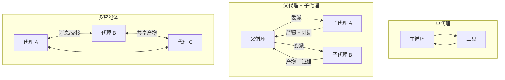
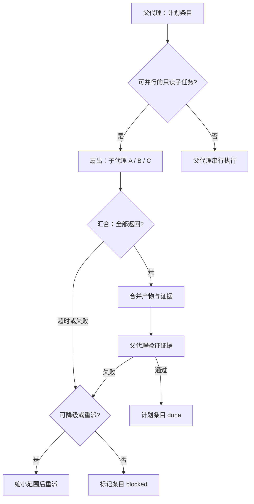

# 第 9 章 子代理与多智能体编排

## 本章导读

一个跨 40 个文件的迁移任务跑到第 15 轮，主对话已经被搜索结果塞满。为了“复核”，Agent 又派出两个审查代理，但它们继承的是同一段有错误的父摘要，于是三个代理都同意了一个错误结论。问题不在于并行得不够，而在于委派没有契约、上下文没有隔离、结果没有验收。本章讨论：什么时候值得派生子代理，怎样把任务交出去，又怎样把结果收回来。

## 学习目标

读完本章你将能够：

- 区分委派、子代理与多智能体三种控制结构，判断一个需求是否真的需要多代理；
- 用四个条件判断一个子任务“该拆”还是“该留在主循环”；
- 写出包含输入、工具、权限、预算、输出 Schema 与验收条件的委派契约；
- 实现主管—工人模式的并行派发、失败降级、预算回收与事件命名；
- 设计父子 trace 关联，并在 CLI 中展示委派树。

## 9.1 先分清：委派、子代理与多智能体

“多智能体”是本书被误用最多的词之一。模型在一轮里返回三个工具调用，不是多智能体；Harness 为三个文件各起一次摘要调用，也不是多智能体；只有当一个代理把一部分工作交给另一个**拥有自己上下文与决策循环**的代理时，才出现本章讨论的问题。

三个概念可以这样划界：

- **委派（Delegation）**：一个代理把有界任务交给另一个执行单元，保留最终控制权与验收责任。它是控制结构，不是拓扑。
- **子代理（Subagent）**：委派的一种实现形态。父代理派生一个上下文独立、工具集受限、任务有界的代理；子代理跑完后返回**结构化产物与摘要**，而不是完整对话。
- **多智能体（Multi-agent）**：多个拥有独立决策循环的代理，通过消息、交接或共享产物区协作。控制权可能转移，也可能由第三方协调。

三者的关键差别不在“开了几个模型调用”，而在**谁对结果负责**。子代理模式里，父代理始终是唯一权威：子代理的返回是提案，父代理负责验证与合并。多智能体模式里，权威被分散，系统必须额外定义交接协议、冲突解决与全局终止条件。

负责派发、等待与汇总的一方称为编排者（Orchestrator），本章也称主管；执行具体子任务的一方称为执行者（Worker）。这两个角色描述的是结构位置，不是人格设定。同一个 Harness 在主任务里是编排者，在被更上层调用时也可能成为执行者。

用函数调用作类比有助于理解：父代理传入参数（简报），子代理在自己的栈帧里执行，最后返回一个值（产物）。但类比有一个重要边界：函数共享进程内存，子代理往往共享同一个工作区。**上下文是隔离的，副作用却未必隔离**。这正是子代理不能简单地“多开几个”的原因。



图 9-1 中，只有中间的父代理结构保留了单一权威。右边的多智能体没有天然的主节点，任何一致性保证都必须显式设计。

**交接（Handoff）** 是多智能体里的另一个高频词，指把控制权、相关上下文与责任移交给另一个代理。它和子代理方向相反：子代理是“我派人去查，结果回到我这里”；交接是“这件事以后归你，我不再处理”。客服分流、按领域转接是典型交接场景。把两者混用，会出现“派出去的子代理反过来要求父代理继续决策”的循环。


判断你正在做的是不是多智能体，只看一个问题：任务结束后，谁有资格宣布“完成”？如果只有一个父代理能宣布，系统本质上是子代理编排；如果有多个代理都能独立宣布，才需要多智能体的共识与终止协议。


## 9.2 什么时候值得拆

子代理不是免费的。它至少带来四类成本：写简报的 token、子代理重复阅读的成本、汇总时的信息损失，以及调试时多出来的一层调用栈。因此第一原则不是“能拆就拆”，而是**只有当隔离或并行带来的收益大于协调成本时才拆**。

值得拆的场景有五类：

1. **上下文隔离**。子任务会产生大量中间噪声，例如在整个仓库里搜索某个符号。父代理只关心“命中哪些文件”，不需要看到 200 行搜索输出。子代理在自己的上下文里消化噪声，只把结论与证据带回来。
2. **并行取证**。几个调查任务互不依赖，例如同时检查前端、后端与部署配置。并行缩短墙钟时间，且结果在汇合点统一比较。
3. **工具集或能力特化**。子代理只拿到与任务相关的一小套工具，减少误用；例如只读的代码搜索代理不需要写文件与执行命令的能力。
4. **权限收窄**。复核、审计、只读分析可以派给一个工具集被裁剪到只剩读操作的子代理。这比在主代理里靠提示词约束更可靠。
5. **独立复核**。让一个没有看过作者推理过程的新鲜上下文去检查产物，能减少自我确认偏误。注意，独立复核的前提是**真的独立**：如果审查者继承了作者的完整推理，它大概率只会复述结论。

不划算的条件同样明确：

- 任务强耦合，子任务之间需要频繁交换中间状态；
- 子任务会写同一批文件，合并冲突的成本高于并行收益；
- 任务小到简报本身就超过了直接执行的成本；
- 验收条件写不出来，无法判断子代理是否完成；
- 结果依赖父对话里的隐含语境，而这份语境很难显式表达。

可以用四个问题做快速筛选：

| 问题 | 通过条件 | 不通过时的建议 |
|---|---|---|
| 任务能否用一段话描述清楚？ | 一个不了解父对话的人也能执行 | 留在主循环，边做边澄清 |
| 输入能否枚举？ | 文件、目录、查询范围可列清单 | 先由父代理缩小范围 |
| 输出能否检查？ | 有 Schema、证据格式或验收命令 | 改成探索型产物，如 `file:line` 列表 |
| 是否独立于共享可变状态？ | 只读，或写入范围互不相交 | 串行执行，或由父代理统一写入 |

四个问题都通过，子代理通常是划算的；有一个不通过，先尝试在主循环里解决。**“过早多代理”不是道德问题，而是信息问题**：在任务结构还不清楚时拆出去，简报必然含糊，子代理只能猜，最后父代理还要替它收拾。

一个容易忽略的区分是**上下文节省与 token 节省**。子代理能显著降低父上下文占用，但总 token 往往更高：父代理要写简报，子代理要重新读文件，汇总还要一次调用。图省钱的场景不应默认上子代理；图“主线程不被噪声淹没”的场景才适合。

净收益可以粗略理解为：

```text
净收益 ≈ 父上下文节省 + 并行缩短的墙钟时间
        − 简报与汇总的 token − 重复阅读 − 协调与合并成本
```

它不是可计算公式，只用于归因：如果一次委派失败，先看是哪一项为负，而不是笼统地说“模型不适合多代理”。

## 9.3 委派契约

子代理看不到父对话。它看到的只有 Harness 构造的简报，因此**简报就是接口**。接口写得含糊，子代理只能自由发挥；接口写得完整，子代理才可能稳定复现。

一份可执行的委派契约至少包含以下字段：

| 字段 | 作用 | 缺失时的典型故障 |
|---|---|---|
| `delegation_id` | 稳定身份，用于事件、幂等与 trace 关联 | 重试无法去重，日志对不上 |
| `role` | 一句话角色，限定视角 | 子代理越界做架构决策 |
| `brief` | 任务、范围、已知事实、非目标 | 重复搜索、漏掉关键文件 |
| `acceptance` | 验收条件，父代理据此判断产物 | “完成”只能靠子代理自述 |
| `tools` | 工具白名单 | 子代理调用未授权工具 |
| `context` | 上下文策略：全新简报或继承摘要 | 无意识地灌入父对话噪声 |
| `budget` | 步数、token、时间上限 | 单个子代理耗尽全局预算 |
| `deadline` | 截止时间，超时即回收 | 父任务被一个挂起的子任务拖死 |
| `output_schema` | 返回物的 JSON Schema 子集 | 汇总时字段缺失或类型错乱 |
| `parent_item` | 对应的父计划条目，由编排层传入，不进入子代理简报 | 结果无法落成计划证据 |

`brief` 的写法可以用“陌生人测试”：把这段文字交给一个没有参加过前面讨论、但熟悉项目的工程师，他应当知道去哪里找、找什么、什么算完成、什么不能碰。需要显式给出的信息包括：

- 目标与验收条件，而不是“帮我看看”；
- 允许访问的路径与工具，以及明确禁止的动作；
- 已知事实与已经排除的假设，避免重复劳动；
- 输出的字段与证据格式，例如 `file:line`、命令与退出码；
- 信息不足时的升级方式：返回 `blocked` 并说明缺什么，而不是猜。

返回契约与输入同样重要。子代理**不应回传完整 transcript**，原因有三：父上下文会被再次灌满；transcript 里的中间错误会干扰父代理判断；体积不可控。合理的返回是一个结构化产物：

```json
{
  "delegation_id": "investigate-retry",
  "status": "completed",
  "summary": "retry 在 client.py:3，循环 2 次",
  "artifact": {
    "summary": "retry 在 client.py:3，循环 2 次",
    "evidence": ["client.py:3 def retry", "client.py:4 range(2)"]
  },
  "evidence": ["client.py:3 def retry", "client.py:4 range(2)"],
  "usage": {"input_tokens": 360, "output_tokens": 120}
}
```

父代理在边界上做三件事：按 `output_schema` 校验字段；检查 `evidence` 非空且可核对；限制返回体积，超出部分只保留摘要与文件引用。任何一项不通过，都应当把这次委派标记为 `invalid_artifact`，而不是“勉强可用”。**在边界上宽松，等于把错误推迟到合并阶段**，而合并阶段通常已经损失了定位问题所需的上下文。


不要把子代理的 `summary` 直接当作事实写入 `TaskState`。摘要是有损压缩，可能省略反例、混淆文件版本。父代理至少要抽查证据中的一条；涉及写操作时，证据必须是可重放的命令或文件哈希。


## 9.4 上下文隔离

子代理的上下文应当是父上下文的**投影**，不是分叉。分叉意味着把父对话原样复制一份，再让子代理在上面继续；投影意味着只挑选完成任务所必需的信息，重新组织成简报。

三种常见策略：

| 策略 | 内容 | 成本 | 风险 |
|---|---|---|---|
| 全新简报（Fresh） | 系统提示 + 任务简报 + 工具定义 | 最低 | 简报漏信息时子代理只能猜 |
| 继承摘要（Inherited Summary） | 简报 + 父代理维护的摘要块 | 中等 | 摘要里的错误会被继承并放大 |
| 完整分叉（Fork） | 复制父对话历史 | 最高 | 噪声、锚定与 token 成本同时上升 |

默认应当是全新简报。继承摘要只在子代理确实需要父对话的细微语境时使用，例如多轮谈判、交互式调试；即使如此，也应传递**经过审核的摘要**，而不是原始消息。完整分叉在少数“并行探索同一对话的不同分支”场景有用，但它更像复制会话，不属于常规委派。

| 维度 | 全新简报 | 继承父对话 |
|---|---|---|
| 父上下文占用 | 只增加简报与结果 | 子代理 transcript 可能回流 |
| 信息完整性 | 依赖简报质量 | 高，但包含大量无关信息 |
| 污染风险 | 低 | 高，父代理的错误假设会被继承 |
| 可复现性 | 高，输入可审计 | 低，依赖当时的对话状态 |
| 适用场景 | 调查、搜索、审查、批处理 | 需要延续细微语境的少数任务 |

简报的结构建议固定为六块，便于模型稳定解析：

1. **角色与边界**：你是谁、只负责什么、不做什么；
2. **任务**：一句话目标；
3. **已知事实**：父代理已经确认的结论与证据；
4. **输入范围**：允许读的路径、查询关键词、起始文件；
5. **输出契约**：字段、证据格式、体积上限；
6. **升级规则**：信息不足、权限不足、发现冲突时如何返回。


不要把“父代理认为的结论”写成“事实”。如果子代理的简报里写着“问题一定在 retry 循环”，它很可能只找支持这个假设的证据。简报应当区分“已核实事实”与“待验证假设”，并要求子代理在证据冲突时显式返回，而不是顺从父代理。


上下文隔离的收益要在父代理侧兑现：父代理只把子代理的产物与证据并入自己的状态，而不是把子代理的推理过程重新读一遍。这也是为什么返回契约要限制体积。若父代理需要更多细节，应当按证据中的 `file:line` 定向读取，而不是要求子代理回传全文。第 6 章的渐进式披露在这里同样适用：先拿索引，再按需加载。

## 9.5 编排模式

子代理一旦多于一个，就需要编排。常见的四种模式：

| 模式 | 控制流 | 依赖结构 | 适用场景 | 主要风险 |
|---|---|---|---|---|
| 主管—工人（Orchestrator-Worker） | 主管派发、等待、汇总 | 扇出后汇合 | 并行调查、批量处理 | 主管成为瓶颈或汇总失真 |
| 流水线（Pipeline） | 阶段串行，上一阶段产物是下一阶段输入 | 线性依赖 | 生成 → 校验 → 修复 | 单阶段失败导致整条停滞 |
| 生成者—审查者（Generator-Reviewer） | 一方产出，另一方独立挑错 | 两阶段，可多轮 | 高风险改动、代码审查 | 审查者与生成者共享偏见 |
| 黑板（Blackboard） | 多个代理读写共享产物区 | 松耦合，事件驱动 | 多来源信息融合 | 写入冲突与版本混乱 |

选择模式看依赖结构，不看流行度。能并行的才并行；有汇合点的必须等齐；有严格先后顺序的用流水线；需要独立判断的用生成者—审查者，并确保审查者拿到的是产物与验收条件，而不是生成者的自我辩护。



扇出必须有限制。并发上限取决于下游模型配额、工具负载与合并复杂度；常见的默认值是 2～4 个同时运行的子代理，超出的请求排队而不是无限派生。没有上限的扇出会把一次任务变成一次小型流量攻击，也会让父代理的汇总上下文重新爆炸。

| 维度 | 单代理串行 | 主管—工人并行 |
|---|---|---|
| 墙钟时间 | 各子任务之和 | 接近最慢子任务 |
| 总 token | 较低，无简报开销 | 较高，含简报与重复阅读 |
| 父上下文增长 | 全部工具结果 | 仅简报与产物摘要 |
| 一致性 | 天然一致 | 需要合并规则与冲突处理 |
| 失败隔离 | 单点失败影响全局 | 单个子代理失败可局部降级 |
| 适用任务 | 强耦合、需连续推理 | 独立取证、大范围搜索、批量审查 |

并行只适用于只读或写入范围互不相交的任务。两个子代理同时修改同一个文件，即使各自都“成功”，合并时也只有一个版本能存活。工程上的默认值是：**读操作可以并行，写操作由父代理串行执行，或者按文件分区后显式声明所有权**。第 10 章的沙箱与第 11 章的权限会进一步收紧这条边界，本章只保留接缝。

## 9.6 计划、状态与结果合并

子代理不应拥有与父代理平级的计划。正确的关系是：父计划的一个条目对应一次委派；子代理可以在内部维护自己的小计划，但对外只暴露状态与证据。

```text
父 Plan
└── p1 调查 retry 实现（doing）
    └── delegation: investigate-retry
        ├── 子代理内部步骤（不进入父 Plan）
        └── 返回：completed + evidence
```

这种层级带来两个规则：

- 子代理未完成，父计划条目不能标记 `done`；
- 子代理完成了，父计划条目也未必 `done`，还要父代理核对证据与验收条件。

第 8 章的 `done` 守卫在这里继续生效。子代理返回的 `ok=true` 只是“我这边做完了”，不是“父任务完成了”。父代理在标记 `done` 之前，应当至少做一次独立验证：重跑命令、读取证据文件、或用一个新鲜上下文的审查子代理复核。

并行执行会带来一个计划状态问题：同一个父计划里可以同时有多个 `doing` 吗？答案取决于操作类型。只读调查可以；写操作不行。实现上可以给条目增加 `execution` 元数据（`read_only` / `write`），在派发前检查冲突。第 8 章“同一时刻只保持一个 `doing`”的规则，是针对单执行代理的；多子代理并行时，应把规则细化为“写条目互斥，读条目可并行”。

事件命名需要两层：

| 事件 | 写入位置 | 内容 | 用途 |
|---|---|---|---|
| `subagent_dispatched` | 父会话日志 | 委派 id、计划条目、角色、工具、上下文策略、预算 | 审计“派了什么” |
| `subagent_returned` | 父会话日志 | 状态、证据数量、用量、错误 | 审计“收回了什么” |
| `sub:<delegation_id>:tool_finished` | 子会话日志 | 子代理内部的工具调用 | 调试子代理 |
| `sub:<delegation_id>:step` | 子会话日志 | 子代理的步数与预算消耗 | 调试与成本归因 |

不要让子代理的内部事件直接写进父会话的 reducer 流。第 7 章的 `apply_event` 遇到未知事件会标记“状态可能不完整”；把大量子代理事件塞进去，会让父状态恢复出现噪声。更清晰的做法是：**父日志只记录委派生命周期，子代理内部事件写入以 `delegation_id` 命名的子会话日志**，两边用同一个 `delegation_id` 关联。导出 trace 时再把它们展开为带 `parent_span_id` 的 `sub:` 命名空间事件，供第 14 章使用。

合并结果时遵守四条规则：

1. **产物是提案，不是事实**。父代理按 `output_schema` 与验收条件复核后，才写入 `TaskState`。
2. **证据优先于叙述**。两条子代理结论冲突时，回到证据；没有证据的结论不参与合并。
3. **父状态为准**。子代理不直接修改父 `Plan` 或 `TaskState`；所有状态迁移由父代理执行，冲突以父状态为准。
4. **幂等**。同一个 `delegation_id` 重复返回只应用一次；重派应使用新的 id，或带 `attempt` 字段，避免把两次不同范围的调查混为一次。


如果两个子代理给出互斥结论，不要用“投票”解决。投票只适合独立同分布的判断；子代理共享同一批文件、同一个模型、甚至同一段简报，错误高度相关。正确做法是回到证据、扩大样本，或让一个没有看过两份结论的审查者从原始文件重新判断。


## 9.7 失败、取消与预算

子代理的失败不是父任务的失败。父代理需要按失败类型选择处理方式，而不是一律重试或一律终止。

| 失败类型 | 检测方式 | 默认处理 | 是否可用部分结果 |
|---|---|---|---|
| `rejected` | 工具不存在、越权、简报不合法 | 修正契约后重派 | 否 |
| `timeout` | 超过 `deadline` | 缩小范围重派，或父代理接管 | 视情况 |
| `failed` | 子代理内部异常 | 记录失败签名，换策略重派 | 可能 |
| `invalid_artifact` | Schema 校验失败、证据为空 | 指出缺什么，重派一次 | 产物可供参考 |
| `budget_exceeded` | 子代理用量超过预算 | 不再重派同类任务，降级 | 是 |
| `max_steps` | 达到步数上限 | 拆小任务后重派 | 是 |
| `cancelled` | 父代理取消 | 回收部分结果，不标记完成 | 是 |

重试的前提是**输入发生了变化**：缩小路径、换关键词、补充已知事实、换工具集。用同一份简报重派，大概率得到同一个失败；连续两次相同失败签名应直接升级，而不是消耗第三次预算。第 8 章的失败签名与反思预算在这里可以直接复用，只是签名要带上 `delegation_id` 与子任务范围。

降级有一条推荐顺序：

1. 缩小范围重派；
2. 父代理接管最关键的一小段；
3. 使用部分结果，并把未覆盖部分写入条目的 `note`；
4. 标记条目 `blocked`，等待用户或上游输入；
5. 只有目标本身不可达时，才终止父任务。

取消必须向子代理传播。父代理的 `CancelToken` 要传给每个运行中的委派；子代理在每次模型调用与工具执行之间检查取消状态。只停父循环、不管子代理，会出现“父任务已经结束，后台还有三个子代理在消耗 token、写文件”的情况。取消后的结果状态是 `cancelled`，不是 `completed`；已产生的只读证据可以保留，写操作要按第 7 章的副作用对账处理。

预算要在派发前预扣，而不是事后统计：

```text
父剩余预算 = 父总预算 − 已用预算
可派发预算 = 父剩余预算 × 并行系数（例如 0.7，保留 30% 给汇总与重试）
单个子预算 = min(任务估算, 可派发预算 / 并发数)
```

子代理返回后，未用完的部分归还父预算；超支部分由父代理记录并计入总账，不能假装没发生。用量以子代理 Provider 返回的 `usage` 为准，不要用父代理的估算二次计费，否则会重复计算。并行不会减少总 token，它只是把消耗从父上下文转移到子上下文；预算系统必须如实反映这一点。

## 9.8 可观测性与 CLI 集成

子代理让调用栈从一层变成一棵树，可观测性也要跟着变成树。每条委派至少记录：

- `trace_id`：整棵树的根；
- `span_id` / `parent_span_id`：委派与父循环的父子关系；
- `delegation_id`、`parent_item`：业务身份；
- `context_policy`、`tools`、`budget`：这次委派的输入条件；
- `status`、`usage`、`duration`、`retry_of`：结果与成本。

CLI 可以展示一棵委派树：

```text
sess-9  goal=定位 retry 与 logging 的调用点并汇总
├── p1 调查 retry 实现            done
│   └── investigate-retry         completed  3 calls / 480 tok
├── p2 调查 logging 调用          done
│   ├── investigate-logging       invalid_artifact  2 calls / 320 tok
│   └── investigate-logging-2     completed  2 calls / 320 tok
└── p3 汇总并交叉验证             done（父代理复核 2/2）
```

这棵树比“总共调用了 7 次模型”有用得多：它直接告诉运维哪次委派失败了、失败在哪个条目、重派是否换过范围。第 14 章会把同一组字段映射到 `Span` 与 `TraceEvent`；本章只需要保证事件里有足够的关联键，不提前展开追踪后端。


日志里不要写入完整简报与完整产物。简报可能包含敏感路径、用户数据或内部约束；产物可能很长。记录摘要、哈希、证据数量与体积即可，需要细节时按 `delegation_id` 去子会话日志中检索。


## 9.9 代码实践：MiniCoder 的子代理层

下面的 `subagent.py` 复用第 3 章 `Provider`、第 5 章 `ToolRegistry`/`ToolExecutor`、第 7 章 `SessionStore`、第 8 章 `Plan` 的接口，新增三个核心对象：

- `SubagentSpec`：委派契约；
- `SubagentResult`：结构化返回；
- `delegate()` 与 `Orchestrator`：执行与编排。

为了让示例离线可运行，代码重复了前几章的最小类型与只读工具实现；接口签名保持一致，完整实现以对应章节为准。演示场景是：父计划拆出两个只读调查子任务并行执行；其中一个返回缺少证据的产物，被判为 `invalid_artifact`；父代理缩小范围重派；最后父代理读取文件复核，计划条目才标记 `done`。



```python
import asyncio
import json
import os
import re
import tempfile
import time
from dataclasses import dataclass, field
from pathlib import Path
from typing import Any, Awaitable, Callable, Optional, Sequence


# ---------- 沿用第 3 章：接入层类型 ----------
@dataclass(frozen=True)
class ToolCall:
    id: str
    name: str
    args: dict[str, Any]


@dataclass(frozen=True)
class ToolSpec:
    name: str
    description: str
    parameters: dict[str, Any]


@dataclass
class Message:
    role: str
    content: str = ""
    tool_call_id: Optional[str] = None
    tool_calls: list[ToolCall] = field(default_factory=list)


@dataclass
class Usage:
    input_tokens: int = 0
    output_tokens: int = 0

    @property
    def total_tokens(self) -> int:
        return self.input_tokens + self.output_tokens


@dataclass
class ModelResponse:
    text: str = ""
    tool_calls: list[ToolCall] = field(default_factory=list)
    usage: Usage = field(default_factory=Usage)


# ---------- 沿用第 5 章：只读工具的最小实现 ----------
@dataclass
class ToolResult:
    ok: bool
    content: str = ""
    error: Optional[str] = None
    error_code: str = ""
    truncated: bool = False
    metadata: dict[str, Any] = field(default_factory=dict)

    def to_observation(self) -> str:
        body = self.content if self.ok else f"[{self.error_code}] {self.error}"
        if self.truncated:
            body += "\n[结果已截断；请缩小查询范围]"
        return body


class ToolFailure(Exception):
    def __init__(self, code: str, message: str) -> None:
        super().__init__(message)
        self.code = code


Handler = Callable[[dict[str, Any]], Awaitable[ToolResult]]


@dataclass(frozen=True)
class Tool:
    spec: ToolSpec
    handler: Handler
    parallel_safe: bool = False
    risk: str = "read"
    timeout_s: float = 15.0


class SchemaError(Exception):
    pass


def validate_args(schema: dict[str, Any], args: Any, path: str = "$") -> None:
    checks = {
        "object": lambda v: isinstance(v, dict),
        "array": lambda v: isinstance(v, list),
        "string": lambda v: isinstance(v, str),
        "integer": lambda v: isinstance(v, int) and not isinstance(v, bool),
    }
    expected = schema.get("type")
    if expected in checks and not checks[expected](args):
        raise SchemaError(f"{path} 应为 {expected}")
    if expected == "object":
        props = schema.get("properties", {})
        for key in schema.get("required", []):
            if key not in args:
                raise SchemaError(f"缺少必填参数 {path}.{key}")
        if schema.get("additionalProperties") is False:
            extra = sorted(set(args) - set(props))
            if extra:
                raise SchemaError(f"出现未定义参数 {path}.{extra[0]}")
        for key, sub in props.items():
            if key in args:
                validate_args(sub, args[key], f"{path}.{key}")
    if expected == "array" and "items" in schema:
        for index, item in enumerate(args):
            validate_args(schema["items"], item, f"{path}[{index}]")


class ToolRegistry:
    def __init__(self) -> None:
        self._tools: dict[str, Tool] = {}

    def register(self, tool: Tool) -> None:
        if tool.spec.name in self._tools:
            raise ValueError(f"工具名 {tool.spec.name!r} 重复注册")
        self._tools[tool.spec.name] = tool

    def get(self, name: str) -> Optional[Tool]:
        return self._tools.get(name)

    def specs(self) -> list[ToolSpec]:
        return [self._tools[name].spec for name in sorted(self._tools)]


class Workspace:
    def __init__(self, root: str | Path) -> None:
        self.root = Path(root).resolve()

    def resolve(self, raw: Any) -> Path:
        candidate = (self.root / str(raw)).resolve()
        try:
            candidate.relative_to(self.root)
        except ValueError:
            raise ToolFailure("path_outside_workspace", f"路径 {raw!r} 超出工作区") from None
        return candidate


def numbered(lines: list[str], start: int) -> str:
    return "\n".join(f"{i:>5}\t{line}" for i, line in enumerate(lines, start=start))


def make_read_file(ws: Workspace) -> Handler:
    async def read_file(args: dict[str, Any]) -> ToolResult:
        path = ws.resolve(args["path"])
        if not path.is_file():
            raise ToolFailure("not_found", f"文件不存在：{args['path']}")
        lines = path.read_text(encoding="utf-8").splitlines()
        return ToolResult(ok=True, content=numbered(lines, 1))

    return read_file


def make_search_text(ws: Workspace) -> Handler:
    async def search_text(args: dict[str, Any]) -> ToolResult:
        regex = re.compile(args["pattern"])
        base = ws.resolve(args.get("path", "."))
        files = [base] if base.is_file() else sorted(base.rglob("*"))
        matches: list[str] = []
        for path in files:
            if not path.is_file():
                continue
            for number, line in enumerate(path.read_text(encoding="utf-8").splitlines(), 1):
                if regex.search(line):
                    matches.append(f"{path.relative_to(ws.root)}:{number}: {line.strip()}")
        return ToolResult(ok=True, content="\n".join(matches) or "（无匹配）")

    return search_text


class ToolExecutor:
    def __init__(self, registry: ToolRegistry) -> None:
        self.registry = registry

    async def execute(self, call: ToolCall) -> ToolResult:
        tool = self.registry.get(call.name)
        if tool is None:
            return ToolResult(ok=False, error=f"未知工具 {call.name}", error_code="unknown_tool")
        try:
            validate_args(tool.spec.parameters, call.args)
        except SchemaError as exc:
            return ToolResult(ok=False, error=f"参数不合法：{exc}", error_code="invalid_args")
        try:
            return await asyncio.wait_for(tool.handler(call.args), timeout=tool.timeout_s)
        except ToolFailure as exc:
            return ToolResult(ok=False, error=str(exc), error_code=exc.code)

    async def execute_batch(self, calls: Sequence[ToolCall]) -> list[ToolResult]:
        return [await self.execute(call) for call in calls]


# ---------- 沿用第 7 章：只追加的事件日志 ----------
class SessionStore:
    """本章只用 append；recover 与 reducer 的整合见第 7 章和第 13 章。"""

    def __init__(self, root: str | Path, session_id: str) -> None:
        self.dir = Path(root).resolve() / ".minicoder" / "sessions" / session_id
        self.dir.mkdir(parents=True, exist_ok=True)
        self.events_path = self.dir / "events.jsonl"
        if self.events_path.exists():
            lines = self.events_path.read_text(encoding="utf-8").splitlines()
            self.seq = sum(1 for line in lines if line.strip())
        else:
            self.seq = 0

    def append(self, type_: str, data: dict[str, Any]) -> dict[str, Any]:
        self.seq += 1
        event = {"seq": self.seq, "type": type_, "data": data, "schema_version": 1}
        with self.events_path.open("a", encoding="utf-8") as handle:
            handle.write(json.dumps(event, ensure_ascii=False, sort_keys=True) + "\n")
            handle.flush()
            os.fsync(handle.fileno())
        return event


# ---------- 沿用第 8 章：计划的最小实现 ----------
@dataclass
class PlanItem:
    id: str
    title: str
    acceptance: str
    depends_on: list[str] = field(default_factory=list)
    status: str = "pending"
    evidence: str = ""
    attempts: int = 0
    note: str = ""


@dataclass
class Plan:
    plan_id: str
    goal: str
    constraints: list[str]
    items: list[PlanItem]
    version: int = 1
    state: str = "draft"
    approved_ids: list[str] = field(default_factory=list)

    def by_id(self, item_id: str) -> PlanItem:
        for item in self.items:
            if item.id == item_id:
                return item
        raise KeyError(item_id)


def approve_plan(plan: Plan) -> Plan:
    plan.state = "approved"
    plan.approved_ids = [item.id for item in plan.items]
    return plan


def update_plan(plan: Plan, item_id: str, status: str, *, evidence: str = "", note: str = "") -> PlanItem:
    item = plan.by_id(item_id)
    statuses = {entry.id: entry.status for entry in plan.items}
    if status == "doing":
        if item.id not in plan.approved_ids:
            raise ValueError("未批准条目不能执行")
        if any(statuses[dep] != "done" for dep in item.depends_on):
            raise ValueError("依赖未完成，不能开始")
        plan.state = "executing"
    elif status == "done":
        if not evidence.strip():
            raise ValueError("标记完成必须附验收证据")
        item.evidence = evidence
    elif status == "failed":
        item.attempts += 1
        item.evidence = evidence
    elif status == "pending":
        item.note = note
    item.status = status
    return item


# ---------- 第 9 章新增：委派契约与结果 ----------
OUTPUT_SCHEMA: dict[str, Any] = {
    "type": "object",
    "additionalProperties": False,
    "required": ["summary", "evidence"],
    "properties": {
        "summary": {"type": "string"},
        "evidence": {"type": "array", "items": {"type": "string"}},
    },
}


@dataclass(frozen=True)
class SubagentSpec:
    delegation_id: str
    role: str
    brief: str
    acceptance: str
    tools: tuple[str, ...]
    output_schema: dict[str, Any] = field(default_factory=lambda: OUTPUT_SCHEMA)
    max_steps: int = 4
    budget_tokens: int = 1500
    deadline_s: float = 5.0
    context: str = "fresh"  # fresh / inherited_summary
    allow_write: bool = False


@dataclass
class SubagentResult:
    delegation_id: str
    ok: bool
    status: str
    summary: str = ""
    artifact: dict[str, Any] = field(default_factory=dict)
    evidence: list[str] = field(default_factory=list)
    usage: Usage = field(default_factory=Usage)
    error: str = ""
    partial: bool = False

    def to_event(self) -> dict[str, Any]:
        return {
            "delegation_id": self.delegation_id,
            "status": self.status,
            "ok": self.ok,
            "evidence": self.evidence,
            "usage_tokens": self.usage.total_tokens,
            "error": self.error,
        }


SUBAGENT_RULES = """你是父代理派出的只读调查员。
规则：
1. 只使用给定工具；不得假设未读过的文件内容。
2. 结论必须带证据，格式为 file:line 或命令输出。
3. 范围外的问题不要展开；信息不足时在 evidence 中写明缺什么。
4. 最终只输出 JSON：{"summary": "...", "evidence": ["..."]}。"""


def build_child_messages(spec: SubagentSpec, parent_summary: str) -> list[Message]:
    if spec.context == "inherited_summary":
        brief = f"父代理摘要：\n{parent_summary}\n\n你的任务：\n{spec.brief}"
    else:
        brief = spec.brief
    user = (
        f"{brief}\n\n验收条件：{spec.acceptance}\n"
        f"最多 {spec.max_steps} 步；预算 {spec.budget_tokens} tokens。"
    )
    return [Message("system", f"{SUBAGENT_RULES}\n角色：{spec.role}"), Message("user", user)]


def add_usage(left: Usage, right: Usage) -> Usage:
    return Usage(left.input_tokens + right.input_tokens, left.output_tokens + right.output_tokens)


def _parse_artifact(text: str) -> dict[str, Any]:
    value = text.strip()
    if value.startswith("```"):
        value = value.split("\n", 1)[1] if "\n" in value else ""
        if value.endswith("```"):
            value = value[:-3]
    data = json.loads(value.strip())
    if not isinstance(data, dict):
        raise ValueError("artifact 必须是 JSON 对象")
    return data


async def delegate(
    spec: SubagentSpec,
    provider: Any,
    registry: ToolRegistry,
    *,
    parent_summary: str = "",
    cancel: Optional[Any] = None,
    sink: Optional[Callable[[str, dict[str, Any]], Any]] = None,
) -> SubagentResult:
    started = time.monotonic()
    child = ToolRegistry()
    for name in spec.tools:
        tool = registry.get(name)
        if tool is None:
            return SubagentResult(spec.delegation_id, False, "rejected", error=f"工具 {name} 不存在")
        if tool.risk != "read" and not spec.allow_write:
            return SubagentResult(spec.delegation_id, False, "rejected", error=f"工具 {name} 不是只读")
        child.register(tool)

    executor = ToolExecutor(child)
    messages = build_child_messages(spec, parent_summary)
    usage = Usage()

    async def run() -> SubagentResult:
        nonlocal usage
        for _ in range(spec.max_steps):
            if cancel is not None and getattr(cancel, "cancelled", False):
                return SubagentResult(spec.delegation_id, False, "cancelled", partial=True)
            response = await provider.complete(messages, child.specs())
            usage = add_usage(usage, response.usage)
            messages.append(Message("assistant", response.text, tool_calls=response.tool_calls))
            if not response.tool_calls:
                try:
                    artifact = _parse_artifact(response.text)
                    validate_args(spec.output_schema, artifact)
                except (ValueError, json.JSONDecodeError, SchemaError) as exc:
                    return SubagentResult(
                        spec.delegation_id, False, "invalid_artifact",
                        error=f"返回物不合法：{exc}", usage=usage,
                    )
                evidence = [str(item) for item in artifact.get("evidence", [])]
                if not evidence:
                    return SubagentResult(
                        spec.delegation_id, False, "invalid_artifact",
                        artifact=artifact, usage=usage,
                        error="artifact 缺少 evidence；请缩小范围并给出 file:line",
                    )
                return SubagentResult(
                    spec.delegation_id, True, "completed",
                    summary=str(artifact.get("summary", "")),
                    artifact=artifact, evidence=evidence, usage=usage,
                )
            results = await executor.execute_batch(response.tool_calls)
            for call, result in zip(response.tool_calls, results):
                messages.append(Message("tool", result.to_observation(), tool_call_id=call.id))
                if sink is not None:
                    sink(
                        f"sub:{spec.delegation_id}:tool_finished",
                        {"tool": call.name, "ok": result.ok, "error_code": result.error_code},
                    )
            if usage.total_tokens > spec.budget_tokens:
                return SubagentResult(
                    spec.delegation_id, False, "budget_exceeded",
                    usage=usage, partial=True, error="子代理预算耗尽",
                )
        return SubagentResult(
            spec.delegation_id, False, "max_steps",
            usage=usage, partial=True, error="达到步数上限仍未返回结果",
        )

    try:
        return await asyncio.wait_for(run(), timeout=spec.deadline_s)
    except asyncio.TimeoutError:
        return SubagentResult(
            spec.delegation_id, False, "timeout", usage=usage,
            partial=True, error=f"超过 {spec.deadline_s:g} 秒",
        )
    except Exception as exc:
        return SubagentResult(
            spec.delegation_id, False, "failed", usage=usage,
            error=f"{type(exc).__name__}: {exc}",
        )


class Orchestrator:
    def __init__(
        self,
        registry: ToolRegistry,
        store: SessionStore,
        root: str | Path,
        parent_session_id: str,
        providers: dict[str, Any],
        *,
        max_parallel: int = 2,
    ) -> None:
        self.registry = registry
        self.store = store
        self.root = Path(root)
        self.parent_session_id = parent_session_id
        self.providers = providers
        self.semaphore = asyncio.Semaphore(max_parallel)
        self.child_event_counts: dict[str, int] = {}

    async def dispatch(self, item_id: str, specs: Sequence[SubagentSpec]) -> list[SubagentResult]:
        async def run_one(spec: SubagentSpec) -> SubagentResult:
            async with self.semaphore:
                self.store.append(
                    "subagent_dispatched",
                    {
                        "delegation_id": spec.delegation_id,
                        "item_id": item_id,
                        "role": spec.role,
                        "tools": list(spec.tools),
                        "context": spec.context,
                        "budget_tokens": spec.budget_tokens,
                    },
                )
                child_store = SessionStore(
                    self.root, f"{self.parent_session_id}--{spec.delegation_id}"
                )
                result = await delegate(
                    spec,
                    self.providers[spec.delegation_id],
                    self.registry,
                    sink=child_store.append,
                )
                self.child_event_counts[spec.delegation_id] = child_store.seq
                self.store.append("subagent_returned", {"item_id": item_id, **result.to_event()})
                return result

        return list(await asyncio.gather(*(run_one(spec) for spec in specs)))


# ---------- 演示 ----------
class ScriptedProvider:
    def __init__(self, responses: list[ModelResponse], *, delay_s: float = 0.0) -> None:
        self.responses = list(responses)
        self.delay_s = delay_s

    async def complete(self, messages: list[Message], tools: list[ToolSpec]) -> ModelResponse:
        await asyncio.sleep(self.delay_s)
        if not self.responses:
            raise RuntimeError("脚本响应已用尽")
        return self.responses.pop(0)


def response(text: str = "", calls: Optional[list[ToolCall]] = None) -> ModelResponse:
    return ModelResponse(text, calls or [], Usage(120, 40))


def build_registry(ws: Workspace) -> ToolRegistry:
    registry = ToolRegistry()
    registry.register(Tool(
        ToolSpec("read_file", "读取工作区内的 UTF-8 文本文件，返回带行号的内容。", {
            "type": "object", "additionalProperties": False,
            "required": ["path"],
            "properties": {"path": {"type": "string"}},
        }),
        make_read_file(ws), parallel_safe=True, risk="read",
    ))
    registry.register(Tool(
        ToolSpec("search_text", "按正则搜索工作区文本，返回 file:line。", {
            "type": "object", "additionalProperties": False,
            "required": ["pattern"],
            "properties": {"pattern": {"type": "string"}, "path": {"type": "string"}},
        }),
        make_search_text(ws), parallel_safe=True, risk="read",
    ))
    return registry


def plan_event(store: SessionStore, plan: Plan, item: PlanItem) -> None:
    store.append("plan_item_updated", {
        "plan_id": plan.plan_id, "item_id": item.id, "status": item.status,
        "evidence": item.evidence, "attempts": item.attempts, "note": item.note,
    })


async def main() -> None:
    root = Path(tempfile.mkdtemp(prefix="minicoder-ch9-"))
    (root / "client.py").write_text(
        "import logging\n\ndef retry(fn):\n    for _ in range(2):\n"
        "        try:\n            return fn()\n        except Exception:\n"
        "            logging.warning(\"retry failed\")\n",
        encoding="utf-8",
    )
    (root / "logging.py").write_text(
        "import logging\n\nlogger = logging.getLogger(__name__)\n\n"
        "def emit():\n    logger.warning(\"retry exhausted\")\n",
        encoding="utf-8",
    )
    registry = build_registry(Workspace(root))
    store = SessionStore(root, "sess-9")

    plan = Plan("plan-9", "定位 retry 与 logging 的调用点并汇总", ["只读调查"], [
        PlanItem("p1", "调查 retry 实现", "给出 file:line 与循环次数"),
        PlanItem("p2", "调查 logging 调用", "给出 file:line 与日志级别"),
        PlanItem("p3", "汇总并交叉验证", "两条证据均能在文件中核实", ["p1", "p2"]),
    ])
    approve_plan(plan)

    spec_a = SubagentSpec(
        "investigate-retry", "retry 调查员",
        "在 client.py 中定位 retry 的循环次数，只回答事实。",
        "给出 retry 所在行与 range 参数", ("search_text", "read_file"),
    )
    spec_b = SubagentSpec(
        "investigate-logging", "logging 调查员",
        "在 logging.py 中定位日志调用与级别。",
        "给出 logger.warning 所在行", ("search_text", "read_file"),
    )

    providers = {
        "investigate-retry": ScriptedProvider([
            response(calls=[ToolCall("c1", "search_text", {"pattern": "retry"})]),
            response(calls=[ToolCall("c2", "read_file", {"path": "client.py"})]),
            response(json.dumps({"summary": "retry 在 client.py:3，循环 2 次",
                                 "evidence": ["client.py:3 def retry", "client.py:4 range(2)"]}, ensure_ascii=False)),
        ], delay_s=0.03),
        "investigate-logging": ScriptedProvider([
            response(calls=[ToolCall("c3", "search_text", {"pattern": "logger", "path": "logging.py"})]),
            response(json.dumps({"summary": "logging.py:6 使用 logger.warning", "evidence": []}, ensure_ascii=False)),
        ], delay_s=0.005),
        "investigate-logging-2": ScriptedProvider([
            response(calls=[ToolCall("c4", "read_file", {"path": "logging.py"})]),
            response(json.dumps({"summary": "logging.py:6 使用 logger.warning",
                                 "evidence": ["logging.py:6 logger.warning"]}, ensure_ascii=False)),
        ], delay_s=0.005),
    }
    orchestrator = Orchestrator(registry, store, root, "sess-9", providers)

    print("== 1. 计划与并行委派 ==")
    print(f"批准：{','.join(plan.approved_ids)}")
    for item_id in ("p1", "p2"):
        plan_event(store, plan, update_plan(plan, item_id, "doing"))
    results = await asyncio.gather(
        orchestrator.dispatch("p1", [spec_a]),
        orchestrator.dispatch("p2", [spec_b]),
    )
    res_a, res_b = results[0][0], results[1][0]
    print(f"dispatch p1 {spec_a.delegation_id}；dispatch p2 {spec_b.delegation_id}（并行）")
    for res in sorted([res_a, res_b], key=lambda r: 0 if r.status != "completed" else 1):
        print(f"return {res.delegation_id} {res.status}：{res.summary or res.error}")

    plan_event(store, plan, update_plan(plan, "p1", "done", evidence="；".join(res_a.evidence)))
    plan_event(store, plan, update_plan(plan, "p2", "failed", evidence=res_b.error))
    print(f"p1 done：{'；'.join(res_a.evidence)}")
    print(f"p2 failed（第 {plan.by_id('p2').attempts} 次）：{res_b.error}")

    print("\n== 2. 重派：缩小范围 ==")
    plan_event(store, plan, update_plan(plan, "p2", "pending", note="缩小到 logging.py 后重派"))
    plan_event(store, plan, update_plan(plan, "p2", "doing"))
    spec_b2 = SubagentSpec(
        "investigate-logging-2", "logging 调查员（重派）",
        "只读 logging.py，确认 logger.warning 的行号与级别。",
        "给出 logger.warning 所在行", ("read_file",),
    )
    res_b2 = (await orchestrator.dispatch("p2", [spec_b2]))[0]
    print(f"重派 {spec_b2.delegation_id}：工具={','.join(spec_b2.tools)}")
    print(f"return {res_b2.delegation_id} {res_b2.status}：{res_b2.summary}")
    plan_event(store, plan, update_plan(plan, "p2", "done", evidence="；".join(res_b2.evidence)))
    print(f"p2 done：{'；'.join(res_b2.evidence)}")

    print("\n== 3. 父代理汇合与验证 ==")
    plan_event(store, plan, update_plan(plan, "p3", "doing"))
    parent = ToolExecutor(registry)
    client_text = (await parent.execute(ToolCall("v1", "read_file", {"path": "client.py"}))).content
    logging_text = (await parent.execute(ToolCall("v2", "read_file", {"path": "logging.py"}))).content
    checks = ["range(2)" in client_text, "logger.warning" in logging_text]
    evidence = []
    if checks[0]:
        evidence.append("client.py:4 range(2)")
    if checks[1]:
        evidence.append("logging.py:6 logger.warning")
    plan_event(store, plan, update_plan(plan, "p3", "done", evidence="；".join(evidence)))
    print(f"父代理复核：client.py={'通过' if checks[0] else '失败'}；logging.py={'通过' if checks[1] else '失败'}")
    print(f"p3 done：{'；'.join(evidence)}")
    plan.state = "completed"
    done = sum(1 for item in plan.items if item.status == "done")
    print(f"计划完成：{done}/{len(plan.items)}，状态={plan.state}")

    print("\n== 4. 事件与预算 ==")
    counts: dict[str, int] = {}
    for line in store.events_path.read_text(encoding="utf-8").splitlines():
        if line.strip():
            kind = json.loads(line)["type"]
            counts[kind] = counts.get(kind, 0) + 1
    summary = " ".join(f"{key}={counts[key]}" for key in sorted(counts))
    print(f"父日志 {store.seq} 条：{summary}")
    child_summary = " ".join(
        f"{key}={value}" for key, value in sorted(orchestrator.child_event_counts.items())
    )
    print(f"子日志：{child_summary}")
    total_calls = 3 + 2 + 2
    total_tokens = total_calls * 160
    print(f"委派用量：{total_calls} 次模型调用，{total_tokens} tokens")


if __name__ == "__main__":
    asyncio.run(main())
```


```typescript
import * as fs from "node:fs";
import * as os from "node:os";
import * as path from "node:path";

// ---------- 沿用第 3 章：接入层类型 ----------
type ToolCall = { id: string; name: string; args: Record<string, unknown> };
type ToolSpec = { name: string; description: string; parameters: Record<string, unknown> };
type Message = {
  role: string;
  content: string;
  toolCallId?: string;
  toolCalls?: ToolCall[];
};
type Usage = { inputTokens: number; outputTokens: number };
type ModelResponse = { text: string; toolCalls: ToolCall[]; usage: Usage };

const totalTokens = (u: Usage): number => u.inputTokens + u.outputTokens;

// ---------- 沿用第 5 章：只读工具的最小实现 ----------
class ToolResult {
  ok: boolean;
  content: string;
  error?: string;
  errorCode: string;
  truncated: boolean;
  metadata: Record<string, unknown>;

  constructor(
    ok: boolean,
    content = "",
    error?: string,
    errorCode = "",
    truncated = false,
    metadata: Record<string, unknown> = {},
  ) {
    this.ok = ok;
    this.content = content;
    this.error = error;
    this.errorCode = errorCode;
    this.truncated = truncated;
    this.metadata = metadata;
  }

  toObservation(): string {
    let body = this.ok ? this.content : `[${this.errorCode}] ${this.error}`;
    if (this.truncated) body += "\n[结果已截断；请缩小查询范围]";
    return body;
  }
}

class ToolFailure extends Error {
  code: string;

  constructor(code: string, message: string) {
    super(message);
    this.code = code;
  }
}

type Handler = (args: Record<string, unknown>) => Promise<ToolResult>;

class Tool {
  spec: ToolSpec;
  handler: Handler;
  parallelSafe: boolean;
  risk: string;
  timeoutS: number;

  constructor(
    spec: ToolSpec,
    handler: Handler,
    parallelSafe = false,
    risk = "read",
    timeoutS = 15.0,
  ) {
    this.spec = spec;
    this.handler = handler;
    this.parallelSafe = parallelSafe;
    this.risk = risk;
    this.timeoutS = timeoutS;
  }
}

class SchemaError extends Error {}

function validateArgs(schema: Record<string, any>, args: unknown, at = "$"): void {
  const expected = schema.type;
  const checks: Record<string, (v: unknown) => boolean> = {
    object: (v) => typeof v === "object" && v !== null && !Array.isArray(v),
    array: (v) => Array.isArray(v),
    string: (v) => typeof v === "string",
    integer: (v) => Number.isInteger(v),
  };
  if (expected in checks && !checks[expected](args)) throw new SchemaError(`${at} 应为 ${expected}`);
  if (expected === "object") {
    const obj = args as Record<string, unknown>;
    const props = (schema.properties ?? {}) as Record<string, any>;
    for (const key of (schema.required ?? []) as string[]) {
      if (!(key in obj)) throw new SchemaError(`缺少必填参数 ${at}.${key}`);
    }
    if (schema.additionalProperties === false) {
      const extra = Object.keys(obj).filter((k) => !(k in props)).sort();
      if (extra.length > 0) throw new SchemaError(`出现未定义参数 ${at}.${extra[0]}`);
    }
    for (const [key, sub] of Object.entries(props)) {
      if (key in obj) validateArgs(sub, obj[key], `${at}.${key}`);
    }
  }
  if (expected === "array" && schema.items) {
    (args as unknown[]).forEach((item, index) => validateArgs(schema.items, item, `${at}[${index}]`));
  }
}

class ToolRegistry {
  private tools = new Map<string, Tool>();

  register(tool: Tool): void {
    if (this.tools.has(tool.spec.name)) throw new Error(`工具名 ${tool.spec.name} 重复注册`);
    this.tools.set(tool.spec.name, tool);
  }

  get(name: string): Tool | undefined {
    return this.tools.get(name);
  }

  specs(): ToolSpec[] {
    return [...this.tools.keys()].sort().map((name) => this.tools.get(name)!.spec);
  }
}

class Workspace {
  root: string;

  constructor(root: string) {
    this.root = path.resolve(root);
  }

  resolve(raw: unknown): string {
    const candidate = path.resolve(this.root, String(raw));
    if (candidate !== this.root && !candidate.startsWith(this.root + path.sep)) {
      throw new ToolFailure("path_outside_workspace", `路径 ${String(raw)} 超出工作区`);
    }
    return candidate;
  }
}

const numbered = (lines: string[], start: number): string =>
  lines.map((line, i) => `${String(start + i).padStart(5)}\t${line}`).join("\n");

function makeReadFile(ws: Workspace): Handler {
  return async (args) => {
    const file = ws.resolve(args.path);
    if (!fs.existsSync(file) || !fs.statSync(file).isFile()) {
      throw new ToolFailure("not_found", `文件不存在：${args.path}`);
    }
    const lines = fs.readFileSync(file, "utf8").split(/\r?\n/);
    if (lines.length > 0 && lines[lines.length - 1] === "") lines.pop();
    return new ToolResult(true, numbered(lines, 1));
  };
}

function* walk(dir: string): Generator<string> {
  for (const entry of fs.readdirSync(dir, { withFileTypes: true })) {
    const full = path.join(dir, entry.name);
    if (entry.isDirectory()) yield* walk(full);
    else if (entry.isFile()) yield full;
  }
}

function makeSearchText(ws: Workspace): Handler {
  return async (args) => {
    const regex = new RegExp(String(args.pattern));
    const base = ws.resolve(args.path ?? ".");
    const files = fs.statSync(base).isFile() ? [base] : [...walk(base)].sort();
    const matches: string[] = [];
    for (const file of files) {
      const text = fs.readFileSync(file, "utf8");
      text.split(/\r?\n/).forEach((line, i) => {
        if (regex.test(line)) {
          matches.push(`${path.relative(ws.root, file)}:${i + 1}: ${line.trim()}`);
        }
      });
    }
    return new ToolResult(true, matches.length > 0 ? matches.join("\n") : "（无匹配）");
  };
}

class ToolExecutor {
  registry: ToolRegistry;

  constructor(registry: ToolRegistry) {
    this.registry = registry;
  }

  async execute(call: ToolCall): Promise<ToolResult> {
    const tool = this.registry.get(call.name);
    if (!tool) return new ToolResult(false, "", `未知工具 ${call.name}`, "unknown_tool");
    try {
      validateArgs(tool.spec.parameters, call.args);
    } catch (err) {
      if (err instanceof SchemaError) {
        return new ToolResult(false, "", `参数不合法：${err.message}`, "invalid_args");
      }
      throw err;
    }
    try {
      return await tool.handler(call.args);
    } catch (err) {
      if (err instanceof ToolFailure) return new ToolResult(false, "", err.message, err.code);
      throw err;
    }
  }

  async executeBatch(calls: ToolCall[]): Promise<ToolResult[]> {
    const results: ToolResult[] = [];
    for (const call of calls) results.push(await this.execute(call));
    return results;
  }
}

// ---------- 沿用第 7 章：只追加的事件日志 ----------
class SessionStore {
  dir: string;
  eventsPath: string;
  seq: number;

  constructor(root: string, sessionId: string) {
    this.dir = path.resolve(root, ".minicoder", "sessions", sessionId);
    fs.mkdirSync(this.dir, { recursive: true });
    this.eventsPath = path.join(this.dir, "events.jsonl");
    this.seq = fs.existsSync(this.eventsPath)
      ? fs.readFileSync(this.eventsPath, "utf8").split("\n").filter((line) => line.trim()).length
      : 0;
  }

  append(type: string, data: Record<string, unknown>): Record<string, unknown> {
    this.seq += 1;
    const event = { seq: this.seq, type, data, schema_version: 1 };
    const fd = fs.openSync(this.eventsPath, "a");
    try {
      fs.writeSync(fd, JSON.stringify(event) + "\n");
      fs.fsyncSync(fd);
    } finally {
      fs.closeSync(fd);
    }
    return event;
  }
}

// ---------- 沿用第 8 章：计划的最小实现 ----------
type PlanItem = {
  id: string;
  title: string;
  acceptance: string;
  dependsOn: string[];
  status: string;
  evidence: string;
  attempts: number;
  note: string;
};
type Plan = {
  planId: string;
  goal: string;
  constraints: string[];
  items: PlanItem[];
  version: number;
  state: string;
  approvedIds: string[];
};

const makeItem = (
  id: string,
  title: string,
  acceptance: string,
  dependsOn: string[] = [],
): PlanItem => ({ id, title, acceptance, dependsOn, status: "pending", evidence: "", attempts: 0, note: "" });

const byId = (plan: Plan, itemId: string): PlanItem => {
  const item = plan.items.find((entry) => entry.id === itemId);
  if (!item) throw new Error(`计划中不存在条目 ${itemId}`);
  return item;
};

const approvePlan = (plan: Plan): Plan => {
  plan.state = "approved";
  plan.approvedIds = plan.items.map((item) => item.id);
  return plan;
};

function updatePlan(
  plan: Plan,
  itemId: string,
  status: string,
  opts: { evidence?: string; note?: string } = {},
): PlanItem {
  const item = byId(plan, itemId);
  const statuses = new Map(plan.items.map((entry) => [entry.id, entry.status]));
  if (status === "doing") {
    if (!plan.approvedIds.includes(item.id)) throw new Error("未批准条目不能执行");
    if (item.dependsOn.some((dep) => statuses.get(dep) !== "done")) {
      throw new Error("依赖未完成，不能开始");
    }
    plan.state = "executing";
  } else if (status === "done") {
    const evidence = (opts.evidence ?? "").trim();
    if (!evidence) throw new Error("标记完成必须附验收证据");
    item.evidence = evidence;
  } else if (status === "failed") {
    item.attempts += 1;
    item.evidence = opts.evidence ?? "";
  } else if (status === "pending") {
    item.note = opts.note ?? "";
  }
  item.status = status;
  return item;
}

// ---------- 第 9 章新增：委派契约与结果 ----------
const OUTPUT_SCHEMA: Record<string, unknown> = {
  type: "object",
  additionalProperties: false,
  required: ["summary", "evidence"],
  properties: {
    summary: { type: "string" },
    evidence: { type: "array", items: { type: "string" } },
  },
};

type SubagentSpec = {
  delegationId: string;
  role: string;
  brief: string;
  acceptance: string;
  tools: readonly string[];
  outputSchema: Record<string, unknown>;
  maxSteps: number;
  budgetTokens: number;
  deadlineS: number;
  context: "fresh" | "inherited_summary";
  allowWrite: boolean;
};

type SubagentResult = {
  delegationId: string;
  ok: boolean;
  status: string;
  summary: string;
  artifact: Record<string, unknown>;
  evidence: string[];
  usage: Usage;
  error: string;
  partial: boolean;
};

const makeSpec = (
  delegationId: string,
  role: string,
  brief: string,
  acceptance: string,
  tools: readonly string[],
  extra: Partial<SubagentSpec> = {},
): SubagentSpec => ({
  delegationId,
  role,
  brief,
  acceptance,
  tools,
  outputSchema: OUTPUT_SCHEMA,
  maxSteps: 4,
  budgetTokens: 1500,
  deadlineS: 5.0,
  context: "fresh",
  allowWrite: false,
  ...extra,
});

const makeResult = (
  delegationId: string,
  ok: boolean,
  status: string,
  extra: Partial<SubagentResult> = {},
): SubagentResult => ({
  delegationId,
  ok,
  status,
  summary: "",
  artifact: {},
  evidence: [],
  usage: { inputTokens: 0, outputTokens: 0 },
  error: "",
  partial: false,
  ...extra,
});

const resultEvent = (result: SubagentResult): Record<string, unknown> => ({
  delegation_id: result.delegationId,
  status: result.status,
  ok: result.ok,
  evidence: result.evidence,
  usage_tokens: totalTokens(result.usage),
  error: result.error,
});

const SUBAGENT_RULES = `你是父代理派出的只读调查员。
规则：
1. 只使用给定工具；不得假设未读过的文件内容。
2. 结论必须带证据，格式为 file:line 或命令输出。
3. 范围外的问题不要展开；信息不足时在 evidence 中写明缺什么。
4. 最终只输出 JSON：{"summary": "...", "evidence": ["..."]}。`;

function buildChildMessages(spec: SubagentSpec, parentSummary: string): Message[] {
  const brief =
    spec.context === "inherited_summary"
      ? `父代理摘要：\n${parentSummary}\n\n你的任务：\n${spec.brief}`
      : spec.brief;
  const user =
    `${brief}\n\n验收条件：${spec.acceptance}\n` +
    `最多 ${spec.maxSteps} 步；预算 ${spec.budgetTokens} tokens。`;
  return [
    { role: "system", content: `${SUBAGENT_RULES}\n角色：${spec.role}` },
    { role: "user", content: user },
  ];
}

const addUsage = (left: Usage, right: Usage): Usage => ({
  inputTokens: left.inputTokens + right.inputTokens,
  outputTokens: left.outputTokens + right.outputTokens,
});

function parseArtifact(text: string): Record<string, unknown> {
  let value = text.trim();
  if (value.startsWith("```")) {
    value = value.includes("\n") ? value.split("\n").slice(1).join("\n") : "";
    if (value.endsWith("```")) value = value.slice(0, -3);
  }
  const data: unknown = JSON.parse(value.trim());
  if (typeof data !== "object" || data === null || Array.isArray(data)) {
    throw new Error("artifact 必须是 JSON 对象");
  }
  return data as Record<string, unknown>;
}

class TimeoutError extends Error {}

const withTimeout = <T>(promise: Promise<T>, ms: number): Promise<T> => {
  let timer: ReturnType<typeof setTimeout> | undefined;
  const timeout = new Promise<T>((_, reject) => {
    timer = setTimeout(() => reject(new TimeoutError("timeout")), ms);
  });
  return Promise.race([promise, timeout]).finally(() => {
    if (timer) clearTimeout(timer);
  });
};

async function delegate(
  spec: SubagentSpec,
  provider: { complete(messages: Message[], tools: ToolSpec[]): Promise<ModelResponse> },
  registry: ToolRegistry,
  opts: {
    parentSummary?: string;
    cancel?: { cancelled: boolean };
    sink?: (type: string, data: Record<string, unknown>) => void;
  } = {},
): Promise<SubagentResult> {
  const child = new ToolRegistry();
  for (const name of spec.tools) {
    const tool = registry.get(name);
    if (!tool) return makeResult(spec.delegationId, false, "rejected", { error: `工具 ${name} 不存在` });
    if (tool.risk !== "read" && !spec.allowWrite) {
      return makeResult(spec.delegationId, false, "rejected", { error: `工具 ${name} 不是只读` });
    }
    child.register(tool);
  }

  const executor = new ToolExecutor(child);
  const messages = buildChildMessages(spec, opts.parentSummary ?? "");
  let usage: Usage = { inputTokens: 0, outputTokens: 0 };

  const run = async (): Promise<SubagentResult> => {
    for (let step = 0; step < spec.maxSteps; step += 1) {
      if (opts.cancel?.cancelled) {
        return makeResult(spec.delegationId, false, "cancelled", { usage, partial: true });
      }
      const response = await provider.complete(messages, child.specs());
      usage = addUsage(usage, response.usage);
      messages.push({ role: "assistant", content: response.text, toolCalls: response.toolCalls });
      if (response.toolCalls.length === 0) {
        try {
          const artifact = parseArtifact(response.text);
          validateArgs(spec.outputSchema, artifact);
          const evidence = ((artifact.evidence as unknown[]) ?? []).map(String);
          if (evidence.length === 0) {
            return makeResult(spec.delegationId, false, "invalid_artifact", {
              artifact,
              usage,
              error: "artifact 缺少 evidence；请缩小范围并给出 file:line",
            });
          }
          return makeResult(spec.delegationId, true, "completed", {
            summary: String(artifact.summary ?? ""),
            artifact,
            evidence,
            usage,
          });
        } catch (err) {
          if (err instanceof Error) {
            return makeResult(spec.delegationId, false, "invalid_artifact", {
              usage,
              error: `返回物不合法：${err.message}`,
            });
          }
          throw err;
        }
      }
      const results = await executor.executeBatch(response.toolCalls);
      response.toolCalls.forEach((call, index) => {
        const result = results[index];
        messages.push({ role: "tool", content: result.toObservation(), toolCallId: call.id });
        opts.sink?.(`sub:${spec.delegationId}:tool_finished`, {
          tool: call.name,
          ok: result.ok,
          error_code: result.errorCode,
        });
      });
      if (totalTokens(usage) > spec.budgetTokens) {
        return makeResult(spec.delegationId, false, "budget_exceeded", {
          usage,
          partial: true,
          error: "子代理预算耗尽",
        });
      }
    }
    return makeResult(spec.delegationId, false, "max_steps", {
      usage,
      partial: true,
      error: "达到步数上限仍未返回结果",
    });
  };

  try {
    return await withTimeout(run(), spec.deadlineS * 1000);
  } catch (err) {
    if (err instanceof TimeoutError) {
      return makeResult(spec.delegationId, false, "timeout", {
        usage,
        partial: true,
        error: `超过 ${spec.deadlineS} 秒`,
      });
    }
    return makeResult(spec.delegationId, false, "failed", {
      usage,
      error: err instanceof Error ? err.message : String(err),
    });
  }
}

class Orchestrator {
  childEventCounts = new Map<string, number>();
  private queue: Array<() => void> = [];
  private active = 0;
  private registry: ToolRegistry;
  private store: SessionStore;
  private root: string;
  private parentSessionId: string;
  private providers: Record<string, { complete(m: Message[], t: ToolSpec[]): Promise<ModelResponse> }>;
  private maxParallel: number;

  constructor(
    registry: ToolRegistry,
    store: SessionStore,
    root: string,
    parentSessionId: string,
    providers: Record<string, { complete(m: Message[], t: ToolSpec[]): Promise<ModelResponse> }>,
    maxParallel = 2,
  ) {
    this.registry = registry;
    this.store = store;
    this.root = root;
    this.parentSessionId = parentSessionId;
    this.providers = providers;
    this.maxParallel = maxParallel;
  }

  private async acquire(): Promise<void> {
    if (this.active < this.maxParallel) {
      this.active += 1;
      return;
    }
    await new Promise<void>((resolve) => this.queue.push(resolve));
    this.active += 1;
  }

  private release(): void {
    this.active -= 1;
    this.queue.shift()?.();
  }

  async dispatch(itemId: string, specs: SubagentSpec[]): Promise<SubagentResult[]> {
    const runOne = async (spec: SubagentSpec): Promise<SubagentResult> => {
      await this.acquire();
      try {
        this.store.append("subagent_dispatched", {
          delegation_id: spec.delegationId,
          item_id: itemId,
          role: spec.role,
          tools: [...spec.tools],
          context: spec.context,
          budget_tokens: spec.budgetTokens,
        });
        const childStore = new SessionStore(
          this.root,
          `${this.parentSessionId}--${spec.delegationId}`,
        );
        const result = await delegate(spec, this.providers[spec.delegationId], this.registry, {
          sink: (type, data) => childStore.append(type, data),
        });
        this.childEventCounts.set(spec.delegationId, childStore.seq);
        this.store.append("subagent_returned", { item_id: itemId, ...resultEvent(result) });
        return result;
      } finally {
        this.release();
      }
    };
    return Promise.all(specs.map(runOne));
  }
}

// ---------- 演示 ----------
class ScriptedProvider {
  private responses: ModelResponse[];
  private delayS: number;

  constructor(responses: ModelResponse[], delayS = 0) {
    this.responses = [...responses];
    this.delayS = delayS;
  }

  async complete(_messages: Message[], _tools: ToolSpec[]): Promise<ModelResponse> {
    await new Promise((resolve) => setTimeout(resolve, this.delayS * 1000));
    if (this.responses.length === 0) throw new Error("脚本响应已用尽");
    return this.responses.shift()!;
  }
}

const response = (text = "", calls: ToolCall[] = []): ModelResponse => ({
  text,
  toolCalls: calls,
  usage: { inputTokens: 120, outputTokens: 40 },
});

function buildRegistry(ws: Workspace): ToolRegistry {
  const registry = new ToolRegistry();
  registry.register(
    new Tool(
      {
        name: "read_file",
        description: "读取工作区内的 UTF-8 文本文件，返回带行号的内容。",
        parameters: {
          type: "object",
          additionalProperties: false,
          required: ["path"],
          properties: { path: { type: "string" } },
        },
      },
      makeReadFile(ws),
      true,
      "read",
    ),
  );
  registry.register(
    new Tool(
      {
        name: "search_text",
        description: "按正则搜索工作区文本，返回 file:line。",
        parameters: {
          type: "object",
          additionalProperties: false,
          required: ["pattern"],
          properties: { pattern: { type: "string" }, path: { type: "string" } },
        },
      },
      makeSearchText(ws),
      true,
      "read",
    ),
  );
  return registry;
}

function planEvent(store: SessionStore, plan: Plan, item: PlanItem): void {
  store.append("plan_item_updated", {
    plan_id: plan.planId,
    item_id: item.id,
    status: item.status,
    evidence: item.evidence,
    attempts: item.attempts,
    note: item.note,
  });
}

async function main(): Promise<void> {
  const root = fs.mkdtempSync(path.join(os.tmpdir(), "minicoder-ch9-"));
  fs.writeFileSync(
    path.join(root, "client.py"),
    'import logging\n\ndef retry(fn):\n    for _ in range(2):\n' +
      '        try:\n            return fn()\n        except Exception:\n' +
      '            logging.warning("retry failed")\n',
  );
  fs.writeFileSync(
    path.join(root, "logging.py"),
    'import logging\n\nlogger = logging.getLogger(__name__)\n\n' +
      'def emit():\n    logger.warning("retry exhausted")\n',
  );
  const registry = buildRegistry(new Workspace(root));
  const store = new SessionStore(root, "sess-9");

  const plan: Plan = {
    planId: "plan-9",
    goal: "定位 retry 与 logging 的调用点并汇总",
    constraints: ["只读调查"],
    items: [
      makeItem("p1", "调查 retry 实现", "给出 file:line 与循环次数"),
      makeItem("p2", "调查 logging 调用", "给出 file:line 与日志级别"),
      makeItem("p3", "汇总并交叉验证", "两条证据均能在文件中核实", ["p1", "p2"]),
    ],
    version: 1,
    state: "draft",
    approvedIds: [],
  };
  approvePlan(plan);

  const specA = makeSpec(
    "investigate-retry",
    "retry 调查员",
    "在 client.py 中定位 retry 的循环次数，只回答事实。",
    "给出 retry 所在行与 range 参数",
    ["search_text", "read_file"],
  );
  const specB = makeSpec(
    "investigate-logging",
    "logging 调查员",
    "在 logging.py 中定位日志调用与级别。",
    "给出 logger.warning 所在行",
    ["search_text", "read_file"],
  );

  const providers: Record<string, ScriptedProvider> = {
    "investigate-retry": new ScriptedProvider(
      [
        response("", [{ id: "c1", name: "search_text", args: { pattern: "retry" } }]),
        response("", [{ id: "c2", name: "read_file", args: { path: "client.py" } }]),
        response(
          JSON.stringify({
            summary: "retry 在 client.py:3，循环 2 次",
            evidence: ["client.py:3 def retry", "client.py:4 range(2)"],
          }),
        ),
      ],
      0.03,
    ),
    "investigate-logging": new ScriptedProvider(
      [
        response("", [
          { id: "c3", name: "search_text", args: { pattern: "logger", path: "logging.py" } },
        ]),
        response(JSON.stringify({ summary: "logging.py:6 使用 logger.warning", evidence: [] })),
      ],
      0.005,
    ),
    "investigate-logging-2": new ScriptedProvider(
      [
        response("", [{ id: "c4", name: "read_file", args: { path: "logging.py" } }]),
        response(
          JSON.stringify({
            summary: "logging.py:6 使用 logger.warning",
            evidence: ["logging.py:6 logger.warning"],
          }),
        ),
      ],
      0.005,
    ),
  };
  const orchestrator = new Orchestrator(registry, store, root, "sess-9", providers);

  console.log("== 1. 计划与并行委派 ==");
  console.log(`批准：${plan.approvedIds.join(",")}`);
  for (const itemId of ["p1", "p2"]) {
    planEvent(store, plan, updatePlan(plan, itemId, "doing"));
  }
  const results = await Promise.all([
    orchestrator.dispatch("p1", [specA]),
    orchestrator.dispatch("p2", [specB]),
  ]);
  const resA = results[0][0];
  const resB = results[1][0];
  console.log(`dispatch p1 ${specA.delegationId}；dispatch p2 ${specB.delegationId}（并行）`);
  for (const res of [resA, resB].sort(
    (a, b) => (a.status === "completed" ? 1 : 0) - (b.status === "completed" ? 1 : 0),
  )) {
    console.log(`return ${res.delegationId} ${res.status}：${res.summary || res.error}`);
  }

  planEvent(store, plan, updatePlan(plan, "p1", "done", { evidence: resA.evidence.join("；") }));
  planEvent(store, plan, updatePlan(plan, "p2", "failed", { evidence: resB.error }));
  console.log(`p1 done：${resA.evidence.join("；")}`);
  console.log(`p2 failed（第 ${byId(plan, "p2").attempts} 次）：${resB.error}`);

  console.log("\n== 2. 重派：缩小范围 ==");
  planEvent(store, plan, updatePlan(plan, "p2", "pending", { note: "缩小到 logging.py 后重派" }));
  planEvent(store, plan, updatePlan(plan, "p2", "doing"));
  const specB2 = makeSpec(
    "investigate-logging-2",
    "logging 调查员（重派）",
    "只读 logging.py，确认 logger.warning 的行号与级别。",
    "给出 logger.warning 所在行",
    ["read_file"],
  );
  const resB2 = (await orchestrator.dispatch("p2", [specB2]))[0];
  console.log(`重派 ${specB2.delegationId}：工具=${specB2.tools.join(",")}`);
  console.log(`return ${resB2.delegationId} ${resB2.status}：${resB2.summary}`);
  planEvent(store, plan, updatePlan(plan, "p2", "done", { evidence: resB2.evidence.join("；") }));
  console.log(`p2 done：${resB2.evidence.join("；")}`);

  console.log("\n== 3. 父代理汇合与验证 ==");
  planEvent(store, plan, updatePlan(plan, "p3", "doing"));
  const parent = new ToolExecutor(registry);
  const clientText = (await parent.execute({ id: "v1", name: "read_file", args: { path: "client.py" } })).content;
  const loggingText = (await parent.execute({ id: "v2", name: "read_file", args: { path: "logging.py" } })).content;
  const checks = [clientText.includes("range(2)"), loggingText.includes("logger.warning")];
  const evidence: string[] = [];
  if (checks[0]) evidence.push("client.py:4 range(2)");
  if (checks[1]) evidence.push("logging.py:6 logger.warning");
  planEvent(store, plan, updatePlan(plan, "p3", "done", { evidence: evidence.join("；") }));
  console.log(`父代理复核：client.py=${checks[0] ? "通过" : "失败"}；logging.py=${checks[1] ? "通过" : "失败"}`);
  console.log(`p3 done：${evidence.join("；")}`);
  plan.state = "completed";
  const done = plan.items.filter((item) => item.status === "done").length;
  console.log(`计划完成：${done}/${plan.items.length}，状态=${plan.state}`);

  console.log("\n== 4. 事件与预算 ==");
  const counts = new Map<string, number>();
  for (const line of fs.readFileSync(store.eventsPath, "utf8").split("\n")) {
    if (!line.trim()) continue;
    const kind = JSON.parse(line).type as string;
    counts.set(kind, (counts.get(kind) ?? 0) + 1);
  }
  const summary = [...counts.keys()].sort().map((key) => `${key}=${counts.get(key)}`).join(" ");
  console.log(`父日志 ${store.seq} 条：${summary}`);
  const childSummary = [...orchestrator.childEventCounts.entries()]
    .sort(([a], [b]) => a.localeCompare(b))
    .map(([key, value]) => `${key}=${value}`)
    .join(" ");
  console.log(`子日志：${childSummary}`);
  const totalCalls = 3 + 2 + 2;
  const totalTokenCount = totalCalls * 160;
  console.log(`委派用量：${totalCalls} 次模型调用，${totalTokenCount} tokens`);
}

main().catch((err) => {
  console.error(err);
  process.exitCode = 1;
});
```



运行结果：

```text
== 1. 计划与并行委派 ==
批准：p1,p2,p3
dispatch p1 investigate-retry；dispatch p2 investigate-logging（并行）
return investigate-logging invalid_artifact：artifact 缺少 evidence；请缩小范围并给出 file:line
return investigate-retry completed：retry 在 client.py:3，循环 2 次
p1 done：client.py:3 def retry；client.py:4 range(2)
p2 failed（第 1 次）：artifact 缺少 evidence；请缩小范围并给出 file:line

== 2. 重派：缩小范围 ==
重派 investigate-logging-2：工具=read_file
return investigate-logging-2 completed：logging.py:6 使用 logger.warning
p2 done：logging.py:6 logger.warning

== 3. 父代理汇合与验证 ==
父代理复核：client.py=通过；logging.py=通过
p3 done：client.py:4 range(2)；logging.py:6 logger.warning
计划完成：3/3，状态=completed

== 4. 事件与预算 ==
父日志 15 条：plan_item_updated=9 subagent_dispatched=3 subagent_returned=3
子日志：investigate-logging=1 investigate-logging-2=1 investigate-retry=2
委派用量：7 次模型调用，1120 tokens
```

这段输出对应四个设计点：

1. **并行但有边界**。`p1` 与 `p2` 同时派发，`max_parallel=2` 控制扇出；事件日志里先出现两次 `subagent_dispatched`，再按完成顺序出现 `subagent_returned`。
2. **返回契约可校验**。`investigate-logging` 的产物字段合法，但 `evidence` 为空，`delegate()` 判为 `invalid_artifact`，而不是把空证据交给父代理。
3. **失败即降级**。父代理把 `p2` 标记为 `failed`，缩小到只读 `logging.py` 后重派；新委派使用新的 `delegation_id`，避免与第一次调查混淆。
4. **父代理保留验收权**。`p3` 的 `done` 不是子代理自报的结果，而是父代理重新读取两个文件、核对 `range(2)` 与 `logger.warning` 之后写入的证据。

`delegate()` 的实现要点是“三明治”：进入时校验工具白名单与只读约束；中间跑一个有步数、预算、超时上限的小循环；出口统一做 Schema 校验与证据检查。任何异常都在出口转成 `SubagentResult`，不把堆栈或半截消息抛回父循环。这样父代理只需要处理状态，不需要理解子代理内部发生了什么。

`Orchestrator` 的职责只有三件：按并发上限派发、记录委派生命周期事件、把子代理事件写入以 `delegation_id` 命名的子会话日志。它不修改父 `Plan`，也不替父代理做验收。计划状态由父代理在 `dispatch()` 返回后自行迁移，这条边界让合并逻辑保持透明。

## 9.10 业界案例：子代理作为工具，还是独立拓扑

主流 Harness 对子代理有两种截然不同的处理方式。

**第一种：子代理就是一种工具。** Claude Code 的子代理通过一个类似 `Task` 的工具派发：父代理发起调用，子代理在独立上下文中运行，最后把一段摘要作为工具结果返回。父代理看不到子代理的完整对话，只能看到结果；子代理通常有独立的系统提示与工具集，可以是只读的探索代理，也可以是专门的审查代理。这种设计把“多代理”压回单代理的控制流：循环仍然只有一个，委派只是循环里的一个动作。

**第二种：交接（Handoff）是控制权转移。** 部分 Agent SDK 把交接建模为一种特殊工具调用：代理 A 调用交接工具后，后续对话由代理 B 接管，A 不再参与。它适合客服分流、领域转接，但不适合“派出去查完再回来”的场景。把交接误用成子代理，会出现责任链断裂：A 以为 B 会返回，B 以为 A 已经退出。

| 维度 | 子代理作为工具 | 交接（Handoff） |
|---|---|---|
| 控制权 | 父代理保留 | 转移给接收方 |
| 返回 | 结构化结果或摘要回到父代理 | 不返回，后续对话由新代理继续 |
| 上下文 | 默认独立 | 可携带部分或全部对话 |
| 终止责任 | 父代理 | 接收方 |
| 典型场景 | 调查、搜索、审查、批处理 | 客服分流、领域转接 |

Claude Agent SDK 也提供子代理定义，允许为不同子代理配置描述、提示词与工具集；OpenAI Agents SDK 则以 handoff 与 guardrail 为一等概念。LangGraph 更偏向显式图：节点可以是代理，边定义控制流，主管模式需要自己搭。具体字段与最新能力以官方文档为准，这里只比较控制结构。

案例给出的工程结论有三条：

1. **把子代理暴露成工具，复杂度最低**。父循环不需要知道子代理内部有几轮，只需要一次调用与一个结果；循环的停止条件、预算与取消仍然只有一套。
2. **独立上下文要配合独立工具集**。只隔上下文不隔权限，子代理仍然可能越权写入；只隔权限不隔上下文，父对话的噪声仍会拖垮它。
3. **嵌套要有上限**。允许子代理再派生子代理会迅速放大成本与调试难度；多数生产 Harness 默认只允许一层，或在配置里显式限制深度与扇出。

## 9.11 常见陷阱

1. **把扇出当默认动作**。遇到复杂任务先派三个代理，结果简报写不清、结果对不上、预算超支。先问四个筛选问题，再决定是否拆。
2. **让子代理继承完整父对话**。省了写简报的功夫，却把噪声、错误假设和 token 成本一起继承过去。默认全新简报，继承摘要只用于确有细微语境需求的任务。
3. **只回传叙述，不回传证据**。子代理说“已确认”，父代理无法验证，合并阶段只能二选一：盲信或重做。返回契约必须要求 `evidence`，并在边界校验非空。
4. **多个子代理并行写同一工作区**。各自都成功，合并时互相覆盖；即使不覆盖，也可能读到对方写了一半的文件。读并行、写串行，或按文件分区并声明所有权。
5. **预算与取消只记在父层**。子代理在自己的循环里继续消耗，父代理已经超时；或者父任务取消了，子代理还在写文件。预算要预扣并回收，取消令牌要传入每个子代理，超时后要处理已发生的副作用。

## 9.12 本章小结

- 委派是控制结构，子代理是委派的一种实现，多智能体是控制权分散的拓扑；三者的分界是“谁有资格宣布完成”。
- 子代理的收益是上下文隔离、并行取证、工具特化、权限收窄与独立复核；成本是简报、重复阅读、汇总损失与协调开销。
- 四个筛选问题：任务可描述、输入可枚举、输出可检查、独立于共享可变状态。
- 委派契约的核心字段是任务、工具、权限、上下文策略、预算、截止时间、输出 Schema 与验收条件；返回的是产物与证据，不是 transcript。
- 上下文默认全新简报；父代理只吸收产物与证据，按 `file:line` 定向补读。
- 四种编排模式按依赖结构选择；扇出有上限，读可并行，写要串行或分区。
- 父计划条目是委派的锚点；子代理结果是提案，父代理验证后才能标记 `done`。
- 父日志记录委派生命周期，子代理内部事件写入独立子会话并以 `delegation_id` 关联。
- 失败按类型降级，重试必须改变输入；预算预扣、用量以子代理 `usage` 为准、未用完归还。

## 9.13 思考题

1. 设计一个“独立代码审查”子代理：它应当拿到哪些输入，必须不能拿到哪些输入？如果审查者与生成者使用同一个模型，你如何降低错误相关性？
2. 父任务总预算为 10000 token，计划并行三个调查子任务，并预留一次汇总。你会如何分配预算、设置并发上限与超时？如果其中一个子任务在 80% 预算时超时，剩下的预算如何处理？
3. 什么情况下你会选择交接（handoff）而不是子代理？请举一个“派出去再收回来”会破坏责任链的具体例子，并说明如何改造。
