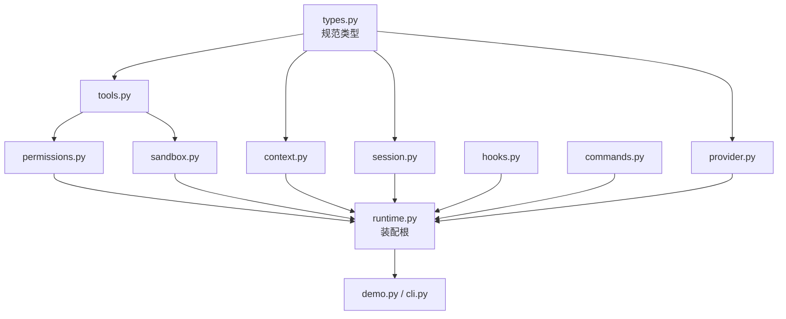
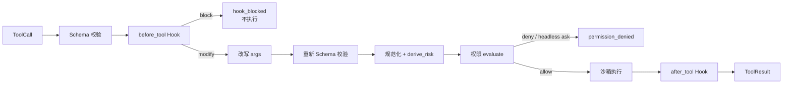

# 第 13 章 从零实现一个最小 Harness：MiniCoder

## 本章导读

前十二章分别实现了工具、上下文、会话、沙箱、权限和扩展。每个模块的单测都通过，接起来却出问题：Hook 返回了 `modify`，参数却没变；文件工具改了宿主目录，命令却在沙箱副本里看不到；恢复会话时，工具计数是 0。模块之间缺的不是 import，而是装配契约。本章把 MiniCoder 装成一个能跑、能审计、能恢复的最小 Harness，给出一份可复用的装配清单。

## 学习目标

读完本章你将能够：

- 用四条装配不变量检查一个 Harness 是否真正完成，而不是模块堆叠。
- 画出依赖分层与装配顺序，消除循环依赖、重复类型和隐式适配。
- 为工具选择沙箱生命周期与工作区归属，并说明本地后端的安全边界。
- 区分状态事件与审计事件，设计可重放的事件日志、检查点与恢复流程。
- 把 Hook、权限、幂等、压缩和停止原因接进同一个执行漏斗，并用离线演示验证。

## 13.1 模块都对，装起来为什么不对

单独看每一章的代码，逻辑都自洽。问题出在“自洽”只覆盖了模块内部。第 6 章讲上下文时，`Message` 只需要 `role` 和 `content`；第 3 章为了表达工具调用，又给 `Message` 加了 `tool_calls`。第 7 章的 `TaskState` 由 reducer 从事件重建，演示里却只追加事件，没有同步更新内存状态。第 10 章的沙箱会复制一份只读基座，而第 5 章的文件工具仍然指向宿主工作区。第 12 章的 `HookRegistry` 把补丁合并进了载荷，却始终返回 `continue`，调用方根本没机会读取补丁。

这些差异在单测里看不出来，因为单测只检查“本模块是否按本模块的约定工作”。装配要检查的是另一件事：**跨模块的语义是否仍然成立**。同一个字段在不同模块里含义是否一致？同一个动作是否只经过一条路径？同一次失败是否只有一个退出原因？同一个文件是否只属于一个工作区？


本章的“最小”指**不变量完整**，不是行数最少。一个没有权限、没有恢复、没有审计的循环也能跑，但它不是 Harness，只是一次脚本调用。MiniCoder v1 的目标是把主循环、工具、上下文、会话、沙箱、权限和扩展装成一个闭环，计划与子代理作为可选层留出接口。


装配阶段最常见的四类缺陷是：

| 缺陷 | 典型表现 | 根因 |
|---|---|---|
| 类型分裂 | 两套 `Message`、两套 `ToolResult`，字段逐渐漂移 | 每章各自定义，未做规范化合并 |
| 顺序错位 | Hook 改完参数又按旧参数鉴权，或先写审计再判定 | 执行漏斗有多个入口 |
| 归属混乱 | 文件工具写宿主，命令工具读沙箱副本 | 工作区对象绑定错误 |
| 事件失配 | 恢复时把审计事件当状态事件，或把未知事件静默吞掉 | 事件分类未集中定义 |

## 13.2 四条装配不变量

### 13.2.1 单一执行漏斗

所有工具调用，无论来自主循环、Slash Command、Skill 脚本还是子代理，都必须经过同一个入口：`MiniCoder._execute()`。这个入口依次完成 `before_tool` Hook、参数改写、意图记录、权限判定、工具执行、结果截断、`after_tool` Hook 和提交/失败记录。任何模块直接调用 `ToolExecutor.execute()` 或工具处理器，都会绕过其中至少一项。

单一漏斗的价值不在“代码整洁”，而在**可证明的顺序**。第 12 章已经给出安全顺序：校验 → Hook → 重校验 → 权限 → 沙箱 → after Hook。如果 Skill 脚本自己调执行器，这个顺序就无法保证；如果子代理直接写文件，审计里就不会出现 `tool_intent`。一旦出现第二条路径，安全属性就从“由结构保证”退化成“靠开发者自觉”。

漏斗还承担两个副作用：生成幂等键、追加 `tool_intent`。这两件事必须发生在 Hook 改写参数**之后**，否则恢复时用旧参数算出的键与真正执行的参数对不上。

### 13.2.2 单一事实源

`TaskState` 与事件日志是事实源，消息历史只是投影。模型看到的 `Message` 列表可以压缩、可以外置、可以在重启后重建；`TaskState` 里的文件摘要、待执行调用、已完成调用、轮次和最后错误不能依赖消息推导。

这条不变量在装配时最容易破。演示循环如果只调用 `store.append("tool_committed", ...)`，而不更新内存里的 `TaskState`，那么运行中的 `tool_calls` 一直是 0，只有等到下一次 `recover()` 重放事件才会变对。第 7 章的 reducer 是给恢复用的，不是给在线状态用的；在线状态必须显式维护。

同理，上下文压缩只能替换 `history`，不能改 `TaskState`。摘要里写的“已完成修改”是缓存，是否真的完成要看 `state_changed` 事件与工作区文件摘要。两者冲突时，以事件和状态为准。

### 13.2.3 单一退出原因

循环只允许一个退出枚举：`LoopStopReason`。`completed`、`max_steps`、`no_progress`、`budget_exceeded`、`cancelled` 覆盖了“正常完成、步数耗尽、原地打转、预算耗尽、被取消”。模型返回的 `FinishReason` 是**单次响应**的结束原因，不能直接当循环结束原因；厂商的 `stop`、`length`、`content_filter` 必须先在接入层归一化，再由循环决定是否继续。

这个区分影响调用方。只有 `completed` 时，`answer` 才可作为最终答复；`max_steps` 和 `no_progress` 必须报告原因，必要时附带最后一条验证结果。`tool_calls` 只统计**已提交**的调用；被 Hook 阻断或权限拒绝的调用单独出现在事件与审计里，不混入这个数字。

### 13.2.4 端到端可关联

一次执行至少要有五个标识：`session_id`、`call_id`、`action_id`、`sandbox_id`、`idempotency_key`。它们分别回答：属于哪个会话、模型提出的哪次调用、对应哪条权限动作、在哪个沙箱执行、重复执行时如何识别。

缺一个标识，排障就会退化成猜。例如只有 `call_id` 没有 `action_id`，就无法证明“这次写入是那次审批放行的”；只有 `sandbox_id` 没有 `session_id`，就无法把命令输出归到具体任务。第 14 章做追踪时，这些标识会直接变成 Span 属性；装配阶段不埋，后面补不回来。

## 13.3 依赖分层与装配顺序

模块之间不是平铺的。正确的依赖方向是单向的：类型层被所有层依赖，工具/权限/沙箱层互不反向依赖运行时，运行时只做构造与编排，CLI 与演示只依赖运行时。



装配顺序应当与依赖方向一致：

1. **合并类型**：先建立唯一的 `types.py`，把 `Message`、`ToolCall`、`ToolSpec`、`ToolResult`、`ModelResponse`、`Usage`、`FinishReason`、`LoopStopReason` 固定下来。
2. **构造底座**：工具注册表、权限引擎、沙箱。
3. **构造状态与上下文**：会话存储、上下文构建器。
4. **接入扩展**：Hook 注册表、命令注册表。
5. **装配运行时**：`MiniCoder` 只负责创建对象、注册工具、编排调用。
6. **接入口**：演示或 CLI 只调用 `run()`、`recover()`、`close()`。

`runtime.py` 是组合根（composition root），它允许知道所有模块，但其他模块不能反过来 import 它。这条规则可以用一个简单检查守住：除 `demo.py` 与 `cli.py` 外，任何模块出现 `from .runtime import` 都视为架构违规。

类型合并还有一个具体决定：`LoopStopReason` 与 `FinishReason` 必须分开。前者是 Harness 的循环终止原因，后者是模型响应的结束原因。把两者合成一个枚举，短期省事，长期会让“模型说完了”和“循环该停了”混为一谈。

## 13.4 沙箱生命周期与工作区归属

第 10 章给出了沙箱的实现，但把“什么时候创建、什么时候销毁、工具看哪个目录”留给了装配层。三个选项：

| 生命周期 | 隔离强度 | 启动成本 | 文件与命令连续性 | 适用 |
|---|---|---|---|---|
| 每次工具调用 | 最高 | 最高 | 无，读不到上一次写入 | 不可信代码片段 |
| 每个任务 | 高 | 中 | 任务内连续，跨任务丢失 | 单任务执行器 |
| 每个会话 | 中 | 低 | 会话内连续，便于多轮修复 | 交互式编码助手 |

MiniCoder 选择**每会话一个沙箱**。会话开始时，把宿主工作区作为只读基座复制到 `sandbox.workspace`；所有文件工具和命令工具都绑定这个副本；会话结束时销毁。这样一次多轮修复中的读、写、验证看到的是同一份文件系统，同时宿主目录保持不变。

关键接线只有两行：

```python
self.sandbox = create_sandbox(SandboxSpec(read_only_base=self.host, ...))
self.ws = Workspace(self.sandbox.workspace)
```

如果写成 `Workspace(self.host)`，文件工具会改宿主，命令工具却在副本里执行，演示里的 `applied` 与 `host unchanged` 会立刻分裂。这个错误不会被类型检查发现，只会被端到端演示发现。

工作区归属需要一张明确的表：

| 内容 | 归属 | 理由 |
|---|---|---|
| 源码与构建产物 | 沙箱工作区 | 模型可写，命令可见 |
| 会话事件与快照 | 宿主 `.minicoder/sessions/<id>/` | 审计需跨沙箱存活 |
| 压缩 transcript | 宿主会话目录 | 按会话隔离，避免串写 |
| 外置观察文件 | 沙箱 `.minicoder/observations/` | 模型可用 `read_file` 找回 |

子代理的约定沿用第 10 章：每次委派创建独立可写层，父代理只按工作区快照或补丁合并，不共享可写目录。v1 演示不展开委派，但沙箱工厂与事件命名已经为它留好位置。


`local` 后端不是安全边界。它只做路径检查、环境白名单、进程组终止与输出上限；网络、CPU、内存、PID、磁盘限制只是契约字段，没有强制执行。把 MiniCoder 跑在宿主机上，意味着模型仍可能造成真实副作用。生产环境必须换成容器、microVM 或远程沙箱后端，并单独验证隔离效果。


## 13.5 事件分类与恢复

事件日志要同时服务两个目的：恢复状态、审计事实。两者对“未知事件”的态度不同。恢复希望事件可重放；审计希望历史完整。如果混在一起，reducer 会把 `hook_finished` 当成未知状态事件，恢复出来的 `last_error` 就会莫名其妙。

MiniCoder 把所有事件显式分成两类：

| 类别 | 事件 | reducer 行为 |
|---|---|---|
| 状态事件 | `session_started`、`task_started`、`state_changed`、`tool_intent`、`tool_committed`、`tool_failed`、`turn_finished`、`checkpoint` | 重建 `TaskState` / `SessionState` |
| 审计事件 | `turn_started`、`loop_stopped`、`context_compacted`、`permission_requested`、`permission_decided`、`grant_*`、`hook_finished`、`tool_blocked`、`command_*`、`sandbox_*`、`subagent_*`、`session_ended` | 忽略，不参与状态重建 |

`tool_blocked` 必须是审计事件而不是状态事件：被 Hook 阻断的调用从未进入执行器，也没有 `pending` 记录，恢复时不需要“补一笔失败”。如果把它写成状态事件，reducer 就得猜它对应哪次意图，反而引入不一致。

未知事件的处理策略是“记录并继续”：`apply_event` 把 `last_error` 设为“未知事件 …，状态可能不完整”，但不让进程崩溃。这是为了可观测性优先，让旧版本读到新事件时仍能启动。生产环境应在此基础上加告警，或按事件版本决定是否失败关闭；静默忽略是不可接受的。

检查点的顺序也固定：先追加 `checkpoint` 事件并拿到 `seq`，更新 `state.updated_seq`，再把 `session` 与 `state` 写入临时文件，最后原子替换 `snapshot.json`。恢复时先读快照，再重放 `seq` 大于快照序号的事件。演示里的 `replayed=1` 不是错误：`session_ended` 在检查点之后追加，属于审计事件，重放它不会改变状态，但会计入重放条数。

第 6 章的 `compact()` 默认把 transcript 写到工作区根目录；多会话共用一个文件会串写。MiniCoder 给 `compact()` 传入 `transcript_path=store.dir / "transcript.jsonl"`，并让相对路径以宿主工作区为基准计算，解决了第 7 章留下的路径整合问题。摘要生成使用独立的 `FixedSummaryProvider`，避免压缩调用消耗主响应的脚本队列。

## 13.6 安全路径、幂等与审批

执行漏斗里的顺序必须是固定的：



这里有两个容易写错的点。

第一，**改写之后必须重新校验**。Hook 可以把 `["python3", "app.py"]` 改成 `["python3", "-u", "app.py"]`，也可以改出一个不符合 Schema 的参数。示例把改写放在 `_execute()` 内、调用 `ToolExecutor` 之前；执行器入口仍然执行 `validate_args()`，所以非法改写会得到 `invalid_args`，而不会进入权限判定。

第二，**幂等键必须在改写之后计算**。`idempotency_key(session_id, call)` 的输入包含 `call_id`、工具名和规范化参数。如果先按模型原始参数算键、再执行改写后的参数，恢复时重放 `tool_intent` 就会得到另一个键，去重失效。演示里 `intent c3 args=['python3', '-u', 'src/app.py']` 与 `key=dd89cd000d8fad64` 同时出现，就是在证明这一点。

有效风险由 `derive_risk(tool, args)` 计算：取工具声明风险与实参推导风险的较高者，绝不降低。`rm -rf`、`git push --force`、`sudo` 等命令前缀会把风险提升到 `destructive`；`curl`、`ssh`、`pip install` 等提升到 `external`。这样即使工具声明为 `read`，危险参数也不会被低估。

审批层保持第 11 章的契约：`check()` 预览规则，`authorize()` 触发审批并记录审计。`HeadlessApprover` 对所有 `ask` 返回拒绝，会话状态里的权限档位也写成 `deny`。v1 不提供 `allow_always`：单次批准与会话授权（带 TTL）已经够用，长期授权的持久化、撤销与策略版本失效留给第 17 章。授权只存在内存里，重启后必须重新审批；这是有意的保守选择。

Hook 阻断的调用会返回 `hook_blocked`，并追加一条 `tool_blocked` 审计事件；它不会进入权限层，也不会产生 `pending`。这解释了演示里 `rm -rf` 既没有执行、也没有权限审计记录：它在更早的 Hook 层就被拦下了。


装配时会暴露接口契约的细节。写作本书时，最初的 `HookRegistry.run()` 即使收到 `modify` 也返回 `continue`，调用方看到 `post.action == "modify"` 永远为假，参数改写和结果脱敏都静默失效。修正后，`run()` 必须返回 `"modify" if modified else "continue"`。这不是文档问题，而是装配验证问题：只要有一个端到端用例检查“密钥不应出现在模型可见文本里”，这个 bug 就藏不住。


## 13.7 设计权衡

### 13.7.1 组装式核心 vs 单体循环

| 维度 | 组装式核心 | 单体循环 |
|---|---|---|
| 变更半径 | 改一个模块只影响其接口 | 每加一个能力都改主循环 |
| 测试 | 模块可单测，装配需端到端用例 | 只能整体测试 |
| 性能 | 多一层调用与对象构造 | 路径最短 |
| 上手成本 | 需要理解依赖图 | 一个文件读完 |
| 适用 | 长期维护的 Harness | 原型、一次性脚本 |

MiniCoder 选择组装式，因为本书讨论的是“生产 Harness”的工程属性。代价是装配本身成为需要测试的代码；四条不变量就是它的测试提纲。

### 13.7.2 每调用沙箱 vs 每会话沙箱

| 维度 | 每调用沙箱 | 每会话沙箱 |
|---|---|---|
| 隔离 | 最强，调用间无残留 | 会话内共享，跨会话隔离 |
| 启动成本 | 每个工具都复制一次 | 每会话一次 |
| 多步修复 | 读不到上一步写入，不可用 | 自然支持 |
| 失败恢复 | 状态全在宿主 | 需同时考虑沙箱与宿主状态 |

编码助手的基本工作方式是“读—改—验证”，因此每会话沙箱是合理默认。若执行的是不可信代码片段，应该降级到每调用沙箱，甚至每调用一个独立进程或容器。

### 13.7.3 事件日志为源 vs 可变状态为源

| 维度 | 事件日志为源 | 可变状态为源 |
|---|---|---|
| 可审计 | 完整历史，可重放 | 只看到最终值 |
| 写入成本 | 每步追加，需 fsync | 原地更新，成本低 |
| 恢复 | 快照 + 重放 | 直接读快照 |
| 调试 | 可回答“为什么变成这样” | 只能看结果 |
| 复杂度 | 需定义状态事件与 reducer | 简单 |

MiniCoder 采用“事件日志 + 快照”的混合模式：日志负责事实与恢复，快照负责启动速度。在线状态仍需显式更新，不能只靠 reducer；这一点在 13.2.2 已经说明。

### 13.7.4 同步审批 vs 异步审批

| 维度 | 同步审批 | 异步审批 |
|---|---|---|
| 实现 | 调用即返回决议 | 需要请求、等待、回调与取消 |
| 演示 | 确定性好，离线可复现 | 需模拟 UI 与计时器 |
| 生产 | 阻塞循环，难以接 Web/IM | 可接人工队列与超时 |
| 风险 | 超时靠外层 | 需处理重复批准与动作 ID 校验 |

v1 保持同步，是为了让离线演示可复现；接口 `Approver.approve()` 已经是可替换的协议。生产实现应改为异步，并补上取消、超时、动作 ID 校验与幂等，不能把同步协议直接暴露给网络。

## 13.8 代码实践：把十二章装成一个可运行程序

完整实现位于 `code/python/minicoder/` 与 `code/typescript/minicoder/src/`。模块对应关系如下：

| 模块 | 来源章节 | 装配职责 |
|---|---|---|
| `types.py` | 第 3、5、7 章 | 合并规范类型，消除教学快照分歧 |
| `tools.py` | 第 5 章 | 注册表、Schema 校验、执行器、截断 |
| `context.py` | 第 6 章 | 预算、历史组装、压缩 |
| `session.py` | 第 7 章 | 事件日志、快照、reducer、漂移检测 |
| `permissions.py` | 第 11 章 | 规范化、有效风险、规则、审批、审计 |
| `sandbox.py` | 第 10 章 | 工作区复制、命令执行、生命周期 |
| `hooks.py` | 第 12 章 | 生命周期事件、改写、阻断、轨迹 |
| `commands.py` | 第 12 章 | 斜杠命令展开 |
| `provider.py` | 第 3 章 | 模型协议、脚本化提供方、摘要提供方 |
| `runtime.py` | 本章 | 组合根：构造、注册、主循环、执行漏斗 |
| `demo.py` | 本章 | 离线端到端演示 |

### 13.8.1 规范类型

合并后的类型只保留一份。关键约束是：`Message` 始终带 `tool_calls` 字段（默认空列表），`ToolResult.to_observation()` 统一错误与截断格式，`LoopStopReason` 与 `FinishReason` 分开。



```python
class LoopStopReason(str, Enum):
    COMPLETED = "completed"
    MAX_STEPS = "max_steps"
    NO_PROGRESS = "no_progress"
    BUDGET_EXCEEDED = "budget_exceeded"
    CANCELLED = "cancelled"


@dataclass(frozen=True)
class ToolCall:
    id: str
    name: str
    args: dict[str, Any]


@dataclass
class Message:
    role: str
    content: str = ""
    tool_call_id: Optional[str] = None
    tool_calls: list[ToolCall] = field(default_factory=list)


@dataclass
class ToolResult:
    ok: bool
    content: str = ""
    error: Optional[str] = None
    error_code: str = ""
    truncated: bool = False
    metadata: dict[str, Any] = field(default_factory=dict)

    def to_observation(self) -> str:
        body = self.content if self.ok else f"[{self.error_code}] {self.error}"
        if self.truncated:
            body += "\n[结果已截断；请缩小查询范围或分段读取]"
        return body
```


```typescript
export type LoopStopReason =
  | "completed"
  | "max_steps"
  | "no_progress"
  | "budget_exceeded"
  | "cancelled";

export type ToolCall = {
  id: string;
  name: string;
  args: Record<string, unknown>;
};

export class Message {
  role: string;
  content: string;
  tool_call_id: string | null;
  tool_calls: ToolCall[];

  constructor(role: string, content = "", tool_call_id: string | null = null, tool_calls: ToolCall[] = []) {
    this.role = role;
    this.content = content;
    this.tool_call_id = tool_call_id;
    this.tool_calls = tool_calls;
  }
}

export class ToolResult {
  ok: boolean;
  content: string;
  error: string | null;
  error_code: string;
  truncated: boolean;
  metadata: Record<string, unknown>;

  constructor(
    ok: boolean,
    content = "",
    error: string | null = null,
    error_code = "",
    truncated = false,
    metadata: Record<string, unknown> = {},
  ) {
    this.ok = ok;
    this.content = content;
    this.error = error;
    this.error_code = error_code;
    this.truncated = truncated;
    this.metadata = metadata;
  }

  to_observation(): string {
    let body = this.ok ? this.content : `[${this.error_code}] ${this.error}`;
    if (this.truncated) {
      body += "\n[结果已截断；请缩小查询范围或分段读取]";
    }
    return body;
  }
}
```



### 13.8.2 组合根：构造与接线

`MiniCoder.__init__` 只做五件事：解析宿主路径、创建沙箱、绑定工作区、创建权限与会话、装配上下文。注意工具注册表绑定的是 `sandbox.workspace`，会话存储绑定的是宿主 `host`。



```python
class MiniCoder:
    """把 Provider、工具、上下文、会话、权限、沙箱与扩展装配成一个运行时。"""

    def __init__(
        self,
        config: HarnessConfig,
        provider: Provider,
        *,
        approver: Optional[Approver] = None,
        summarizer: Optional[Provider] = None,
        hooks: Optional[HookRegistry] = None,
        commands: Optional[CommandRegistry] = None,
    ) -> None:
        self.config = config
        self.host = Path(config.workspace).resolve()
        self.sandbox: SandboxHandle = create_sandbox(
            SandboxSpec(
                read_only_base=self.host,
                timeout_s=20.0,
                max_output_chars=2000,
                keep_workspace=config.keep_sandbox_workspace,
            )
        )
        self.ws = Workspace(self.sandbox.workspace)
        self.registry = build_registry(self.ws)
        self.registry.register(self._make_run_command())
        self.provider = provider
        self.summarizer = summarizer or FixedSummaryProvider(
            "目标：修复工作区代码；约束：只改 src 下的文件；下一步：运行验证命令。"
        )
        self.hooks = hooks or HookRegistry()
        self.commands = commands or CommandRegistry([])
        self.permissions = PermissionEngine(
            default_policy(),
            approver or HeadlessApprover(),
            session_ttl=10,
        )
        self.store = SessionStore(self.host, config.session_id)
        self.executor = ToolExecutor(self.registry, authorize=self._authorize)
        specs = "\n".join(f"- {spec.name}: {spec.description}" for spec in self.registry.specs())
        self.context = ContextBuilder(
            config.budget,
            system_prompt=SYSTEM_PROMPT,
            tool_specs="可用工具：\n" + specs,
            workspace=self.ws.root,
        )
        self.session = SessionState(
            session_id=config.session_id,
            workspace=str(self.host),
            provider=config.provider_name,
            model=config.model,
            permission_profile="deny" if config.headless else config.permission_profile,
            created_at="2026-11-03T00:00:00Z",
        )
        self.task: Optional[TaskState] = None
        self.compactions = 0
        self.closed = False

    def _make_run_command(self) -> Tool:
        async def handler(args: dict[str, Any]) -> ToolResult:
            result = run_command(self.sandbox, args["argv"], timeout_s=15.0)
            ok = result.exit_code == 0 and not result.timed_out
            return ToolResult(
                ok=ok,
                content=result.to_observation(),
                error=None if ok else "命令执行失败",
                error_code="" if ok else ("timeout" if result.timed_out else "execution_failed"),
                truncated=result.truncated,
                metadata={"sandbox_id": result.sandbox_id, "exit_code": result.exit_code},
            )

        return Tool(
            ToolSpec(
                "run_command",
                "在沙箱内执行 argv 数组形式的命令；默认需要审批。",
                {
                    "type": "object",
                    "additionalProperties": False,
                    "required": ["argv"],
                    "properties": {"argv": {"type": "array", "items": {"type": "string"}}},
                },
            ),
            handler,
            parallel_safe=False,
            risk="destructive",
            timeout_s=20.0,
        )
```


```typescript
export class MiniCoder {
  config: HarnessConfig;
  host: string;
  sandbox: SandboxHandle;
  ws: Workspace;
  registry: ReturnType<typeof buildRegistry>;
  provider: Provider;
  summarizer: Provider;
  hooks: HookRegistry;
  commands: CommandRegistry;
  permissions: PermissionEngine;
  store: SessionStore;
  executor: ToolExecutor;
  context: ContextBuilder;
  session: SessionState;
  task: TaskState | null = null;
  compactions = 0;
  closed = false;

  constructor(
    config: HarnessConfig,
    provider: Provider,
    options: {
      approver?: Approver;
      summarizer?: Provider;
      hooks?: HookRegistry;
      commands?: CommandRegistry;
    } = {},
  ) {
    this.config = config;
    this.host = fs.realpathSync(path.resolve(config.workspace));
    this.sandbox = createSandbox(
      new SandboxSpec(
        this.host,
        DEFAULT_ENV_ALLOWLIST,
        20.0,
        2000,
        "deny",
        "local",
        config.keep_sandbox_workspace,
      ),
    );
    this.ws = new Workspace(this.sandbox.workspace);
    this.registry = buildRegistry(this.ws);
    this.registry.register(this.makeRunCommand());
    this.provider = provider;
    this.summarizer =
      options.summarizer ??
      new FixedSummaryProvider("目标：修复工作区代码；约束：只改 src 下的文件；下一步：运行验证命令。");
    this.hooks = options.hooks ?? new HookRegistry();
    this.commands = options.commands ?? new CommandRegistry([]);
    this.permissions = new PermissionEngine(defaultPolicy(), options.approver ?? new HeadlessApprover(), 10);
    this.store = new SessionStore(this.host, config.session_id);
    this.executor = new ToolExecutor(this.registry, (tool, args) => this.authorize(tool, args));
    const specs = this.registry
      .specs()
      .map((spec) => `- ${spec.name}: ${spec.description}`)
      .join("\n");
    this.context = new ContextBuilder(config.budget, {
      system_prompt: SYSTEM_PROMPT,
      tool_specs: "可用工具：\n" + specs,
      workspace: this.ws.root,
    });
    this.session = new SessionState(
      config.session_id,
      this.host,
      config.provider_name,
      config.model,
      config.headless ? "deny" : config.permission_profile,
      "2026-11-03T00:00:00Z",
    );
  }

  private makeRunCommand(): Tool {
    const handler = async (args: Record<string, unknown>): Promise<ToolResult> => {
      const result = runCommand(this.sandbox, (args.argv as unknown[]).map((item) => String(item)), { timeout_s: 15.0 });
      const ok = result.exit_code === 0 && !result.timed_out;
      return new ToolResult(
        ok,
        result.to_observation(),
        ok ? null : "命令执行失败",
        ok ? "" : result.timed_out ? "timeout" : "execution_failed",
        result.truncated,
        { sandbox_id: result.sandbox_id, exit_code: result.exit_code },
      );
    };
    return new Tool(
      {
        name: "run_command",
        description: "在沙箱内执行 argv 数组形式的命令；默认需要审批。",
        parameters: {
          type: "object",
          additionalProperties: false,
          required: ["argv"],
          properties: { argv: { type: "array", items: { type: "string" } } },
        },
      },
      handler,
      false,
      "destructive",
      20.0,
    );
  }
```



### 13.8.3 主循环：压缩、模型调用、工具执行与停止

主循环保持第 2 章的六阶段，但把每个阶段接到具体模块：`assemble` 负责上下文，`needs_compaction` 决定是否压缩，`provider.complete` 负责模型，`_execute` 负责工具，`LoopStopReason` 负责退出。



```python
    async def run(self, task: str, *, constraints: tuple[str, ...] = ()) -> LoopResult:
        if self.task is not None:
            raise RuntimeError("一个 MiniCoder 实例只运行一个任务；新任务请新建会话")
        self.task = TaskState("t-001", task, list(constraints))
        history = [Message("user", task)]
        self.store.append("session_started", self.session.to_json())
        self.store.append(
            "task_started",
            {"task_id": self.task.task_id, "goal": task, "constraints": list(constraints)},
        )
        start = self.hooks.run(HookEvent.SESSION_START, {"session_id": self.config.session_id, "task": task})
        if start.action == "block":
            return self._finish(LoopStopReason.CANCELLED, "", history, Usage(), "session_start hook blocked")

        usage = Usage()
        answer = ""
        reason = LoopStopReason.MAX_STEPS
        seen: dict[str, int] = {}

        for _ in range(self.config.max_steps):
            report = self.context.assemble(history)
            if needs_compaction(history, self.config.budget, report.fixed_tokens):
                result: CompactionResult = await compact(
                    history,
                    self.config.budget,
                    self.summarizer,
                    workspace=self.host,
                    keep_recent=2,
                    transcript_path=self.store.dir / "transcript.jsonl",
                )
                history = result.messages
                self.compactions += 1
                self.store.append(
                    "context_compacted",
                    {
                        "before_tokens": result.before_tokens,
                        "after_tokens": result.after_tokens,
                        "kept_recent": result.kept_recent,
                        "degraded": result.degraded,
                        "transcript": result.transcript_path,
                    },
                )

            model_hook = self.hooks.run(
                HookEvent.BEFORE_MODEL, {"messages": len(report.messages), "estimated_tokens": report.estimated_tokens}
            )
            if model_hook.action == "block":
                return self._finish(LoopStopReason.CANCELLED, "", history, usage, "before_model hook blocked")

            response: ModelResponse = await self.provider.complete(report.messages, self.registry.specs())
            usage.input_tokens += response.usage.input_tokens
            usage.output_tokens += response.usage.output_tokens
            self.task.turns += 1
            self.store.append("turn_started", {"turn": self.task.turns, "estimated_input": report.estimated_tokens})

            if not response.tool_calls:
                answer = response.text
                history.append(Message("assistant", answer))
                self.store.append("turn_finished", {"turn": self.task.turns, "tools": 0, "stop": "completed"})
                reason = LoopStopReason.COMPLETED
                break

            history.append(Message("assistant", response.text, tool_calls=response.tool_calls))
            results: list[ToolResult] = []
            for call in response.tool_calls:
                result = await self._execute(call)
                results.append(result)
                history.append(Message("tool", result.to_observation(), tool_call_id=call.id))
                if call.name == "write_file" and result.ok:
                    rel = str(result.metadata.get("path", ""))
                    if rel:
                        self.task.record_file(self.ws.root, rel, changed_by="write_file")
                        record = self.task.files[rel]
                        self.store.append(
                            "state_changed",
                            {
                                "kind": "file",
                                "path": rel,
                                "sha256": record.sha256,
                                "size": record.size,
                                "changed_by": "write_file",
                            },
                        )

            self.store.append(
                "turn_finished",
                {"turn": self.task.turns, "tools": len(response.tool_calls), "stop": ""},
            )
            signature = "|".join(
                f"{call.name}:{json.dumps(call.args, sort_keys=True)}:{result.to_observation()[:80]}"
                for call, result in zip(response.tool_calls, results)
            )
            seen[signature] = seen.get(signature, 0) + 1
            if seen[signature] >= self.config.max_identical:
                reason = LoopStopReason.NO_PROGRESS
                break
            if usage.total_tokens >= self.config.budget.window * 4:
                reason = LoopStopReason.BUDGET_EXCEEDED
                break

        return self._finish(reason, answer, history, usage, "")
```


```typescript
  async run(task: string, constraints: string[] = []): Promise<LoopResult> {
    if (this.task !== null) throw new Error("一个 MiniCoder 实例只运行一个任务；新任务请新建会话");
    this.task = new TaskState("t-001", task, constraints.slice());
    let history = [new Message("user", task)];
    this.store.append("session_started", this.session.toJSON());
    this.store.append("task_started", { task_id: this.task.task_id, goal: task, constraints: constraints.slice() });
    const start = this.hooks.run("session_start", { session_id: this.config.session_id, task });
    if (start.action === "block") {
      return this.finish("cancelled", "", history, new Usage(), "session_start hook blocked");
    }

    const usage = new Usage();
    let answer = "";
    let reason: LoopStopReason = "max_steps";
    const seen = new Map<string, number>();

    for (let step = 0; step < this.config.max_steps; step += 1) {
      const report = this.context.assemble(history);
      if (needsCompaction(history, this.config.budget, report.fixed_tokens)) {
        const result = await compact(history, this.config.budget, this.summarizer, {
          workspace: this.host,
          keep_recent: 2,
          transcript_path: path.join(this.store.dir, "transcript.jsonl"),
        });
        history = result.messages;
        this.compactions += 1;
        this.store.append("context_compacted", {
          before_tokens: result.before_tokens,
          after_tokens: result.after_tokens,
          kept_recent: result.kept_recent,
          degraded: result.degraded,
          transcript: result.transcript_path,
        });
      }

      const modelHook = this.hooks.run("before_model", {
        messages: report.messages.length,
        estimated_tokens: report.estimated_tokens,
      });
      if (modelHook.action === "block") {
        return this.finish("cancelled", "", history, usage, "before_model hook blocked");
      }

      const response: ModelResponse = await this.provider.complete(report.messages, this.registry.specs());
      usage.input_tokens += response.usage.input_tokens;
      usage.output_tokens += response.usage.output_tokens;
      this.task.turns += 1;
      this.store.append("turn_started", { turn: this.task.turns, estimated_input: report.estimated_tokens });

      if (response.tool_calls.length === 0) {
        answer = response.text;
        history.push(new Message("assistant", answer));
        this.store.append("turn_finished", { turn: this.task.turns, tools: 0, stop: "completed" });
        reason = "completed";
        break;
      }

      history.push(new Message("assistant", response.text, null, response.tool_calls));
      const results: ToolResult[] = [];
      for (const call of response.tool_calls) {
        const result = await this.execute(call);
        results.push(result);
        history.push(new Message("tool", result.to_observation(), call.id));
        if (call.name === "write_file" && result.ok) {
          const rel = String(result.metadata.path ?? "");
          if (rel !== "") {
            this.task.recordFile(this.ws.root, rel, "write_file");
            const record = this.task.files[rel];
            this.store.append("state_changed", {
              kind: "file",
              path: rel,
              sha256: record.sha256,
              size: record.size,
              changed_by: "write_file",
            });
          }
        }
      }

      this.store.append("turn_finished", { turn: this.task.turns, tools: response.tool_calls.length, stop: "" });
      const signature = response.tool_calls
        .map((call, index) => `${call.name}:${canonicalJson(call.args)}:${results[index].to_observation().slice(0, 80)}`)
        .join("|");
      seen.set(signature, (seen.get(signature) ?? 0) + 1);
      if ((seen.get(signature) ?? 0) >= this.config.max_identical) {
        reason = "no_progress";
        break;
      }
      if (usage.total_tokens >= this.config.budget.window * 4) {
        reason = "budget_exceeded";
        break;
      }
    }

    return this.finish(reason, answer, history, usage, "");
  }
```



### 13.8.4 执行漏斗：Hook、幂等、权限与结果

`_execute` 是唯一入口。它在 Hook 改写后计算幂等键，在调用执行器前写入 `tool_intent`，成功后更新 `TaskState` 并记录 `tool_committed`，失败后清理 pending 并记录 `tool_failed`。`_authorize` 把权限拒绝映射成 `permission_denied`，把动作 ID 与规则写进元数据。



```python
    async def _execute(self, call: ToolCall) -> ToolResult:
        pre = self.hooks.run(HookEvent.BEFORE_TOOL, {"tool": call.name, "args": dict(call.args)})
        self.store.append(
            "hook_finished",
            {"event": "before_tool", "action": pre.action, "trace": list(pre.trace)},
        )
        if pre.action == "block":
            self.store.append(
                "tool_blocked",
                {
                    "call_id": call.id,
                    "tool": call.name,
                    "reason": pre.reason,
                    "trace": list(pre.trace),
                },
            )
            return ToolResult(False, error=f"扩展阻断：{pre.reason}", error_code="hook_blocked")
        if pre.action == "modify" and "args" in pre.payload:
            call = replace(call, args=dict(pre.payload["args"]))

        key = idempotency_key(self.config.session_id, call)
        assert self.task is not None
        self.task.pending[call.id] = PendingCall(call.id, call.name, dict(call.args), key)
        self.store.append(
            "tool_intent",
            {"call_id": call.id, "tool": call.name, "args": call.args, "idempotency_key": key},
        )
        result = await self.executor.execute(call)
        if result.ok:
            self.task.complete_call(call.id, result.content[:80])
            self.store.append(
                "tool_committed",
                {"call_id": call.id, "tool": call.name, "summary": result.content[:80]},
            )
        else:
            self.task.pending.pop(call.id, None)
            self.task.last_error = result.to_observation()[:200]
            self.store.append(
                "tool_failed",
                {"call_id": call.id, "tool": call.name, "error": result.to_observation()[:200]},
            )

        post = self.hooks.run(
            HookEvent.AFTER_TOOL,
            {"tool": call.name, "result": result.content, "ok": result.ok},
        )
        self.store.append(
            "hook_finished",
            {"event": "after_tool", "action": post.action, "trace": list(post.trace)},
        )
        if post.action == "modify" and result.ok:
            result = replace(result, content=str(post.payload.get("result", result.content)))
        return result

    def _authorize(self, tool: Tool, args: dict[str, Any]) -> Optional[ToolResult]:
        try:
            action = action_from_tool(tool, args, self.ws)
        except ToolFailure as exc:
            return ToolResult(False, error=str(exc), error_code=exc.code)

        preview = self.permissions.check(action)
        if preview.kind == DecisionKind.ASK:
            self.store.append(
                "permission_requested",
                {"action_id": action.id, "tool": action.tool, "target": action.target, "risk": action.risk.value},
            )
        decision = self.permissions.authorize(action)
        self.store.append(
            "permission_decided",
            {
                "action_id": action.id,
                "tool": action.tool,
                "kind": decision.kind.value,
                "rule": decision.rule,
                "risk": action.risk.value,
            },
        )
        if decision.kind == DecisionKind.ALLOW:
            return None
        return ToolResult(
            False,
            error=f"权限拒绝：{decision.reason}",
            error_code="permission_denied",
            metadata={"action_id": action.id, "rule": decision.rule},
        )
```


```typescript
  private async execute(call: ToolCall): Promise<ToolResult> {
    const pre = this.hooks.run("before_tool", { tool: call.name, args: { ...call.args } });
    this.store.append("hook_finished", { event: "before_tool", action: pre.action, trace: pre.trace.slice() });
    if (pre.action === "block") {
      this.store.append("tool_blocked", {
        call_id: call.id,
        tool: call.name,
        reason: pre.reason,
        trace: pre.trace.slice(),
      });
      return new ToolResult(false, "", `扩展阻断：${pre.reason}`, "hook_blocked");
    }
    if (pre.action === "modify" && pre.payload.args !== undefined) {
      call = { id: call.id, name: call.name, args: { ...(pre.payload.args as Record<string, unknown>) } };
    }

    if (this.task === null) throw new Error("任务尚未开始");
    const key = idempotencyKey(this.config.session_id, call);
    this.task.pending[call.id] = new PendingCall(call.id, call.name, { ...call.args }, key);
    this.store.append("tool_intent", {
      call_id: call.id,
      tool: call.name,
      args: call.args,
      idempotency_key: key,
    });
    let result = await this.executor.execute(call);
    if (result.ok) {
      this.task.completeCall(call.id, result.content.slice(0, 80));
      this.store.append("tool_committed", {
        call_id: call.id,
        tool: call.name,
        summary: result.content.slice(0, 80),
      });
    } else {
      delete this.task.pending[call.id];
      this.task.last_error = result.to_observation().slice(0, 200);
      this.store.append("tool_failed", {
        call_id: call.id,
        tool: call.name,
        error: result.to_observation().slice(0, 200),
      });
    }

    const post = this.hooks.run("after_tool", { tool: call.name, result: result.content, ok: result.ok });
    this.store.append("hook_finished", { event: "after_tool", action: post.action, trace: post.trace.slice() });
    if (post.action === "modify" && result.ok) {
      result = new ToolResult(
        result.ok,
        String(post.payload.result ?? result.content),
        result.error,
        result.error_code,
        result.truncated,
        result.metadata,
      );
    }
    return result;
  }

  private authorize(tool: Tool, args: Record<string, unknown>): ToolResult | null {
    let action;
    try {
      action = actionFromTool(tool, args, this.ws);
    } catch (error) {
      if (error instanceof ToolFailure) return new ToolResult(false, "", error.message, error.code);
      throw error;
    }

    const preview = this.permissions.check(action);
    if (preview.kind === "ask") {
      this.store.append("permission_requested", {
        action_id: action.id,
        tool: action.tool,
        target: action.target,
        risk: action.risk,
      });
    }
    const decision = this.permissions.authorize(action);
    this.store.append("permission_decided", {
      action_id: action.id,
      tool: action.tool,
      kind: decision.kind,
      rule: decision.rule,
      risk: action.risk,
    });
    if (decision.kind === "allow") return null;
    return new ToolResult(false, "", `权限拒绝：${decision.reason}`, "permission_denied", false, {
      action_id: action.id,
      rule: decision.rule,
    });
  }
```



### 13.8.5 演示：脚本化模型与审批人

演示使用临时宿主目录、一个 35 行的 `src/app.py` 和五条脚本化响应：读文件、写文件、运行验证、尝试 `rm -rf`、给出最终答复。审批人只放行 `src/app.py` 的单次写入与 `python3` 的会话授权，其余拒绝。



```python
class DemoApprover:
    def __init__(self) -> None:
        self.requests: list[str] = []

    def approve(self, request: ApprovalRequest) -> ApprovalResult:
        action = request.action
        rendered = " ".join(action.argv) if action.argv else action.target
        self.requests.append(f"{action.tool} {rendered}")
        if action.tool == "write_file" and action.target == "src/app.py":
            return ApprovalResult("allow_once", "演示：单次允许修改源码")
        if action.tool == "run_command" and action.argv[:1] == ("python3",):
            return ApprovalResult("allow_session", "演示：本会话允许运行 python3")
        return ApprovalResult("deny", "演示：其余动作拒绝")


def read_events(path: Path) -> list[dict[str, Any]]:
    if not path.exists():
        return []
    return [json.loads(line) for line in path.read_text(encoding="utf-8").splitlines() if line.strip()]


def normalize(text: str) -> str:
    text = re.sub(r" in \d+\.\d+s", "", text)
    text = re.sub(r"\[sandbox sbx-\d+\]", "[sandbox]", text)
    return text.strip()


async def main() -> None:
    root = Path(tempfile.mkdtemp(prefix="minicoder-demo-"))
    host = root / "workspace"
    (host / "src").mkdir(parents=True)
    (host / "src" / "app.py").write_text(ORIGINAL, encoding="utf-8")

    approver = DemoApprover()
    coder = MiniCoder(
        HarnessConfig(
            workspace=host,
            session_id="demo-13",
            budget=ContextBudget(
                window=900,
                output_reserve=220,
                safety_margin=68,
                tool_result_cap=500,
                compact_at=0.85,
            ),
            keep_sandbox_workspace=False,
        ),
        ScriptedProvider(
            [
                response(calls=[ToolCall("c1", "read_file", {"path": "src/app.py"})]),
                response(calls=[ToolCall("c2", "write_file", {"path": "src/app.py", "content": FIXED})]),
                response(calls=[ToolCall("c3", "run_command", {"argv": ["python3", "src/app.py"]})]),
                response(calls=[ToolCall("c4", "run_command", {"argv": ["rm", "-rf", "build"]})]),
                response(text="已修复 src/app.py 的 TODO，并运行 python3 src/app.py 验证通过。"),
            ]
        ),
        approver=approver,
        hooks=make_demo_hooks(),
    )

    result = await coder.run("修复 src/app.py 中的 TODO 并验证", constraints=("只改 src 下的文件",))
```


```typescript
class DemoApprover implements Approver {
  requests: string[] = [];

  approve(request: ApprovalRequest): ApprovalResult {
    const action = request.action;
    const rendered = action.argv.length > 0 ? action.argv.join(" ") : action.target;
    this.requests.push(`${action.tool} ${rendered}`);
    if (action.tool === "write_file" && action.target === "src/app.py") {
      return new ApprovalResult("allow_once", "演示：单次允许修改源码");
    }
    if (action.tool === "run_command" && action.argv[0] === "python3") {
      return new ApprovalResult("allow_session", "演示：本会话允许运行 python3");
    }
    return new ApprovalResult("deny", "演示：其余动作拒绝");
  }
}

type EventRecord = {
  seq: number;
  type: string;
  ts: string;
  data: Record<string, unknown>;
};

function readEvents(file: string): EventRecord[] {
  if (!fs.existsSync(file)) return [];
  return fs
    .readFileSync(file, "utf8")
    .split("\n")
    .filter((line) => line.trim() !== "")
    .map((line) => JSON.parse(line) as EventRecord);
}

async function main(): Promise<void> {
  const root = fs.mkdtempSync(path.join(os.tmpdir(), "minicoder-demo-"));
  const host = path.join(root, "workspace");
  fs.mkdirSync(path.join(host, "src"), { recursive: true });
  fs.writeFileSync(path.join(host, "src", "app.py"), ORIGINAL, "utf8");

  const approver = new DemoApprover();
  const coder = new MiniCoder(
    new HarnessConfig({
      workspace: host,
      session_id: "demo-13",
      budget: new ContextBudget(900, 220, 68, 500, 0.85),
      keep_sandbox_workspace: false,
    }),
    new ScriptedProvider([
      response("", [{ id: "c1", name: "read_file", args: { path: "src/app.py" } }]),
      response("", [{ id: "c2", name: "write_file", args: { path: "src/app.py", content: FIXED } }]),
      response("", [{ id: "c3", name: "run_command", args: { argv: ["python3", "src/app.py"] } }]),
      response("", [{ id: "c4", name: "run_command", args: { argv: ["rm", "-rf", "build"] } }]),
      response("已修复 src/app.py 的 TODO，并运行 python3 src/app.py 验证通过。"),
    ]),
    { approver, hooks: makeDemoHooks() },
  );

  const result = await coder.run("修复 src/app.py 中的 TODO 并验证", ["只改 src 下的文件"]);
```



运行方式：

```bash
# Python 3.11+
cd code/python
python -m minicoder.demo

# Node.js 26（原生类型剥离）；Node 20+ 可用 tsx/tsc
cd code/typescript
npm run demo
```

两版输出逐行一致：

```text
== MiniCoder demo ==
loop      completed turns=5 tools=3 compactions=1
usage     input=500 output=100
tool      c1  read_file   ok
tool      c2  write_file  ok
tool      c3  run_command ok
tool      c4  run_command blocked block-rm:递归删除
read      lines=35 secret_visible=False redacted=True
write     chars=650 applied=True
host      unchanged=True
compact   before=233 after=70 kept_recent=2 degraded=False
hook      before_tool continue add-unbuffered=continue,block-rm=continue
hook      after_tool  modify   redact-secret=modify
hook      before_tool continue add-unbuffered=continue,block-rm=continue
hook      after_tool  continue redact-secret=continue
hook      before_tool modify   add-unbuffered=modify,block-rm=continue
hook      after_tool  continue redact-secret=continue
hook      before_tool block    add-unbuffered=continue,block-rm=block
audit     01 allow          read_file   rule=read-source
audit     02 approve_once   write_file  rule=write-source
audit     03 approve_session run_command rule=destructive-review
intent    c3 args=['python3', '-u', 'src/app.py'] key=dd89cd000d8fad64
recover   source=snapshot replayed=1 files=1 drift=none
sandbox   runs=1 kept=False
```


`usage input=500 output=100` 是脚本化提供方每次固定返回 100/20 的累计值，不是真实计费。生产接线应使用第 3 章的厂商 `Usage`，并在会话结束时写入 `budget_used`。演示保留固定值，是为了让输出可复现。


## 13.9 演示读解：每一行验证了哪条不变量

**`tools=3` 而不是 4**：模型提出了四次工具调用，但 `rm -rf` 被 Hook 阻断，从未进入执行器。`tool_calls` 只统计已提交调用；被阻断、被拒绝、执行失败的调用分别落在审计事件与 `last_error` 里。

**`secret_visible=False` 与 `redacted=True`**：读文件时，`after_tool` Hook 把 `sk-live-123` 替换成 `sk-***`。由于压缩把早期消息移进 transcript，检查同时覆盖 transcript 与当前消息，防止“压缩后泄露”。这也验证了 Hook 的 `modify` 动作确实被调用方消费。

**`applied=True` 与 `host unchanged=True`**：写入落在沙箱副本，宿主文件未变。如果工具工作区误绑宿主，这两项会一项为真、一项为假，测试立即报警。

**`compact before=233 after=70`**：压缩只作用于历史消息，摘要保留目标、约束、下一步三项标记，`degraded=False`。`before/after` 只统计历史 token，不含固定系统提示，避免把压缩效果算得虚高。

**Hook 轨迹**：`c3` 的 `before_tool` 显示 `add-unbuffered=modify`，`c4` 显示 `block-rm=block`；读操作后的 `redact-secret=modify` 与写操作后的 `continue` 形成对照。轨迹是排查“为什么参数变了/为什么没执行”的第一手证据。

**审计三条**：读文件命中 `read-source` 直接放行；写源码命中 `write-source`，人工单次批准；运行 `python3` 命中 `destructive-review`，会话授权。`rm -rf` 没有审计记录，因为它在权限之前就被阻断——这正是“Hook 不替代权限，但可以更早短路”的体现。

**`intent args` 与 `key`**：参数已经包含 Hook 注入的 `-u`，幂等键基于改写后的参数计算。若把幂等键提前到 Hook 之前，恢复时会对不上，去重与对账都会失效。

**`recover source=snapshot replayed=1`**：快照可用，检查点之后的事件只有 `session_ended`（审计事件），重放它不改变状态。`drift=none` 说明写入后的文件摘要与记录一致。生产环境应定期运行漂移检测，发现“记录说改过、磁盘却不是那个内容”的情况。

**`sandbox runs=1`**：只有 `python3` 真正执行；`rm -rf` 被阻断，所以沙箱只记录一次运行。这个数字比“看日志说被拦了”更有说服力。

## 13.10 业界案例：OpenHands 的事件流

OpenHands（前身 OpenDevin）把 Agent 的执行拆成三层：Agent 控制器负责决策，事件流（Event Stream）记录动作与观察，运行时/工作区负责实际执行。工具调用不是函数直调，而是产生 Action 事件；执行结果作为 Observation 事件回到事件流，状态可以从事件重建。运行时支持本地与容器化后端，工作区与执行环境由运行时抽象管理。

这与 MiniCoder 的四条不变量同构：单一执行漏斗对应 Action/Observation 的统一入口，单一事实源对应事件流，单一退出原因对应控制器状态机，端到端可关联对应事件里的会话与动作标识。差别在规模：OpenHands 要同时服务 UI、多 Agent、远程运行时与更丰富的工具集，因此事件模型、序列化和前后端边界都更复杂。

值得借鉴的不是字段名，而是**把“执行了什么”和“看到了什么”都变成一等事件**。一旦工具调用变成事件，恢复、回放、评测和 UI 都复用同一份数据；反过来，如果执行只存在于函数调用栈里，后面每加一个需求都要重新埋点。


OpenHands 的具体类名、事件字段与运行时后端随版本变化，本节只描述稳定的架构分工。接入前请以官方文档与对应版本的源码为准，不要照搬字段。


## 13.11 常见陷阱

**1. Hook 返回 `modify`，调用方却只认 `continue`。** 补丁被合并进载荷，但最终动作没有升级为 `modify`，调用方判断失败，改写与脱敏静默失效。修复方式不是加注释，而是让 `HookRegistry.run()` 返回最终动作，并加一个端到端用例验证“密钥不可见、参数已注入”。

**2. 工具与命令绑定不同工作区。** 文件工具绑宿主、命令工具绑沙箱副本，或者反过来。表现是“写了但命令看不到”“验证通过但宿主被改”。装配时只允许一个 `Workspace`，它必须指向 `sandbox.workspace`；宿主目录只用于会话存储与只读基座。

**3. 状态与事件两头不一致。** 一种表现是只追加 `tool_committed`、不调用 `TaskState.complete_call()`，运行中的计数、pending 与 `last_error` 全是旧值；另一种是把 `hook_finished`、`permission_decided` 塞进 reducer，恢复时重建出错误状态。前者要记住 reducer 是恢复路径、在线状态必须显式维护；后者要先列事件分类表再写 `apply_event`，未知事件记录告警而不是静默吞掉。

**4. 把本地沙箱当安全边界。** `local` 后端只提供工作区复制、路径检查、环境白名单与进程组终止，不限制网络、CPU、内存与系统调用。演示能拦住 `rm -rf`，不代表能拦住恶意代码。生产必须换真实隔离后端，并单独做逃逸测试。

**5. 完成声明没有证据。** 模型说“已修复并验证”，不等于文件真的改了、命令真的跑了。MiniCoder 的演示检查 `applied`、`host unchanged`、`drift` 与退出码；生产还应把测试命令、输出摘要与文件哈希写进 `state_changed`，让完成声明可复核。

## 13.12 本章小结

- 装配验证的是跨模块语义，不是模块内部逻辑；类型分裂、顺序错位、归属混乱、事件失配是四类高发缺陷。
- 四条不变量：单一执行漏斗、单一事实源、单一退出原因、端到端可关联。
- 依赖必须单向：类型 → 工具/权限/沙箱 → 上下文/会话 → 运行时 → CLI；运行时是组合根，其他模块不得反向依赖。
- 每会话一个沙箱，工具绑定 `sandbox.workspace`，会话日志留在宿主；本地后端不是安全边界。
- 状态事件进 reducer，审计事件只记录；检查点用事件序号与原子快照，未知事件记录告警而不是崩溃。
- 安全顺序是“校验 → Hook → 重校验 → 权限 → 沙箱 → after Hook”；幂等键在改写之后计算，有效风险取声明与实参的较高者。
- 压缩只改消息投影，不改 `TaskState`；transcript 按会话隔离，摘要提供方与主提供方分开。
- 演示用五个标识、三类审计、一次阻断和一次恢复，证明装配不是 import，而是可验证的行为。

## 13.13 思考题

1. 如果把沙箱生命周期从“每会话”改成“每任务”，哪些事件、幂等键与会话授权需要调整？多任务会话中，文件摘要应归属任务还是会话？
2. 设计一个异步审批流程：请求、等待、超时、取消、重复批准分别对应哪些事件与状态？如何保证“批准后只执行一次”？
3. 计划事件与子代理事件目前按审计事件处理。若要让它们参与恢复，应该提升为状态事件还是新增投影层？用本章的四条不变量说明你的选择。
