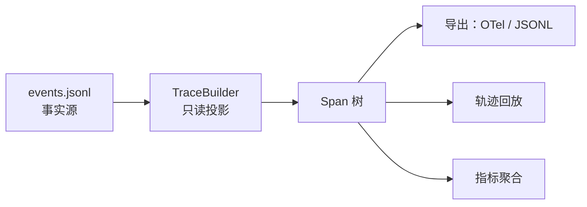
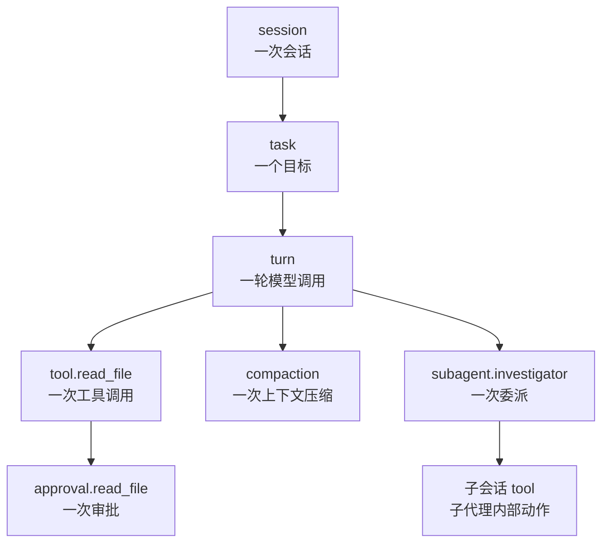
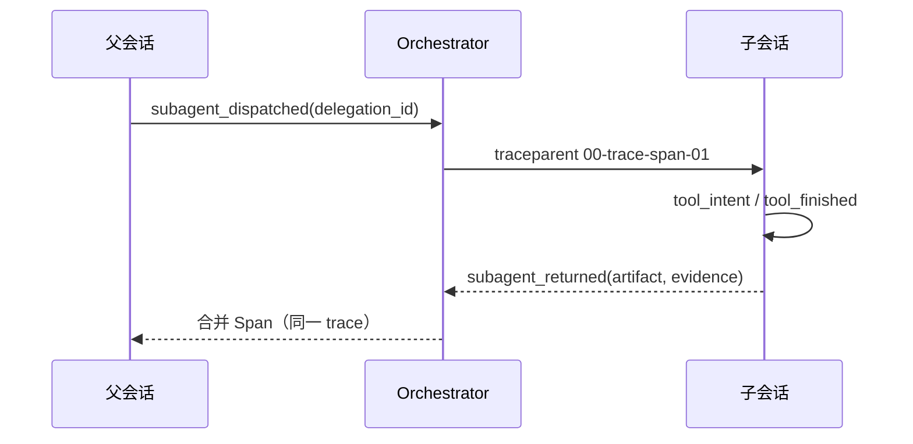
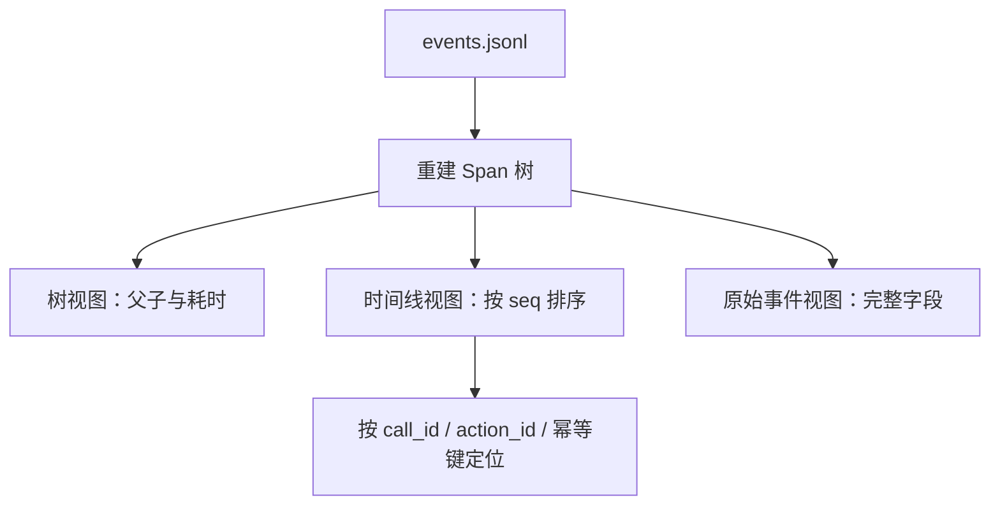

# 第 14 章 可观测性与追踪

## 本章导读

线上任务失败，界面只显示五个字：“任务失败”。日志里有最后一次模型回复，却没有说明它发生在第几轮、之前调用了哪些工具、哪次写入被审批放行、压缩是否吞掉了关键约束。换一个模型复现不了，加几行 `print` 也只能看到局部。本章要解决的问题是：让一次 Agent 执行在结束后仍能被完整回答——发生了什么、为什么发生、代价多少，并且回放时不重新执行任何副作用。

## 学习目标

读完本章你将能够：

- 设计 session → task → turn → tool → approval 的 Span 层级，并说明每个 Span 的职责边界。
- 把第 13 章已有的五个标识与事件日志投影成追踪树，而不引入第二份事实源。
- 用 `delegation_id` 合并父子会话，用 W3C Trace Context 跨进程传播同一个 trace。
- 为采样、脱敏与高基数属性制定可执行规则，避免追踪本身成为泄漏源。
- 从事件日志重建可读时间线，定位到具体调用与审批，而不触发任何工具或模型调用。

## 14.1 可观测性不是更多日志

排障时真正要回答的是三个问题，而不是“有没有日志”：

1. **发生了什么**：任务经过了几轮、调用了哪些工具、每次结果是什么。
2. **为什么发生**：哪条约束、哪次审批、哪次压缩或哪次外部修改导致了结果。
3. **代价多少**：token、时间、审批等待、失败重试分别花在哪里。

普通日志擅长记录离散事实，却不擅长表达因果关系。十条格式不一的 `print` 可以证明“某次写文件失败了”，但无法证明它属于哪一轮、是否经过审批、是否与上一轮的读文件共享同一个幂等键。指标擅长聚合，却天然丢失个体。追踪补上的正是**调用树与关联关系**：它把一次执行拆成有父子关系、有起止、有属性的 Span，再把它们串成一条可检索的时间线。

在 Agent 语境里还要区分两个词。**轨迹（Trajectory）**是执行内容：消息、工具调用、观察与状态变化；**追踪（Trace）**是可观测性记录：Span 树、耗时、状态与属性。轨迹回答“模型看到了什么、做了什么”，追踪回答“系统在何时、以什么关系执行了这些动作”。两者可以互相引用，但不应互相复制。



本章坚持一条原则：**事件日志是事实，追踪是事实的投影**。一次执行先写事件，再由投影器生成 Span；崩溃后可以从同一份事件重建追踪，不需要维护“日志一套、追踪一套”的双写。双写看起来直接，实际会制造两个真相：某次请求写日志成功、写追踪失败时，排障看到的就是残缺的故事。

这条原则也给可观测性一个可验收的标准：给定任意一份事件日志，不启动模型、不执行工具，就能回答前面三个问题。做不到，说明关键事实没有进入事件，或者投影器在猜执行路径。追踪做得好不好，不取决于仪表盘多漂亮，而取决于断网、崩溃、换机器之后，事实是否仍然完整。


第 7 章已经定义了事件日志、快照与 reducer；本节不重复它们的格式与恢复语义。这里只讨论：同一批事件如何被读成追踪，以及读的时候为什么不能反过来修改状态。


## 14.2 追踪模型：Trace、Span 与五个标识

**Trace** 是一次完整执行的调用树；**Span** 是树上的一个操作单元，包含 `trace_id`、`span_id`、`parent_span_id`、名称、起止、状态与属性。一个 Span 还可以挂若干**Span 事件**，表示发生在该操作内部的瞬时事实，例如一次 Hook 执行。

MiniCoder 的层级固定为：



Span 名称遵循“类别 + 有界主语”的格式。主语必须来自有限集合：工具名来自工具注册表，审批对象来自工具名，压缩与命令只有固定名称。不能用用户自由输入拼 Span 名称，否则会制造近乎无限的名字，既拖垮索引，也让聚合失去意义。

| Span | 父 Span | 关键属性 | 结束条件 |
|---|---|---|---|
| `session` | 无 | `session_id`、模型、权限档 | `session_ended` |
| `task` | `session` | `task_id`、目标、硬约束 | 会话结束 |
| `turn` | `task` | 轮次、估算输入 token | `turn_finished` |
| `tool.<name>` | `turn` | `call_id`、参数摘要、幂等键 | 提交、失败或阻断 |
| `approval.<name>` | `tool` | `action_id`、目标、风险、规则 | 审批决议 |
| `compaction` | `turn` | 压缩前后 token、保留条数 | 压缩完成 |
| `sandbox` | `session` | `sandbox_id`、后端 | 沙箱销毁 |
| `command` | `tool` / `sandbox` | `argv`、退出码、超时 | 命令结束 |
| `subagent.<role>` | `turn` / `task` | `delegation_id`、角色、工具白名单 | 子代理返回 |

五个标识在第 13 章只是约定，本章必须落到具体属性，否则排障时仍然对不上：

| 标识 | 落点 | 用途 |
|---|---|---|
| `session_id` | `session` Span 属性；所有 Span 的 `scope` | 区分会话，合并同一会话的全部 Span |
| `call_id` | `tool.<name>` 的 `call_id` | 关联模型提出的工具调用、观察与重试 |
| `action_id` | `approval.<name>` 的 `action_id` | 关联审批请求、决议与执行 |
| `sandbox_id` | `command` 与 `sandbox` Span | 把命令输出归到具体执行环境 |
| `idempotency_key` | `tool.<name>` 的 `idempotency_key` | 关联恢复对账与重复执行检测 |

这些属性必须在 Span 创建时写入，不能事后从消息文本里猜。第 13 章的 `_execute()` 在 Hook 改写参数后才计算幂等键；追踪若在改写前取参数，就会记录一个与真实执行不一致的键。**可关联性不是补日志补出来的，是执行路径本身带出来的。**

## 14.3 事件到 Span 的映射

投影器的输入只有事件日志。它维护一小组“当前打开的 Span”：当前 task、当前 turn、按 `call_id` 索引的 tool、按 `action_id` 索引的 approval，以及沙箱、命令与子代理。每读到一个事件，就打开、关闭或挂载到对应 Span 上。

| 事件 | 产生的 Span / 事件 | 父级 | 关键属性 |
|---|---|---|---|
| `session_started` | `session` 开始 | 无 | 会话配置 |
| `task_started` | `task` 开始 | `session` | 目标、约束 |
| `turn_started` | `turn` 开始 | `task` | 轮次、估算输入 |
| `turn_finished` | `turn` 结束 | — | 工具数、停止原因 |
| `tool_intent` | `tool.<name>` 开始 | `turn` | `call_id`、参数摘要、幂等键 |
| `tool_committed` | `tool.<name>` 结束，状态 `ok` | — | 结果摘要 |
| `tool_failed` | `tool.<name>` 结束，状态 `error` | — | 错误摘要 |
| `tool_blocked` | 零时长 `tool.<name>`，状态 `blocked` | `turn` | 阻断原因 |
| `permission_requested` | `approval.<name>` 开始 | `tool` | `action_id`、目标、风险 |
| `permission_decided` | `approval.<name>` 结束 | — | 决议、命中规则 |
| `hook_finished` | 当前 tool / turn 上的 Span 事件 | — | Hook 名、动作、轨迹 |
| `context_compacted` | 零时长 `compaction` | `turn` / `task` | 前后 token、是否降级 |
| `sandbox_created` | `sandbox` 开始 | `session` | 沙箱 ID、后端 |
| `command_started` | `command` 开始 | `tool` / `sandbox` | `argv`、工作目录 |
| `command_finished` | `command` 结束 | — | 退出码、超时、输出长度 |
| `subagent_dispatched` | `subagent.<role>` 开始 | `turn` / `task` | `delegation_id`、工具白名单 |
| `subagent_returned` | `subagent.<role>` 结束 | — | 返回状态、是否满足契约 |
| `state_changed` / `loop_stopped` / `checkpoint` | 当前 Span 上的点事件 | — | 变更内容 |
| 未知事件 | 当前 Span 上的点事件 | — | 原事件名与数据 |

映射里有三处容易写错。

**第一，`tool_blocked` 发生在 `tool_intent` 之前。** 第 13 章的执行漏斗先跑 `before_tool` Hook；被阻断的调用从未进入权限与执行器，也没有 `pending` 记录。因此它不能去关闭一个不存在的 tool Span，而应生成一个零时长的 blocked Span，直接挂在 turn 下。如果强行“补一个 intent 再失败”，追踪会显示一次从未发生的执行。

**第二，自动放行的审批没有 `permission_requested`。** 读文件这类动作命中 `allow` 规则，只产生 `permission_decided`。投影器应生成一个零等待的 approval Span，状态为 `ok`，而不是伪造一个请求事件。这样“审批次数”与“审批等待次数”才是两个不同指标：前者衡量覆盖范围，后者衡量人工成本。

**第三，Hook 默认是 Span 事件，不是 Span。** 同步 Hook 的耗时通常可以忽略，把它做成独立 Span 会让树迅速膨胀。`hook_finished` 作为点事件挂到当前 tool 或 turn 上，记录 Hook 名、动作与执行轨迹；只有进程外、可能超时的 Hook 才值得提升为带时长的 Span。这个区分要在 Schema 里固定，不要随实现摇摆。

### 14.3.1 状态事件与审计事件的分流

第 13 章把事件分成状态事件与审计事件：reducer 只消费状态事件，`hook_finished`、`permission_decided`、`tool_blocked` 等审计事件只记录事实。追踪投影器消费**全部事件**，但它是只读的：

- 不允许投影器修改 `TaskState`，否则恢复路径与观测路径互相污染。
- 不允许 reducer 读取 Span，否则“事件是唯一事实源”被打破。
- 未知事件在 reducer 里记为 `last_error`，在追踪里降级为 Span 事件；两者都不应崩溃。

同一份事件日志同时服务恢复、审计与追踪，靠的是**不同消费者、各自只读**，而不是把三种语义塞进一个处理器。

投影还应满足幂等：同一批事件读两遍，得到两棵完全相同的树。这意味着 Span 标识不能依赖随机数或当前时间，而要从 `trace_id`、事件序号与作用域确定性派生。演示环境使用固定时间戳，正好能暴露不满足幂等的实现——两次运行的 `span_id` 一旦不同，回放与比对就失去基础。

## 14.4 父子追踪与跨进程传播

进程内建立父子关系很直接：打开 Span 时记下当前父 Span 的 `span_id`。跨进程时，父子关系不能靠“时间接近”猜，必须显式传播。W3C Trace Context 规定的 `traceparent` 头格式是：

```text
traceparent: 00-<32 位 trace-id>-<16 位 parent-span-id>-<flags>
```

`flags` 的最低位表示采样。远程工具、沙箱服务或另一个 Agent 进程收到该头后，用同一个 `trace_id` 创建子 Span，并把传入的 `span_id` 作为父级。若头缺失或格式非法，应新建 trace，而不是拼一个看似相关的 ID。

子代理的合并规则与第 9 章一致：父日志写 `subagent_dispatched` / `subagent_returned`，子代理内部事件写在 `sessions/<parent>--<delegation_id>/` 下，事件名带 `sub:<delegation_id>:` 前缀。投影器按 `delegation_id` 找到父级的 `subagent` Span，把子会话所有 Span 挂到它下面，并复用同一个 `trace_id`。



这里有两个设计约束。第一，**子代理返回的是提案**，父代理复核后才更新计划；追踪也应体现这一点：`subagent_returned` 的 `ok` 只表示委派契约是否满足，不表示任务完成。第二，子代理的 Span 不能因为“独立进程”就生成独立 trace；独立 trace 事后合并需要额外关联字段，且容易在采样时被拆散。共享 trace、显式父级是更稳的默认值。


MiniCoder v1 尚未装配子代理层。本章的 `merge_child()` 用注入的子会话事件演示合并规则；接入真实 `Orchestrator` 时，必须把 `delegation_id`、`call_id` 与父级 `span_id` 一并传入，不能只靠目录名推断父子关系。


## 14.5 采样、脱敏与保留

追踪的成本与风险都不低：一次编码任务可能产生几十个 Span，每个 Span 又可能携带工具参数、命令输出与模型用量。全量采集会让存储与索引迅速失控；不加区分地采集又会把密钥、源码与用户输入写进另一个系统。两条规则必须同时成立：**采样不能丢掉失败与评测样本，脱敏必须在数据离开进程之前发生。**

采样策略见 14.8 的对比。这里先给出 MiniCoder 的默认选择：开发与评测环境全量；生产按 trace 头部采样，默认 10%；错误、审批拒绝、无进展终止、子代理返回物非法的 trace 强制保留。强制保留需要尾部决策，因此生产导出器通常要缓冲到 trace 结束再决定，而不是在第一个 Span 就丢弃。

脱敏采用“源头结构化 + 导出再过滤”的双层策略：

| 数据 | 采集规则 | 理由 |
|---|---|---|
| 工具参数 | 按工具白名单选字段；`content` 只记字符数 | 参数可能含源码与凭证 |
| 命令 `argv` | 保留可执行名与参数结构；`--token`、`--password` 后的值替换为 `***` | 可审计又不泄漏 |
| 标准输出 | 只记头尾预览、总字符数与截断标记 | 完整输出留在受控工件目录 |
| 路径 | 相对工作区；绝对临时目录替换为占位符 | 避免泄漏宿主信息 |
| 提示词与回复 | 默认只记哈希、长度与模型用量 | 原文可能含用户数据 |
| 密钥 | 正则扫描 `sk-*` 等常见形态，统一替换 | 防止意外写入 |

高基数属性要单独警惕。`session_id`、`task_id`、`user_id`、`file_path` 适合放在 Span 属性里做检索，**不能作为指标标签**；否则每个会话都会生成一条时间序列，监控系统会先于业务崩溃。Span 名称本身也必须低基数：`tool.read_file` 可以，`tool.read_file:/tmp/abc123.py` 不行。

错误与重试也应显式建模。同一个 `call_id` 的每次重试生成独立 tool Span，带 `retry.attempt` 与 `error.code`；不要覆盖上一次的 Span。这样既能统计“一次调用重试了几次”，也能区分“工具本身失败”与“模型反复提出同一调用”。

保留策略要按数据等级分层，而不是一律 30 天。事故 trace、评测 trace 与含审批的 trace 进入长期归档；普通成功 trace 只保留聚合指标与根 Span；原始事件仍按第 7 章的会话策略保留，追踪删除不影响事实源。换句话说，**追踪可以过期，事件不能随手丢**。

## 14.6 轨迹回放与调试

**轨迹回放（Trace Replay）**是从已记录的事件重建执行时间线，而不是重新执行任务。回放器只读事件与 Span，不调用模型、不执行工具、不写工作区。它的价值在于：线上失败可以离线复现决策链；评测可以对比两条轨迹的差异；事故复盘可以精确回答“哪一步被批准了”。

回放通常提供三个视图：



树视图回答“谁在谁里面”，时间线回答“先后顺序”，原始事件回答“字段原值”。三者共用同一份数据，不各自维护副本。定位时优先用标识而不是文本搜索：用 `call_id` 找到工具 Span，再用同一 Span 的 `action_id` 找到审批，最后用 `idempotency_key` 判断恢复时是否重复执行。

回放与重跑必须分开。若需要重新执行，应创建新会话、新 trace，并明确这是“重跑”而不是“回放”；否则旧事件与新副作用会混在同一条时间线上，排障结论不再可信。第 15 章会把关键场景的归一化追踪保存为黄金轨迹，用于回归比对。

## 14.7 指标与告警

Span 适合个体排障，指标适合发现趋势。MiniCoder 从追踪聚合出以下核心指标：

| 指标 | 计算方式 | 用途 |
|---|---|---|
| 轮次 | `turn` Span 数 / 任务 | 发现任务变长 |
| 工具成功率 | `ok` / 全部 tool Span | 工具或权限回归 |
| 阻断率 | `blocked` / 全部 tool Span | Hook 或策略过严 |
| 审批等待 | `permission_decided.seq - permission_requested.seq` | 人工瓶颈 |
| 压缩次数与压缩比 | `compaction` 数；`after / before` | 上下文压力 |
| token / 成本 | 根 Span 上的用量 | 预算与路由 |
| 无进展终止率 | `reason=no_progress` / 任务 | 循环设计问题 |
| 恢复与漂移 | `recover` 次数、`drift` 数量 | 状态一致性 |
| 子代理无效产物率 | `invalid_artifact` / 委派 | 契约或简报问题 |

指标标签只保留低基数的维度：模型、工具名、状态、停止原因、规则名。不要把会话 ID、任务 ID、文件路径放进去。比率类指标要同时保留分子与分母，否则“成功率 100%”可能只是样本只有一次。

告警应绑定可行动的信号：工具成功率连续下降、审批等待 p95 超过阈值、无进展终止率突增、恢复时漂移数量上升。单独一条“Span 数变多”通常不是告警，而是容量规划问题。

## 14.8 设计权衡

### 14.8.1 事件派生 vs 独立追踪流

| 维度 | 事件派生 | 独立追踪流 |
|---|---|---|
| 事实源 | 一份，天然一致 | 两份，可能漂移 |
| 实时性 | 需要观察者或读取延迟 | 可边执行边导出 |
| 恢复后重建 | 可以 | 通常不行 |
| 写入成本 | 无额外写入 | 每个 Span 额外写入 |
| 适用 | 审计优先、可回放 | 超高吞吐、只在线观测 |

MiniCoder 选择事件派生，并在生产实现中给 `SessionStore.append()` 挂一个只读观察者，实现准实时导出。关键是观察者不能反写状态；它只是把同一个事件投影成 Span。

### 14.8.2 头部采样 vs 尾部采样

| 维度 | 头部采样 | 尾部采样 |
|---|---|---|
| 决策时机 | 请求开始时 | trace 结束后 |
| 实现成本 | 低 | 需要缓冲与聚合 |
| 能否保留错误 | 默认不能 | 可以 |
| 存储 | 可预测 | 需要临时缓冲 |
| 适用 | 高吞吐、成本敏感 | 失败必须可查 |

生产默认“头部 10% + 尾部强制保留异常”。评测轨迹不受采样影响，必须全量，否则回归样本会随机缺失。

### 14.8.3 采集端脱敏 vs 导出端脱敏

| 维度 | 采集端 | 导出端 |
|---|---|---|
| 泄漏风险 | 最低 | 原始值已落盘 |
| 灵活性 | 低，规则前置 | 高，可按目的地过滤 |
| 性能 | 采集时多做工作 | 导出时多做工作 |
| 适用 | 密钥、凭证、用户数据 | 内部调试细节 |

正确做法是两层都做：采集端只允许结构化、已知字段；导出端再按目的地做一次过滤。只靠导出端，意味着敏感值已经写进本地文件；只靠采集端，则无法应对新增的导出目的地。

### 14.8.4 子代理共享 trace vs 独立 trace

| 维度 | 共享 trace | 独立 trace |
|---|---|---|
| 父子关系 | 天然完整 | 需要额外关联字段 |
| 采样 | 作为一个整体 | 可能被拆散 |
| 隔离 | 子代理数据进入父 trace | 边界更清晰 |
| 合并成本 | 低 | 高，且易错 |

MiniCoder 选择共享 trace + 显式父级 `span_id`。如果子代理属于不同信任域，可以独立存储，但对外仍应暴露同一个 `trace_id` 与父级引用。

## 14.9 代码实践：把事件投影成追踪

完整实现位于 `code/python/minicoder/trace.py` 与 `code/typescript/minicoder/src/trace.ts`；演示位于 `trace_demo.py` 与 `trace_demo.ts`。新增模块不修改任何既有接口，只读第 13 章的事件日志与 `Usage`。

核心 API：

| 名称 | 作用 |
|---|---|
| `Span` / `Trace` / `TraceSummary` | 追踪树、根引用与聚合结果 |
| `TraceBuilder` | 维护打开中的 Span，消费事件流 |
| `build_trace(events)` | 一次性投影 |
| `merge_child(trace, delegation_id, events)` | 合并子会话，挂到 subagent Span |
| `redact_args` / `redact_text` | 结构化脱敏 |
| `traceparent` / `parse_traceparent` | W3C 头生成与解析 |
| `render_tree` / `replay` / `summarize` | 三种视图与指标 |

### 14.9.1 数据结构

`Span` 同时保存逻辑时钟（`start_seq` / `end_seq`）与墙钟字段的位置。示例只用事件序号排序，避免固定时间戳的演示环境产生“所有耗时都是 0”的假象；生产导出时再补 `start_time` / `end_time`。



```python
@dataclass
class Span:
    trace_id: str
    span_id: str
    parent_span_id: Optional[str]
    name: str
    kind: str
    scope: str
    start_seq: int
    end_seq: int = 0
    status: str = "ok"
    attributes: dict[str, Any] = field(default_factory=dict)
    events: list[dict[str, Any]] = field(default_factory=list)

    def close(self, seq: int, status: str = "ok", **attributes: Any) -> None:
        self.end_seq = seq
        self.status = status
        self.attributes.update(attributes)


@dataclass
class Trace:
    trace_id: str
    session_id: str
    root_span_id: str
    spans: list[Span]


@dataclass
class TraceSummary:
    turns: int = 0
    tool_attempts: int = 0
    tool_ok: int = 0
    tool_failed: int = 0
    tool_blocked: int = 0
    approvals: int = 0
    approval_wait: int = 0
    compactions: int = 0
    subagents: int = 0
    reason: str = ""
    input_tokens: int = 0
    output_tokens: int = 0
```


```typescript
export class Span {
  trace_id: string;
  span_id: string;
  parent_span_id: string | null;
  name: string;
  kind: string;
  scope: string;
  start_seq: number;
  end_seq: number;
  status: string;
  attributes: Record<string, unknown>;
  events: SpanEvent[];

  constructor(
    trace_id: string,
    span_id: string,
    parent_span_id: string | null,
    name: string,
    kind: string,
    scope: string,
    start_seq: number,
    attributes: Record<string, unknown> = {},
  ) {
    this.trace_id = trace_id;
    this.span_id = span_id;
    this.parent_span_id = parent_span_id;
    this.name = name;
    this.kind = kind;
    this.scope = scope;
    this.start_seq = start_seq;
    this.end_seq = 0;
    this.status = "ok";
    this.attributes = attributes;
    this.events = [];
  }

  close(seq: number, status = "ok", attributes: Record<string, unknown> = {}): void {
    this.end_seq = seq;
    this.status = status;
    this.attributes = { ...this.attributes, ...attributes };
  }
}
```



### 14.9.2 事件映射的核心

投影器不是一个巨大的 `switch`，而是一组“打开—关闭—挂载”的状态转移。下面保留最容易出错的三类：工具、审批与子代理。



```python
def _feed_one(self, event: dict[str, Any]) -> None:
    typ = str(event.get("type", ""))
    data = dict(event.get("data") or {})
    seq = int(event.get("seq", 0))

    delegation_id = ""
    if typ.startswith("sub:") and typ.count(":") >= 2:
        _, delegation_id, typ = typ.split(":", 2)
    if typ == "tool_finished":
        typ = "tool_committed" if data.get("ok", True) else "tool_failed"

    if typ == "tool_intent":
        parent = self.subagents.get(delegation_id) or self._parent()
        tool = str(data.get("tool", "tool"))
        span = self._new(
            f"tool.{tool}", "tool", parent, seq,
            call_id=data.get("call_id", ""),
            tool=tool,
            args=redact_args(tool, dict(data.get("args") or {})),
            idempotency_key=data.get("idempotency_key", ""),
            session_id=self.session_id,
        )
        self.tools[str(data.get("call_id", ""))] = span
    elif typ == "tool_committed":
        span = self.tools.pop(str(data.get("call_id", "")), None)
        if span is not None:
            span.close(seq, "ok", summary=redact_text(data.get("summary", "")))
    elif typ == "tool_blocked":
        span = self._new(
            f"tool.{data.get('tool', 'tool')}", "tool", self._parent(), seq,
            call_id=data.get("call_id", ""), blocked=True,
        )
        span.close(seq, "blocked", reason=redact_text(data.get("reason", "")))
    elif typ == "permission_requested":
        action_id = str(data.get("action_id", ""))
        span = self._new(
            f"approval.{data.get('tool', 'tool')}", "approval",
            next(reversed(self.tools.values()), None) or self._parent(), seq,
            action_id=action_id, target=redact_text(data.get("target", "")),
        )
        self.approvals[action_id] = span
    elif typ == "permission_decided":
        action_id = str(data.get("action_id", ""))
        span = self.approvals.pop(action_id, None)
        if span is None:
            # 自动放行没有请求事件：生成零等待 Span，不伪造请求。
            span = self._new(
                f"approval.{data.get('tool', 'tool')}", "approval", self._parent(), seq,
                action_id=action_id, tool=data.get("tool", ""),
            )
        kind = str(data.get("kind", "allow"))
        span.close(seq, "denied" if kind == "deny" else "ok", decision=kind)
    elif typ == "subagent_returned":
        span = self.subagents.pop(delegation_id, None)
        if span is not None:
            status = str(data.get("status", "completed"))
            span.close(seq, "ok" if status == "completed" else "error", result_status=status)
```


```typescript
private feedOne(event: StoredEvent): void {
  let typ = String(event.type ?? "");
  const data: Record<string, unknown> = { ...(event.data ?? {}) };
  const seq = Number(event.seq ?? 0);

  let delegationId = "";
  if (typ.startsWith("sub:") && typ.split(":").length >= 3) {
    const parts = typ.split(":");
    delegationId = parts[1];
    typ = parts.slice(2).join(":");
  }
  if (typ === "tool_finished") typ = data.ok === false ? "tool_failed" : "tool_committed";

  if (typ === "tool_intent") {
    const parent = this.subagents.get(delegationId) ?? this.parent();
    const tool = String(data.tool ?? "tool");
    const span = this.newSpan(`tool.${tool}`, "tool", parent, seq, {
      call_id: data.call_id ?? "",
      tool,
      args: redactArgs(tool, (data.args as Record<string, unknown> | undefined) ?? {}),
      idempotency_key: data.idempotency_key ?? "",
      session_id: this.session_id,
    });
    this.tools.set(String(data.call_id ?? ""), span);
  } else if (typ === "tool_committed") {
    const span = this.tools.get(String(data.call_id ?? ""));
    if (span !== undefined) {
      this.tools.delete(String(data.call_id ?? ""));
      span.close(seq, "ok", { summary: redactText(data.summary ?? "") });
    }
  } else if (typ === "tool_blocked") {
    const span = this.newSpan(`tool.${data.tool ?? "tool"}`, "tool", this.parent(), seq, {
      call_id: data.call_id ?? "",
      blocked: true,
    });
    span.close(seq, "blocked", { reason: redactText(data.reason ?? "") });
  } else if (typ === "permission_requested") {
    const actionId = String(data.action_id ?? "");
    const span = this.newSpan(
      `approval.${data.tool ?? "tool"}`, "approval", lastTool(this.tools) ?? this.parent(), seq,
      { action_id: actionId, target: redactText(data.target ?? "") },
    );
    this.approvals.set(actionId, span);
  } else if (typ === "permission_decided") {
    const actionId = String(data.action_id ?? "");
    let span = this.approvals.get(actionId);
    if (span !== undefined) this.approvals.delete(actionId);
    if (span === undefined) {
      span = this.newSpan(`approval.${data.tool ?? "tool"}`, "approval", this.parent(), seq, {
        action_id: actionId,
        tool: data.tool ?? "",
      });
    }
    const kind = String(data.kind ?? "allow");
    span.close(seq, kind === "deny" ? "denied" : "ok", { decision: kind });
  } else if (typ === "subagent_returned") {
    const span = this.subagents.get(delegationId);
    if (span !== undefined) {
      this.subagents.delete(delegationId);
      const status = String(data.status ?? "completed");
      span.close(seq, status === "completed" ? "ok" : "error", { result_status: status });
    }
  }
}
```



### 14.9.3 脱敏与跨进程传播

脱敏函数只做结构化替换，不尝试“智能判断”。密钥形态、字段名与工具名是三条明确规则；未知字段默认按文本截断，不直接落盘。



```python
SECRET = re.compile(r"sk-[A-Za-z0-9_-]+")
SENSITIVE_KEYS = ("token", "secret", "password", "authorization", "api_key", "apikey")


def redact_args(tool: str, args: dict[str, Any]) -> dict[str, Any]:
    clean: dict[str, Any] = {}
    for key, value in args.items():
        lower = key.lower()
        if lower == "content":
            clean[key] = f"<{len(str(value))} chars>"
        elif any(word in lower for word in SENSITIVE_KEYS):
            clean[key] = "***"
        elif isinstance(value, str):
            clean[key] = redact_text(value)
        elif isinstance(value, (list, tuple)):
            clean[key] = [redact_text(item) if isinstance(item, str) else item for item in value]
        else:
            clean[key] = value
    argv = clean.get("argv")
    if tool == "run_command" and isinstance(argv, list):
        for index, item in enumerate(argv):
            if item in {"--token", "--password", "--api-key"} and index + 1 < len(argv):
                argv[index + 1] = "***"
    return clean


def traceparent(trace_id: str, span_id: str, sampled: bool = True) -> str:
    if len(trace_id) != 32 or len(span_id) != 16:
        raise ValueError("traceparent 需要 32 位 trace-id 与 16 位 span-id")
    return f"00-{trace_id}-{span_id}-{'01' if sampled else '00'}"
```


```typescript
const SECRET = /sk-[A-Za-z0-9_-]+/g;
const SENSITIVE_KEYS = ["token", "secret", "password", "authorization", "api_key", "apikey"];

export function redactArgs(tool: string, args: Record<string, unknown>): Record<string, unknown> {
  const clean: Record<string, unknown> = {};
  for (const [key, value] of Object.entries(args)) {
    const lower = key.toLowerCase();
    if (lower === "content") {
      clean[key] = `<${String(value).length} chars>`;
    } else if (SENSITIVE_KEYS.some((word) => lower.includes(word))) {
      clean[key] = "***";
    } else if (typeof value === "string") {
      clean[key] = redactText(value);
    } else if (Array.isArray(value)) {
      clean[key] = value.map((item) => (typeof item === "string" ? redactText(item) : item));
    } else {
      clean[key] = value;
    }
  }
  if (tool === "run_command" && Array.isArray(clean.argv)) {
    const argv = clean.argv as unknown[];
    for (let index = 0; index < argv.length; index += 1) {
      if (["--token", "--password", "--api-key"].includes(String(argv[index])) && index + 1 < argv.length) {
        argv[index + 1] = "***";
      }
    }
  }
  return clean;
}

export function traceparent(traceId: string, spanIdValue: string, sampled = true): string {
  if (traceId.length !== 32 || spanIdValue.length !== 16) {
    throw new Error("traceparent 需要 32 位 trace-id 与 16 位 span-id");
  }
  return `00-${traceId}-${spanIdValue}-${sampled ? "01" : "00"}`;
}
```



### 14.9.4 演示与输出

演示复用第 13 章的脚本：读文件、写文件、运行验证、尝试 `rm -rf`、给出结论；随后从事件日志投影追踪，再注入一组子会话事件验证合并。为避免把“回放”做成“重跑”，演示只读取事件，不再次调用模型或工具。



```python
result = await coder.run("修复 src/app.py 中的 TODO 并验证", constraints=("只改 src 下的文件",))
trace = build_trace(read_events(coder.store.events_path), session_id="demo-14")

child = [
    {"seq": 1, "type": "sub:dg-1:tool_intent",
     "data": {"call_id": "d1", "tool": "read_file", "args": {"path": "src/app.py"}}},
    {"seq": 2, "type": "sub:dg-1:tool_finished",
     "data": {"call_id": "d1", "tool": "read_file", "ok": True, "summary": "read src/app.py"}},
]
merged = merge_child(trace, "dg-1", child, role="investigator")
summary = summarize(trace, input_tokens=result.usage.input_tokens, output_tokens=result.usage.output_tokens)

for line in render_tree(trace):
    print("span      " + line)
```


```typescript
const result = await coder.run("修复 src/app.py 中的 TODO 并验证", ["只改 src 下的文件"]);
const trace = buildTrace(readEvents(coder.store.events_path), { session_id: "demo-14" });

const child: StoredEvent[] = [
  { seq: 1, type: "sub:dg-1:tool_intent",
    data: { call_id: "d1", tool: "read_file", args: { path: "src/app.py" } } },
  { seq: 2, type: "sub:dg-1:tool_finished",
    data: { call_id: "d1", tool: "read_file", ok: true, summary: "read src/app.py" } },
];
const merged = mergeChild(trace, "dg-1", child, "investigator");
const summary = summarize(trace, result.usage.input_tokens, result.usage.output_tokens);

for (const line of renderTree(trace)) console.log("span      " + line);
```



运行方式：

```bash
cd code/python && python3 -m minicoder.trace_demo
cd code/typescript && node minicoder/src/trace_demo.ts
```

两版输出逐行一致：

```text
== Trace demo ==
trace     id=416e6119 spans=17
span      session                  ok         seq=1..36
span        task                     ok         seq=2..36
span          turn                     ok         seq=3..9
span            tool.read_file           ok         seq=5..7
span              approval.read_file       ok         seq=6..6
span          turn                     ok         seq=10..18
span            tool.write_file          ok         seq=12..15
span              approval.write_file      ok         seq=13..14
span          turn                     ok         seq=19..26
span            tool.run_command         ok         seq=21..24
span              approval.run_command     ok         seq=22..23
span          compaction               ok         seq=27..27
span          turn                     ok         seq=28..31
span            tool.run_command         blocked    seq=30..30
span          turn                     ok         seq=32..33
span          subagent.investigator    ok         seq=36..38
span            tool.read_file           ok         seq=37..38
metrics   turns=5 tools=4 ok=3 failed=0 blocked=1 approvals=3 wait=2 compactions=1 subagents=1 reason=completed tokens=500/100
redact    secret_visible=False argv=['curl', '-H', 'Authorization: Bearer sk-***', '--token', '***']
child     merged=1 parent=subagent.investigator status=ok
replay      1 session start status=ok
replay      2 task start status=ok
replay      3 turn start status=ok
replay      4 turn event=hook_finished
replay      5 tool.read_file start status=ok
replay      6 approval.read_file start status=ok
replay      6 approval.read_file end status=ok
replay      7 tool.read_file end status=ok
replay      8 turn event=hook_finished
```

**`spans=17`**：15 个主链路 Span（session、task、5 个 turn、4 个 tool、3 个 approval、1 个 compaction），加上注入的 1 个 subagent 与 1 个child tool。`tool_blocked` 单独成 Span，因此工具尝试是 4 次而不是 3 次；`tools=4` 与第 13 章的 `tools=3` 不矛盾——前者统计尝试，后者只统计已提交。

**`approvals=3 wait=2`**：读文件自动放行，只有 `permission_decided`，生成零等待 Span；写文件与 `python3` 各有请求与决议，等待数为 2。`rm -rf` 在权限之前被 Hook 阻断，所以没有审批 Span。

**`compactions=1`**：压缩发生在第 4 轮之前，早于 `turn_started`，因此挂在 `task` 下而不是 `turn` 下。这不是错误，而是事件顺序的真实反映；如果希望它总挂在某一轮，需要在压缩事件里显式带 `turn` 号，而不是让投影器猜。

**`redact secret_visible=False`**：`Authorization` 头里的密钥被正则替换，`--token` 后的值被参数规则替换。两次替换分别验证了“文本形态”和“结构化字段”两条规则。

**`child merged=1`**：子会话的 tool Span 挂到 `subagent.investigator` 下，复用同一 `trace_id` 与父级 `span_id`。演示注入的是子会话事件，不执行任何子代理逻辑，验证的只是合并规则。

## 14.10 业界案例：OpenAI Agents SDK 的内建追踪

OpenAI Agents SDK 把追踪做成框架的一等能力，而不是可选插件：一次 run 产生 trace，trace 下有 agent、generation、tool 等 Span；处理器（processor）接收 trace 与 span 的开始、结束事件，并负责导出。框架提供“是否包含敏感数据”的开关与自定义 Span 接口，让默认行为偏向安全，同时允许开发者在受控环境中打开完整载荷。

这与 MiniCoder 的取向一致：**追踪信息在构造执行单元时就产生，而不是事后从日志里拼**。差别在默认值。SDK 把“敏感数据默认不采集”作为框架契约，MiniCoder 则把脱敏放在投影器入口；两者都在回答同一个问题：谁能看到原始参数、谁只能看到摘要。

OpenTelemetry 的 GenAI 语义约定尝试统一模型调用、token 用量与工具调用的属性名（如 `gen_ai.system`、`gen_ai.request.model`、`gen_ai.usage.*`）。这些约定仍在演进，字段名与覆盖范围可能变化；接入时应以官方文档和对应 SDK 版本为准，不要把某一版属性名当作永久标准。

值得借鉴的不是具体字段，而是三条工程原则：

1. **追踪是框架原语**：Trace 上下文随执行传播，工具与子代理自动继承，不依赖开发者手工传参。
2. **脱敏是默认值**：敏感载荷需要显式开启，而不是显式关闭。
3. **导出可插拔**：处理器/导出器决定数据去向，核心循环不绑定某一家后端。

## 14.11 常见陷阱

**1. 事件与追踪双写，产生两个真相。** 一边写 `events.jsonl`，一边单独写 `trace.jsonl`，任一侧失败就会出现残缺轨迹。解决方式是只写事件，用只读观察者或投影器生成追踪；若必须实时导出，观察者也只能读，不能改状态。

**2. 把完整 prompt、工具输出、密钥和绝对路径写进 Span。** 追踪系统往往比业务日志保留更久、访问更宽。参数要按工具白名单采集，内容只记长度与哈希，命令参数要脱敏，路径要相对化；完整输出应进入受控工件目录，而不是 Span 属性。

**3. 子代理生成独立 trace，父代理无法关联。** 常见表现是父 trace 里只有一个 `subagent_returned`，子代理内部动作却查不到。应复用父 `trace_id`，用 `delegation_id` 找到父 Span，并把子会话事件名里的 `sub:<id>:` 前缀解析掉，而不是把前缀当成新事件类型。

**4. 只在入口按比例采样，失败样本被丢掉。** 头部采样在请求开始时决定，无法预知后面是否失败。生产应加尾部策略，至少强制保留错误、拒绝、无进展与评测轨迹；否则事故发生时恰好没有样本。

**5. 把回放做成重跑。** 回放器如果顺手调用了模型或执行了工具，就会产生新的副作用，旧 trace 也不再是事实。回放必须只读事件；需要重新执行时，新建会话与新 trace，并在界面上明确标注“重跑”。

## 14.12 本章小结

- 可观测性要回答“发生了什么、为什么、代价多少”，日志多不等于能回答；轨迹是执行内容，追踪是可观测性记录。
- 事件日志是事实，追踪是只读投影；同一批事件服务恢复、审计与追踪，靠不同消费者各自只读。
- Span 层级固定为 session → task → turn → tool → approval，压缩、沙箱、命令与子代理各有明确父级。
- 五个标识必须落在 Span 属性上：`session_id`、`call_id`、`action_id`、`sandbox_id`、`idempotency_key`，且在执行路径中生成，不能事后猜。
- 映射要处理三种边界：被 Hook 阻断的调用没有 intent、自动放行没有 request、Hook 默认是点事件而非 Span。
- 子代理共享 trace，按 `delegation_id` 合并；跨进程用 W3C `traceparent` 传播，不能靠时间接近推断父子。
- 采样要保留失败与评测样本；脱敏在采集端与导出端各做一层；高基数属性不能进指标标签。
- 回放只读事件，不重跑副作用；树视图、时间线视图与原始事件视图共用同一份事实。

## 14.13 思考题

1. 如果一次任务产生上万条 Span，头部采样只有 1%，你会如何设计尾部采样策略，既保证失败可查，又把存储控制在预算内？哪些指标必须基于全量数据计算？
2. 子代理属于不同信任域时，共享 `trace_id` 与隔离存储如何同时成立？需要增加哪些关联字段，又如何避免父子 Span 泄漏对方的敏感参数？
3. 假设一条追踪显示“工具成功、审批通过、任务仍无进展”，你会按什么顺序检查事件、Span 与工作区漂移？请用本章的五个标识写出定位步骤。
