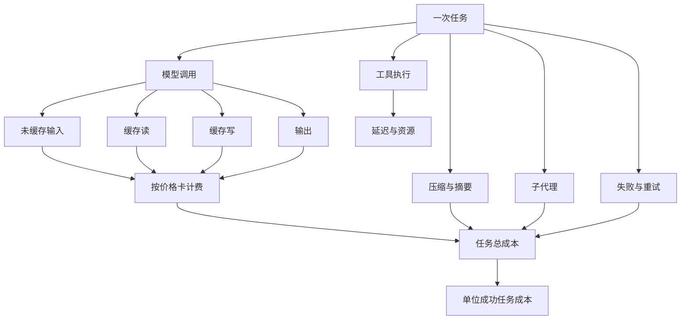
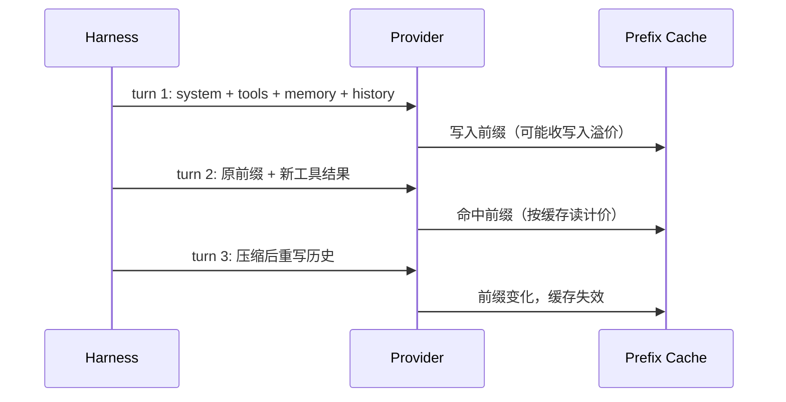

# 第 16 章 成本与延迟优化

## 本章导读

一个编码 Agent 上线后，单次任务均价 0.12 美元，看起来可控；但 5% 的长任务消耗了 40% 的预算，一次失败重试就把省下的模型差价赔回去。团队把系统提示词改成动态注入后，缓存命中率从 72% 掉到 3%，延迟随之翻倍。本章要解决的，就是把这些看似零散的数字，变成 Harness 可以控制和验证的工程指标。

## 学习目标

读完本章你将能够：

- 把 token、金钱与时间拆成可分别优化的三层成本，并用“单位成功任务成本”而不是单价做决策。
- 设计缓存友好的上下文前缀，识别常见的前缀失效源，并计算缓存写入与读取的盈亏平衡点。
- 实现确定性的模型路由，区分粘性策略与逐轮策略，规划升级与降级边界。
- 用预留、结算与归还管理任务预算，避免并行子任务同时透支。
- 用关键路径而不是平均值分析延迟，判断并行、缓存与预热各自能省下多少。

## 16.1 成本是一本账，不是一张价目表

模型厂商给的是**价目表**，Harness 需要的是**账本**。价目表只说明“每百万 token 多少钱”，账本还要回答：这次任务调用了多少次、每次带了多少上下文、多少调用被重试、多少上下文被压缩、多少子代理在并行烧钱、缓存命中还是失效。两个使用同一模型的 Agent，任务成本可能相差一个数量级，差别不在单价，而在账本结构。

先看一个典型编码任务的成本构成：



这张图里有两个容易被忽略的乘数。

第一，**失败会放大一切**。一次失败的任务不只浪费最后一次调用，而是浪费从第一步到失败点的全部输入、全部工具观察、全部重试。如果失败后换模型重跑，还要再付一次完整上下文。便宜模型如果成功率低 10 个百分点，省下的单价很可能被重试吃掉。

第二，**辅助调用不是零头**。压缩摘要、标题生成、提交信息、子代理简报、评测打分，都是真实的模型调用。它们单次不贵，但在长任务里调用频次高，而且常常被排除在“主模型预算”之外，最后变成账外支出。

因此本章统一使用两个指标：

- **单位成功任务成本（Cost per Successful Task）**：任务总成本除以成功任务数。失败的、被取消的、被人拒绝的任务，成本都要计入分母之前的总成本。
- **单位成功任务延迟**：从用户提交到任务通过外部验证的墙钟时间，分别看 p50 与 p95。流式输出改善的是首 Token 延迟，不是完成时间。

这两个指标把“优化”从调参变成可验证的工程问题。降低单价、减少轮次、提高缓存命中率、并行工具、提前停止，都是候选手段；是否真的更优，要看它们对单位成功任务成本、延迟与成功率的影响。第 15 章的评测包已经把成本字段接进结果记录，本章补上产生这些字段的核算层。


**不要用降低质量换成本。** 成本优化的约束条件永远是成功率、安全事件与延迟 SLO。一个更便宜但更容易失败的配置，会把成本转移到重试、人工排障与用户流失上，账本上反而更贵。


## 16.2 Prompt Caching：把稳定前缀变成资产

Prompt Caching（提示词缓存）的机制可以概括为一句话：**厂商缓存的是精确匹配的 token 前缀（Cache Prefix），命中后按更低的缓存读（Cache Read）价格计费，并跳过大部分预填充计算**。对 Agent 来说，这几乎是量身定制的优化，因为 Agent 的上下文天然具有“稳定头部 + 追加尾部”的结构。

一次典型的 Agent 轮次里，系统提示词、工具 Schema、项目记忆在会话内基本不变；历史消息只在尾部追加；工具结果、状态块、当前轮指令逐轮变化。如果把这些内容按稳定性排序，缓存就能跨轮复用：



但缓存有一个残酷的性质：**前缀里任何一位变化，从变化点之后全部失效**。这就是**前缀失效（Prefix Invalidation）**。最常见的失效源不在模型，而在 Harness 自己的拼接顺序：

- 系统提示词里放了当前时间、随机 session id、请求 id。
- 工具定义按字典序或注册顺序漂移，今天 `read_file` 在前，明天 `write_file` 在前。
- 把逐轮变化的状态块、TODO 列表、当前时间插在工具定义之前。
- 每轮重新生成项目记忆摘要，哪怕内容相同，字节也不同。
- 压缩改写了历史中段，导致后面的全部前缀变化。
- 切换到另一个模型；缓存通常按模型隔离，换模型等于重新开始。

这些问题的共同点是：**变化本身未必有错，错的是变化的位置**。把易变内容移到尾部，把稳定内容固定在头部，命中率就会从个位数回到几十个百分点。

### 16.2.1 缓存不是免费的

缓存写入（Cache Write）通常比普通输入更贵，缓存读取才更便宜。是否值得，要做盈亏平衡计算。假设某模型未缓存输入价格为 `P`，缓存写价格为 `1.25P`，缓存读价格为 `0.1P`，一个长度为 `N` 的前缀被复用 `k` 次：

- 不缓存：`k × N × P`
- 缓存：`N × 1.25P + (k - 1) × N × 0.1P`
- 盈亏平衡：`1.25 + 0.1(k - 1) < k`，即 `k > 1.28`

也就是说，前缀至少要被复用两次，缓存才开始回本。复用次数越多，收益越接近 90%。这解释了两个工程现象：短会话里激进缓存可能亏钱；长任务、子任务复用同一前缀时，缓存是最大的单项优化。

具体倍率、有效期、最小可缓存长度与计费口径因厂商而异，必须以官方文档为准。本书代码里的价格是演示值，不是任何厂商的报价。


**缓存也涉及数据边界。** 前缀可能包含项目代码、内部文档与用户数据。启用缓存前要确认厂商的存储位置、保留期与隔离策略；不要把密钥、个人数据或受监管内容放进可缓存前缀，除非合规明确允许。


### 16.2.2 缓存友好的上下文布局

把上下文按稳定性分成三层，并固定顺序：

1. **static**：系统提示词、工具 Schema、输出格式约定、安全边界。整个部署周期不变。
2. **session**：项目记忆、权限档、模型配置、会话级约束。一次会话内不变。
3. **turn**：当前状态块、最近工具结果、TODO、用户本轮输入。每轮可变。

拼接时永远按 `static → session → turn` 排列，且同一层内部保持确定顺序。不要按“重要性”排序，也不要让某个中间件在头部插入动态字段。用一个**前缀指纹（Prefix Fingerprint）**把这件事变成可测试的约束：对稳定段做哈希，指纹变化就意味着缓存失效，应该在测试与发布检查里显式暴露。

| 方案 A：缓存友好布局 | 方案 B：按语义动态拼接 |
|---|---|
| 稳定段固定在前，逐轮内容追加在尾部 | 按当前任务需要，把最相关内容放最前 |
| 缓存命中率高，长任务成本显著下降 | 每次上下文更“贴身”，单轮相关性可能更好 |
| 需要约束中间件不得在头部插入动态字段 | 实现自由，但难以预测命中率 |
| 适合长会话、多轮 Agent、重复子任务 | 适合一次性问答、短会话、强个性化场景 |
| 代价：布局僵化，新增动态段要重新设计 | 代价：缓存基本失效，成本与延迟随轮次上升 |

选择并不绝对。短会话、单次调用、对上下文顺序极敏感的任务，可以接受低命中率；长任务与高频复用场景，应把缓存友好作为硬约束。

## 16.3 模型路由：让合适的模型做合适的阶段

模型路由（Model Routing）是在任务执行过程中选择不同模型层级（Model Tier）的策略。常见分层是：

- **small**：便宜、快，适合探索、分类、摘要、格式化。
- **standard**：日常编辑与验证，能力与成本平衡。
- **strong**：复杂推理、跨文件修改、破坏性操作前的复核。

路由不是“能便宜就便宜”，而是**在质量约束下选择最低足够层级**。判断依据通常有四类：

1. **阶段**：只读探索、摘要、标题生成可以用小模型；复杂编辑与验证用标准或强模型。
2. **风险**：破坏性、外部副作用操作应由更强模型复核，且不能因为省钱跳过审批。
3. **上下文长度**：先按上下文窗口过滤，再在能容纳的模型里选最便宜的。
4. **失败历史**：同类失败达到阈值后升级，而不是在同一层反复重试。

### 16.3.1 粘性路由与逐轮路由

| 方案 A：粘性路由（Sticky Routing） | 方案 B：逐轮路由（Per-turn Routing） |
|---|---|
| 选定后整个任务沿用，只在升级或阶段边界切换 | 每一轮根据阶段、长度、失败数重新选择 |
| 缓存前缀稳定，行为风格一致，便于复现 | 每轮都可能更“最优”，成本曲线更细 |
| 失败后可能在同一层停留过久 | 失败后容易快速换层，但也可能来回抖动 |
| 适合长任务、需要连续编辑的场景 | 适合短任务、阶段差异极大的流水线 |
| 代价：阶段变化时不够灵活 | 代价：切换带来缓存失效、风格漂移与额外验证成本 |

生产系统通常采用“**粘性 + 受控切换**”：默认粘住当前模型；只有在外部验证失败、上下文超出窗口、风险等级变化或进入独立的辅助阶段时才切换。切换必须记录原因，并被视为一次成本事件，因为它会让缓存前缀失效。

升级（Escalation）要基于**外部证据**，不是模型自述。工具失败、测试失败、Schema 校验失败、连续无进展，都可以触发升级；模型说“我需要更强模型”只能作为参考。降级（Downgrade）则更保守：只在任务边界、辅助调用或明确低风险阶段降级，不在一个连续编辑过程中来回跳。


**路由决策属于追踪的一部分。** 每次选择应记录 `model`、`tier`、`reason`、`switched`、`escalated` 与当时的 `prompt_tokens`。第 14 章的 Span 可以直接承载这些字段。没有记录的路由，无法解释成本变化，也无法在评测中复现。


## 16.4 预算控制：预扣、结算与归还

第 2 章已经把预算拆成轮数、Token、金额、时间与单次观察长度五个维度，这里不再重复清单。本节解决的是落地问题：**如何在并发执行中，保证预算不被透支，同时不因为估算偏差误杀正常任务**。

只在调用后检查用量是不够的。模型调用是异步的，工具是并行的，子代理可能同时派发；如果每个执行单元都先看到“还有余额”再一起花钱，最后一定超支。正确的做法是三步：

1. **预扣（Budget Reservation）**：调用前按“最坏情况”申请额度。输入 token 用当前上下文的估算上限，输出 token 用 `max_tokens` 或输出预算上限。
2. **结算（Budget Settlement）**：拿到厂商 `usage` 后按实际用量结算，多退少补。实际低于预扣就归还差额；实际高于预扣就记一次 overrun，并触发停止或告警。
3. **归还（Budget Release）**：取消、超时、审批拒绝时主动释放未使用的预扣，避免额度被僵尸请求占住。

| 方案 A：调用前预扣 + 调用后结算 | 方案 B：调用后按实际用量记账 |
|---|---|
| 并发安全，能防止多个子任务同时透支 | 实现简单，无预扣簿记 |
| 预估偏差会短暂占用额度，需要合理的上限估计 | 额度利用率高，不会误伤正常任务 |
| 超支在结算时暴露，可立即停止后续调用 | 超支往往在账单出来后才被发现 |
| 适合多子代理、并行工具、长任务 | 适合单线程、短会话、成本不敏感场景 |
| 代价：需要维护预扣生命周期与取消清理 | 代价：无法做硬预算，事故成本高 |

预扣的关键不是精确，而是**偏保守且可结算**。输入按估算上限、输出按上限预扣，结算时退还差额；这样正常任务不会被误杀，异常任务也不会悄悄超支。若预扣本身就被拒绝，应返回类型化错误并让 Harness 选择压缩、降级或停止，而不是静默截断上下文。静默截断会破坏任务语义，省下的钱会在失败重试里加倍还回去。

预算作用域也要分清：

- **任务级**：用户可见的一次任务，硬上限。
- **会话级**：跨任务的累计上限，防止一个会话无限续跑。
- **子代理级**：父预算的份额，必须在派发时预扣，结束时归还未用部分。
- **辅助调用级**：摘要、标题、评测单独记账，避免挤占主任务预算。

第 9 章留下的“预算预留与归还”问题，在这里落地为账本；具体份额算法可以按任务类型配置，但**预扣发生在派发时、结算发生在返回时、取消必须归还**这三条不能省。

## 16.5 延迟：看关键路径，不看平均值

延迟优化最常见的错误，是拿单次模型调用的平均耗时做决策。用户感知的是整个任务的墙钟时间，而墙钟时间由关键路径（Critical Path）决定：并行的步骤只取最慢的一条，串行的步骤全部相加，审批和重试会把路径拉长。

把一次 Agent 执行拆成以下阶段：

- **冷启动**：创建沙箱、加载镜像、拉取依赖。可通过预热池降低。
- **排队**：限流、并发争用、供应商侧排队。
- **预填充**：处理输入 token，决定首 Token 延迟（Time to First Token，TTFT）。缓存命中会显著缩短。
- **解码**：逐 token 生成输出，受输出长度与模型速度影响。
- **工具**：读写文件、运行命令、网络请求。读操作可并行，写操作通常串行。
- **审批**：等待人工确认。常被忽略，却可能是长尾的主要来源。
- **重试与退避**：失败后的等待与重新预填充。

并行工具调用的收益，本质是把“所有工具耗时之和”变成“每组最慢工具耗时之和”。假设一组读操作分别耗时 200ms、900ms、300ms，另一组写操作 150ms：

- 串行：`200 + 900 + 300 + 150 = 1550ms`
- 并行：`max(200, 900, 300) + 150 = 1050ms`
- 节省：`500ms`

但如果其中一个读操作需要审批，审批等待就会成为该组的关键路径；此时并行其余读操作只能节省工具执行时间，省不下审批时间。优化的顺序应该是：先消除不必要的审批与重试，再并行只读操作，最后才考虑更快的模型。

| 方案 A：串行执行工具 | 方案 B：并行执行只读工具 |
|---|---|
| 顺序确定，易于调试与审计 | 关键路径缩短，长尾更可控 |
| 写操作不会互相覆盖 | 必须按 `parallel_safe` 分组，写操作仍需串行 |
| 审批可以逐条展示，但总等待时间长 | 审批可能成为新的瓶颈，需要批量或预授权 |
| 适合副作用强、依赖顺序的任务 | 适合调查、检索、多文件读取 |
| 代价：多工具任务延迟线性累加 | 代价：并发限流、结果保序、部分失败处理更复杂 |


**p50 可以相加做规划，p95 不可以。** 本章的延迟模型是确定性的规划工具，不是统计保证。尾延迟受排队、重试、供应商抖动影响，必须用真实追踪数据校准；不要把几个 p95 相加当成任务 p95。


对冲请求（Hedged Request）是另一种尾延迟手段：主请求超过某个分位后，向另一个模型或副本再发一份，谁先返回用谁，并取消另一份。它能把 p99 拉低，但正常情况下成本翻倍，只适合只读、可取消、对延迟极敏感的场景；写操作与计费敏感场景不应默认启用。

## 16.6 设计权衡：成本、延迟、质量与安全互相拉扯

前面几节分别讨论了缓存、路由、预算与并行。实际系统里，它们会互相抵消，需要放在一张表里看：

| 手段 | 降低成本 | 降低延迟 | 主要代价 | 适用边界 |
|---|---|---|---|---|
| 稳定前缀 + Prompt Caching | 显著，复用越多越明显 | 降低预填充与 TTFT | 布局僵化，写入溢价，数据边界 | 长会话、多轮、重复子任务 |
| 小模型路由 | 显著 | 通常更快 | 成功率下降，可能增加重试 | 探索、摘要、低风险编辑 |
| 模型升级 | 可能降低总成本（少重试） | 可能更慢 | 单价高，缓存失效 | 已验证的复杂失败 |
| 预扣预算 | 防止超支 | 无直接收益 | 簿记复杂，预扣偏差 | 并发、多子代理、硬预算 |
| 并行只读工具 | 不直接省钱 | 缩短关键路径 | 并发限流、结果保序 | 调查、检索、多文件读取 |
| 压缩上下文 | 降低输入成本 | 降低预填充 | 摘要调用成本，信息损失 | 接近窗口上限的长任务 |
| 预热沙箱 | 无 | 降低冷启动 | 资源闲置成本 | 高频短任务、交互式场景 |

优化顺序建议是：**先建立账本与追踪，再消除浪费，最后才做精细调参**。没有账本，你无法知道钱花在哪；没有追踪，你无法知道延迟卡在哪；没有评测，你无法知道优化是否牺牲了成功率。第 14 章的追踪与第 15 章的评测，是本章的前置条件，不是可选项。

## 16.7 代码实践：MiniCoder 的成本核算层

新增模块位于 `code/python/minicoder/cost.py` 与 `code/typescript/minicoder/src/cost.ts`，演示入口是 `cost_demo.py` / `cost_demo.ts`。它只做加法：不修改 `Provider`、`Usage`、`HarnessConfig` 等既有接口，通过适配函数把厂商用量转成成本账本需要的形状。

设计要点：

- 金额统一用**整数微美元**（1e-6 美元）计算，避免浮点累计误差；两语言使用相同的半向上取整。
- `CostUsage` 把未缓存输入、缓存读、缓存写与输出分开；厂商若把缓存作为 `prompt_tokens` 的子集上报，适配器要先归一化，不能直接相加。
- `BudgetLedger` 维护已用、已预扣与开放预扣；`reserve` 失败抛类型化 `BudgetExceeded`，`settle` 返回正数退款或负数超支。
- `Router` 是纯规则、确定性的；`switches` 只统计模型变化，便于把“缓存失效次数”与成本关联。
- `plan_cache` 把稳定段排到最前，同时计算“未重排时”的可缓存长度，暴露动态内容插在前缀中间的代价。
- `CacheStats` 用累计口径计算节省；首轮缓存写入可能为负，这不是 bug，而是写入溢价。
- `latency_breakdown` 按组取最大值，输出串行与并行两条关键路径。

### 16.7.1 用量与价格卡（Price Card）



```python
@dataclass(frozen=True)
class CostUsage:
    """归一化用量：未缓存输入、缓存读、缓存写与输出分开计费。"""

    input_tokens: int = 0
    cache_read_tokens: int = 0
    cache_write_tokens: int = 0
    output_tokens: int = 0

    @classmethod
    def from_usage(
        cls, usage: Usage, *, cache_read: int = 0, cache_write: int = 0
    ) -> "CostUsage":
        return cls(usage.input_tokens, cache_read, cache_write, usage.output_tokens)

    @property
    def prompt_tokens(self) -> int:
        return self.input_tokens + self.cache_read_tokens + self.cache_write_tokens

    @property
    def total_tokens(self) -> int:
        return self.prompt_tokens + self.output_tokens

    def __add__(self, other: "CostUsage") -> "CostUsage":
        return CostUsage(
            self.input_tokens + other.input_tokens,
            self.cache_read_tokens + other.cache_read_tokens,
            self.cache_write_tokens + other.cache_write_tokens,
            self.output_tokens + other.output_tokens,
        )


@dataclass(frozen=True)
class PriceCard:
    """单个模型的价格与容量；价格为每百万 token 的微美元数。"""

    model: str
    input_micro_per_mtok: int
    output_micro_per_mtok: int
    cache_read_micro_per_mtok: int
    cache_write_micro_per_mtok: int
    latency_p50_ms: int = 0
    context_window: int = 200_000

    def _micros(self, numerator: int) -> int:
        # 四舍五入到整数微美元；两语言使用相同的半向上取整。
        return (numerator + MTOK // 2) // MTOK

    def cost_micros(self, usage: CostUsage) -> int:
        numerator = (
            usage.input_tokens * self.input_micro_per_mtok
            + usage.cache_read_tokens * self.cache_read_micro_per_mtok
            + usage.cache_write_tokens * self.cache_write_micro_per_mtok
            + usage.output_tokens * self.output_micro_per_mtok
        )
        return self._micros(numerator)

    def uncached_cost_micros(self, usage: CostUsage) -> int:
        numerator = (
            usage.prompt_tokens * self.input_micro_per_mtok
            + usage.output_tokens * self.output_micro_per_mtok
        )
        return self._micros(numerator)

    def savings_micros(self, usage: CostUsage) -> int:
        """相对“全部输入按未缓存价”的差额；缓存写入回合可能为负。"""
        return self.uncached_cost_micros(usage) - self.cost_micros(usage)
```


```typescript
export class CostUsage {
  input_tokens: number;
  cache_read_tokens: number;
  cache_write_tokens: number;
  output_tokens: number;

  constructor(
    input_tokens = 0,
    cache_read_tokens = 0,
    cache_write_tokens = 0,
    output_tokens = 0,
  ) {
    this.input_tokens = input_tokens;
    this.cache_read_tokens = cache_read_tokens;
    this.cache_write_tokens = cache_write_tokens;
    this.output_tokens = output_tokens;
  }

  get prompt_tokens(): number {
    return this.input_tokens + this.cache_read_tokens + this.cache_write_tokens;
  }

  get total_tokens(): number {
    return this.prompt_tokens + this.output_tokens;
  }

  add(other: CostUsage): CostUsage {
    return new CostUsage(
      this.input_tokens + other.input_tokens,
      this.cache_read_tokens + other.cache_read_tokens,
      this.cache_write_tokens + other.cache_write_tokens,
      this.output_tokens + other.output_tokens,
    );
  }
}

export class PriceCard {
  model: string;
  input_micro_per_mtok: number;
  output_micro_per_mtok: number;
  cache_read_micro_per_mtok: number;
  cache_write_micro_per_mtok: number;
  latency_p50_ms: number;
  context_window: number;

  constructor(
    model: string,
    input_micro_per_mtok: number,
    output_micro_per_mtok: number,
    cache_read_micro_per_mtok: number,
    cache_write_micro_per_mtok: number,
    latency_p50_ms = 0,
    context_window = 200_000,
  ) {
    this.model = model;
    this.input_micro_per_mtok = input_micro_per_mtok;
    this.output_micro_per_mtok = output_micro_per_mtok;
    this.cache_read_micro_per_mtok = cache_read_micro_per_mtok;
    this.cache_write_micro_per_mtok = cache_write_micro_per_mtok;
    this.latency_p50_ms = latency_p50_ms;
    this.context_window = context_window;
  }

  private micros(numerator: number): number {
    return Math.floor((numerator + MTOK / 2) / MTOK);
  }

  costMicros(usage: CostUsage): number {
    return this.micros(
      usage.input_tokens * this.input_micro_per_mtok +
        usage.cache_read_tokens * this.cache_read_micro_per_mtok +
        usage.cache_write_tokens * this.cache_write_micro_per_mtok +
        usage.output_tokens * this.output_micro_per_mtok,
    );
  }

  uncachedCostMicros(usage: CostUsage): number {
    return this.micros(
      usage.prompt_tokens * this.input_micro_per_mtok +
        usage.output_tokens * this.output_micro_per_mtok,
    );
  }

  savingsMicros(usage: CostUsage): number {
    return this.uncachedCostMicros(usage) - this.costMicros(usage);
  }
}
```



### 16.7.2 预算账本（Budget Ledger）

`BudgetLedger` 的核心是预扣与结算。预扣按上限申请，结算按实际用量退还或记超支；`snapshot` 同时返回已用、剩余、拒绝数与超支数，方便在追踪与评测中直接读取。



```python
    def reserve(self, model: str, *, prompt_tokens: int, output_tokens: int) -> Reservation:
        if prompt_tokens < 0 or output_tokens < 0:
            raise ValueError("预扣 token 不能为负")
        card = self.catalog.get(model)
        cost = card.cost_micros(
            CostUsage(input_tokens=prompt_tokens, output_tokens=output_tokens)
        )

        checks = [
            ("cost", cost, self.budget.max_cost_micros - self.cost_used_micros - self._reserved_cost),
            (
                "prompt",
                prompt_tokens,
                self.budget.max_prompt_tokens - self.used.prompt_tokens - self._reserved_prompt,
            ),
            (
                "output",
                output_tokens,
                self.budget.max_output_tokens - self.used.output_tokens - self._reserved_output,
            ),
        ]
        for scope, requested, remaining in checks:
            if requested > remaining:
                self.rejected += 1
                raise BudgetExceeded(scope, requested, max(0, remaining))

        reservation = Reservation(self._next_id, model, prompt_tokens, output_tokens, cost)
        self._next_id += 1
        self._open[reservation.reservation_id] = reservation
        self._reserved_cost += cost
        self._reserved_prompt += prompt_tokens
        self._reserved_output += output_tokens
        return reservation

    def settle(self, reservation: Reservation, usage: CostUsage) -> int:
        """按实际用量结算，返回正数表示退还，负数表示超支。"""
        stored = self._open.pop(reservation.reservation_id, None)
        if stored is None:
            raise ValueError(f"预扣不存在或已结算：{reservation.reservation_id}")
        self._reserved_cost -= stored.cost_micros
        self._reserved_prompt -= stored.prompt_tokens
        self._reserved_output -= stored.output_tokens

        actual = self.catalog.get(reservation.model).cost_micros(usage)
        self.used = self.used + usage
        self.cost_used_micros += actual
        if actual > stored.cost_micros:
            self.overruns += 1
        return stored.cost_micros - actual
```


```typescript
  reserve(model: string, promptTokens: number, outputTokens: number): Reservation {
    if (promptTokens < 0 || outputTokens < 0) {
      throw new Error("预扣 token 不能为负");
    }
    const card = this.catalog.get(model);
    const cost = card.costMicros(new CostUsage(promptTokens, 0, 0, outputTokens));

    const checks: Array<[string, number, number]> = [
      ["cost", cost, this.budget.max_cost_micros - this.cost_used_micros - this.reservedCost],
      [
        "prompt",
        promptTokens,
        this.budget.max_prompt_tokens - this.used.prompt_tokens - this.reservedPrompt,
      ],
      [
        "output",
        outputTokens,
        this.budget.max_output_tokens - this.used.output_tokens - this.reservedOutput,
      ],
    ];
    for (const [scope, requested, remaining] of checks) {
      if (requested > remaining) {
        this.rejected += 1;
        throw new BudgetExceeded(scope, requested, Math.max(0, remaining));
      }
    }

    const reservation: Reservation = {
      reservation_id: this.nextId,
      model,
      prompt_tokens: promptTokens,
      output_tokens: outputTokens,
      cost_micros: cost,
    };
    this.nextId += 1;
    this.open.set(reservation.reservation_id, reservation);
    this.reservedCost += cost;
    this.reservedPrompt += promptTokens;
    this.reservedOutput += outputTokens;
    return reservation;
  }

  settle(reservation: Reservation, usage: CostUsage): number {
    const stored = this.open.get(reservation.reservation_id);
    if (stored === undefined) {
      throw new Error(`预扣不存在或已结算：${reservation.reservation_id}`);
    }
    this.open.delete(reservation.reservation_id);
    this.reservedCost -= stored.cost_micros;
    this.reservedPrompt -= stored.prompt_tokens;
    this.reservedOutput -= stored.output_tokens;

    const actual = this.catalog.get(reservation.model).costMicros(usage);
    this.used = this.used.add(usage);
    this.cost_used_micros += actual;
    if (actual > stored.cost_micros) this.overruns += 1;
    return stored.cost_micros - actual;
  }
```



### 16.7.3 模型路由

`Router.select` 先按上下文窗口找最小可容纳层级，再按风险、失败数与阶段决定目标；粘性策略下，当前模型能容纳就直接沿用。升级只会向上或保持，降级只发生在摘要等独立辅助阶段。



```python
    def select(self, request: RouteRequest, *, current_model: str = "") -> RouteDecision:
        fit = self._smallest_fit(request.prompt_tokens)
        current = self._index_of(current_model)
        escalated = False

        if request.risk in ("destructive", "external"):
            desired = len(self.tiers) - 1
            reason = f"risk:{request.risk}"
        elif request.failures >= self.hard_after:
            desired = len(self.tiers) - 1
            reason = f"escalation:failures={request.failures}"
            escalated = True
        elif request.failures >= self.escalate_after:
            desired = min(1, len(self.tiers) - 1)
            reason = f"escalation:failures={request.failures}"
            escalated = True
        elif request.phase == "summarize":
            desired = fit
            reason = "phase:summarize:cheapest-fit"
        elif self.policy == "sticky" and current >= 0 and current >= fit:
            tier = self.tiers[current]
            decision = RouteDecision(tier.model, tier.name, "sticky:current")
            self.decisions.append(decision)
            return decision
        else:
            desired = fit
            reason = "context:overflow" if fit > 0 else "base:cheapest-fit"

        desired = max(desired, fit)
        if (request.failures > 0 or request.risk in ("destructive", "external")) and current >= 0:
            desired = max(desired, current)

        tier = self.tiers[desired]
        decision = RouteDecision(
            tier.model,
            tier.name,
            reason,
            switched=bool(current_model) and tier.model != current_model,
            escalated=escalated,
        )
        if decision.switched:
            self.switches += 1
        self.decisions.append(decision)
        return decision
```


```typescript
  select(request: RouteRequest, currentModel = ""): RouteDecision {
    const fit = this.smallestFit(request.prompt_tokens);
    const current = this.indexOf(currentModel);
    const failures = request.failures ?? 0;
    let escalated = false;
    let desired: number;
    let reason: string;

    if (request.risk === "destructive" || request.risk === "external") {
      desired = this.tiers.length - 1;
      reason = `risk:${request.risk}`;
    } else if (failures >= this.hard_after) {
      desired = this.tiers.length - 1;
      reason = `escalation:failures=${failures}`;
      escalated = true;
    } else if (failures >= this.escalate_after) {
      desired = Math.min(1, this.tiers.length - 1);
      reason = `escalation:failures=${failures}`;
      escalated = true;
    } else if (request.phase === "summarize") {
      desired = fit;
      reason = "phase:summarize:cheapest-fit";
    } else if (this.policy === "sticky" && current >= 0 && current >= fit) {
      const tier = this.tiers[current];
      const decision: RouteDecision = {
        model: tier.model,
        tier: tier.name,
        reason: "sticky:current",
        switched: false,
        escalated: false,
      };
      this.decisions.push(decision);
      return decision;
    } else {
      desired = fit;
      reason = fit > 0 ? "context:overflow" : "base:cheapest-fit";
    }

    desired = Math.max(desired, fit);
    if ((failures > 0 || request.risk === "destructive" || request.risk === "external") && current >= 0) {
      desired = Math.max(desired, current);
    }

    const tier = this.tiers[desired];
    const decision: RouteDecision = {
      model: tier.model,
      tier: tier.name,
      reason,
      switched: currentModel !== "" && tier.model !== currentModel,
      escalated,
    };
    if (decision.switched) this.switches += 1;
    this.decisions.push(decision);
    return decision;
  }
```



### 16.7.4 缓存前缀计划

`plan_cache` 做两件事：按 `static → session → turn` 重排，并计算重排前后的可缓存长度。`naive_tokens` 是“不改顺序、遇到第一个动态段就断”的长度；它和 `cacheable_tokens` 的差距，就是动态内容插错位置付出的代价。



```python
def plan_cache(sections: Sequence[PrefixSection]) -> CachePlan:
    """把 static/session 段排到最前，计算可缓存前缀与指纹。

    naive_tokens 表示“不改顺序、遇到第一个 turn 段就断”的可缓存长度，
    用来暴露动态内容插在稳定前缀中间的代价。
    """
    for section in sections:
        if section.stability not in _STABILITY:
            raise ValueError(f"未知稳定性：{section.stability}")

    ordered = [
        section
        for _, section in sorted(
            enumerate(sections), key=lambda pair: (_STABILITY[pair[1].stability], pair[0])
        )
    ]
    cacheable: list[PrefixSection] = []
    for section in ordered:
        if section.stability == "turn":
            break
        cacheable.append(section)

    naive: list[PrefixSection] = []
    for section in sections:
        if section.stability == "turn":
            break
        naive.append(section)

    cacheable_text = "\n".join(section.text for section in cacheable)
    naive_text = "\n".join(section.text for section in naive)
    order = tuple(section.name for section in ordered)
    return CachePlan(
        order=order,
        cacheable_chars=len(cacheable_text),
        cacheable_tokens=estimate_tokens(cacheable_text),
        naive_tokens=estimate_tokens(naive_text),
        fingerprint=_fingerprint(cacheable),
        reordered=order != tuple(section.name for section in sections),
        volatile=tuple(section.name for section in sections if section.stability == "turn"),
    )
```


```typescript
export function planCache(sections: PrefixSection[]): CachePlan {
  for (const section of sections) {
    const stability = section.stability ?? "static";
    if (!(stability in STABILITY)) {
      throw new Error(`未知稳定性：${section.stability}`);
    }
  }

  const ordered = sections
    .map((section, index) => ({ section, index }))
    .sort((left, right) => {
      const delta =
        STABILITY[left.section.stability ?? "static"] -
        STABILITY[right.section.stability ?? "static"];
      return delta !== 0 ? delta : left.index - right.index;
    })
    .map((item) => item.section);

  const cacheable: PrefixSection[] = [];
  for (const section of ordered) {
    if ((section.stability ?? "static") === "turn") break;
    cacheable.push(section);
  }

  const naive: PrefixSection[] = [];
  for (const section of sections) {
    if ((section.stability ?? "static") === "turn") break;
    naive.push(section);
  }

  const cacheableText = cacheable.map((section) => section.text).join("\n");
  const naiveText = naive.map((section) => section.text).join("\n");
  const order = ordered.map((section) => section.name);
  return {
    order,
    cacheable_chars: cacheableText.length,
    cacheable_tokens: estimateTokens(cacheableText),
    naive_tokens: estimateTokens(naiveText),
    fingerprint: fingerprint(cacheable),
    reordered: order.join(" ") !== sections.map((section) => section.name).join(" "),
    volatile: sections
      .filter((section) => (section.stability ?? "static") === "turn")
      .map((section) => section.name),
  };
}
```



### 16.7.5 缓存节省与延迟分解（Latency Breakdown）

缓存节省按输入侧口径计算：以“全部 prompt 按未缓存价”为基线，减去实际的“未缓存 + 缓存读 + 缓存写”成本。首轮写入可能为负，累计到多轮后转正。延迟分解按组取最大值，组间串行。



```python
    def input_savings_micros(self, card: PriceCard) -> int:
        baseline = self.prompt_tokens * card.input_micro_per_mtok
        actual = (
            self.uncached_tokens * card.input_micro_per_mtok
            + self.read_tokens * card.cache_read_micro_per_mtok
            + self.write_tokens * card.cache_write_micro_per_mtok
        )
        return (baseline - actual + MTOK // 2) // MTOK


def latency_breakdown(
    *,
    cold_start_ms: int = 0,
    prefill_ms: int = 0,
    decode_ms: int = 0,
    approval_ms: int = 0,
    tool_groups: Sequence[Sequence[int]] = (),
) -> LatencyBreakdown:
    """p50 规划模型：每组工具并行，组间串行；不是 p95 的统计保证。"""
    parallel = sum(max(group) for group in tool_groups if group)
    serial = sum(sum(group) for group in tool_groups)
    return LatencyBreakdown(
        cold_start_ms=cold_start_ms,
        prefill_ms=prefill_ms,
        decode_ms=decode_ms,
        approval_ms=approval_ms,
        tool_parallel_ms=parallel,
        tool_serial_ms=serial,
    )
```


```typescript
  inputSavingsMicros(card: PriceCard): number {
    const baseline = this.prompt_tokens * card.input_micro_per_mtok;
    const actual =
      this.uncached_tokens * card.input_micro_per_mtok +
      this.read_tokens * card.cache_read_micro_per_mtok +
      this.write_tokens * card.cache_write_micro_per_mtok;
    return Math.floor((baseline - actual + MTOK / 2) / MTOK);
  }
}

export function latencyBreakdown(options: {
  cold_start_ms?: number;
  prefill_ms?: number;
  decode_ms?: number;
  approval_ms?: number;
  tool_groups?: number[][];
}): LatencyBreakdown {
  const groups = options.tool_groups ?? [];
  let parallel = 0;
  let serial = 0;
  for (const group of groups) {
    if (group.length === 0) continue;
    parallel += Math.max(...group);
    serial += group.reduce((total, value) => total + value, 0);
  }
  return new LatencyBreakdown(
    options.cold_start_ms ?? 0,
    options.prefill_ms ?? 0,
    options.decode_ms ?? 0,
    options.approval_ms ?? 0,
    parallel,
    serial,
  );
}
```



### 16.7.6 运行与输出

```bash
cd code/python && python3 -m minicoder.cost_demo
cd code/typescript && node minicoder/src/cost_demo.ts
```

两版输出逐行一致：

```text
== MiniCoder cost ==
price     mini-1         in=$0.25 out=$1.00 read=$0.03 write=$0.31 /Mtok
price     standard-1     in=$3.00 out=$15.00 read=$0.30 write=$3.75 /Mtok
price     strong-1       in=$15.00 out=$75.00 read=$1.50 write=$18.75 /Mtok
usage     prompt=10000 uncached=8200 read=1200 write=600 output=900
cost      mini-1         actual=$0.003172 uncached=$0.003400 savings=$0.000228
budget    max_cost=$0.030000 max_prompt=40000 max_output=5000
reserve   mini-1 id=1 cost=$0.003700
settle    actual=$0.003172 refund=$0.000528
remaining cost=$0.026828 prompt=30000 output=4100
denied    strong-1 scope=cost requested=$1.020000 remaining=$0.026828
route     policy=sticky escalate_after=1 hard_after=3
route     t1 explore   f=0 p=20000  -> mini-1       switched=false reason=base:cheapest-fit
route     t2 edit      f=0 p=22000  -> mini-1       switched=false reason=sticky:current
route     t3 edit      f=1 p=24000  -> standard-1   switched=true  reason=escalation:failures=1
route     t4 edit      f=0 p=90000  -> standard-1   switched=false reason=sticky:current
route     t5 edit      f=4 p=140000 -> strong-1     switched=true  reason=escalation:failures=4
route     t6 edit      f=0 p=30000  -> strong-1     switched=false reason=risk:destructive
route     t7 summarize f=0 p=9000   -> mini-1       switched=true  reason=phase:summarize:cheapest-fit
route     t8 explore   f=0 p=150000 -> strong-1     switched=true  reason=context:overflow
route     switches=4
cache     good  naive=590 stable=590 reordered=false fp=888509f522561377
cache     bad   naive=279 stable=590 reordered=true  fp=888509f522561377
cache     static-changed fp_changed=true
cache     volatile-changed fp_changed=false
cache     t1 write=590   read=0     savings=-35 cumulative=-35
cache     t2 write=0     read=590   savings=129 cumulative=94
cache     t3 write=0     read=590   savings=130 cumulative=224
latency   ttft=1400ms total_parallel=4050ms total_serial=4550ms saved=500ms
latency   tools parallel=1050ms serial=1550ms approval=400ms decode=1200ms
report    mini-1         turns=1 prompt=10000  output=900   cost=$0.003172 savings=$0.000228
report    standard-1     turns=1 prompt=8000   output=800   cost=$0.030600 savings=$0.005400
report    total cost=$0.033772 per_success=$0.033772 successes=1
```

逐段解读：

- **`cost`**：同样 10000 个 prompt token，未缓存要 $0.003400，缓存混合后 $0.003172，省 $0.000228。节省比例不高，是因为写入 600 token 付了溢价；复用轮次越多，比例越接近缓存读折扣。
- **`reserve/settle`**：预扣按 10000 输入 + 1200 输出算出 $0.003700，实际只用了 900 输出，退还 $0.000528。预扣偏保守是刻意设计，目的不是精确，而是并发安全。
- **`denied`**：向 `strong-1` 预扣 38000 输入 + 6000 输出需要 $1.020000，超过剩余 $0.026828，账本直接拒绝。硬预算在调用前生效，不会先花再报错。
- **`route`**：前两轮粘在 `mini-1`；第 3 轮一次失败升级到 `standard-1`；第 5 轮四次失败升到 `strong-1`；破坏性操作强制最强模型；摘要轮降回小模型；150k 上下文无法被小模型容纳，触发 `context:overflow`。全程 4 次切换，每次切换都意味着缓存前缀失效，应计入成本。
- **`cache`**：正确顺序下可缓存 590 token；把 `state` 插到 `tools` 前面后，未重排只能缓存 279 token，但重排后仍是 590，指纹也一致。改静态段指纹变化，改动态段指纹不变，说明前缀计划把“该失效”和“不该失效”分开了。
- **`cache t1-t3`**：首轮写入亏 35 微美元，第二轮转正 129，第三轮累计 224。缓存不是首轮就赚，而是重复复用才赚。
- **`latency`**：TTFT 1400ms；工具串行 1550ms，并行后 1050ms；总耗时从 4550ms 降到 4050ms，节省 500ms。
- **`report`**：不同模型分别记账，总成本 $0.033772；成功 1 次，单位成功任务成本相同。若成功 0 次，分母为 0，报告应显示不可计算，而不是 0。

## 16.8 业界案例：Aider 的主模型、弱模型与缓存开关

Aider 是一个开源的终端编码助手，它的成本控制做法值得借鉴，因为它把三类杠杆都做成了显式配置，而不是藏在代码里：

- **主模型与弱模型分工**。Aider 允许配置一个能力更强的主模型负责代码修改，再用一个更便宜的弱模型处理提交信息、摘要等辅助任务。这类辅助调用频次高、质量要求相对低，单独路由能显著压低账本，同时不牺牲主任务质量。
- **仓库地图的 token 预算**。Aider 的仓库地图不是把所有文件都塞进上下文，而是在预算内选择相关定义与引用。它把“上下文选择”与“成本上限”绑定，避免随着仓库变大而线性烧钱。
- **Prompt Caching 开关**。Aider 提供显式的缓存配置，让用户按供应商与工作流决定是否启用。这与本章的建议一致：缓存不是默认免费的，短会话或缓存语义不匹配时，启用反而可能亏钱，应该可观测、可关闭。

这三点对应本章的三层账本：辅助调用用弱模型控制单次价格，仓库地图预算控制 token 数量，缓存开关控制输入计费结构。它们共同说明一个原则：**成本控制应该是配置与策略，不是散落在代码里的临时判断**。

具体参数、默认值与支持范围随版本变化，以 Aider 官方文档为准。本书不复述某一版本的命令行细节，只讨论其设计取舍。

## 16.9 常见陷阱

**1. 只看单价，不看单位成功任务成本。** 便宜模型如果多两轮重试，总成本可能高过强模型一次做对。决策指标应该是 `总成本 / 成功任务数`，并把失败、取消、人工介入都算进总成本。

**2. 把动态内容插在稳定前缀前面。** 当前时间、状态块、TODO、随机 id 放在系统提示词或工具定义之前，会让缓存从第一个动态字段起全部失效。用前缀指纹做发布检查，比事后看命中率更早发现问题。

**3. 预算只在调用后检查。** 并行子代理与并行工具会同时看到“还有余额”，然后一起超支。预扣必须发生在派发前，取消必须归还，结算必须按厂商 `usage` 而不是本地估算。

**4. 路由逐轮抖动。** 每轮按瞬时信号切换模型，会造成缓存反复失效、风格不一致、验证成本上升。默认粘性，升级基于外部证据，降级限定在任务边界或独立辅助阶段。

**5. 把缓存写入当成免费。** 首轮写入可能比不缓存更贵；前缀复用不足两次时，缓存是负收益。短会话、一次性任务、频繁压缩的任务，要先算盈亏平衡再启用。

**6. 并行一切。** 写操作并行会互相覆盖，审批会变成串行瓶颈，供应商限流会让并发退化为重试。只并行声明了 `parallel_safe` 的只读工具，并给并发设上限。

## 16.10 本章小结

- 成本是一本账：看单位成功任务成本，而不是单价；失败、重试、压缩、子代理与审批等待都要入账。
- Prompt Caching 复用精确前缀；静态、会话、逐轮三层排序，任何前置变化都会让后缀失效。
- 缓存有写入溢价；前缀至少复用两次才回本，长任务与重复子任务收益最大。
- 模型路由默认粘性，按上下文窗口、风险与已验证失败升级；降级只在任务边界或辅助阶段。
- 预算用预扣、结算、归还管理；并发安全靠预扣，准确性靠厂商 `usage` 结算，取消必须归还。
- 延迟看关键路径：TTFT 与总耗时分开，并行只读工具缩短工具段，审批与重试常是真正的长尾。
- 优化顺序是先账本与追踪，再消除浪费，最后调参；没有评测约束的成本优化是在转移风险。

## 16.11 思考题

1. 你的任务 p50 成本是 $0.08，但 p95 是 $0.60。你会先优化哪一段：缓存命中率、模型路由、预算上限，还是压缩策略？需要哪些追踪字段才能判断？
2. 一个前缀在会话中平均被复用 1.6 次，缓存写入溢价是 1.25 倍，缓存读折扣是 0.1 倍。你会启用缓存吗？如果业务要求把复用次数提高到 3 次，你会改上下文布局还是改交互流程？
3. 路由策略把摘要调用降级到小模型后，单位成功任务成本下降了 15%，但人工抽检发现摘要遗漏了关键约束，导致后续轮次走错方向。你会如何修改路由规则与评测断言，既保留成本收益又不牺牲任务正确性？
