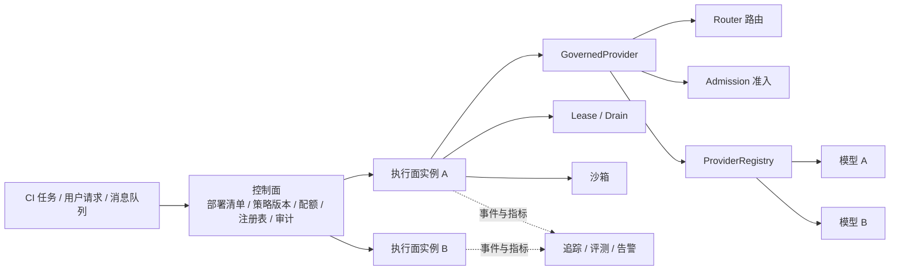

# 第 17 章 生产部署

## 本章导读

MiniCoder 在开发机上跑通，只说明它“能跑”。进入 CI、定时任务或多租户服务后，问题会换一组：谁允许它执行？并发打满时先拒绝谁？模型抖动时如何退避与切换？进程被回收时，正在执行的任务会不会重复写入？本章把第 11、13、14、16 章的能力装进一个可发布的部署单元，回答“如何让 Agent 在无人值守时仍然可控”。

## 学习目标

读完本章你将能够：

- 区分无头、服务与 worker 三种部署形态，划分控制面与执行面的职责。
- 把版本、策略、密钥、租户与预授权收敛为可校验、可回滚的部署清单。
- 用多 Provider 注册表与治理网关接入路由、重试、熔断、故障转移、预算结算与缓存归一化。
- 用准入控制实现并发、限流与预算，并解释预扣、结算、归还在并发下的正确性。
- 用租约、fencing token 与 drain 设计优雅停机，并为发布定义 SLO、灰度与运行手册。

## 17.1 从“能跑”到“可运营”

开发环境里的 Agent 是一个进程：读文件、调模型、跑测试，出错就人工看一眼。生产环境里的 Agent 是一个**服务**，它要回答四个开发阶段不必回答的问题。

1. **谁能触发它？** 是人类用户、CI 机器人，还是定时任务？不同主体有不同的权限、预算与审计要求。
2. **花谁的钱？** 一次任务的成本要记到租户、项目或工单上，而不是混在一张公司账单里。
3. **坏了怎么办？** 模型超时、供应商限流、沙箱崩溃、进程被回收，都是常态；系统要能重试、切换、停止与恢复。
4. **怎么证明没坏？** 成功率、延迟、成本、阻断率与重复执行率，必须持续可观测，否则“上线”只是把风险藏起来。

这四个问题把“部署”从打包发布变成了四件事的组合：**身份与策略、配额与成本、失败语义、可观测性**。本章的每一项机制都服务于其中之一。把它们拆开看会显得零散，合在一起才构成一个可运营的系统。



这张图里最重要的划线不是模块，而是**控制面与执行面的分离**。控制面持有部署清单、策略版本、租户配额与审计记录，是权威来源；执行面尽量无状态，只负责把一次任务跑完，并在退出前把状态交还。这样执行实例可以随时扩缩、替换与滚动更新，而不会带走唯一的配置或审计证据。


**“无状态”不等于“没有状态”。** 执行面仍然需要会话日志、沙箱工作区与任务租约，只是这些状态必须外置到数据库、对象存储或会话服务中，不能只活在进程内存里。判断标准是：实例被杀死后，另一个实例能否接管并得到一致结果。


## 17.2 部署形态：无头、服务与 worker

同一个 Harness 内核可以装成三种形态，区别不在代码，而在**触发方式、审批方式与生命周期**。

| 形态 | 触发方式 | 审批方式 | 生命周期 | 典型场景 |
|---|---|---|---|---|
| 无头（headless） | CI、定时任务、脚本 | 预授权或一律拒绝 | 一次性，退出即结束 | 代码检查、批量修复、定时报告 |
| 服务（service） | HTTP / WebSocket 请求 | 交互审批或异步回调 | 长驻，按会话隔离 | IDE 助手、内部平台、对外 API |
| worker | 队列消息 | 预授权或异步审批 | 长驻，按任务领取 | 大规模批处理、后台重构、评测执行 |

**无头模式**没有人在旁边点“允许”。它必须把审批前移到部署配置里：哪些工具、哪些目标、最高什么风险、有效期多长，全部显式声明；没有声明的一律拒绝。无头任务的输出应该是**退出码 + 工件 + 事件日志**，而不是一段需要人读的自然语言。

**服务模式**的关键是会话与隔离。每个会话绑定主体（principal）、租户（tenant）与预算；审批请求要能异步回传，支持超时、取消、断线重连与重复回调幂等。服务实例通常无状态，会话状态放在外部存储，这样才能水平扩展。

**worker 模式**的核心是任务所有权。队列通常是“至少一次”投递，同一个任务可能被两个 worker 同时拿到；因此需要租约（lease）与 fencing token，确保旧 worker 复活后不能继续写。滚动发布时还要 drain：停止领取新任务，等待在途任务结束，超过截止时间再强制终止。

三种形态可以共存：控制面统一管理清单与配额，无头任务与服务请求共用同一套治理网关，worker 用租约把长任务串起来。不要为每种形态各写一套权限与重试逻辑，那样三套行为迟早会分叉。

## 17.3 部署清单：版本、密钥与身份

生产部署的第一个工件不是镜像，而是**部署清单（Deployment Manifest）**。它回答“这次发布的到底是什么”：代码版本、部署形态、策略版本、密钥引用、租户列表、灰度比例，以及无头模式是否声明了预授权。

```text
DeploymentManifest
├── version                 代码与镜像版本，不可变
├── topology                headless / service / worker
├── policy_version          权限与配额策略版本
├── secret_refs             只允许 env: / vault: / file: 引用
├── tenants[]               每个租户的并发、速率、预算、沙箱作用域
├── canary_percent          灰度百分比
└── headless_preauthorized  无头模式是否显式声明预授权
```

清单校验的目标不是“尽量通过”，而是**尽可能早、尽可能稳定地失败**。`validate_manifest` 返回一组稳定的问题代码，例如 `policy-version`、`sandbox-scope:acme`、`secret-ref:literal-key`、`headless-preauth`；CI 直接以此作为发布门禁。问题代码必须稳定，因为告警、仪表盘与回滚脚本都会依赖它们；不要返回会随措辞变化的自然语言。

三条硬规则：

- **密钥只存引用。** 清单里出现 `literal-key` 这种明文，校验直接失败。密钥由运行环境注入，按最小权限授予，并支持轮换；清单只记录“从哪里取”，不记录“值是什么”。
- **策略有版本。** `policy_version` 变化意味着权限规则可能变化。正在运行的会话授权、预授权票据与审批缓存应按版本失效，重新审批；否则新策略发布后，旧任务仍按旧规则执行。
- **无头必须显式预授权。** `topology=headless` 却没有声明预授权，是配置错误，不是“运行时再问”。没有任何交互审批人时，默认动作只能是拒绝。

身份与租户是两个维度。**主体（principal）** 回答“是谁在操作”，可能是人类、服务账号或 CI 机器人；**租户（tenant）** 回答“资源记在谁头上”，决定并发、限流、预算与沙箱作用域。一个 CI 机器人可以代表多个租户执行任务，但每次执行必须明确当前租户，否则配额与审计无法归属。本章代码用字符串表达租户与主体，真实系统应把它们映射到 OIDC 声明或服务账号，并对审批人身份做验证；这部分是契约，不是本版实现。

沙箱作用域（`sandbox_scope`）也要写进清单：`task` 表示每个任务一个隔离环境，`session` 表示同一会话复用环境以保留缓存与构建产物。作用域越宽，复用收益越高，隔离边界越弱；不要用一个全局默认值掩盖这个选择。

## 17.4 模型接入：注册表与治理网关

第 16 章已经有了路由、预算与成本账本，但它们只是独立模块。生产路径需要一个地方把“选模型、做准入、调 Provider、失败处理、结算成本”串成一次调用。这个位置就是**治理网关（Governed Provider）**。

### 17.4.1 注册表：模型到 Provider 的映射

`ProviderRegistry` 把模型名映射到绑定（binding）。一个绑定包含 Provider 实例、它支持的模型列表、可选的故障转移模型，以及一个 `cache_reader` 适配函数。

- **模型名是路由的输出，也是调用的输入。** `Router` 选出 `mini-1`，网关就把 `model="mini-1"` 透传给 Provider，不改变既有的 `Provider.complete` 签名。
- **故障转移写在绑定里。** 例如 `mini-1` 的绑定声明 `standard-1` 作为后备；网关仍按注册表查找 `standard-1` 的 Provider，而不是硬编码供应商。
- **缓存字段由适配器归一化。** 各厂商对缓存命中、缓存写入的上报方式不同，有的放在独立字段，有的包含在 `prompt_tokens` 里。`cache_reader` 把响应转换成 `(cache_read, cache_write)`，再构造 `CostUsage`；既有的 `Usage` 仍然只有输入与输出两个字段，不需要为缓存改协议。
- **注册表在启动时校验。** 同一个模型重复注册、路由指向未注册模型，都应该在启动阶段失败，而不是等到第一次调用。

### 17.4.2 治理网关：一次调用的完整生命周期

`GovernedProvider` 实现既有 `Provider` 协议，因此对 MiniCoder 来说，它和普通 Provider 没有区别。一次调用依次经过：

1. **路由**：如果调用方指定了 `preferred_model`，就固定使用；否则交给 `Router` 按阶段、风险、上下文长度与失败数选择。
2. **确定候选**：首选模型 + 绑定声明的后备模型，去重后按顺序尝试。
3. **熔断检查**：每个模型一个熔断器；打开时不再调用上游，直接进入下一个候选。
4. **准入**：对当前模型做并发、限流与预算预扣；被拒绝时记录类型化原因。
5. **调用**：把 `model` 放进 options 透传给 Provider。
6. **失败分类**：可重试错误在模型内退避重试；不可重试错误直接进入故障转移；未知异常一律按不可重试处理。
7. **成功结算**：按实际 `usage` 结算预算、记录成本与缓存统计、关闭熔断器、写入事件。
8. **故障转移**：当前候选耗尽后，尝试下一个；租户级准入被拒绝时停止所有候选，因为换模型也解决不了配额问题。

这条链路有一个容易被忽略的顺序：**准入必须发生在调用前，且每次重试都要重新准入**。如果一次准入覆盖所有重试，失败重试就不会消耗新的预算与速率额度，账本会系统性偏低；反过来，如果在调用前只检查、不在返回后结算，预扣又会被僵尸请求永久占住。第 16 章讲过的预扣、结算、归还在网关里必须成对出现。

### 17.4.3 事件是部署的一部分

网关产出的不是一段日志，而是一组结构稳定的事件：`model_routed`、`admitted`、`attempt_failed`、`retry_scheduled`、`failover`、`breaker_open`、`admission_denied`、`call_succeeded`。这些事件至少有三个用途：

- **追踪**：第 14 章的 Span 直接消费路由原因、切换标记、重试次数与预留 ID。
- **评测**：第 15 章可以按事件统计单位成功任务成本、缓存命中率与故障转移频率。
- **告警**：`breaker_open` 与 `admission_denied` 的突增，通常比模型平均延迟更早反映问题。

没有事件，网关只是一个黑盒；有了事件，才能回答“为什么这一轮换了模型”“为什么这个租户被拒绝”。


**切换模型是一次成本事件。** 第 16 章讲过，缓存通常按模型隔离；切换到后备模型意味着前缀缓存失效、重新预填充，甚至风格漂移。故障转移应当记录 `from`、`to` 与原因，并在成本报告中单独观察，而不是把它当成“免费的高可用”。


## 17.5 多租户与配额：准入控制

多租户系统最常见的事故不是模型答错，而是**一个租户把共享资源打满**。配额要覆盖三个维度，且判定顺序要稳定：并发、速率、预算。

- **并发**：同一租户同时在跑的任务数。它防止单个租户占满连接池、沙箱池或工作线程。
- **速率**：单位时间内允许发起的请求数，用令牌桶实现。它防止瞬时突发压垮上游或触发供应商限流。
- **预算**：按 token 与金额的日预算。它防止“每个请求都不大，但一天下来费用失控”。

判定顺序建议是**并发 → 速率 → 预算**：前两者是廉价的内存检查，最后才做需要价格卡与账本的预扣。顺序本身也是契约，变更时必须同步修改文档与事件，否则告警口径会漂移。

限流与预算解决的是不同问题，不能互相替代。限流按**请求数**计，保护上游与服务自身；预算按 **token 与金额**计，保护钱包。一个请求可能很小但很频繁（限流先触发），也可能很少但上下文极长（预算先触发）。两层都要有。

| 方案 A：调用后按实际用量记账 | 方案 B：调用前准入 + 预扣，返回后结算 |
|---|---|
| 实现简单，无预留簿记 | 并发安全，多个任务不能同时透支同一份预算 |
| 额度利用率高，不会误伤正常任务 | 预估偏差会短暂占用额度，需要保守上限 |
| 超支在账单或轮询检查时才暴露 | 超支在准入阶段直接拒绝，可返回类型化原因 |
| 适合单线程、短会话、成本不敏感场景 | 适合多租户、并行子代理、硬预算场景 |
| 代价：无法阻止并发透支 | 代价：需要维护预留生命周期与取消清理 |

本章选择方案 B。实现上还有几个细节：

- **预扣按上限、结算按实际。** 输入按当前上下文估算，输出按 `output_tokens` 上限；结算时多退少补，正数是退款，负数是超支。
- **失败必须归还。** 调用抛错、超时、取消时，释放未使用的预扣；否则额度会被失败请求慢慢占满。
- **拒绝要类型化。** `concurrency`、`rate_limit`、`budget` 三种原因应分别返回，调用方据此决定排队、降级还是停止，而不是统一当成“失败重试”。
- **速率额度在预算拒绝时不退还。** 这是刻意的保守选择：请求已经到达网关并占用了判定资源，算作一次上游压力更安全。如果业务更在意公平性，也可以显式退还，但必须把策略写清楚。
- **预算周期是部署决策。** 固定日窗口、滚动窗口还是按任务生命周期，决定了边界时刻的突发行为；时钟来源必须统一，不能一部分用本地时间、一部分用数据库时间。

## 17.6 可靠性与恢复：重试、熔断、故障转移

模型调用失败不是异常，而是常态。可靠性设计的第一步不是“多试几次”，而是**把错误分类**。

- **可重试（transient）**：上游 5xx、连接重置、临时不可用。
- **限流（rate_limited）**：上游返回 429 或明确的重试等待时间。
- **超时（timeout）**：请求超过截止时间，通常可重试，但要避免写操作重复执行。
- **不可重试（permanent）**：模型下线、参数非法、鉴权失败、Schema 不兼容。
- **未知异常**：适配器没有归一化的错误，一律按不可重试处理。宁可快速失败并告警，也不要在不确定是否安全时反复重试。

**重试**使用指数退避加抖动。第 `n` 次重试的基础等待是 `base × 2^(n-1)`，再叠加一个抖动，避免大量实例在同一时刻同时重试形成风暴。本章演示使用确定性抖动，目的是让两语言输出可比、测试可复现；生产环境应给每个进程一个随机种子，否则“抖动”会退化成同步。上游返回了 `retry_after` 时，优先使用上游给出的等待时间。

**熔断**按模型隔离，状态机只有三个状态：

- **closed**：正常放行，累计连续失败。
- **open**：达到阈值后打开，冷却期内直接拒绝，不再调用上游。
- **half_open**：冷却结束后只放行一个试探请求；成功则回到 closed，失败立即重新打开。

熔断与重试解决不同问题：重试是“这一次再试”，熔断是“这一段时间别再试”。只有重试没有熔断，会在上游持续故障时把所有请求都变成重试风暴；只有熔断没有重试，又会把一次瞬时抖动直接放大成任务失败。两者要一起用。

**故障转移**在候选列表内进行。可重试错误先在同一模型内重试，耗尽后换下一个候选；不可重试错误直接换候选；租户级准入拒绝则停止全部候选。后备模型必须有独立的 Provider 绑定与熔断器，否则“切换”只是换个名字继续打同一个上游。

| 方案 A：进程内熔断与配额 | 方案 B：共享熔断与集中配额 |
|---|---|
| 无外部依赖，延迟低，实现简单 | 全局限流准确，实例间一致 |
| 每个实例各自计数，集群总量可能超标 | 需要 Redis / 数据库 / 配置中心等共享存储 |
| 实例重启后状态丢失，冷启动更激进 | 存储故障会影响所有实例，需要降级策略 |
| 适合单实例、小规模、可容忍短时超发 | 适合多租户、多实例、需要硬配额的场景 |

本章代码采用方案 A，这是教学实现的边界。生产通常把**预算与租户配额**放在集中存储，把**熔断**做成“本地快速判断 + 周期性共享快照”的混合方案；这样既保留本地低延迟，又避免集群整体失控。

## 17.7 无头模式、预授权与优雅停机

无头模式的审批不能靠“运行时再问”，只能靠**预授权（Preauthorization）**。一条预授权至少包含四个约束：

- **工具**：只匹配指定工具，例如 `run_command`。
- **目标前缀**：只匹配指定命令或路径前缀，例如 `pytest`；不能是空字符串，否则等于放行一切。
- **最高风险**：只放行不高于该等级的动作用，例如 `write`；`destructive` 与 `external` 需要单独授权。
- **有效期**：到点即失效，防止一张票据被长期复用。

匹配时四个条件必须同时满足；任何一项不满足都返回拒绝。**绝不把 `ask` 静默转换成 `allow`**：交互审批人不在场时，`ask` 的语义就是“无法确认”，只能拒绝，除非部署清单里存在明确覆盖它的预授权。每次预授权命中都应记录票据 ID、工具、目标、风险、有效期与匹配结果，供审计追溯。

预授权的危险在于“为了方便，把范围开得很大”。正确做法是围绕任务而不是工具配置：一个 CI 任务需要跑测试与格式化，就只授权 `pytest` 与 `ruff` 的前缀，而不是授权整个 `run_command`；需要提交时，单独授权 `git` 的具体子命令，并设置更短的有效期。范围越小，票据泄露或误用的影响越小。

**优雅停机**解决的是另一个问题：执行实例被回收时，正在跑的任务怎么办。三步：

1. **进入 drain**：停止领取新任务，新租约申请一律拒绝。
2. **续租在途任务**：继续为已持有的租约续期，让任务有时间完成。
3. **到达截止时间**：强制终止剩余任务，释放租约并记录 `forced` 数量。

租约本身需要 **fencing token**：每次重新获取租约时递增的令牌。旧 worker 即使恢复并持有旧令牌，也不能再写共享资源，因为下游会拒绝较小的令牌。只有“租约 + fencing token + 下游校验”三者齐全，才能防止僵尸写入；只在内存里删掉租约是不够的。本章的 `LeaseManager` 是单进程教学实现，生产应把它放到数据库或配置中心，并用 CAS 保证原子性。

## 17.8 发布、回滚与运行手册

生产发布不是“把镜像推上去”，而是**清单、策略与流量的协同变更**。

- **灰度（Canary）**：先让 `canary_percent` 的流量或指定租户使用新版本，观察成功率、p95 延迟、单位成功任务成本与阻断率；指标平稳后再扩大。
- **策略版本**：权限与配额变更应独立于代码发布，并有自己的版本号；策略更新要让旧授权失效，避免“旧任务用新策略”或“新任务用旧策略”。
- **回滚**：回滚的是清单与策略的组合，不只是镜像。回滚后要确认预授权票据、会话授权与缓存前缀都已按预期失效。
- **不可变工件**：镜像、清单、策略包都应有内容摘要；部署时校验摘要，避免“同一个版本号对应不同内容”。

SLO 至少要覆盖以下几类，否则“稳定”无法量化：

| 指标 | 含义 | 常见异常信号 |
|---|---|---|
| 任务成功率 | 通过外部验证的任务占比 | 模型切换或工具变更后下降 |
| p95 完成时间 | 端到端墙钟时间 | 沙箱冷启动、审批等待、重试风暴 |
| 单位成功任务成本 | 总成本 / 成功任务数 | 缓存失效、模型升级、重试增多 |
| 准入拒绝率 | concurrency / rate / budget 拒绝占比 | 配额过紧或某租户异常放量 |
| 熔断打开次数 | 各模型熔断触发次数 | 供应商故障或错误分类不当 |
| 重复执行率 | 同一任务被多个 worker 提交结果的次数 | 租约失效、fencing 未生效 |
| 审批等待 p95 | 人机协同的等待时间 | 审批人不足、请求展示不清 |

运行手册（Runbook）应当对每个告警给出第一步动作，而不是只给一个仪表盘链接。例如：熔断持续打开时，先确认是区域故障还是错误分类把可重试错误当成永久错误；预算拒绝突增时，先区分是流量上涨还是预扣上限设得过高；drain 超时增多时，先检查在途任务是否卡在无截止时间的工具调用上。

## 17.9 设计权衡：把失败当作常态

生产部署没有“全都要”的选项，只有把代价放在明处的选择。

| 决策点 | 方案 A | 方案 B | 取舍 |
|---|---|---|---|
| 每次重试是否重新准入 | 重新准入 | 一次准入覆盖全部重试 | A 账本准确、能及时止损；B 开销小但会系统性低估成本 |
| 配额状态放哪 | 进程内 | 集中存储 | A 简单低延迟；B 全局准确但有外部依赖 |
| 预授权范围 | 窄：工具 + 目标前缀 + 风险 + 有效期 | 宽：按工具整体放行 | 窄更安全但配置成本高；宽方便但事故半径大 |
| 停机策略 | drain + 截止时间 | 直接杀进程 | drain 保证在途任务完成；直接杀更快但可能重复执行 |
| 故障转移 | 自动切换后备模型 | 失败即返回 | 自动切换可用性高；返回更可预测、成本更可控 |

这些选择没有统一答案，但必须**显式**。最危险的不是选错，而是把选择藏在代码里：重试次数写死在适配器、配额只在一个实例生效、预授权范围大到等于放行一切。显式化之后，才能用评测与事故复盘去校准。

## 17.10 代码实践：MiniCoder 的生产控制层

新增模块位于 `code/python/minicoder/ops.py` 与 `code/typescript/minicoder/src/ops.ts`，演示入口是 `ops_demo.py` / `ops_demo.ts`。它只做加法：不修改 `Provider`、`Usage`、`HarnessConfig` 与 `MiniCoder.run`，而是用 `ProviderRegistry`、`AdmissionController` 与实现了 `Provider` 协议的 `GovernedProvider` 把第 16 章的成本层接进调用路径。

设计要点：

- 部署清单只保存**密钥引用**，校验返回稳定问题代码，适合作为 CI 门禁。
- 准入把并发、速率、预算放在一次判定里；预扣在上限处、结算在返回处、归还在失败处。
- 限流用整数毫令牌桶，两语言使用相同的整数运算，避免浮点与取整差异。
- 重试抖动是确定性的，方便演示与测试复现；生产可替换种子。
- 熔断按模型隔离，半开状态只放行一个试探请求。
- 租约带单调递增的 fencing token；drain 拒绝新租约，截止时间后强制清理。
- 预授权只匹配“工具 + 目标前缀 + 最高风险 + 有效期”，未命中即拒绝。

### 17.10.1 部署清单与租户策略



```python
@dataclass(frozen=True)
class TenantPolicy:
    tenant: str
    max_concurrent: int = 1
    requests_per_minute: int = 60
    daily_token_budget: int = 1_000_000
    daily_cost_micros: int = 5_000_000
    sandbox_scope: str = "task"


@dataclass(frozen=True)
class DeploymentManifest:
    version: str
    topology: str
    policy_version: str
    secret_refs: tuple[str, ...]
    tenants: tuple[TenantPolicy, ...]
    canary_percent: int = 0
    headless_preauthorized: bool = False


def validate_manifest(manifest: DeploymentManifest) -> tuple[str, ...]:
    """返回稳定的问题代码；空元组表示可以发布。"""
    issues: list[str] = []
    if manifest.topology not in TOPOLOGIES:
        issues.append("topology")
    if not manifest.version:
        issues.append("version")
    if not manifest.policy_version:
        issues.append("policy-version")
    if not 0 <= manifest.canary_percent <= 100:
        issues.append("canary-percent")
    if not manifest.tenants:
        issues.append("tenants")

    seen: set[str] = set()
    for tenant in manifest.tenants:
        if tenant.tenant in seen:
            issues.append(f"duplicate-tenant:{tenant.tenant}")
        seen.add(tenant.tenant)
        if tenant.sandbox_scope not in SANDBOX_SCOPES:
            issues.append(f"sandbox-scope:{tenant.tenant}")
        if tenant.max_concurrent < 1:
            issues.append(f"concurrency:{tenant.tenant}")
        if tenant.requests_per_minute < 1:
            issues.append(f"rate:{tenant.tenant}")

    for ref in manifest.secret_refs:
        if not ref.startswith(("env:", "vault:", "file:")):
            issues.append(f"secret-ref:{ref}")

    if manifest.topology == "headless" and not manifest.headless_preauthorized:
        issues.append("headless-preauth")
    return tuple(issues)
```


```typescript
export interface TenantPolicy {
  tenant: string;
  max_concurrent: number;
  requests_per_minute: number;
  daily_token_budget: number;
  daily_cost_micros: number;
  sandbox_scope: string;
}

export interface DeploymentManifest {
  version: string;
  topology: string;
  policy_version: string;
  secret_refs: string[];
  tenants: TenantPolicy[];
  canary_percent: number;
  headless_preauthorized: boolean;
}

export function validateManifest(manifest: DeploymentManifest): string[] {
  const issues: string[] = [];
  if (!(TOPOLOGIES as readonly string[]).includes(manifest.topology)) issues.push("topology");
  if (manifest.version === "") issues.push("version");
  if (manifest.policy_version === "") issues.push("policy-version");
  if (manifest.canary_percent < 0 || manifest.canary_percent > 100) issues.push("canary-percent");
  if (manifest.tenants.length === 0) issues.push("tenants");

  const seen = new Set<string>();
  for (const tenant of manifest.tenants) {
    if (seen.has(tenant.tenant)) issues.push(`duplicate-tenant:${tenant.tenant}`);
    seen.add(tenant.tenant);
    if (!(SANDBOX_SCOPES as readonly string[]).includes(tenant.sandbox_scope)) {
      issues.push(`sandbox-scope:${tenant.tenant}`);
    }
    if (tenant.max_concurrent < 1) issues.push(`concurrency:${tenant.tenant}`);
    if (tenant.requests_per_minute < 1) issues.push(`rate:${tenant.tenant}`);
  }

  for (const ref of manifest.secret_refs) {
    if (!ref.startsWith("env:") && !ref.startsWith("vault:") && !ref.startsWith("file:")) {
      issues.push(`secret-ref:${ref}`);
    }
  }

  if (manifest.topology === "headless" && !manifest.headless_preauthorized) {
    issues.push("headless-preauth");
  }
  return issues;
}
```



### 17.10.2 准入控制：并发、限流与预算

`admit` 的顺序是并发 → 速率 → 预算。前两项拒绝时不会构造预扣；预算拒绝时返回 `scope:requested>remaining`，调用方可以据此区分“等一会再试”与“这个任务太大”。



```python
    def admit(
        self, tenant: str, model: str, prompt_tokens: int, output_tokens: int, now_ms: int
    ) -> Admission:
        state = self._state(tenant)
        policy = state.policy
        if state.active >= policy.max_concurrent:
            return Admission(
                False, tenant, "concurrency", detail=f"{state.active}/{policy.max_concurrent}"
            )
        rate = state.limiter.take(tenant, 1, now_ms)
        if not rate.allowed:
            return Admission(
                False,
                tenant,
                "rate_limit",
                retry_after_ms=rate.retry_after_ms,
                detail=f"remaining={rate.remaining}",
            )
        try:
            reservation = state.ledger.reserve(
                model, prompt_tokens=prompt_tokens, output_tokens=output_tokens
            )
        except BudgetExceeded as exc:
            return Admission(
                False,
                tenant,
                "budget",
                detail=f"{exc.scope}:{exc.requested}>{exc.remaining}",
            )
        state.active += 1
        return Admission(True, tenant, "admitted", reservation)

    def settle(self, admission: Admission, usage: CostUsage) -> int:
        if not admission.granted or admission.reservation is None:
            raise ValueError("未准入的请求不能结算")
        state = self._state(admission.tenant)
        key = admission.reservation.reservation_id
        if key in state.closed:
            raise RuntimeError("重复结算预算预留")
        state.closed.add(key)
        state.active -= 1
        return state.ledger.settle(admission.reservation, usage)

    def release(self, admission: Admission) -> int:
        if not admission.granted or admission.reservation is None:
            return 0
        state = self._state(admission.tenant)
        key = admission.reservation.reservation_id
        if key in state.closed:
            raise RuntimeError("重复释放预算预留")
        state.closed.add(key)
        state.active -= 1
        return state.ledger.release(admission.reservation)
```


```typescript
  admit(
    tenant: string,
    model: string,
    promptTokens: number,
    outputTokens: number,
    nowMs: number,
  ): Admission {
    const state = this.state(tenant);
    const policy = state.policy;
    if (state.active >= policy.max_concurrent) {
      return {
        granted: false,
        tenant,
        reason: "concurrency",
        reservation: null,
        retry_after_ms: 0,
        detail: `${state.active}/${policy.max_concurrent}`,
      };
    }
    const rate = state.limiter.take(tenant, 1, nowMs);
    if (!rate.allowed) {
      return {
        granted: false,
        tenant,
        reason: "rate_limit",
        reservation: null,
        retry_after_ms: rate.retry_after_ms,
        detail: `remaining=${rate.remaining}`,
      };
    }
    try {
      const reservation = state.ledger.reserve(model, promptTokens, outputTokens);
      state.active += 1;
      return {
        granted: true,
        tenant,
        reason: "admitted",
        reservation,
        retry_after_ms: 0,
        detail: "",
      };
    } catch (error) {
      if (error instanceof BudgetExceeded) {
        return {
          granted: false,
          tenant,
          reason: "budget",
          reservation: null,
          retry_after_ms: 0,
          detail: `${error.scope}:${error.requested}>${error.remaining}`,
        };
      }
      throw error;
    }
  }

  settle(admission: Admission, usage: CostUsage): number {
    if (!admission.granted || admission.reservation === null) {
      throw new Error("未准入的请求不能结算");
    }
    const state = this.state(admission.tenant);
    const key = admission.reservation.reservation_id;
    if (state.closed.has(key)) throw new Error("重复结算预算预留");
    state.closed.add(key);
    state.active -= 1;
    return state.ledger.settle(admission.reservation, usage);
  }

  release(admission: Admission): number {
    if (!admission.granted || admission.reservation === null) return 0;
    const state = this.state(admission.tenant);
    const key = admission.reservation.reservation_id;
    if (state.closed.has(key)) throw new Error("重复释放预算预留");
    state.closed.add(key);
    state.active -= 1;
    return state.ledger.release(admission.reservation);
  }
```



### 17.10.3 治理网关：路由、重试与故障转移

`GovernedProvider.complete` 是本章的核心。注意准入在重试循环**内部**：每次尝试都重新申请并发、速率与预算；失败时归还未使用的预扣，成功时按实际用量结算。



```python
    async def complete(
        self, messages: Sequence[Message], tools: Sequence[ToolSpec] = (), **options: Any
    ) -> ModelResponse:
        prompt_tokens = int(options.get("prompt_tokens") or _estimate_prompt(messages))
        output_tokens = int(options.get("output_tokens") or 512)
        preferred = str(options.get("preferred_model") or "")

        if preferred:
            decision = RouteDecision(
                preferred,
                "pinned",
                "pinned:preferred",
                switched=bool(self.current_model) and preferred != self.current_model,
            )
        else:
            decision = self.router.select(
                RouteRequest(
                    str(options.get("phase", "edit")),
                    str(options.get("risk", "write")),
                    prompt_tokens,
                    int(options.get("turn", 1)),
                    int(options.get("failures", 0)),
                ),
                current_model=self.current_model,
            )
        self.current_model = decision.model
        self.events.append(
            {
                "event": "model_routed",
                "model": decision.model,
                "reason": decision.reason,
                "switched": decision.switched,
                "prompt_tokens": prompt_tokens,
            }
        )

        first = self.registry.binding_for(decision.model)
        candidates = [decision.model]
        for fallback in first.fallbacks:
            if fallback not in candidates:
                candidates.append(fallback)

        last_error: Optional[ModelCallError] = None
        for index, model in enumerate(candidates):
            binding = self.registry.binding_for(model)
            breaker = self.breakers.setdefault(
                model, CircuitBreaker(self.breaker_threshold, self.breaker_cooldown_ms)
            )
            if not breaker.allow(self.clock()):
                last_error = ModelCallError(CallErrorKind.PERMANENT, "circuit_open")
                self.events.append({"event": "breaker_open", "model": model})
                continue

            stop_all = False
            for attempt in range(1, self.retry.max_attempts + 1):
                admission = self.admission.admit(
                    self.tenant, model, prompt_tokens, output_tokens, self.clock()
                )
                if not admission.granted:
                    last_error = ModelCallError(
                        CallErrorKind.RATE_LIMITED
                        if admission.reason == "rate_limit"
                        else CallErrorKind.PERMANENT,
                        admission.reason,
                    )
                    self.events.append(
                        {
                            "event": "admission_denied",
                            "reason": admission.reason,
                            "detail": admission.detail,
                        }
                    )
                    stop_all = True
                    break

                self.events.append(
                    {
                        "event": "admitted",
                        "model": model,
                        "reservation": admission.reservation.reservation_id
                        if admission.reservation
                        else 0,
                    }
                )
                try:
                    response = await binding.provider.complete(
                        messages, tools, model=model, **options
                    )
                except ModelCallError as exc:
                    refund = self.admission.release(admission)
                    breaker.record_failure(self.clock())
                    last_error = exc
                    self.events.append(
                        {
                            "event": "attempt_failed",
                            "model": model,
                            "attempt": attempt,
                            "kind": exc.kind.value,
                            "refund": refund,
                        }
                    )
                    if self.retry.retryable(exc.kind) and attempt < self.retry.max_attempts:
                        delay = exc.retry_after_ms or self.retry.delay_ms(attempt, self.seed)
                        self.events.append({"event": "retry_scheduled", "delay_ms": delay})
                        await self.sleeper(delay)
                        continue
                    break
                except Exception as exc:  # 适配器未归一化的异常一律视为不可重试
                    refund = self.admission.release(admission)
                    breaker.record_failure(self.clock())
                    last_error = ModelCallError(CallErrorKind.PERMANENT, str(exc))
                    self.events.append(
                        {
                            "event": "attempt_failed",
                            "model": model,
                            "attempt": attempt,
                            "kind": "permanent",
                            "refund": refund,
                        }
                    )
                    break

                cache_read, cache_write = binding.cache_reader(response)
                usage = CostUsage.from_usage(
                    response.usage, cache_read=cache_read, cache_write=cache_write
                )
                refund = self.admission.settle(admission, usage)
                breaker.record_success()
                self.cost_report.record(model, usage)
                self.cache.observe(usage)
                self.events.append(
                    {
                        "event": "call_succeeded",
                        "model": model,
                        "attempt": attempt,
                        "refund": refund,
                        "cost_micros": self.catalog.get(model).cost_micros(usage),
                    }
                )
                return response

            if stop_all:
                break
            if index + 1 < len(candidates):
                self.events.append(
                    {"event": "failover", "from": model, "to": candidates[index + 1]}
                )

        raise last_error or ModelCallError(CallErrorKind.PERMANENT, "no provider available")
```


```typescript
  async complete(
    messages: Message[],
    tools: ToolSpec[] = [],
    options: Record<string, unknown> = {},
  ): Promise<ModelResponse> {
    const promptTokens = Number(options.prompt_tokens ?? estimatePrompt(messages));
    const outputTokens = Number(options.output_tokens ?? 512);
    const preferred = String(options.preferred_model ?? "");

    let decision: RouteDecision;
    if (preferred !== "") {
      decision = {
        model: preferred,
        tier: "pinned",
        reason: "pinned:preferred",
        switched: this.current_model !== "" && preferred !== this.current_model,
        escalated: false,
      };
    } else {
      decision = this.router.select(
        {
          phase: String(options.phase ?? "edit"),
          risk: String(options.risk ?? "write"),
          prompt_tokens: promptTokens,
          turn: Number(options.turn ?? 1),
          failures: Number(options.failures ?? 0),
        },
        this.current_model,
      );
    }
    this.current_model = decision.model;
    this.events.push({
      event: "model_routed",
      model: decision.model,
      reason: decision.reason,
      switched: decision.switched,
      prompt_tokens: promptTokens,
    });

    const first = this.registry.bindingFor(decision.model);
    const candidates = [decision.model];
    for (const fallback of first.fallbacks) {
      if (!candidates.includes(fallback)) candidates.push(fallback);
    }

    let lastError: ModelCallError | null = null;
    for (let index = 0; index < candidates.length; index += 1) {
      const model = candidates[index];
      const binding = this.registry.bindingFor(model);
      let breaker = this.breakers.get(model);
      if (breaker === undefined) {
        breaker = new CircuitBreaker(this.breaker_threshold, this.breaker_cooldown_ms);
        this.breakers.set(model, breaker);
      }
      if (!breaker.allow(this.clock())) {
        lastError = new ModelCallError("permanent", "circuit_open");
        this.events.push({ event: "breaker_open", model });
        continue;
      }

      let stopAll = false;
      for (let attempt = 1; attempt <= this.retry.max_attempts; attempt += 1) {
        const admission = this.admission.admit(
          this.tenant,
          model,
          promptTokens,
          outputTokens,
          this.clock(),
        );
        if (!admission.granted) {
          lastError = new ModelCallError(
            admission.reason === "rate_limit" ? "rate_limited" : "permanent",
            admission.reason,
          );
          this.events.push({
            event: "admission_denied",
            reason: admission.reason,
            detail: admission.detail,
          });
          stopAll = true;
          break;
        }
        this.events.push({
          event: "admitted",
          model,
          reservation: admission.reservation?.reservation_id ?? 0,
        });

        let response: ModelResponse;
        try {
          response = await binding.provider.complete(messages, tools, { ...options, model });
        } catch (error) {
          const refund = this.admission.release(admission);
          breaker.recordFailure(this.clock());
          if (error instanceof ModelCallError) {
            lastError = error;
            this.events.push({
              event: "attempt_failed",
              model,
              attempt,
              kind: error.kind,
              refund,
            });
            if (this.retry.retryable(error.kind) && attempt < this.retry.max_attempts) {
              const delay = error.retry_after_ms || this.retry.delayMs(attempt, this.seed);
              this.events.push({ event: "retry_scheduled", delay_ms: delay });
              await this.sleeper(delay);
              continue;
            }
          } else {
            lastError = new ModelCallError("permanent", String(error));
            this.events.push({
              event: "attempt_failed",
              model,
              attempt,
              kind: "permanent",
              refund,
            });
          }
          break;
        }

        const [cacheRead, cacheWrite] = binding.cache_reader(response);
        const usage = costUsageFrom(response.usage, cacheRead, cacheWrite);
        const refund = this.admission.settle(admission, usage);
        breaker.recordSuccess();
        this.cost_report.record(model, usage);
        this.cache.observe(usage);
        this.events.push({
          event: "call_succeeded",
          model,
          attempt,
          refund,
          cost_micros: this.catalog.get(model).costMicros(usage),
        });
        return response;
      }

      if (stopAll) break;
      if (index + 1 < candidates.length) {
        this.events.push({ event: "failover", from: model, to: candidates[index + 1] });
      }
    }

    throw lastError ?? new ModelCallError("permanent", "no provider available");
  }
```



### 17.10.4 熔断与退避

熔断器只在冷却结束后放行一个试探请求；失败立即重新打开，成功才回到 closed。退避使用整数运算，两语言得到相同结果。



```python
    def allow(self, now_ms: int) -> bool:
        if self.state == BreakerState.OPEN:
            if now_ms - self.opened_at_ms < self.cooldown_ms:
                return False
            self.state = BreakerState.HALF_OPEN
            self._trial = False
        if self.state == BreakerState.HALF_OPEN:
            if self._trial:
                return False
            self._trial = True
            return True
        return True

    def record_failure(self, now_ms: int) -> None:
        self.failures += 1
        self._trial = False
        if self.state == BreakerState.HALF_OPEN or self.failures >= self.failure_threshold:
            self.state = BreakerState.OPEN
            self.opened_at_ms = now_ms


@dataclass(frozen=True)
class RetryPolicy:
    max_attempts: int = 3
    base_ms: int = 200
    max_ms: int = 2_000
    jitter_permille: int = 200

    def retryable(self, kind: CallErrorKind) -> bool:
        return kind in (CallErrorKind.TRANSIENT, CallErrorKind.RATE_LIMITED, CallErrorKind.TIMEOUT)

    def delay_ms(self, attempt: int, seed: int) -> int:
        exponent = min(20, max(0, attempt - 1))
        base = min(self.max_ms, self.base_ms * (1 << exponent))
        noise = (seed * 1_103_515_245 + attempt * 12_345) & 0x7FFFFFFF
        jitter = (base * self.jitter_permille * (noise % 1000)) // 100_000
        return base + jitter
```


```typescript
  allow(nowMs: number): boolean {
    if (this.state === "open") {
      if (nowMs - this.opened_at_ms < this.cooldown_ms) return false;
      this.state = "half_open";
      this.trial = false;
    }
    if (this.state === "half_open") {
      if (this.trial) return false;
      this.trial = true;
      return true;
    }
    return true;
  }

  recordFailure(nowMs: number): void {
    this.failures += 1;
    this.trial = false;
    if (this.state === "half_open" || this.failures >= this.failure_threshold) {
      this.state = "open";
      this.opened_at_ms = nowMs;
    }
  }
}

export class RetryPolicy {
  max_attempts: number;
  base_ms: number;
  max_ms: number;
  jitter_permille: number;

  constructor(maxAttempts = 3, baseMs = 200, maxMs = 2000, jitterPermille = 200) {
    this.max_attempts = maxAttempts;
    this.base_ms = baseMs;
    this.max_ms = maxMs;
    this.jitter_permille = jitterPermille;
  }

  retryable(kind: CallErrorKind): boolean {
    return kind === "transient" || kind === "rate_limited" || kind === "timeout";
  }

  delayMs(attempt: number, seed: number): number {
    const exponent = Math.min(20, Math.max(0, attempt - 1));
    const base = Math.min(this.max_ms, this.base_ms * 2 ** exponent);
    const noise = (seed * 1_103_515_245 + attempt * 12_345) & 0x7fffffff;
    const jitter = Math.floor((base * this.jitter_permille * (noise % 1000)) / 100_000);
    return base + jitter;
  }
}
```



### 17.10.5 租约、优雅停机与预授权

租约在 drain 期间拒绝新申请；fencing token 在释放后重新获取时递增。预授权同时检查工具、目标前缀、风险等级与有效期，未命中一律拒绝。



```python
    def acquire(self, task_id: str, owner: str, now_ms: int) -> Optional[Lease]:
        if self.draining:
            return None
        current = self._leases.get(task_id)
        if current is not None and current.expires_at_ms > now_ms:
            return current if current.owner == owner else None
        lease = Lease(task_id, owner, self._next_token, now_ms + self.lease_ms)
        self._next_token += 1
        self._leases[task_id] = lease
        return lease

    def drain_report(self, now_ms: int, deadline_ms: int) -> DrainReport:
        active = sum(1 for lease in self._leases.values() if lease.expires_at_ms > now_ms)
        forced = 0
        if now_ms >= deadline_ms:
            forced = len(self._leases)
            self._leases.clear()
        return DrainReport(self.draining, active, forced)


class PreauthorizedApprover:
    """Headless 预授权：只放行明确列出的工具与目标范围，过期即拒。"""

    def approve(self, request: ApprovalRequest) -> ApprovalResult:
        now = self.clock()
        for grant in self.grants:
            if now > grant.expires_at_ms:
                continue
            if request.action.tool != grant.tool:
                continue
            if not request.action.target.startswith(grant.target_prefix):
                continue
            if _RISK_RANK[request.action.risk] > _RISK_RANK[grant.max_risk]:
                continue
            return ApprovalResult("allow_once", f"preauth:{grant.ticket}")
        return ApprovalResult("deny", "no matching preauthorization")
```


```typescript
  acquire(taskId: string, owner: string, nowMs: number): Lease | null {
    if (this.draining) return null;
    const current = this.leases.get(taskId);
    if (current !== undefined && current.expires_at_ms > nowMs) {
      return current.owner === owner ? current : null;
    }
    const lease: Lease = {
      task_id: taskId,
      owner,
      fencing_token: this.nextToken,
      expires_at_ms: nowMs + this.lease_ms,
    };
    this.nextToken += 1;
    this.leases.set(taskId, lease);
    return lease;
  }

  drainReport(nowMs: number, deadlineMs: number): DrainReport {
    let active = 0;
    for (const lease of this.leases.values()) {
      if (lease.expires_at_ms > nowMs) active += 1;
    }
    let forced = 0;
    if (nowMs >= deadlineMs) {
      forced = this.leases.size;
      this.leases.clear();
    }
    return { draining: this.draining, active, forced };
  }
}

export class PreauthorizedApprover {
  grants: Grant[];
  clock: () => number;

  constructor(grants: Grant[], clock: () => number) {
    this.grants = grants.slice();
    this.clock = clock;
  }

  approve(request: ApprovalRequest): ApprovalResult {
    const now = this.clock();
    for (const grant of this.grants) {
      const action: Action = request.action;
      if (now > grant.expires_at_ms) continue;
      if (action.tool !== grant.tool) continue;
      if (!action.target.startsWith(grant.target_prefix)) continue;
      if (RISK_RANK[action.risk] > RISK_RANK[grant.max_risk]) continue;
      return { decision: "allow_once", note: `preauth:${grant.ticket}` };
    }
    return { decision: "deny", note: "no matching preauthorization" };
  }
}
```



### 17.10.6 运行与输出

```bash
cd code/python && python3 -m minicoder.ops_demo
cd code/typescript && node minicoder/src/ops_demo.ts
```

两版输出逐行一致：

```text
== MiniCoder deploy ==
manifest   good issues=0
manifest   bad  issues=4 codes=policy-version,sandbox-scope:acme,secret-ref:literal-key,headless-preauth
admit      acme task=1 active=1/2 reservation=1
admit      acme task=2 active=2/2 reservation=2
admit      acme task=3 denied reason=concurrency detail=2/2
rate       beta allow=1 remaining=1
rate       beta allow=1 remaining=0
rate       beta denied retry_after=30000ms
rate       beta refill allow=1
budget     tiny denied reason=budget detail=cost:450000>1000
retry      attempts=3 delays=246,768 result=ok text=cached: fix ok
failover   from=mini-1 to=standard-1 result=ok
breaker    state=open failures=2 calls=2 third=circuit_open
breaker    half-open-then-closed state=closed calls=3
preauth    in-scope=allow_once
preauth    out-of-scope=deny
preauth    expired=deny
lease      acquire owner=worker-a fencing=1
lease      duplicate owner=worker-b denied=true
lease      renew owner=worker-a fencing=1
lease      acquire-after-release owner=worker-b fencing=2
drain      acquire-denied=true active=1 forced=0
drain      deadline active=0 forced=1
route      risk=destructive -> strong-1 reason=risk:destructive
cost       total=$0.035022 per_success=$0.011674 successes=3
cache      reads=1200 writes=600 hit=12.0% savings=$0.000228
```

逐段解读：

- **`manifest`**：好清单零问题；坏清单一次返回四个独立问题代码，分别对应策略版本为空、沙箱作用域非法、密钥是字面量、无头未声明预授权。CI 可以逐条展示，而不是只给一个“配置错误”。
- **`admit`**：前两个任务占满并发 2/2，第三个在调用前被拒绝，不能靠“先跑再报错”。
- **`rate`**：`beta` 的桶容量与补充速率都是每分钟 2 次；前两次放行，第三次需等待 30 秒，30 秒后补充 1 个额度。限流按请求数计，与 token 预算相互独立。
- **`budget`**：`tiny` 租户的日成本预算只有 1000 微美元，而一次 `strong-1` 调用按 20000 输入 + 2000 输出预扣需要 450000 微美元，准入直接拒绝并给出 `cost:requested>remaining`。
- **`retry`**：前两次是瞬时错误，退避 246ms 与 768ms 后第三次成功。246 与 768 由基础等待 200/400 加确定性抖动得到；生产应换随机种子，避免所有实例同步重试。
- **`failover`**：`mini-1` 返回永久错误，不再重试，直接切到绑定声明的 `standard-1`，由独立的 Provider 完成调用。
- **`breaker`**：连续两次失败后熔断打开，第三次调用没有到达上游（`calls=2`），事件记录 `circuit_open`；冷却 5 秒后进入半开，试探成功即回到 closed。
- **`preauth`**：工具、目标前缀、风险与有效期都匹配时返回 `allow_once`；越界命令拒绝；过期票据拒绝。没有任何一条路径把 `ask` 变成 `allow`。
- **`lease`**：worker-a 拿到 fencing=1；worker-b 重复获取被拒；释放后 worker-b 重新获取得到 fencing=2，旧令牌无法冒充新持有者。
- **`drain`**：进入 drain 后新租约被拒绝，在途任务仍计入 active；到达截止时间后强制清理，`forced=1`。
- **`cost` / `cache`**：三次成功的调用（重试、故障转移、熔断恢复）分别记账，总成本 $0.035022，单位成功任务成本 $0.011674；缓存适配器把厂商字段转换成 1200 读、600 写，命中率 12.0%，相对未缓存节省 $0.000228。价格与倍率是演示值，不是厂商报价。

本章代码覆盖部署清单、准入、重试、熔断、故障转移、租约与预授权。以下仍是**契约而非本版实现**：真实厂商适配器、OIDC/主体验证、共享配额存储、进程外 Hook、插件签名与供应链校验、容器/microVM/远程沙箱后端、异步审批回调。部署这些能力前，不要把教学实现当作隔离或合规方案。

## 17.11 业界案例：CI 无头执行与滚动发布

持续集成平台是最典型的无头 Agent 部署环境：任务由事件触发，没有交互审批人，运行在临时执行器上，结束后留下退出码、日志与工件。这类系统的设计要点与本章高度重合：

- **临时执行器与短生命周期**。每次任务在干净环境中启动，任务结束即销毁，天然避免跨任务污染；代价是冷启动与缓存无法跨任务复用。Agent 必须在任务开始前拿到全部配置与密钥引用，不能依赖“上一次运行留下的状态”。
- **预授权替代交互审批**。CI 无法在任务中途等待人工确认，因此权限要前移到工作流配置：允许哪些命令、哪些目录、哪些网络目标，全部预先声明；未声明的动作失败关闭。这正是 `PreauthorizedApprover` 的模型。
- **工件与退出码是主要输出**。日志、测试报告、补丁与事件日志要能被后续步骤消费；自然语言总结只是补充，不能作为判断任务是否成功的唯一依据。

容器编排平台的滚动发布提供了另一半经验：实例收到终止信号后进入排空阶段，在宽限期内完成在途请求，超过期限才强制终止；就绪探针确保新实例在真正可服务前不接流量。对应到 Agent worker，就是本章的 **drain + 截止时间**：先停止领取新任务，再等待在途任务，最后强制清理并记录 `forced`。如果没有租约与 fencing token，旧实例在终止边缘写出的结果可能与新实例冲突，这类问题在普通无状态服务里不存在，在 Agent 任务里却很常见。

多模型网关则是第三类参考：把模型供应商差异收敛到统一接口，在网关层做路由、限流、重试、预算与故障转移，业务侧只面对一个 `Provider`。这与 `ProviderRegistry + GovernedProvider` 的分层一致。具体产品的参数、默认值与支持范围随版本变化，以官方文档为准；本书只讨论可迁移的设计取舍。

## 17.12 常见陷阱

**1. 把 `ask` 静默改成 `allow`。** 无头环境没有审批人时，为了让任务“跑通”而默认放行，是最危险的做法。正确行为是拒绝，除非部署清单里有明确覆盖该工具、目标、风险与有效期的预授权。

**2. 预授权范围开得过大。** 直接授权整个 `run_command`，或用空前缀匹配所有目标，等于取消权限系统。预授权应围绕任务配置，使用最窄的工具与目标前缀，并设置短有效期。

**3. 熔断与配额只存在进程内。** 单实例演示没问题，多实例部署后每个副本各自计数，集群总量可能远超配额；实例重启还会让熔断状态清零。预算与租户配额应集中存储，熔断可用“本地判断 + 共享快照”的混合方案。

**4. 重试不分类型、没有抖动。** 把鉴权失败、参数错误也拿去重试，只会放大故障；所有实例使用相同退避曲线，会在同一时刻形成重试风暴。先分类，再退避，并给生产实例随机种子。

**5. 停机直接杀进程。** 没有 drain、租约与 fencing token，正在执行的任务可能被重复提交，或被旧 worker 写入脏结果。至少要做到：停止领取新任务、等待在途任务、截止时间后强制终止并记录。

**6. 只看模型延迟，不看运营指标。** 模型 p50 正常，不代表系统健康；准入拒绝率、熔断次数、单位成功任务成本、重复执行率与审批等待，往往更早暴露问题。SLO 要覆盖这些维度，并为每个告警准备运行手册。

## 17.13 本章小结

- 生产部署回答四件事：谁能触发、花谁的钱、坏了怎么办、怎么证明没坏；核心是控制面与执行面分离。
- 无头、服务与 worker 的区别在触发、审批与生命周期；不要为每种形态复制一套权限与重试逻辑。
- 部署清单是发布单元：版本、拓扑、策略版本、密钥引用、租户配额、灰度与预授权，都要可校验、可回滚。
- `ProviderRegistry` 把模型映射到 Provider；`GovernedProvider` 实现既有 `Provider` 协议，串起路由、准入、重试、熔断、故障转移、结算与事件。
- 准入按并发 → 速率 → 预算判定；预扣在上限、结算按实际、失败必归还；每次重试重新准入，账本才准确。
- 错误先分类再重试；重试配指数退避与抖动，熔断按模型隔离，故障转移使用独立绑定与熔断器。
- 无头安全靠窄范围、短有效期的预授权，绝不把 `ask` 静默改成 `allow`；优雅停机靠 drain、租约与 fencing token。
- 发布要看清单、策略与流量的组合；SLO 至少覆盖成功率、p95、单位成功任务成本、准入拒绝、熔断、重复执行与审批等待。

## 17.14 思考题

1. 你的服务有 20 个实例，租户并发配额是 50，但每个实例都在本地计数。系统最坏情况下会允许多少并发？你会把配额放到共享存储、网关还是数据库，并如何处理存储故障时的降级？
2. 一个 CI 任务需要运行测试、格式化代码并提交补丁。你会如何设计预授权票据：按工具、按目标前缀还是按任务模板？票据有效期设多长，命中与拒绝分别记录哪些审计字段？
3. 某模型持续返回超时。重试会放大上游压力，故障转移会增加成本，直接失败会降低成功率。你会如何组合超时、重试预算、熔断与故障转移，并用哪些指标判断策略是否有效？
