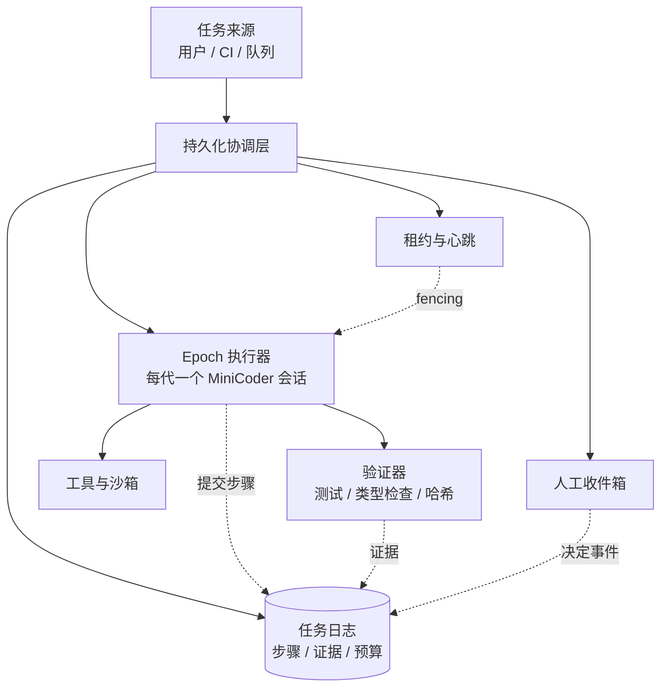
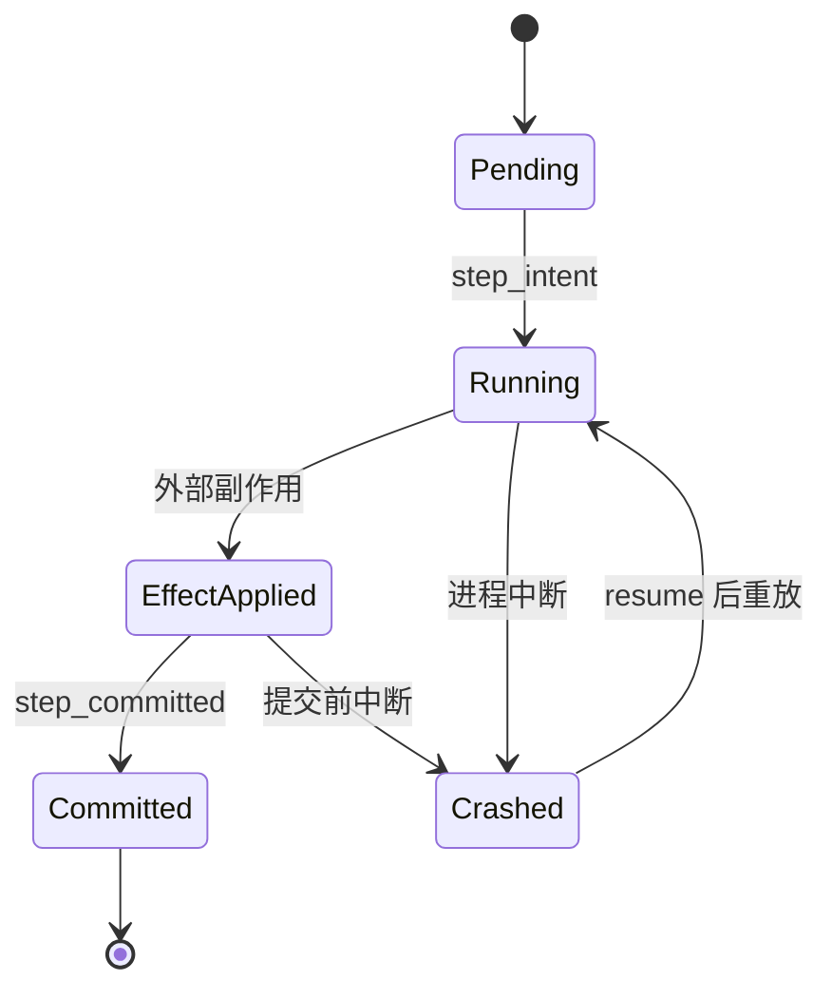
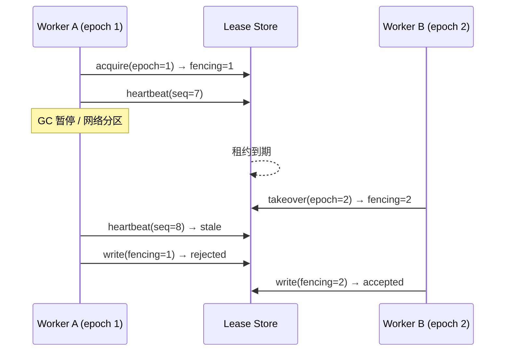
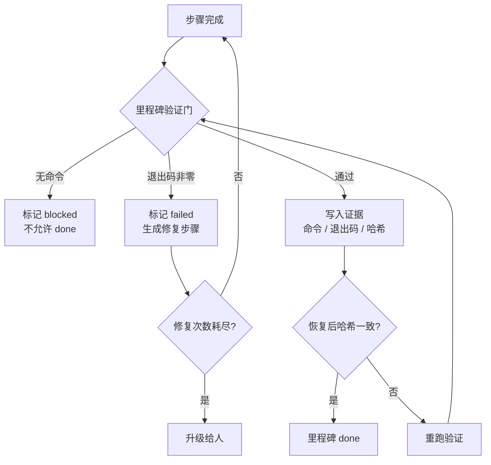

# 第 18 章 长时运行 Agent

## 本章导读

一个迁移 Agent 计划跑六小时。第三小时，它所在的容器被调度器回收；重启后，它从第一条指令重新开始，把已经改过的文件又改了一遍，其中一次写操作因此重复生效。开发者检查日志才发现：进度只存在于上一轮的消息历史里，而消息历史随进程一起消失了。本章讨论如何让一个任务在数小时、多次重启和多次人工介入之后，仍然知道“做到哪了、什么算完成、下一步该做什么”。

## 学习目标

读完本章你将能够：

- 区分会话恢复与持久化执行，把长任务拆成带稳定标识、可提交、可重放的步骤。
- 设计进度账、证据账与预算账，使任务状态不依赖进程内存，也不依赖模型记忆。
- 用心跳、租约续期与 fencing token 处理长任务的存活判断、接管与旧写者隔离。
- 用分代上下文、里程碑压缩与预算节奏控制数小时任务中的上下文腐化与成本累积。
- 设计中断后的人工接管包，明确何时自动继续、何时暂停等待人类决定。

## 18.1 时间尺度变了，问题就变了

短任务里，进程就是任务：启动、跑完、退出，状态随进程生灭。长任务里，这个等式不成立。**任务的生命周期比进程长，比会话长，甚至比模型上下文的“新鲜度”长。** 一旦任务跨越这些边界，原本不成问题的事情会集中暴露。

可以把长任务面临的约束想成三只时钟：

| 时钟 | 走得多快 | 失效后果 |
|---|---|---|
| 进程时钟 | 秒到小时 | 内存状态丢失，正在执行的动作中断 |
| 上下文时钟 | 几轮到几十轮 | 早期信息被压缩或挤出，模型开始“忘记”约束 |
| 预算时钟 | 小时到天 | Token、金额或时间耗尽，任务停在半途 |

三只时钟不同步。进程可能重启十次，上下文只推进了两轮；也可能上下文已经腐化，预算才花掉一成。长时运行 Agent 的工程目标，不是让单次循环跑得更久，而是**让任务在任意一只时钟失效后，都能从已知的正确点继续**。



这张图里最关键的不是“执行器”，而是**执行器之外的那一圈**。执行器可以随时被替换，因为它不拥有权威状态；权威状态在日志、租约和证据里。判断一个 Agent 是否真的支持长时运行，不要看它能不能连续对话，而要看它被杀掉之后，换一个进程能不能接着做，并且不重复副作用。


**“支持恢复”有强弱之分。** 恢复消息历史、恢复工作区、恢复任务状态是三件不同的事。只恢复消息历史的系统，看起来能继续聊天，却不知道哪些动作已经生效；只恢复工作区的系统，文件是对的，但计划和验证结果可能已经过期。本章要求三者都由同一份任务日志派生。


## 18.2 持久化执行：把一次长跑切成可重放的步骤

持久化执行（Durable Execution）的核心思想只有一句：**把任务切成带稳定标识的步骤，每一步的意图、效果和提交都写入持久存储；进程中断后，已完成步骤跳过，未提交步骤重放。**

这里要先区分三个容易混在一起的词：

- **恢复（Resume）**：从持久状态重建任务，决定从哪里继续。
- **重放（Replay）**：重新执行未提交的步骤，或在只读意义上重建历史，但绝不重复已提交的副作用。
- **重试（Retry）**：同一步骤因为瞬时失败再执行一次，通常复用同一个幂等键。

三者不是同义词。恢复回答“从哪继续”，重放回答“怎么补上未完成的部分”，重试回答“这一次失败要不要再来一次”。把它们混在一起，系统就会出现“恢复后整段重跑”或“重试导致重复写入”。

### 18.2.1 步骤的三段式：意图、效果、提交

一个可靠的步骤至少要有三段：

1. **意图（Intent）**：把“准备做什么、用什么幂等键”写入日志。
2. **效果（Effect）**：真正执行外部动作，例如写文件、发请求、提交代码。
3. **提交（Commit）**：把“做完了、证据是什么”写入日志。

崩溃可能发生在任意两个阶段之间：

| 崩溃位置 | 日志里有什么 | 恢复时的正确动作 |
|---|---|---|
| 意图之前 | 什么都没有 | 正常执行 |
| 意图之后、效果之前 | 一条未提交的意图 | 检查效果存储；没有效果则重放 |
| 效果之后、提交之前 | 未提交意图 + 已发生的效果 | 重放步骤，由幂等键抑制重复效果，然后提交 |
| 提交之后 | 已提交记录 | 跳过，不再调用模型 |

这张表解释了一个常见误区：**“先写完成标记，再干活”在长任务里是危险的。** 完成标记一旦先写，崩溃后的系统会认为事情已经做完，而效果可能根本没发生。正确顺序永远是“先记录意图，再产生效果，最后提交证据”。副作用与提交之间允许有一个可恢复的窗口，但这个窗口必须由幂等键兜底。



### 18.2.2 重放的不是模型，是状态

长任务里最昂贵、最不确定的动作是模型调用。**已提交的步骤不应在恢复时重新调用模型。** 模型输出不是确定性的，重跑一次可能得到不同的计划、不同的参数，甚至不同的目标理解；这会让“恢复”变成“换一个任务重做”。

因此，持久化执行要划出一条确定性边界：

- 模型调用、当前时间、随机数、外部系统读取，都放在步骤内部，结果写入日志。
- 恢复时，已提交步骤只读取日志里的结果，不再访问模型。
- 未提交步骤可以重新调用模型，但必须使用稳定的步骤标识与幂等键，让下游能识别重复。
- 上下文不是从旧消息历史照搬，而是从任务日志重新投影：目标、约束、进度、证据、当前步骤。

这条边界也解释了为什么“把完整对话历史存下来”不等于持久化执行。历史里可能包含模型说过但未执行的计划、被压缩掉的约束、已经过期的观察。**日志记录事实，历史只是给模型看的视图。**


**检查点与事件日志的分工。** 事件日志是事实源，检查点是加速恢复的快照。快照可以丢，日志不能丢；快照版本不兼容时应拒绝加载并迁移，而不是猜测字段含义。第 7 章已经给出快照、重放与漂移检测的实现，本章只把同一套语义抬到任务级。


## 18.3 三本账：进度、证据、预算

长任务需要同时维护三本账。把它们混在一个“状态对象”里，迟早会出现某本账悄悄失真。

### 18.3.1 进度账

进度账回答“做到哪了”。它由两部分组成：

- **追加式任务日志**：每一步的意图、提交、失败、挂起，按序号追加，不原地修改。
- **派生的进度摘要**：从日志计算出的紧凑视图，给人看，也给下一轮模型看。

进度摘要不是另一份事实源，而是投影。它至少要包含：任务标识与目标、硬约束、里程碑及状态、当前步骤、已完成项的证据指针、剩余预算、阻塞原因、下一步建议。摘要要短，因为它的主要读者是模型和接手的人，不是归档系统。

一个常见的错误是把进度写成一个 Markdown 文件让人手工维护。文件本身没问题，问题在于**手工编辑会绕过日志**：人改了文件，日志不知道，恢复时两边冲突。正确做法是让人发出“暂停、批准、修改范围”这类命令，命令变成事件，再由事件重新生成进度文件。

### 18.3.2 证据账

证据账回答“凭什么说完成了”。每个里程碑的完成，必须绑定一条可复核的证据：测试命令与退出码、类型检查结果、Schema 校验、文件哈希、变更差异、人工确认记录。没有证据的 `done` 只是模型的声明。

第 2 章讲过“完成是声明，验证是证据”；第 8 章把验收条件写进计划项。长任务把这套要求再推进一步：**证据要能跨进程存活，并且能判断是否过期。** 恢复时如果工作区哈希变了，旧证据就不再可信，必须重跑验证。证据账里至少要有命令、退出码、时间、工作区指纹和产物位置。

### 18.3.3 预算账

预算账回答“还能花多少”。长任务不能只有一个总预算，因为总预算无法回答“这一代还能不能继续”。至少要分三层：

- **任务总预算**：整个任务最多花多少 Token、多少钱、多少墙钟时间。
- **Epoch 预算**：当前这一代（一次会话、一次进程生命周期）的额度，防止单代失控。
- **预留额度**：为验证、收尾、生成报告保留的份额，不能被主线工作吃光。

只分配不预留，任务很容易在“差最后一个里程碑”时预算耗尽。只记账不节奏控制，则会出现“前 20% 的进度花掉 80% 的预算”。本章用一个简单的节奏规则：**已花比例不能长期显著高于已完成比例**；一旦超出阈值，就暂停主线、重规划或交给人类，而不是继续烧钱。

| 账本 | 回答的问题 | 权威形式 | 典型失真方式 |
|---|---|---|---|
| 进度账 | 做到哪了 | 追加日志 + 派生摘要 | 摘要被手工修改，与日志冲突 |
| 证据账 | 凭什么算完成 | 命令、退出码、哈希、产物 | 证据过期，工作区已变 |
| 预算账 | 还能花多少 | 总额、分代额度、预留 | 只记总账，单代透支 |

## 18.4 心跳、租约与接管

长任务最常见的分布式问题是“同一个任务被两个执行者同时跑”。原因通常不是恶意，而是**存活判断不可能绝对准确**：进程可能只是被 GC 暂停、网络分区、宿主机卡顿，或者调度器还没把它杀掉。心跳只能给出“疑似死亡”，不能给出“确定死亡”。

因此要把两件事分开：

- **心跳（Heartbeat）**：证明“我还活着”，携带当前 epoch、进度序号与租约令牌。
- **租约（Lease）**：证明“我有权写”，带过期时间与 fencing token。

心跳间隔必须远小于租约有效期。典型配置是心跳 10 秒、租约 90 秒、连续三次心跳丢失后进入“疑似死亡”，再留一个宽限期才允许接管。间隔太短会让一次正常抖动触发接管；间隔太长会让真正死亡的任务长时间无人处理。

接管时，新的执行者递增 epoch 与 fencing token。所有写操作都要携带令牌，下游存储拒绝比当前令牌小的写入。**只有“租约 + fencing token + 下游校验”三者齐全，旧执行者复活后才不能继续写。** 只在内存里删掉旧租约，等于没有隔离。



接管不是“抢到锁就重跑全部”。接管者必须先读日志，确认最后一个提交点，再决定从哪个步骤继续；如果发现旧执行者留下未提交的意图，要按效果存储对账，而不是盲目重试。第 7 章的 `tool_intent` / `tool_committed` 与恢复对账，在这里变成任务级的同一套流程。

## 18.5 数小时任务的上下文与成本

长任务最反直觉的一点是：**上下文不是越多越好，而是越“新鲜、相关、可核对”越好。** 数小时的历史塞进窗口，会同时带来三类问题：成本线性上升、关键约束被中段信息稀释、模型对早期观察产生错误自信。第 6 章把这叫上下文腐化，第 9 章已经给出“子代理默认使用全新简报”的做法；长任务可以把同一原则用在 epoch 上。

### 18.5.1 每一代从简报开始，而不是从历史开始

推荐做法是让每个 epoch 以一份**新简报**启动，内容来自任务日志而不是旧消息：

- 目标与硬约束（原文，不摘要）。
- 已完成里程碑与证据指针（例如 `m2: pytest exit=0, hash=...`）。
- 当前步骤、验收条件与允许的工具。
- 剩余预算与节奏状态。
- 已知阻塞、风险与升级规则。

旧历史只在需要时按证据指针回读：哪条命令、哪个文件、哪段输出。这样上下文大小与任务总时长解耦，模型每一代都看到“当前最相关的事实”，而不是“过去六小时的全部噪音”。

代价是细节丢失。缓解方式是**证据指针 + 按需读取**：摘要里保留 `artifact://...` 或 `file:line`，需要时再拉取原文。不要把所有细节压成一段自然语言摘要，因为摘要会漂移，指针不会。

### 18.5.2 里程碑压缩与预算节奏

压缩（Compaction）的时机也要改。短任务通常在“接近窗口上限”时压缩；长任务更应该在**里程碑边界**压缩：一个里程碑完成、证据写入之后，把这一代的过程压成“结论 + 证据指针 + 未决项”，丢弃中间消息。这样每一代都从干净的状态块开始，压缩不再是被动救火，而是主动换气。

成本控制同理。不要问“总共还剩多少”，要问“按当前速度，能不能走到下一个里程碑”。一个可操作的规则是：

```text
已花比例 = 已用 token / 本代额度
完成比例 = 已完成步骤 / 本代步骤
若 已花比例 > 完成比例 + 余量，则触发暂停或重规划
```

余量按任务风险设定，例如 15%。这个规则不精确，但它能提前发现“花了八成预算只走了两成进度”的失控，而不是等到账单出来。预留额度则保证验证与收尾永远有钱可用。

| 方案 A：保留完整历史，接近上限再压缩 | 方案 B：每代新简报 + 里程碑压缩 |
|---|---|
| 实现简单，细节不丢 | 上下文与任务时长解耦，成本可控 |
| 长任务成本线性增长，注意力被稀释 | 需要维护日志投影与证据指针 |
| 压缩是被动的，失败时容易丢关键约束 | 压缩是主动的，边界清晰、可验证 |
| 适合短任务、强依赖前文的调试场景 | 适合数小时、多里程碑、可外部验证的任务 |

本章选择方案 B。它不是“不要历史”，而是把历史降级为可检索的证据，把当前状态提升为权威。

## 18.6 自主验证闭环

长任务的“自主”不等于“不需要人”，而是“不需要人在每一步旁边”。要做到这一点，验证必须变成闭环：**每个里程碑都有外部检查，检查结果写入证据账，失败会自动生成修复步骤，修复预算耗尽才升级给人。**

验证门（Verification Gate）至少检查三件事：

1. **命令存在**：没有可执行命令的“验证”不是验证，只是复述。
2. **退出码为零**：测试、类型检查、Schema 校验的可判定结果。
3. **证据可关联**：输出哈希、工作区指纹、时间戳，能证明这条证据对应的是当前产物。

恢复之后要额外做一件事：**检查证据是否过期。** 如果工作区哈希与证据记录不一致，旧里程碑不能直接信任，必须重跑验证。这就是第 7 章工作区漂移检测在长任务里的用法：漂移不是错误，而是“需要重新确认”的信号。



这里有一个容易被忽略的顺序：**先验证，再提交。** 如果先写 `step_committed`，再跑验证，崩溃窗口里就会出现“日志说完成了、证据没写”的假完成。验证本身可以是幂等的只读动作，允许重跑；但提交只能发生一次。

## 18.7 中断与人工接管

长任务一定会停：等待审批、等待外部系统、预算耗尽、依赖阻塞、验证连续失败，或者操作者主动暂停。**暂停不是异常，而是任务的一等状态。** 把暂停建模成“循环卡住”或“进程不退出”，会浪费资源，也会让恢复语义变得模糊。

暂停要写出类型化原因，并生成一份接管包（Handoff Package）。接管包的目标是：**换一个人或换一个 Agent，只读这一份材料就能接手，不必翻完整轨迹。**

一份合格的接管包包含：

- **身份与版本**：任务 ID、epoch、fencing token、当前执行者。
- **目标与硬约束**：原文，不允许摘要改写。
- **进度**：已完成里程碑及证据指针、当前步骤、未完成项。
- **阻塞**：为什么停，已经尝试过什么，哪些尝试被排除。
- **选项**：继续、缩小范围、回滚、放弃，各自的动作、风险与影响。
- **预算**：剩余 Token、金额、时间，以及验证预留。
- **工作区**：已改文件、哈希、未提交差异、可回滚点。
- **建议的下一步**：明确到一个可执行动作，而不是“请人工检查”。

人工接管时，不要直接改日志。人的动作应该变成事件：`operator_paused`、`scope_changed`、`approval_granted`、`rollback_requested`。事件进入日志，再由投影更新进度文件。这样恢复、审计和追踪仍然只有一个事实源。

还要区分两种“停”：

- **动作级拒绝**：某个高风险动作没有通过审批，动作不执行，任务可以继续做别的。这是失败关闭。
- **任务级挂起**：任务在等一个人类决定，继续执行没有意义，但状态必须保留。这是暂停，不是失败。

把两者混为一谈，就会出现“审批超时导致整个任务被判失败”，或者“任务挂起但审批动作被静默放行”。前者浪费已完成的工作，后者是安全事故。

## 18.8 设计权衡

长时运行没有免费的可靠性。下面几组选择必须在设计时显式做出来。

| 决策点 | 方案 A | 方案 B | 取舍 |
|---|---|---|---|
| 恢复方式 | 全量重放 | 快照 + 尾部重放 | A 简单、无需版本管理；B 快，但快照要原子、可迁移 |
| 检查点粒度 | 每个小动作 | 每个里程碑 | A 丢工少、事件多；B 开销低、恢复慢 |
| 心跳与接管 | 短租约、快速接管 | 长租约、保守接管 | A 故障恢复快、误接管多；B 稳定、故障期长 |
| 上下文策略 | 保留完整历史 | 每代简报 + 证据指针 | A 细节全、成本高；B 可控、需检索能力 |
| 继续策略 | 自动继续 | 里程碑人工确认 | A 吞吐高；B 风险低、人工成本高 |

本章的选择是：**里程碑级快照 + 步骤级日志、保守租约、每代简报、按风险决定是否人工确认。** 这套组合适合“任务长、副作用可验证、人工不必全程在场”的场景，例如批量迁移、长时间重构、持续集成修复。

还有一组更细的 A/B，关于“什么时候把控制权交给人”：

| 自动继续 | 人工确认每个里程碑 |
|---|---|
| 适合低风险、可回滚、证据充分的步骤 | 适合高风险、不可逆、成本高的步骤 |
| 吞吐高，人的注意力用在异常上 | 吞吐低，但能在错误扩散前拦住 |
| 需要强验证与清晰的回滚路径 | 需要好的审批界面与接管包 |
| 失败代价是重跑 | 失败代价是数据损坏或合规事故 |

实际系统通常是混合的：低风险里程碑自动过，高风险动作（生产写入、外部通知、删除）逐次审批；审批超时则挂起任务，而不是放行动作。

## 18.9 代码实践：MiniCoder 的持久化执行层

新增模块位于 `code/python/minicoder/durable.py` 与 `code/typescript/minicoder/src/durable.ts`，演示入口是 `durable_demo.py` / `durable_demo.ts`。它只做加法：不修改 `Provider`、`Usage`、`HarnessConfig` 与 `MiniCoder.run`，而是在它们外面加一层任务级协调器。

设计要点：

- **任务日志是权威**：`TaskJournal` 追加写并 `fsync`，`ProgressLedger` 只从日志派生，不反向写回。
- **步骤三段式**：`step_intent` → 外部效果 → `step_committed`；中途崩溃只留下未提交意图。
- **幂等副作用**：`EffectStore` 以稳定键记录效果，重放返回第一次的值，不重复执行。
- **分代预算**：`EpochPacer` 按 epoch 的额度、预留与进度比例判断能否继续。
- **租约与 fencing**：`TaskLeaseManager` 用心跳续期、过期接管，`check_write` 拒绝旧令牌。
- **验证门与接管包**：`VerificationGate` 拒绝无命令或非零退出；`HandoffPackage` 把进度、阻塞、选项与预算打包。
- **接入方式**：外层协调器为每个里程碑构造一个新的 `MiniCoder` 会话，简报来自 `ProgressLedger.digest()` 与证据指针；`MiniCoder.run` 的 `LoopResult` 被映射成 `StepOutcome`，不改变既有接口。

### 18.9.1 任务日志与进度投影

日志只追加；进度投影只读。`apply` 遇到未知事件不崩溃，保持前向兼容。



```python
class TaskJournal:
    def append(self, event, *, step_id="", epoch=1, **data):
        self.seq += 1
        entry = JournalEntry(self.seq, epoch, event, step_id, dict(data))
        payload = {
            "seq": entry.seq,
            "epoch": entry.epoch,
            "event": entry.event,
            "step_id": entry.step_id,
            "data": entry.data,
        }
        with self.path.open("a", encoding="utf-8") as handle:
            handle.write(
                json.dumps(
                    payload, ensure_ascii=False, sort_keys=True, separators=(",", ":")
                )
                + "\n"
            )
            handle.flush()
            os.fsync(handle.fileno())
        self.entries.append(entry)
        return entry

    def apply(self, entry: JournalEntry) -> None:
        step = self.steps.get(entry.step_id) if entry.step_id else None
        if entry.event == "epoch_started":
            self.epoch = entry.epoch
        elif entry.event == "step_intent" and step is not None:
            step.status = StepStatus.RUNNING
            step.attempts = int(entry.data["attempt"])
            step.epoch = entry.epoch
        elif entry.event == "step_committed" and step is not None:
            step.status = StepStatus.COMMITTED
            step.evidence = str(entry.data.get("evidence", ""))
        elif entry.event == "milestone_verified":
            milestone = str(entry.data.get("milestone", ""))
            if milestone and milestone not in self.verified:
                self.verified.append(milestone)
        elif entry.event == "task_suspended":
            self.suspended = str(entry.data.get("reason", ""))
        elif entry.event == "task_completed":
            self.completed = True

    def next_step(self) -> Optional[DurableStep]:
        for step in self.steps.values():
            if step.status != StepStatus.COMMITTED:
                return step
        return None
```


```typescript
export class TaskJournal {
  append(event: string, epoch: number, stepId: string, data: Record<string, unknown>): JournalEntry {
    this.seq += 1;
    const entry: JournalEntry = { seq: this.seq, epoch, event, step_id: stepId, data };
    const line = canonicalJson({
      seq: entry.seq,
      epoch: entry.epoch,
      event: entry.event,
      step_id: entry.step_id,
      data: entry.data,
    });
    const fd = fs.openSync(this.path, "a");
    try {
      fs.writeSync(fd, `${line}\n`);
      fs.fsyncSync(fd);
    } finally {
      fs.closeSync(fd);
    }
    this.entries.push(entry);
    return entry;
  }
}

export class ProgressLedger {
  apply(entry: JournalEntry): void {
    const step = entry.step_id === "" ? undefined : this.steps.get(entry.step_id);
    if (entry.event === "epoch_started") {
      this.epoch = entry.epoch;
    } else if (entry.event === "step_intent" && step !== undefined) {
      step.status = StepStatus.RUNNING;
      step.attempts = Number(entry.data.attempt);
      step.epoch = entry.epoch;
    } else if (entry.event === "step_committed" && step !== undefined) {
      step.status = StepStatus.COMMITTED;
      step.evidence = String(entry.data.evidence ?? "");
    } else if (entry.event === "milestone_verified") {
      const milestone = String(entry.data.milestone ?? "");
      if (milestone !== "" && !this.verified.includes(milestone)) {
        this.verified.push(milestone);
      }
    } else if (entry.event === "task_suspended") {
      this.suspended = String(entry.data.reason ?? "");
    } else if (entry.event === "task_completed") {
      this.completed = true;
    }
  }

  nextStep(): DurableStep | null {
    for (const step of this.steps.values()) {
      if (step.status !== StepStatus.COMMITTED) return step;
    }
    return null;
  }
}
```



### 18.9.2 幂等副作用与崩溃窗口

演示在第二步制造崩溃：效果已经写入 `EffectStore`，提交事件还没写。恢复后重放同一步，`apply_once` 返回 `applied=false`，因此不会产生第二次写入。



```python
class EffectStore:
    def apply_once(self, key: str, value: str) -> tuple[str, bool]:
        if key in self.data:
            self.suppressed_count += 1
            return self.data[key], False
        self.data[key] = value
        self.applied_count += 1
        tmp = self.path.with_suffix(".tmp")
        tmp.write_text(
            json.dumps(self.data, ensure_ascii=False, sort_keys=True),
            encoding="utf-8",
        )
        os.replace(tmp, self.path)
        return value, True

    def run(self, handler, *, epoch, plan, projected_tokens=120):
        self.pacer = EpochPacer(plan)
        self._log("epoch_started", epoch=epoch)
        # ... 跳过已提交、统计重放 ...
        attempt = step.attempts + 1
        key = f"{self.task_id}:{step.step_id}"
        self._log("step_intent", step_id=step.step_id, epoch=epoch,
                  attempt=attempt, idempotency_key=key)
        try:
            outcome = handler(StepContext(self.task_id, step, attempt, epoch, self.effects))
        except InjectedCrash:
            self.pacer.charge(projected_tokens, 0)
            self._log("step_crashed", step_id=step.step_id, epoch=epoch,
                      attempt=attempt, after_effect=True)
            raise
        if outcome.ok:
            self._log("step_committed", step_id=step.step_id, epoch=epoch,
                      evidence=outcome.evidence, tokens=outcome.tokens)
```


```typescript
export class EffectStore {
  applyOnce(key: string, value: string): [string, boolean] {
    if (key in this.data) {
      this.suppressed_count += 1;
      return [this.data[key], false];
    }
    this.data[key] = value;
    this.applied_count += 1;
    const tmp = `${this.path}.tmp`;
    fs.writeFileSync(tmp, canonicalJson(this.data), "utf8");
    fs.renameSync(tmp, this.path);
    return [value, true];
  }
}

export class DurableRunner {
  run(handler: StepHandler, options: { epoch: number; plan: EpochPlan; projected_tokens?: number }): RunReport {
    this.pacer = new EpochPacer(options.plan);
    this.log("epoch_started", options.epoch);
    // ... 跳过已提交、统计重放 ...
    const attempt = step.attempts + 1;
    const key = `${this.task_id}:${step.step_id}`;
    this.log("step_intent", options.epoch, step.step_id, { attempt, idempotency_key: key });
    let outcome: StepOutcome;
    try {
      outcome = handler({ task_id: this.task_id, step, attempt, epoch: options.epoch, effects: this.effects });
    } catch (error) {
      if (error instanceof InjectedCrash) {
        this.pacer.charge(options.projected_tokens ?? 120, 0);
        this.log("step_crashed", options.epoch, step.step_id, { attempt, after_effect: true });
      }
      throw error;
    }
    if (outcome.ok) {
      this.log("step_committed", options.epoch, step.step_id, {
        evidence: outcome.evidence,
        tokens: outcome.tokens,
      });
    }
```



### 18.9.3 分代预算、心跳与租约

预算先判断“这一代还能不能开始下一步”，再记账；租约用心跳续期，接管时递增 fencing token。



```python
class EpochPacer:
    def can_start(self, projected_tokens: int, projected_micros: int = 0) -> tuple[bool, str]:
        available = self.plan.token_allowance - self.plan.reserve_tokens
        if self.usage.tokens + projected_tokens > available:
            return False, "epoch_budget"
        if self.plan.cost_allowance_micros:
            remaining = self.plan.cost_allowance_micros - self.plan.reserve_micros
            if self.usage.cost_micros + projected_micros > remaining:
                return False, "cost_budget"
        return True, "ok"

    def pacing(self, done: int, total: int, margin_permille: int = 150) -> str:
        allowance = max(1, self.plan.token_allowance)
        spent_permille = self.usage.tokens * 1000 // allowance
        progress_permille = done * 1000 // max(1, total)
        if spent_permille > progress_permille + margin_permille:
            return "pacing"
        return "ok"


class TaskLeaseManager:
    def heartbeat(self, lease: TaskLease, seq: int, now_ms: int) -> Heartbeat:
        current = self.leases.get(lease.task_id)
        if (current is None or current.fencing != lease.fencing
                or current.expires_at_ms <= now_ms):
            result = Heartbeat(lease.owner, lease.fencing, seq, now_ms, "stale")
        else:
            current.expires_at_ms = now_ms + self.lease_ms
            result = Heartbeat(lease.owner, lease.fencing, seq, now_ms, "ok")
        self.heartbeats[lease.task_id] = result
        return result

    def check_write(self, lease: TaskLease, now_ms: int) -> tuple[bool, str]:
        current = self.leases.get(lease.task_id)
        if current is None:
            return False, "no_lease"
        if current.fencing != lease.fencing:
            return False, "fencing"
        if current.expires_at_ms <= now_ms:
            return False, "expired"
        return True, "ok"
```


```typescript
export class EpochPacer {
  canStart(projectedTokens: number, projectedMicros = 0): [boolean, string] {
    const available = this.plan.token_allowance - this.plan.reserve_tokens;
    if (this.usage.tokens + projectedTokens > available) return [false, "epoch_budget"];
    if (this.plan.cost_allowance_micros !== 0) {
      const remaining = this.plan.cost_allowance_micros - this.plan.reserve_micros;
      if (this.usage.cost_micros + projectedMicros > remaining) {
        return [false, "cost_budget"];
      }
    }
    return [true, "ok"];
  }

  pacing(done: number, total: number, marginPermille = 150): string {
    const allowance = Math.max(1, this.plan.token_allowance);
    const spentPermille = Math.floor((this.usage.tokens * 1000) / allowance);
    const progressPermille = Math.floor((done * 1000) / Math.max(1, total));
    return spentPermille > progressPermille + marginPermille ? "pacing" : "ok";
  }
}

export class TaskLeaseManager {
  heartbeat(lease: TaskLease, seq: number, nowMs: number): Heartbeat {
    const current = this.leases.get(lease.task_id);
    let result: Heartbeat;
    if (current === undefined || current.fencing !== lease.fencing || current.expires_at_ms <= nowMs) {
      result = { owner: lease.owner, fencing: lease.fencing, seq, at_ms: nowMs, status: "stale" };
    } else {
      current.expires_at_ms = nowMs + this.lease_ms;
      result = { owner: lease.owner, fencing: lease.fencing, seq, at_ms: nowMs, status: "ok" };
    }
    this.heartbeats.set(lease.task_id, result);
    return result;
  }

  checkWrite(lease: TaskLease, nowMs: number): [boolean, string] {
    const current = this.leases.get(lease.task_id);
    if (current === undefined) return [false, "no_lease"];
    if (current.fencing !== lease.fencing) return [false, "fencing"];
    if (current.expires_at_ms <= nowMs) return [false, "expired"];
    return [true, "ok"];
  }
}
```



### 18.9.4 验证门与接管包

验证门只接受“有命令、退出码为零”的结果；接管包把完成项、阻塞项、预算、文件与选项放在同一份材料里。



```python
class VerificationGate:
    def verify(self, result: VerificationResult) -> tuple[bool, str]:
        if result.milestone not in self.required:
            return False, "unknown_milestone"
        if not result.command:
            return False, "no_command"
        self.results.append(result)
        if not result.ok:
            return False, "nonzero_exit"
        return True, "passed"


class HandoffPackage:
    def render(self) -> list[str]:
        lines = [
            f"task={self.task_id} epoch={self.epoch} reason={self.reason}",
            f"done={len(self.done)} blocked={len(self.blocked)} budget={self.budget}",
        ]
        lines.extend(f"  done    {item}" for item in self.done)
        lines.extend(f"  blocked {item}" for item in self.blocked)
        lines.append(f"next={self.next_step}")
        lines.append(f"files={','.join(self.changed_files)}")
        lines.append(f"options={','.join(self.options)}")
        return lines
```


```typescript
export class VerificationGate {
  verify(result: VerificationResult): [boolean, string] {
    if (!this.required.includes(result.milestone)) return [false, "unknown_milestone"];
    if (result.command === "") return [false, "no_command"];
    this.results.push(result);
    if (!result.ok) return [false, "nonzero_exit"];
    return [true, "passed"];
  }
}

export class HandoffPackage {
  render(): string[] {
    const lines = [
      `task=${this.task_id} epoch=${this.epoch} reason=${this.reason}`,
      `done=${this.done.length} blocked=${this.blocked.length} budget=${this.budget}`,
    ];
    for (const item of this.done) lines.push(`  done    ${item}`);
    for (const item of this.blocked) lines.push(`  blocked ${item}`);
    lines.push(`next=${this.next_step}`);
    lines.push(`files=${this.changed_files.join(",")}`);
    lines.push(`options=${this.options.join(",")}`);
    return lines;
  }
}
```



### 18.9.5 运行与输出

```bash
cd code/python && python3 -m minicoder.durable_demo
cd code/typescript && node minicoder/src/durable_demo.ts
```

两版输出逐行一致：

```text
== MiniCoder durable ==
journal  new seq=0
step     step-1 intent attempt=1
step     step-1 committed evidence=cmd:cp exit=0
step     step-2 intent attempt=1
effect   applied=true step=step-2 key=rewrite
crash    after-effect step=step-2 commit=missing
epoch1   committed=1 running=1 spent=300/1000
resume   journal entries=6 last=step_crashed
resume   skip=1 replay=1 epoch=2
step     step-2 intent attempt=2
step     step-2 replay applied=false
step     step-2 committed evidence=effect:rewrite applied=false
step     step-3 intent attempt=1
verify   m3 command=pytest exit=0 -> passed
step     step-3 committed evidence=pytest:exit=0
step     step-4 intent attempt=1
step     step-4 committed evidence=artifact:report
epoch2   committed=3 total=4 completed=true
budget   epoch=2 spent=330/600 reserve=60 pacing=ok
effects  applied=1 suppressed=1
digest   task migrate-1 epoch=2 done=4/4
         committed step-1 copy schema
         committed step-2 rewrite imports
         committed step-3 run tests
         committed step-4 write report

lease    acquire owner=worker-a epoch=1 fencing=1
lease    heartbeat seq=1 status=ok
lease    takeover owner=worker-b epoch=2 fencing=2
lease    stale-heartbeat owner=worker-a status=stale
lease    stale-write owner=worker-a accepted=false reason=fencing
lease    write owner=worker-b accepted=true
pacing   done=2/4 spent=780/1000 status=pacing
pacing   done=3/4 spent=780/1000 status=ok
gate     m1 evidence=missing -> blocked
gate     m1 command=pytest exit=0 -> passed
gate     m2 command=pytest exit=1 -> failed
handoff  task=migrate-1 epoch=2 reason=approval_timeout
handoff  done=2 blocked=1 budget=780/1000
handoff    done    step-1 copy schema
handoff    done    step-2 rewrite imports
handoff    blocked step-3 run tests
handoff  next=resume step-3 after approval
handoff  files=src/app.py
handoff  options=approve_once,stop
```

逐段解读：

- **`epoch1`**：`step-1` 已提交；`step-2` 只留下未提交意图，效果已经写入。日志里 `step-2` 仍是 `running`，恢复时会被重放，而不是被当成完成。
- **`resume`**：从磁盘重新加载日志，共 6 条，最后一条是 `step_crashed`；跳过 1 个已提交步骤，重放 1 个未提交步骤。注意这里没有重新调用 `step-1` 的模型。
- **`step-2 replay applied=false`**：幂等存储认出同一个键，返回第一次写入的值，`suppressed=1`。这就是“至少一次执行 + 幂等 = 结果上只生效一次”。
- **`verify m3 ... passed`**：测试命令给出退出码 0，验证门通过后才写 `step_committed`。验证在前，提交在后。
- **`budget epoch=2 ... pacing=ok`**：本代额度 600、预留 60，实际用了 330；已花比例 55%，完成比例 100%，没有触发节奏警报。演示里的崩溃步骤按预估值计费，这是保守做法：崩溃可能已经消耗了上游资源。
- **`lease`**：worker-a 先拿到 fencing=1；心跳正常时续期；worker-b 在租约过期后接管得到 fencing=2；worker-a 复活后心跳变 `stale`，写入被 `fencing` 拒绝。
- **`pacing`**：同样花了 780/1000，完成 2/4 时已花 78% 而进度 50%，判定为 `pacing`；完成 3/4 时进度 75%，回到 `ok`。这个规则不预测未来，只暴露“花钱快于做事”的当下状态。
- **`gate`**：没有命令的“证据”被拒；退出码为零通过；退出码非零失败。三种结果都不会被模型自述覆盖。
- **`handoff`**：接管包直接列出完成项、阻塞项、预算、文件与选项。接手者不必读完整轨迹，也能知道下一步是“审批后从 step-3 继续”。

本章代码覆盖日志、幂等副作用、分代预算、租约、验证门与接管包。以下仍是**契约而非本版实现**：真实外部存储的 CAS 租约、跨进程 fencing 校验、分布式预算账本、异步人工审批、真实测试命令与产物存储、容器/microVM 后端。部署这些能力前，不要把单进程演示当作生产级隔离或一致性方案。

## 18.10 业界案例：把长任务拆成可恢复单元

**LangGraph** 的检查点（Checkpointer）与中断（Interrupt）是长时运行图执行的典型参考：图状态按超级步（super-step）持久化，同一个 `thread_id` 可以从检查点恢复；`interrupt` 把执行停在某处，等待外部输入后再继续。它给本章的两个启发是：**状态按执行单元提交**，以及**暂停是显式的图状态，而不是异常**。使用时要注意，检查点保存的是图状态，不是外部副作用；节点里的写操作仍然需要幂等键，否则恢复后重放节点会重复写入。具体 API 与默认行为随版本变化，以官方文档为准。

**Aider** 提供了另一种更朴素的持久化：每次成功修改后自动提交 Git，测试与 lint 作为提交前的验证。Git 历史本身就是一份可审计的进度账，恢复时可以看差异、回滚或从某个提交继续。它的局限也很清楚：Git 只覆盖代码与提交，不覆盖跨进程租约、预算与人工接管；多个执行者同时操作同一仓库时，仍然需要外部的所有权机制。第 1 章已经介绍过 Aider 的整体机制，这里只借用“提交即检查点”的思路。

更一般地，工作流引擎把长任务拆成**工作流（workflow）与活动（activity）**：工作流代码必须是确定性的，活动负责外部副作用并可重试；长活动用心跳报告进度，历史过长时用“继续为新执行（continue-as-new）”截断。Agent Harness 不必照搬这些系统的全部实现，但三件事值得直接借用：确定性边界、步骤级提交、长活动心跳。它们共同回答同一个问题：**进程消失之后，凭什么相信任务还能正确继续。**

## 18.11 常见陷阱

**1. 把“恢复会话”当成“恢复执行”。** 消息历史可以重建对话，却不能证明某个写操作已经提交。恢复必须以任务日志与证据为准，历史只是投影。

**2. 先写完成、后做效果。** 这样做在崩溃窗口里会产生“日志说完成了、实际没做”的假完成。顺序必须是意图、效果、提交；提交前崩溃只能重放，不能跳过。

**3. 心跳一超时就立刻接管。** GC 暂停、网络抖动、宿主机卡顿都会造成短暂失联。租约要留够宽限，接管要递增 fencing token，下游必须校验令牌；否则旧执行者复活后仍能写入。

**4. 用一份总预算跑到底。** 没有分代额度与预留，主线会吃掉验证和收尾的钱，任务停在最后一个里程碑。预算要按 epoch 分配、为验证预留，并用“已花比例 vs 完成比例”提前发现失控。

**5. 每个里程碑都等人批，或者从不让人批。** 前者制造审批疲劳，后者让高风险动作无人把关。按风险分级：低风险自动继续，不可逆或高成本动作逐次审批，审批超时挂起任务而不是放行动作。

**6. 把完整历史喂给每一代模型。** 长任务里这会同时推高成本、稀释约束、放大上下文腐化。用进度摘要、证据指针与最近窗口，按需回读原文。

## 18.12 本章小结

- 长时运行的第一性要求是：任务状态不依赖进程内存，也不依赖模型记忆；进程、上下文、预算三只时钟会先后失效。
- 持久化执行把任务切成带稳定标识的步骤，按“意图 → 效果 → 提交”推进；恢复时跳过已提交、重放未提交，已提交步骤不再调用模型。
- 至少一次执行加幂等键，才能在结果上实现有效一次；副作用存储与提交事件之间的窗口必须由幂等键兜底。
- 进度账、证据账、预算账分别回答“做到哪、凭什么算完成、还能花多少”；摘要与消息历史都只是投影。
- 心跳证明存活，租约与 fencing token 证明写权；接管要读日志、核对未提交意图，并让旧令牌失败关闭。
- 每一代用新简报与证据指针，在里程碑边界压缩；预算按代分配、为验证预留，用已花/完成比例做节奏控制。
- 验证门要求真实命令与退出码，先验证后提交；恢复后哈希不一致要重跑验证。
- 暂停是一等状态；接管包要能让人或另一个 Agent 只读一份材料就接手，人工动作以事件写入日志。

## 18.13 思考题

1. 你要设计一个六小时的数据迁移 Agent：哪些动作应该是独立步骤？哪些步骤的副作用无法天然幂等，需要额外的幂等键或对账？检查点放在步骤级还是里程碑级，为什么？
2. 心跳间隔 10 秒、租约 90 秒、一次 GC 暂停 120 秒。会发生什么？如果接管发生在旧执行者恢复之前，旧执行者还有哪些路径可能写入？你会如何用 fencing token、下游校验与失败关闭堵住它们？
3. 一个任务有 10 个里程碑、总预算 200 万 Token。你会如何把预算分到 epoch、验证与收尾？当“已花 70%、完成 40%”时，你会暂停、重规划还是升级给人？判断依据是什么？
