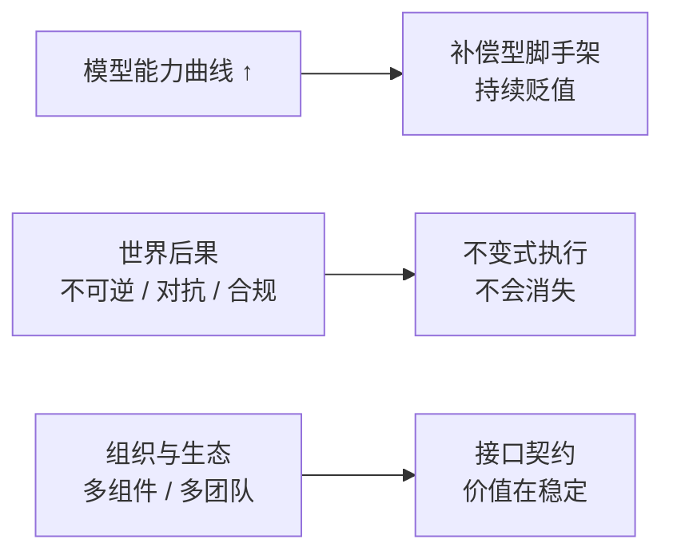
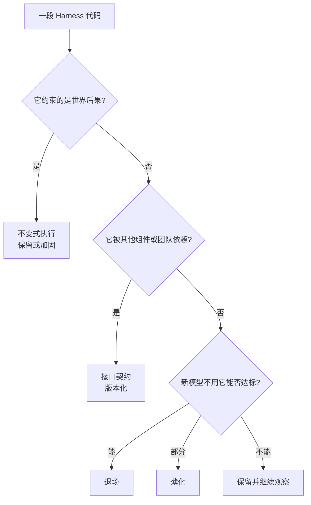
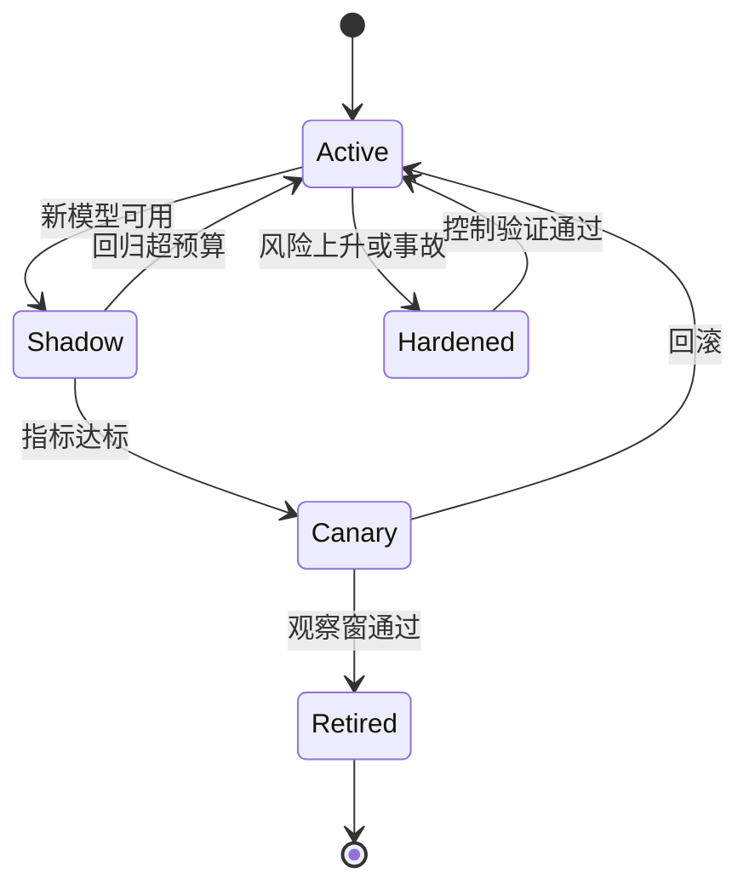
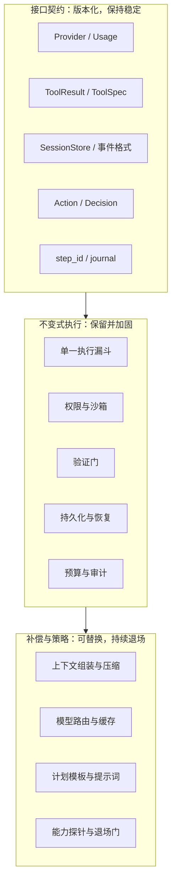

# 第 19 章 Harness 与模型的协同演进

## 本章导读

一个团队把模型升级到新一代，顺手删掉了所有“为旧模型准备”的提示词与强制步骤。短任务更快了，长尾任务却开始漏掉约束；另一次回滚中，审批与验证也被一起删掉。反方向的团队则把每个补丁保留两年，模型变强了，成本与延迟却从未下降。本章讨论一个所有 Harness 团队迟早要回答的问题：哪些设计该退场，哪些必须留下。

## 学习目标

读完本章你将能够：

- 用“补偿型脚手架、不变式执行、接口契约”区分 Harness 代码，判断哪些会随模型变强而过时。
- 用失败代价、发生频率与可自证性，把责任分配给模型、Harness 或外部系统。
- 设计能力探针、影子模式与回归预算，让脚手架退场可测量、可回滚。
- 识别应保持稳定的接口契约，避免把兼容性当成可优化项。
- 把前 18 章的工程结论收束成可执行的三步实践。

## 19.1 两种速度

模型能力在快速变化。每隔一段时间，更强的模型出现，旧的 benchmark 被刷新，昨天还需要精心设计的提示词，今天可能一句自然语言就够了。

世界后果没有同步变化。删掉生产库、泄露密钥、错误转账、把未经验证的版本发布上线，这些事情的代价不会因为模型更聪明而降低。**能力曲线向上，后果曲线基本水平。** Harness 就站在这两条曲线之间：它既要把向上的能力转化成行动，也要处理水平的后果。

这意味着“Harness 要不要变薄”这个问题本身问错了。Harness 不是一块同质的铁板，而是一个资产组合。组合里的资产以不同方式贬值：



- **补偿型脚手架**因为模型暂时做不到而存在。模型变强，它的价值下降。
- **不变式执行**因为世界有后果而存在。模型变强，它的必要性不降，甚至上升。
- **接口契约**因为组件和团队要协作而存在。它的价值不在聪明，而在稳定。

把这三类混在一起讨论，就会得到两个都错误的结论：要么“模型变强了，Harness 都该删”，要么“Harness 是护城河，一行都不能动”。**正确的动作不是整体变薄或变厚，而是逐项重新定价。**

## 19.2 苦涩的教训，以及它没有说的事

“苦涩的教训”（The Bitter Lesson）来自 Richard Sutton 在 2019 年的一篇短文。它的核心观察是：长期看，能够随算力扩展的一般方法——搜索与学习——会胜过把人类知识手工编码进去的方法。这是一条关于**能力生产函数**的判断：不要把钱押在很快会被更多算力淹没的手工技巧上。

它没有说三件事。

第一，它没有说“所有工程都会过时”。它讨论的是能力方法，不是系统治理。模型可以决定“怎么做”，但不能单方面决定“是否允许做”“什么算做完”“崩溃后谁来接手”“这笔钱记在谁账上”。这些不是智能问题，是权限、验证、状态与责任问题。

第二，它没有给出时间表。“长期会胜出”不等于“今天可以删”。在模型能力到达某个阈值之前，脚手架决定了能力能不能被用起来。提前退场不是相信未来，而是把用户当成实验品。

第三，它没有说“模型能做”等于“模型可以被信任去做”。一个能写出正确迁移脚本的模型，也可能在错误的工作目录里执行它；一个能通过单元测试的补丁，也可能引入安全漏洞。**生成能力不等于验证能力，更不等于授权。**

| 会被模型能力吃掉的部分 | 不会自动消失的部分 |
|---|---|
| 输出格式修补、解析容错 | 权限、审批与授权 |
| 为小上下文准备的强制步骤分解 | 沙箱、隔离与爆炸半径控制 |
| 特定编辑格式、提示词技巧 | 验证、证据与完成判定 |
| 反复强调的格式示例 | 持久化、恢复与幂等 |
| 手写的固定流程分支 | 审计、成本、配额与合规 |


**用“苦涩的教训”论证删除审批，是范畴错误。** 那篇短文谈的是怎样获得更强的能力，不是怎样安全地使用能力。能力越强，错误动作的爆炸半径通常越大，治理不是更不必要，而是更必要。


更准确的说法是：**模型能力替代的是“怎么做到”的脚手架，不替代“是否允许、是否完成、是否持续”的机制。** 前者可以退场，后两者必须留下，只是实现方式会变。

## 19.3 三类 Harness 代码

判断一段代码属于哪一类，不要看它写在哪里，而要看它为什么存在。同样是一段 JSON Schema，用来修补模型输出格式，它是补偿型；用来定义工具契约，它是接口型。同样是一个重试循环，用来兜住解析失败，它是补偿型；用来处理瞬时网络错误，它更接近不变式。

### 19.3.1 补偿型脚手架

补偿型脚手架（Compensation Scaffolding）的存在理由只有一句：**当前模型单独做不到，或者做得不够稳、不够便宜。** 它的判别实验很直接：把这段脚手架拿掉，让新模型独立跑同一组任务；如果通过率、成本与安全性都不低于门槛，它就该退场。

典型例子包括输出格式修复、强制分步提示、为小上下文准备的仓库索引、手写的任务分解模板、针对某个模型版本的提示词补丁。它们不是“坏代码”，而是在特定能力水位下的合理工程。问题只在于：能力水位变了，它们没有跟着变。

这里有一个容易误判的地方：**有些脚手架看起来是补偿，实际在做成本优化。** 比如仓库地图，即使新模型能读下整个仓库，预先筛选仍然可能显著降低 token 成本与延迟。判断标准不是“模型能不能不用它”，而是“不用它之后，综合指标是否仍然可接受”。能力达标但成本翻倍，退场就不划算。

### 19.3.2 不变式执行

不变式执行（Invariant Enforcement）的存在理由是：**世界有后果，而且后果不会因为模型更聪明而消失。** 权限、沙箱、验证门、持久化、幂等、审计、预算与配额，都属于这一类。

判别问题不是“模型能不能自己做到”，而是：

- 失败是否可逆？
- 是否存在对抗性输入或越权路径？
- 是否涉及合规、资金、隐私或人身安全？
- 模型能否独立、可靠地证明自己完成了？

只要其中一项的答案是“是”或“不能”，这段机制就不应该因为模型升级而删除。模型变强可以让执行更智能——更准确的风险分类、更好的测试生成、更细的权限建议——但**执行本身仍然要在模型之外**。原因很简单：被治理的对象不能同时是治理者。

### 19.3.3 接口契约

接口契约（Interface Contract）的存在理由是：**让组件、团队和版本能够独立演进。** `Provider` 协议、`ToolResult`、事件日志格式、`Action`/`Decision`、任务步骤标识、追踪上下文，都属于这一类。

契约的价值不在智能，而在稳定。一个团队换了模型适配器，不应该要求上层重写循环；一个服务换了存储，不应该改变事件的语义；一个任务从单进程搬到分布式，不应该让恢复逻辑重新发明。**契约的演进方式是版本化与迁移，不是删除。**



| 类别 | 存在理由 | 关键问题 | 模型变强后的动作 | 例子 |
|---|---|---|---|---|
| 补偿型脚手架 | 模型暂时做不到或不够稳 | 拿掉它，新模型还能达标吗 | 退场或薄化 | 格式修复、强制分步、提示词补丁 |
| 不变式执行 | 世界后果不可逆或需被约束 | 失败可逆吗？模型能自证吗 | 保留，必要时加固 | 权限、沙箱、验证门、持久化 |
| 接口契约 | 组件与团队需要协作 | 谁依赖它？如何迁移 | 版本化，保持兼容 | `Provider`、`ToolResult`、事件格式 |

## 19.4 责任分配：代价、频率与可自证性

分类之后，下一个问题是：这件事到底该由谁负责？可以用三个维度做第一轮筛选。

**失败代价**：做错了会损失什么？是几秒钟的返工，还是一笔无法撤回的转账？可逆性与损失规模决定了下限。

**发生频率**：这类失败多久出现一次？高频小错可以靠快速反馈消化，低频大错必须靠门禁兜底。注意，“代价 × 频率”的乘积只是简化；对于不可逆事件，即使频率很低，也要单独设一条底线。

**可自证性**：模型能否快速、独立、难以造假地判断自己是否成功？单元测试、类型检查、Schema 校验、命令退出码，属于高可自证；用户是否满意、迁移是否安全、是否泄露了数据，属于低可自证。

|  | 可自证 | 不可自证 |
|---|---|---|
| 低代价、可逆 | 模型：让它试错，快速重来 | Harness：提供轻量反馈与重试 |
| 中高代价 | Harness：验证、门禁、审批 | Harness + 外部系统：双重约束 |
| 不可逆、对抗性或合规 | 外部系统：进程内检查不够 | 外部系统：权限、沙箱、数据库约束、支付网关 |

具体的默认规则可以是：

- **模型负责**：低代价、可逆、可自证。例如措辞调整、格式修补、候选方案生成。错了就重来，人工干预成本低于把规则写死。
- **Harness 负责**：中高代价，或模型无法可靠自证。例如变更验证、上下文筛选、重试策略、完成判定。Harness 的职责是提供外部反馈和可控的重试边界。
- **外部系统负责**：不可逆、对抗性或合规相关。例如生产写入、资金支付、密钥访问、跨租户数据。把约束放在模型进程之外，让绕过模型也绕不过约束。

这里的“外部”不是指“不属于 Harness”，而是指**信任边界在模型进程之外**。Harness 仍然要负责集成、编排与审计，只是不能把最终裁决权交给模型自己。


**能力越强，责任分配越要显式。** 弱模型做不了太多事，错误也有限；强模型能执行更复杂的动作，错误的影响面更大。不要因为模型“看起来更可靠”就把不可逆动作的审批降级为事后审计。


## 19.5 退场是一次发布，不是一次删除

有了分类与责任分配，退场就可以被工程化。核心原则是：**退场的单位是脚手架，升级的单位是模型；每次只改变一个变量。**

一个可执行的退场流程包含五步。

1. **能力探针（Capability Probe）**：固定任务集、工具与评测口径，跑两组对照。基线组是“旧模型 + 脚手架”，探针组是“新模型 - 脚手架”。除了这两个变量，其他条件尽量保持一致。
2. **影子模式（Shadow Mode）**：在接近生产的流量上并行运行两条路径，只比较决策与结果，不执行新路径的不可逆副作用。影子模式回答的是“在我的任务分布上会不会退化”，而不是“在公开 benchmark 上分数如何”。
3. **回归预算（Regression Budget）**：为每个指标设定可接受的变化。能力、成本、延迟、人工介入率可以各有预算；安全事件没有预算。预算必须在退场前写清楚，否则事后总会为已经发生的结果找理由。
4. **金丝雀与回滚（Canary & Rollback）**：先对小比例流量退场，保留旧路径的开关，设定观察窗。触发安全或成功率阈值时自动回滚。没有回滚路径的退场不是发布，是赌博。
5. **删除与记账**：观察窗通过后，真正删除代码、提示词、默认值与文档，并把决策写进变更记录。**“已退场”是一个状态，不是一行注释。**



| 指标 | 退场时可接受的方向 | 为什么要看 | 建议预算 |
|---|---|---|---|
| 任务成功率 / `pass^k` | 不下降 | 能力不能倒退 | 0 到 -2% |
| 安全事件 | 不增加 | 一次事故可能抹掉全部收益 | 0，硬门禁 |
| 单位成功任务成本 | 不显著上升 | 省下的脚手架可能变成更多 token | +5% 到 +10% |
| p95 延迟 | 不显著上升 | 用户感知的是完成时间 | +10% 以内 |
| 人工介入率 | 不增加 | 隐性成本会转移到人 | 0 到 +2% |
| 上下文 token | 可以下降 | 退场的直接收益之一 | 越低越好 |

退场策略本身也有权衡：

| 维度 | 方案 A：一次性退场 | 方案 B：分阶段退场 |
|---|---|---|
| 速度 | 快，代码与提示词一起删 | 慢，先影子再金丝雀 |
| 风险 | 长尾与安全问题可能在发布后才暴露 | 每一阶段都有观测窗与回滚点 |
| 成本 | 迁移成本集中，回滚代价大 | 迁移成本分散，旧路径短期仍需维护 |
| 适用 | 低风险、可自证、影响面小的补偿型脚手架 | 高影响面、不可自证或涉及外部后果的改动 |

**默认选 B。** 只有当脚手架属于低风险补偿型、失败可逆且反馈很快时，一次性退场才是合理的加速。

## 19.6 该加厚的地方

“模型越强，Harness 越薄”只对了一半。被削薄的是补偿型脚手架；与此同时，有几层应该加厚。

**生成越强，验证越值钱。** 弱模型经常给出明显错误，人一眼能看出来；强模型给出的是“看起来非常合理”的错误，审查成本更高。生成能力提升不会自动提升验证能力，反而让未经核验的输出更危险。测试、证据、完成判定、回归评测，都需要随能力一起升级。

**能力越大，爆炸半径越大。** 一个只能读文件的助手，权限设计可以很粗糙；一个能改代码、跑命令、发请求、操作生产环境的 Agent，权限、沙箱、审批与审计必须更细。能力提升改变的不是“要不要管”，而是“管到什么粒度”。

**自主性越高，观测越重要。** 短任务可以靠人盯着；长任务、多 Agent、后台运行的系统，必须靠轨迹、指标与回放来定位问题。没有观测的自主性，只是把不确定性推给用户。

**任务越长，状态越重要。** 当任务跨越多次重启与人工介入，日志、进度、证据、预算与租约就是基础设施，不是可选优化。

| Harness 功能 | 模型较弱时 | 模型较强时 | 变化方向 |
|---|---|---|---|
| 任务分解 | 手写步骤、固定流程 | 目标、约束与检查点 | 变薄，但更结构化 |
| 上下文供给 | 预先塞入大量文件 | 工具按需读取、检索 | 变薄 |
| 输出格式 | 解析修补、格式提示 | 原生结构化输出 | 大幅变薄甚至消失 |
| 验证 | 人工抽查、简单断言 | 自动测试、证据门、回归 | 变厚 |
| 权限与沙箱 | 白名单、粗粒度隔离 | 风险分级、最小权限、审批 | 变厚 |
| 观测与评测 | 日志与报错 | 轨迹级评测、漂移检测 | 变厚 |
| 状态与恢复 | 会话内内存 | 持久化步骤、接管 | 变厚 |

这张表解释了一个表面矛盾：**Harness 的补偿层在变薄，治理层在变厚。** 两者并不冲突，因为它们在解决不同的问题。前者在替模型补能力，后者在替系统承担后果。

对工程师来说，工作重心也会上移：从“写更巧的提示词、更鲁棒的解析器”，转向“设计更好的工具契约、验证闭环、权限边界与评测体系”。这些工作不会因为模型变强而消失，只会因为模型变强而更有价值。

## 19.7 设计权衡

第一个权衡是统一厚 Harness 与按任务可配置。

| 维度 | 方案 A：统一厚 Harness | 方案 B：按任务可配置 |
|---|---|---|
| 优势 | 安全与观测一致；新人容易理解；审计简单 | 成本与延迟可按任务优化；模型升级的收益更快到达 |
| 代价 | 简单任务被过度约束；迭代慢；配置项少但每项都重 | 配置组合爆炸；安全边界容易被“临时关闭”；测试矩阵变大 |
| 适用 | 高风险、合规、多团队共享平台 | 低风险、内部工具、快速试验 |

正确的切法不是二选一，而是**按类别分层**：不变式执行全局统一，不能按任务关闭；补偿型脚手架按任务可配置，允许快速退场；接口契约全局稳定，按版本迁移。把权限做成“每个任务可配置”，省下的不是复杂度，而是把风险转移给了配置错误。

第二个权衡是以模型为中心的最小 Harness，与以不变式为中心的分层 Harness。

| 维度 | 方案 A：最小 Harness | 方案 B：分层 Harness |
|---|---|---|
| 核心假设 | 模型会持续变强，少写代码少欠债 | 后果与协作需求长期存在，边界必须显式 |
| 优势 | 升级阻力小；代码少；贴近模型原生能力 | 安全与恢复能力可独立演进；责任清晰 |
| 风险 | 一旦模型在长尾失败，缺少兜底；治理缺口会在事故中暴露 | 容易堆叠永久脚手架；需要持续做退场 |
| 适合 | 低风险、短任务、单团队 | 生产环境、长任务、多团队、多租户 |

本书的立场是 B，但加一条约束：**分层不等于永久。** 每一层都要能回答“为什么它还在”，并接受定期的能力探针与退场审查。

## 19.8 代码实践：一个脚手架退场判定器

下面把前面的判断写成可运行的小模型。它不做真实评测，只把决策规则显式化：给定责任属性与探针结果，输出责任归属与退场动作。真实系统应把探针结果替换为评测流水线的数据。

先看责任分配。风险用“失败代价 × 发生频率”做一个粗筛；高风险直接交给外部系统，中风险交给 Harness，低风险且可自证的交给模型。



```python
@dataclass(frozen=True)
class Responsibility:
    name: str
    failure_cost: int      # 1..5
    frequency: int         # 1..5
    self_verifiable: bool


def allocate(item: Responsibility) -> Allocation:
    risk = item.failure_cost * item.frequency
    if risk >= 16:
        owner, reason = EXTERNAL, "irreversible_or_adversarial"
    elif risk >= 8:
        owner, reason = HARNESS, "guarded_by_verification"
    elif not item.self_verifiable:
        owner, reason = HARNESS, "needs_external_feedback"
    else:
        owner, reason = MODEL, "cheap_and_self_verifiable"
    return Allocation(item.name, owner, risk, reason)
```


```typescript
export interface Responsibility {
  name: string;
  failureCost: number;
  frequency: number;
  selfVerifiable: boolean;
}

export function allocate(item: Responsibility): Allocation {
  const risk = item.failureCost * item.frequency;
  let owner: Owner;
  let reason: string;
  if (risk >= 16) {
    owner = "external";
    reason = "irreversible_or_adversarial";
  } else if (risk >= 8) {
    owner = "harness";
    reason = "guarded_by_verification";
  } else if (!item.selfVerifiable) {
    owner = "harness";
    reason = "needs_external_feedback";
  } else {
    owner = "model";
    reason = "cheap_and_self_verifiable";
  }
  return { name: item.name, owner, risk, reason };
}
```



再看脚手架判定。不变式与接口不被能力探针“投票”决定；只有补偿型脚手架才看探针是否达标，以及相对基线退化多少。



```python
def decide(item: Scaffold) -> Decision:
    risk = item.failure_cost * item.frequency
    delta = item.probe - item.baseline
    if item.kind == "invariant":
        action = "harden" if risk >= 16 else "keep"
        reason = "world_constraint"
    elif item.kind == "interface":
        action, reason = "keep", "compatibility"
    elif item.probe >= 0.90 and delta >= -item.regression_budget:
        action, reason = "retire", "probe_meets_bar"
    elif item.probe >= 0.85 and delta >= -(item.regression_budget * 3):
        action, reason = "thin", "partial_gap"
    else:
        action, reason = "keep", "probe_regression"
    return Decision(item.name, item.kind, risk, action, reason, delta)
```


```typescript
export function decide(item: Scaffold): Decision {
  const risk = item.failureCost * item.frequency;
  const budget = item.regressionBudget ?? 0.02;
  const delta = item.probe - item.baseline;
  let action: Action;
  let reason: string;
  if (item.kind === "invariant") {
    action = risk >= 16 ? "harden" : "keep";
    reason = "world_constraint";
  } else if (item.kind === "interface") {
    action = "keep";
    reason = "compatibility";
  } else if (item.probe >= 0.9 && delta >= -budget) {
    action = "retire";
    reason = "probe_meets_bar";
  } else if (item.probe >= 0.85 && delta >= -(budget * 3)) {
    action = "thin";
    reason = "partial_gap";
  } else {
    action = "keep";
    reason = "probe_regression";
  }
  return { name: item.name, kind: item.kind, risk, action, reason, delta };
}
```



演示数据故意覆盖四种结果：提示词格式修补退场，仓库地图薄化，计划模板保留，测试门与沙箱加固，事件格式作为契约保留。



```python
scaffolds = [
    Scaffold("format-hint", "compensation", 1, 3, True, 0.82, 0.94),
    Scaffold("repo-map", "compensation", 2, 4, True, 0.84, 0.86),
    Scaffold("plan-template", "compensation", 3, 3, False, 0.81, 0.78),
    Scaffold("test-gate", "invariant", 4, 5, False, 0.00, 0.00),
    Scaffold("sandbox", "invariant", 5, 5, False, 0.00, 0.00),
    Scaffold("event-schema", "interface", 4, 4, True, 0.00, 0.00),
]
```


```typescript
const scaffolds: Scaffold[] = [
  { name: "format-hint", kind: "compensation", failureCost: 1, frequency: 3,
    selfVerifiable: true, baseline: 0.82, probe: 0.94 },
  { name: "repo-map", kind: "compensation", failureCost: 2, frequency: 4,
    selfVerifiable: true, baseline: 0.84, probe: 0.86 },
  { name: "plan-template", kind: "compensation", failureCost: 3, frequency: 3,
    selfVerifiable: false, baseline: 0.81, probe: 0.78 },
  { name: "test-gate", kind: "invariant", failureCost: 4, frequency: 5,
    selfVerifiable: false, baseline: 0, probe: 0 },
  { name: "sandbox", kind: "invariant", failureCost: 5, frequency: 5,
    selfVerifiable: false, baseline: 0, probe: 0 },
  { name: "event-schema", kind: "interface", failureCost: 4, frequency: 4,
    selfVerifiable: true, baseline: 0, probe: 0 },
];
```



契约清单与汇总把“该稳定的部分”单独列出来，避免在退场时误删。



```python
contracts = [
    Contract("Provider.complete", 3, "versioned"),
    Contract("ToolResult", 5, "versioned"),
    Contract("SessionStore.events", 7, "append-only"),
    Contract("Action/Decision", 11, "versioned"),
    Contract("step_id/journal", 18, "append-only"),
]
counts = summarize(decisions)
print(
    f"summary  retire={counts.get('retire', 0)} thin={counts.get('thin', 0)} "
    f"keep={counts.get('keep', 0)} harden={counts.get('harden', 0)} "
    f"total={len(decisions)}"
)
```


```typescript
const contracts: Contract[] = [
  { name: "Provider.complete", since: 3, policy: "versioned" },
  { name: "ToolResult", since: 5, policy: "versioned" },
  { name: "SessionStore.events", since: 7, policy: "append-only" },
  { name: "Action/Decision", since: 11, policy: "versioned" },
  { name: "step_id/journal", since: 18, policy: "append-only" },
];
const counts = summarize(decisions);
console.log(
  `summary  retire=${counts["retire"] ?? 0} thin=${counts["thin"] ?? 0} ` +
    `keep=${counts["keep"] ?? 0} harden=${counts["harden"] ?? 0} ` +
    `total=${decisions.length}`,
);
```



运行方式：

```bash
cd code/python && python3 -m minicoder.evolution
cd code/typescript && node minicoder/src/evolution.ts
```

两版输出逐行一致：

```text
== MiniCoder evolution ==
gate     probe=without-scaffold shadow=on regression_budget=0.02 rollback=on
allocate format-repair      risk=6  self_verify=true  -> model reason=cheap_and_self_verifiable
allocate verify-changes     risk=12 self_verify=false -> harness reason=guarded_by_verification
allocate prod-write         risk=20 self_verify=false -> external reason=irreversible_or_adversarial
scaffold format-hint        kind=compensation risk=3  probe=0.94 baseline=0.82 -> retire delta=+0.12
scaffold repo-map           kind=compensation risk=8  probe=0.86 baseline=0.84 -> thin delta=+0.02
scaffold plan-template      kind=compensation risk=9  probe=0.78 baseline=0.81 -> keep delta=-0.03
scaffold test-gate          kind=invariant    risk=20 probe=0.00 baseline=0.00 -> harden delta=+0.00
scaffold sandbox            kind=invariant    risk=25 probe=0.00 baseline=0.00 -> harden delta=+0.00
scaffold event-schema       kind=interface    risk=16 probe=0.00 baseline=0.00 -> keep delta=+0.00
contract Provider.complete        since=3  policy=versioned
contract ToolResult               since=5  policy=versioned
contract SessionStore.events      since=7  policy=append-only
contract Action/Decision          since=11 policy=versioned
contract step_id/journal          since=18 policy=append-only
summary  retire=1 thin=1 keep=2 harden=2 total=6
```

逐段解读：

- **`allocate`**：格式修补风险低且可自证，交给模型；变更验证不可自证，交给 Harness；生产写入不可逆，交给外部系统。责任分配不是“谁写代码”，而是“谁承担最终裁决”。
- **`format-hint`**：探针 0.94，高于 0.90 门槛，且相对基线没有退化，判定退场。
- **`repo-map`**：探针 0.86，超过薄化门槛但没到退场门槛，说明模型大致能自己找文件，但完全去掉仍不划算。保留一个更便宜的检索/索引版本，比一刀切更合理。
- **`plan-template`**：探针 0.78，低于 0.85，说明新模型在长尾任务上仍需要结构化的计划约束。保留，但可以继续观察。
- **`test-gate`、`sandbox`**：不变式，风险 20 与 25，直接加固。探针的 0.00 不是“能力差”，而是“这类机制不适用通过率探针”。
- **`event-schema`**：接口契约，模型再强也要保持兼容。删除它不是简化，而是破坏可升级性。
- **`contracts`**：`since` 记录首次定稿的章节，提醒读者这些接口已经跨版本使用；`versioned` 与 `append-only` 是两种不同的演进策略。

这段代码有三点边界必须说清楚。第一，阈值是政策，不是真理；0.90、0.85、0.02 只是演示值，真实团队应按任务风险与评测方差校准。第二，探针结果必须来自真实评测，不能由模型自评代替。第三，这个判定器只输出建议，不自动删除代码；删除仍然要走评审、金丝雀与回滚流程。

## 19.9 业界案例：三类系统的演进轨迹

不同系统在这条演进线上的位置不同，但结构相似：补偿层在变薄，不变式层在加固。

**Aider** 是编码 Agent 的经典样本。仓库地图与编辑格式在早期承担了“让小上下文模型看懂仓库、稳定产出可应用补丁”的补偿职责；随着模型上下文与代码能力提升，这些设计的角色会从“能力必需”转向“成本与稳定性优化”。但 Git 自动提交与测试/Lint 回路不同：它们处理的是代码后果与可审计性，不会因为模型更会写代码而消失。第 1 章已经介绍过 Aider 的整体机制，这里只借用它的演进视角。

**Claude Code、Codex CLI** 这类产品展示了另一种方向：越来越依赖模型自主搜索、读取与工具调用，而不是把所有上下文预先塞进提示词。补偿层的形态从“预构建索引”转向“更好的工具与工作台”；与此同时，权限、审批、沙箱与审计仍然是产品的一部分。能力越强，可执行的动作越多，治理边界越不能省。具体功能与默认行为随版本变化，使用时应以官方文档为准。

**LangGraph** 提供了显式图与检查点的参照。模型规划能力提升后，图的节点可以变少、条件边可以变简单，但检查点与中断处理的任务状态语义仍然必要：它们解决的是“执行到哪里、如何恢复、如何等待外部输入”，不是“模型会不会规划”。第 2 章与第 18 章已经分别讨论过检查点与持久化，这里不再重复。

| 系统 | 补偿型设计 | 不变式设计 | 演进方向 |
|---|---|---|---|
| Aider | 仓库地图、编辑格式 | Git 提交、测试/Lint 回路 | 地图角色转向成本优化，提交与测试保留 |
| Claude Code / Codex CLI | 预先塞入的上下文、提示词技巧 | 权限、审批、沙箱、审计 | 自主搜索增强，治理保留 |
| LangGraph | 显式节点与条件边 | 检查点、中断、恢复 | 图可简化，状态语义保留 |


**不要把具体产品的当前行为当成长期承诺。** 本节讨论的是演进结构，不是 API 清单；产品的能力边界、默认权限与集成方式会变化，落地前请查阅对应版本的官方文档。


## 19.10 常见陷阱

**1. 把“模型变强”当成删除权限与验证的理由。** 能力提升的是“能做到什么”，不是“允许做什么”，也不是“如何证明做对了”。把审批与验证一起删掉，等于把能力增长直接转换成事故半径。

**2. 用一个 benchmark 分数决定退场。** 公开 benchmark 测的是固定 Harness 下的能力，不覆盖你的任务分布、长尾、安全、成本与人工介入。退场要用自己的探针、影子流量与回归预算。

**3. 同时升级模型和删除脚手架。** 两个变量一起动，退化时无法归因。先升级、跑基线，再退场、跑对照；每次只改变一个变量。

**4. 保留所有脚手架，永不退场。** 补丁会腐烂，提示词会与新模型冲突，配置会组合爆炸。成本与延迟长期降不下来，模型升级的收益被旧工程吃掉。**不欠技术债的方式不是不写代码，而是持续还债。**

**5. 把“可配置”当成“已决策”。** 加一个开关只是把决策推迟给运行时。每个开关都是一个测试矩阵和一条潜在绕过路径。安全边界不应做成可按任务关闭的配置。

## 19.11 收束：一张地图与三步实践

把 MiniCoder 的模块按本章的三类重新排一次，可以得到一张收束全书的地图：



第 13 章提出的四条装配不变量，正好是不变式层的最小检查表：

| 不变量 | 它回答的问题 | 失效信号 |
|---|---|---|
| 单一执行漏斗 | 所有动作是否经过同一入口？ | 存在绕过权限与沙箱的旁路写入 |
| 单一事实源 | 状态是否从日志派生？ | 内存状态与事件日志互相矛盾 |
| 单一退出原因 | 每次结束是否有类型化原因？ | 出现“不知道为什么停了”的任务 |
| 端到端可关联 | 能否从任务追到动作与证据？ | 关键事件缺少会话、动作或步骤标识 |

如果你要把这本书的方法落到自己的项目里，可以按三步走。

**第一步：盘点。** 把 Harness 的每个关键设计贴上三类标签之一：补偿、不变式、契约。对补偿型，写下它当初弥补的具体能力缺口；对不变式，写下它约束的具体后果；对契约，写下谁依赖它。没有标签的代码，通常就是最该审查的代码。

**第二步：建立退场门。** 为补偿型脚手架准备基线、探针、影子流量、回归预算与回滚开关。先把“怎么证明可以删”写清楚，再谈删。安全事件设为零预算，成本与延迟设明确上限。

**第三步：冻结契约，花掉省下的复杂度。** 契约用版本化与迁移演进，不随模型升级而重写。退场省下的 token、延迟与维护成本，优先投入到验证、观测与评测，而不是继续堆新的脚手架。**把复杂度从“替模型补短板”转移到“替系统担后果”，这才是协同演进的正确方向。**

## 19.12 本章小结

- 模型能力曲线向上，世界后果曲线基本水平；Harness 站在两者之间，不能整体讨论“变薄”或“变厚”。
- “苦涩的教训”预测的是能力方法的长期方向，不是治理机制的退场时间；生成能力不等于验证能力，更不等于授权。
- Harness 代码分三类：补偿型脚手架会贬值，不变式执行不会消失，接口契约的价值在稳定。
- 责任分配看失败代价、发生频率与可自证性；不可逆、对抗性或合规相关的裁决应放在模型进程之外。
- 退场是一次发布：能力探针、影子模式、回归预算、金丝雀与回滚、真正删除并记账，缺一不可。
- 模型越强，验证、权限、观测与状态越要加厚；变薄的是补偿层，变厚的是治理层。
- 不变的接口要版本化，可替换的策略要持续退场；复杂度不会消失，只会转移到更该承担它的地方。
- 全书的落点不是“更薄的 Harness”，而是“厚度有理由的 Harness”：每一层都能回答它为什么存在。

## 19.13 思考题

1. 从你的项目里挑三个 Harness 设计，分别归入补偿型、不变式与契约。为补偿型设计一个能力探针与回归预算；你会先退场哪一个，为什么？
2. 一次模型升级让 benchmark 提升 10%，但单位成功任务成本上升 30%、p95 延迟上升 20%，安全事件为零、人工介入率略升。你会退场、保留还是只薄化某几层？判断依据如何写进发布门禁？
3. “模型越强，Harness 应该越薄。”你同意多少？请列出你认为会变厚的三层，并说明如何防止“加厚”变成新的永久脚手架。
